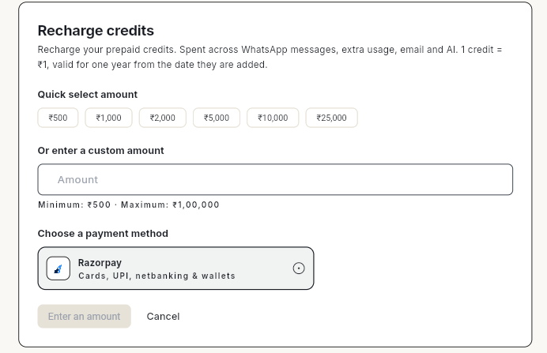
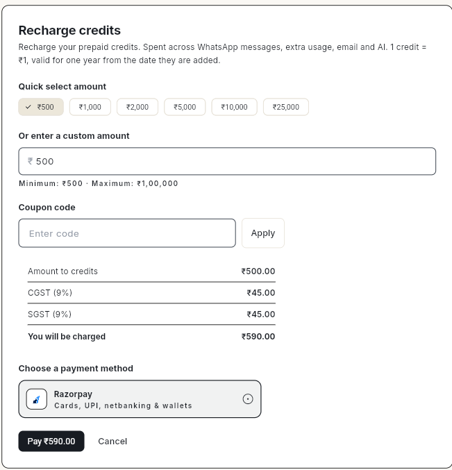
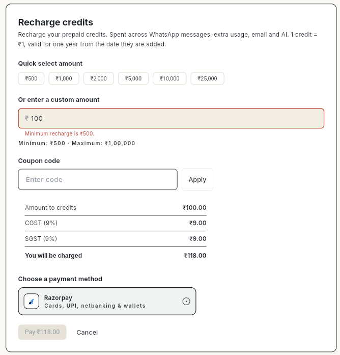

# अपने अकाउंट में पैसे जोड़ें { #add-funds-to-your-account }

WhatsApp मैसेज, ईमेल और AI जवाब भेजते रहने के लिए अकाउंट में पैसे जोड़ें (यानी क्रेडिट रीचार्ज करें)। आप रकम चुनते हैं। Ohanvi उस पर 18% GST जोड़ देता है। फिर आप Razorpay से कार्ड, UPI, नेटबैंकिंग या वॉलेट के ज़रिए पेमेंट करते हैं।

## शुरू करने से पहले { #before-you-start }

- आप Ohanvi में साइन इन हों। देखें [Ohanvi में साइन इन करें](sign-in.md)।
- आपको पता हो कि क्रेडिट कैसे काम करते हैं: 1 क्रेडिट = ₹1, और वह एक साल तक चलता है। देखें [क्रेडिट और बिलिंग](credits-and-billing.md)।
- पेमेंट के लिए कार्ड, UPI ऐप, नेटबैंकिंग या वॉलेट आपके पास तैयार हो।
- आप Ohanvi वेब ब्राउज़र में [app.ohanvi.com](https://app.ohanvi.com) पर चला रहे हों। Ohanvi मोबाइल ऐप में पेमेंट अभी काम नहीं करता।
- GST क्लेम करना हो, तो रीचार्ज से पहले **Invoice Details** में अपना GSTIN जोड़ लें।

## स्टेप { #steps }

1. ऊपर दाएँ कोने में **Credits** बॉक्स पर क्लिक करें। **Credits** पेज खुलेगा।
2. पेज के ऊपर **Recharge** पर क्लिक करें, या **This cycle** कार्ड में **Recharge credits** पर क्लिक करें। **Recharge credits** विंडो खुलेगी।

    

3. रकम चुनें:
    - कोई **Quick select amount** चुनें: ₹500, ₹1,000, ₹2,000, ₹5,000, ₹10,000 या ₹25,000, **या**
    - **Or enter a custom amount** में अपनी रकम लिखें। रकम कम से कम ₹500 और ज़्यादा से ज़्यादा ₹1,00,000 हो सकती है।
4. कूपन है, तो उसे **Coupon code** में लिखें और **Apply** पर क्लिक करें।
5. पेमेंट से पहले हिसाब देख लें:

    | लाइन | ₹500 का उदाहरण |
    | --- | --- |
    | **Amount to credits** | ₹500.00 |
    | **CGST (9%)** | ₹45.00 |
    | **SGST (9%)** | ₹45.00 |
    | **You will be charged** | ₹590.00 |

    यह उदाहरण उस बिज़नेस का है जो Ohanvi के ही राज्य में है, या जिसने GSTIN नहीं जोड़ा है। अगर **Invoice Details** में आपका GSTIN किसी दूसरे राज्य का है, तो CGST और SGST की जगह एक **IGST (18%)** लाइन दिखती है (₹500 पर ₹90.00)। कुल रकम वही रहती है।

    

6. **Choose a payment method** में **Razorpay** ही चुना रहने दें।
7. **Pay ₹[total]** पर क्लिक करें। यहाँ total वही रकम है जो **You will be charged** में दिखती है (जैसे ₹500 के रीचार्ज पर **Pay ₹590.00**)। इसके बाद Razorpay विंडो में पेमेंट पूरा करें।
8. पेमेंट हो जाने पर क्रेडिट आपके **Credit balance** में जुड़ जाते हैं। रीचार्ज Credits पेज के **Statement** और **Invoices** में भी दिखने लगता है।

!!! note
    आपको चुनी हुई रकम के बराबर क्रेडिट मिलते हैं। GST उसके ऊपर लगता है। यानी ₹500 के रीचार्ज के ₹590 लगते हैं और 500 क्रेडिट जुड़ते हैं।

## वीडियो वॉकथ्रू { #video-walkthrough }

[VIDEO]

## समस्या का समाधान { #troubleshooting }

| समस्या | कारण | समाधान |
| --- | --- | --- |
| **Minimum recharge is ₹500.** दिख रहा है और **Pay** बटन ग्रे है | रकम ₹500 से कम है। | ₹500 या उससे ज़्यादा लिखें। |
| **Pay** बटन पर **Enter an amount** दिख रहा है | आपने कोई रकम नहीं चुनी। | कोई क्विक रकम चुनें या अपनी रकम लिखें। |
| **'[code]' is not a valid coupon code.** | कूपन गलत लिखा है, एक्सपायर हो गया है, या आपके अकाउंट के लिए नहीं है। | कोड देने वाले से कोड दोबारा पूछ लें। या कूपन हटाकर बिना कूपन के पेमेंट करें। |
| **Online payment is only available on the web app right now.** | आपने Ohanvi मोबाइल ऐप से पेमेंट करने की कोशिश की। | ब्राउज़र में [app.ohanvi.com](https://app.ohanvi.com) खोलें और वहीं से रीचार्ज करें। |
| आप ₹1,00,000 से ज़्यादा जोड़ना चाहते हैं | एक बार में ज़्यादा से ज़्यादा ₹1,00,000 का रीचार्ज हो सकता है। | रीचार्ज एक से ज़्यादा पेमेंट में करें। |
| बैंक से पैसे कट गए, पर बैलेंस नहीं बदला | पेमेंट की पुष्टि अभी हो रही है। | कुछ मिनट रुकें और Credits पेज रीफ़्रेश करें। फिर भी न दिखे, तो पेमेंट रेफ़रेंस के साथ सपोर्ट से बात करें। |
| इनवॉइस में GSTIN नहीं है | रीचार्ज से पहले GSTIN जोड़ा नहीं था। | अगले रीचार्ज से पहले **Invoice Details** में अपना GSTIN जोड़ लें। |

## संबंधित गाइड { #related }

- [क्रेडिट और बिलिंग](credits-and-billing.md)
- [Ohanvi में साइन इन करें](sign-in.md)
