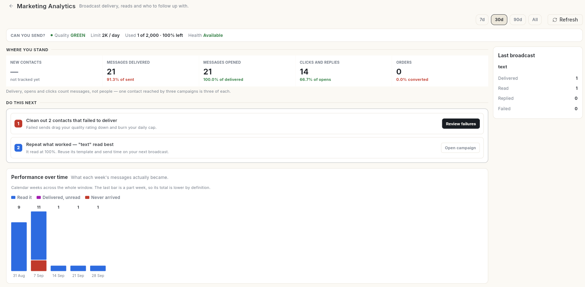

# एनालिटिक्स { #analytics }

एनालिटिक्स आपके व्हाट्सऐप ब्रॉडकास्ट और जुड़े हुए ऑनलाइन स्टोर की रिपोर्ट देता है। हर स्क्रीन के अंत में अगला कदम क्या हो, इसके सुझाव मिलते हैं।

## यह कहाँ मिलेगा { #where-to-find-it }

लेफ़्ट रेल में **Analytics** खोलें। पैनल में ये दिखते हैं:

- **Marketing Analytics** — आपके व्हाट्सऐप ब्रॉडकास्ट की डिलीवरी, रीड, फ़ेल हुए मैसेज और रेवेन्यू।
- **Store Analytics** — आपके Shopify या WooCommerce स्टोर के ऑर्डर, रेवेन्यू, ग्राहक और छोड़ी गई कार्ट।

## शुरू करने से पहले { #before-you-start }

- आपके वर्कस्पेस में व्हाट्सऐप है, और आपका रोल व्हाट्सऐप ब्रॉडकास्ट (**Marketing Analytics** के लिए) या स्टोर इंटीग्रेशन (**Store Analytics** के लिए) देख सकता है। दोनों न हों तो **Analytics** आइकन छिपा रहता है।
- आपने कम से कम 1 व्हाट्सऐप ब्रॉडकास्ट भेजा है, वरना आपके आँकड़े खाली रहेंगे।
- स्टोर के आँकड़ों के लिए आपका स्टोर **Connect** → **Store Connections** के तहत कनेक्ट होना चाहिए।

## गाइड { #guides }

| गाइड | कब इस्तेमाल करें |
| --- | --- |
| [एनालिटिक्स के लिए डेटा सेट करें](set-up-analytics-data.md) | स्क्रीन खाली हैं या दिख नहीं रहीं। |
| [मार्केटिंग एनालिटिक्स पढ़ें](read-marketing-analytics.md) | आप अपने ब्रॉडकास्ट के आँकड़े समझना चाहते हैं। |
| [स्टोर एनालिटिक्स पढ़ें](read-store-analytics.md) | आप अपने स्टोर के आँकड़े समझना चाहते हैं। |
| [अपने एनालिटिक्स पर कार्रवाई करें](act-on-analytics.md) | आप आँकड़ों को अपने अगले कैंपेन में बदलना चाहते हैं। |

## संबंधित गाइड { #related }

- [सेल्स परफ़ॉर्मेंस ट्रैक करें](../crm/track-sales-performance.md) — CRM डैशबोर्ड, फ़नल और सेल्स रिपोर्ट।
- [सोशल इनसाइट्स पढ़ें](../social/view-social-insights.md)
- [नतीजे ट्रैक करें और अनसब्सक्राइब व बाउंस संभालें](../email/track-email-results.md)
