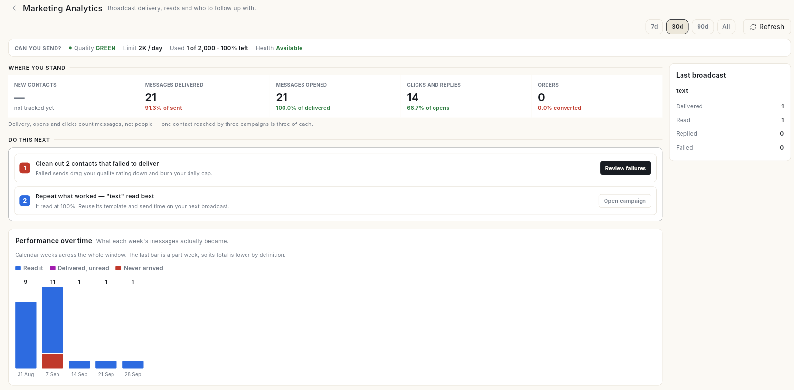

# Analytics

Analytics reports on your WhatsApp broadcasts, your connected online store, your website visitors and how you appear in Google Search. Marketing Analytics and Store Analytics end with suggestions for what to do next.

## Where to find it

Open **Analytics** in the left rail. The panel lists:

- **Marketing Analytics** — delivery, reads, failures and revenue from your WhatsApp broadcasts.
- **Store Analytics** — orders, revenue, customers and abandoned carts from your Shopify or WooCommerce store.
- **Website Analytics** — after the click: visitors, where they came from, the pages they opened and the key actions they took, from Google Analytics.
- **Search Analytics** — before the click: what people searched, how often Google showed your site, how many clicked and your average rank, from Google Search Console.

If **Analytics** is not on the rail, click **More** and find it there. **Website Analytics** and **Search Analytics** show only when your role has access and the feature is switched on for your account. If you are not connected yet, they show **Connect Google Analytics** or **Connect Search Console**, which open Google Workspace. If you are connected but have not linked a property, they list your properties or sites so you can link one right there.

## Before you start

- Your workspace has WhatsApp, and your role can see WhatsApp broadcasts (for **Marketing Analytics**) or the store integration (for **Store Analytics**). With neither, **Marketing Analytics** and **Store Analytics** are hidden.
- You have sent at least 1 WhatsApp broadcast, or your numbers stay empty.
- For store numbers, your store is connected under **Connect** → **Store Connections**.
- For website and search numbers, Google Analytics or Search Console is connected under **Connect** → **Google Workspace**, with a property linked.

## Guides

| Guide | Use it when |
| --- | --- |
| [Set up data for Analytics](set-up-analytics-data.md) | The screens are empty or missing. |
| [Read Marketing Analytics](read-marketing-analytics.md) | You want to understand your broadcast numbers. |
| [Read Store Analytics](read-store-analytics.md) | You want to understand your store numbers. |
| [Connect Google Analytics](../settings/connect-google-analytics.md#read-the-summary) | You want to open **Website Analytics** and read your website numbers. |
| [Connect Google Search Console](../settings/connect-google-search-console.md#read-the-summary) | You want to open **Search Analytics** and read your Google Search numbers. |
| [Act on your analytics](act-on-analytics.md) | You want to turn the numbers into your next campaign. |

## Related

- [Track sales performance](../crm/track-sales-performance.md) — CRM dashboard, funnel and sales reports.
- [Read social insights](../social/view-social-insights.md)
- [Track results and handle unsubscribes and bounces](../email/track-email-results.md)
