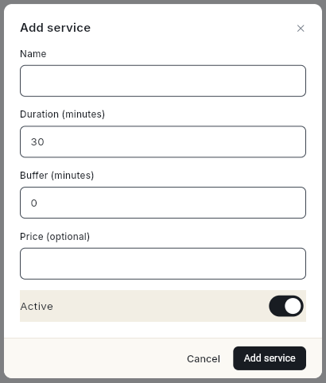

# बुक होने वाली सर्विस जोड़ें { #add-bookable-services }

सर्विस वह चीज़ है जो ग्राहक बुक करता है, जैसे हेयरकट, कंसल्टेशन या प्रोडक्ट डेमो। हर सर्विस में कितना समय लगेगा, यह तय होता है। चाहें तो उसके बाद थोड़ा गैप भी रख सकते हैं। इस गाइड के आख़िर तक आपके पास सर्विस की एक लिस्ट होगी। प्रोवाइडर, क्लास और आपका WhatsApp बुकिंग बॉट इसी लिस्ट का इस्तेमाल करेंगे।

## शुरू करने से पहले { #before-you-start }

- आपको लेफ़्ट रेल में **Appts** दिखता हो। न दिखे, तो अपने एडमिन से कहें कि आपके रोल को Appointments का एक्सेस दें। देखें [सेटिंग्स](../settings/index.md)।
- आपको पता हो कि हर सर्विस में कितना समय लगता है और दो बुकिंग के बीच कितना ब्रेक चाहिए।

## स्टेप { #steps }

### सर्विस जोड़ें { #add-a-service }

पेज के सबटाइटल में लिखा है **What a customer can book, and how long each one takes.** अभी कोई सर्विस नहीं है, तो पेज पर **No services yet** और **Add one to start taking bookings.** दिखता है। शुरू करने के लिए वहीं **Add service** पर क्लिक करें।

1. लेफ़्ट रेल में **Appts** खोलें, फिर **Services** चुनें। **Services** पेज खुलेगा।
2. **Add service** पर क्लिक करें। **Add service** डायलॉग खुलेगा।

    

3. **Name** में सर्विस का नाम लिखें, जो ग्राहकों को दिखेगा। जैसे `Haircut`।
4. **Duration (minutes)** में लिखें कि सर्विस में कितना समय लगता है। यहाँ पहले से `30` लिखा होता है।
5. **Buffer (minutes)** में वह ब्रेक लिखें जो हर बुकिंग के बाद खाली रखना है, जैसे `10`। ब्रेक नहीं चाहिए, तो `0` रहने दें।
6. **Price** में कीमत रुपयों में लिखें। यह फ़ील्ड ज़रूरी नहीं है।
7. **Active** को चालू रहने दें, ताकि ग्राहक इसे बुक कर सकें।
8. **Add service** पर क्लिक करें। **Saved** मैसेज आएगा। सर्विस अपनी अवधि, बफ़र और कीमत के साथ लिस्ट में दिखेगी, जैसे **30 min · +10 min buffer · ₹500**।

### सर्विस में बदलाव करें { #edit-a-service }

1. **Services** पेज पर सर्विस के पेंसिल आइकन (**Edit**) पर क्लिक करें। **Edit service** डायलॉग खुलेगा।
2. जो फ़ील्ड बदलनी हो, बदल दें।
3. कुछ समय के लिए सर्विस बंद करनी हो, तो **Active** बंद कर दें। सर्विस पर **Inactive** बैज दिखेगा।
4. **Save service** पर क्लिक करें।

### सर्विस डिलीट करें { #delete-a-service }

!!! warning "ग्राहक इसे बुक नहीं कर पाएँगे"
    डिलीट की हुई सर्विस बुकिंग के लिए नहीं दिखती। अगर आप इसे आगे फिर से देने वाले हैं, तो डिलीट मत करें। बस **Active** बंद कर दें।

1. सर्विस के बिन आइकन (**Delete**) पर क्लिक करें। **Delete "Service name"?** डायलॉग खुलेगा।
2. **Delete** पर क्लिक करें।

## वीडियो वॉकथ्रू { #video-walkthrough }

[VIDEO]

## समस्या का समाधान { #troubleshooting }

| समस्या | कारण | समाधान |
| --- | --- | --- |
| **Add service** पर क्लिक करने से डायलॉग बंद हो गया, पर कुछ जुड़ा नहीं | **Name** खाली था। | **Add service** फिर से खोलें और नाम लिखें। |
| **Save failed** | सर्वर ने सर्विस सेव नहीं की। जैसे अवधि न लिखी हो, तब ऐसा हो सकता है। | **Name** और **Duration (minutes)** देखें, फिर दोबारा कोशिश करें। |
| नई सर्विस के लिए ग्राहकों को खाली समय नहीं दिख रहा | कोई प्रोवाइडर यह सर्विस नहीं देता, या काम के घंटे सेट नहीं हैं। | प्रोवाइडर जोड़ें। देखें [प्रोवाइडर और काम के घंटे जोड़ें](add-providers.md)। |
| अवधि 30 मिनट सेव हो गई | **Duration (minutes)** में कुछ ऐसा लिखा था जो नंबर नहीं है। | सर्विस में बदलाव करें और सिर्फ़ अंक लिखें। |

## संबंधित गाइड { #related }

- [प्रोवाइडर और काम के घंटे जोड़ें](add-providers.md)
- [बुकिंग के नियम और रिमाइंडर सेट करें](set-booking-rules-and-reminders.md)
- [क्लास शेड्यूल करें](schedule-classes.md)
