# WhatsApp चैटबॉट फ़्लो बनाएँ { #create-a-whatsapp-chatbot-flow }

एक ऐसा चैटबॉट बनाएँ जो ग्राहक के कीवर्ड भेजते ही शुरू हो जाए। वह बटन वाला वेलकम मैसेज दिखाए, नाम और ईमेल पूछे, और आखिर में एक मैसेज भेजे जिसमें ग्राहक के दिए जवाब हों।

## शुरू करने से पहले { #before-you-start }

- आपका WhatsApp Business नंबर **WhatsApp → Manage** में कनेक्ट हो।
- आपके पास एक टेस्ट फ़ोन नंबर हो, जो अभी **Inbox** में किसी एजेंट को असाइन न हो।
- आपने ऐसा स्टार्ट कीवर्ड चुना हो जो कोई और चालू फ़्लो इस्तेमाल न करता हो। इसे **Test** टैब में जाँचें (स्टेप 12 देखें)।

## स्टेप { #steps }

### फ़्लो बनाएँ { #create-the-flow }

1. **WhatsApp → Flows** खोलें।
2. **New flow** पर क्लिक करें। एक खाली कैनवास खुलता है।

    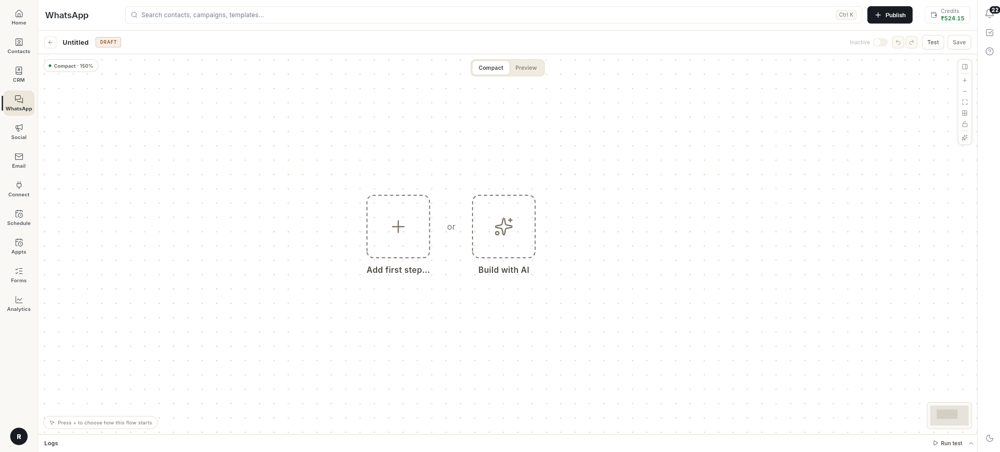

3. **Add first step…** पर क्लिक करें, फिर **Start WhatsApp flow** चुनें।

    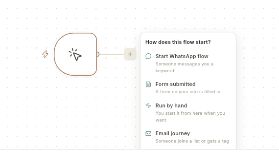

4. **Keywords** में वह शब्द लिखें जिससे बॉट शुरू होगा, जैसे `hello`। एक से ज़्यादा कीवर्ड हों तो उन्हें कॉमा से अलग करें।
5. **Match when the message** को **Has the keyword as a word** पर ही रहने दें, फिर **Start building** पर क्लिक करें।

    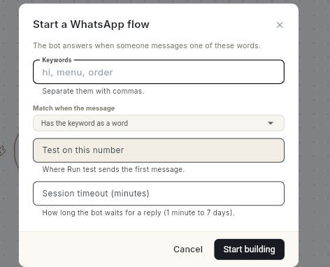

    कीवर्ड में छोटे-बड़े अक्षर से फ़र्क नहीं पड़ता। `hello`, `Hello` और `HELLO`, तीनों से फ़्लो शुरू हो जाता है।

    **Match when the message** तय करता है कि ग्राहक का मैसेज कीवर्ड से कितना मिलना चाहिए। कीवर्ड `hi` हो तो:

    | ऑप्शन | इन पर फ़्लो शुरू होता है | इन पर शुरू नहीं होता |
    | --- | --- | --- |
    | **Has the keyword as a word** | `hi`, `hi there` | `hii` |
    | **Contains the keyword** | `hi`, `hii`, `chilli` | `hello` |
    | **Is exactly the keyword** | `hi` | `hi there` |

### वेलकम मैसेज और बटन जोड़ें { #add-the-welcome-message-and-buttons }

6. स्टार्ट नोड के पास **+** पर क्लिक करें और **Send a message** चुनें।
7. दाईं तरफ़ के पैनल में मैसेज लिखें, जैसे `Hi, how can I help you?`।
8. **+ Add Button** पर क्लिक करें और बटन का नाम लिखें, जैसे `Admission`। `Fees` और `Contact Us` के लिए भी यही करें।

    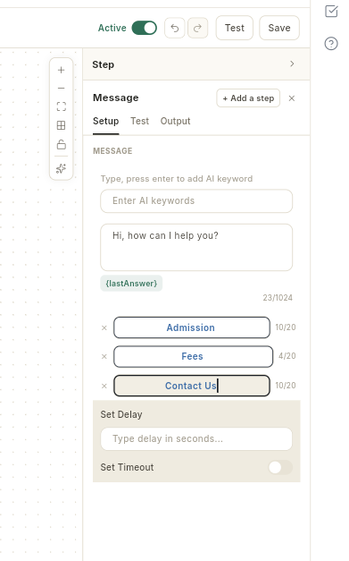

    एक मैसेज में ज़्यादा से ज़्यादा 3 बटन हो सकते हैं। हर बटन के नाम में ज़्यादा से ज़्यादा 20 अक्षर हो सकते हैं।

### नाम और ईमेल पूछें { #ask-for-name-and-email }

9. कार्ड के नीचे **+ Add Content** पर क्लिक करें और **Ask Question** चुनें।
10. सवाल लिखें, जैसे `What is your name?`, और **Save the answer as** में **Name** चुनें। जवाब वेरिएबल `name` में सेव हो जाता है।

    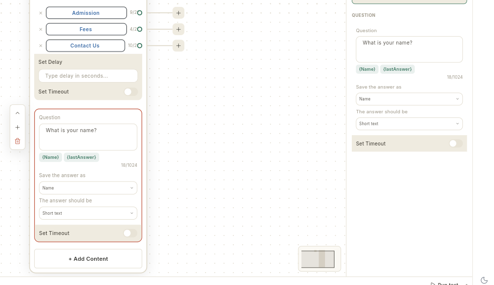

11. ईमेल के लिए स्टेप 9 और 10 फिर से करें। सवाल `What is your email?` लिखें और जवाब **Email** में सेव करें। जवाब वेरिएबल `email` में सेव हो जाता है।

### आखिरी मैसेज जोड़ें { #add-the-closing-message }

12. **+ Add Content** पर क्लिक करें और **Text + Button** चुनें। आखिरी मैसेज लिखें। उसमें सेव हुए जवाब डालने के लिए दोहरे कर्ली ब्रैकेट इस्तेमाल करें:

    ```text
    Thanks {{name}}, we will contact you at {{email}}.
    ```

    आसान तरीका यह है: `Thanks ` लिखें, फिर मैसेज बॉक्स के नीचे **{Name}** चिप पर क्लिक करें। इससे `{{name}}` अपने आप लिख जाता है। **{Email}** के साथ भी यही करें।

    WhatsApp पर ग्राहक को उसका अपना जवाब दिखता है, जैसे **Thanks Priya**।

    !!! warning "छोटे अक्षरों में दोहरे कर्ली ब्रैकेट इस्तेमाल करें"
        वेरिएबल खुद टाइप करें तो `{{name}}` और `{{email}}` लिखें। बड़े अक्षर वाला `{{Name}}` ग्राहक के पास सादे टेक्स्ट की तरह ही चला जाता है।

### हर बटन के लिए अलग मैसेज भेजें (ऑप्शनल) { #send-a-different-message-for-each-button-optional }

आम तौर पर हर बटन उसी कार्ड के अगले ब्लॉक पर जाता है। किसी बटन को उसका अपना जवाब देना हो तो:

1. कार्ड पर बटन वाली लाइन के दाईं तरफ़ आखिर में **+** पर क्लिक करें, जैसे **Fees** के लिए, और **Send a message** चुनें।

    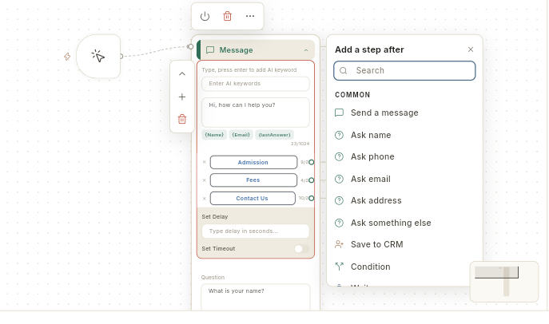

2. एक नया कार्ड खुलता है, जो उस बटन से जुड़ा होता है। उसका मैसेज लिखें, जैसे `Fees details will be shared soon.`

    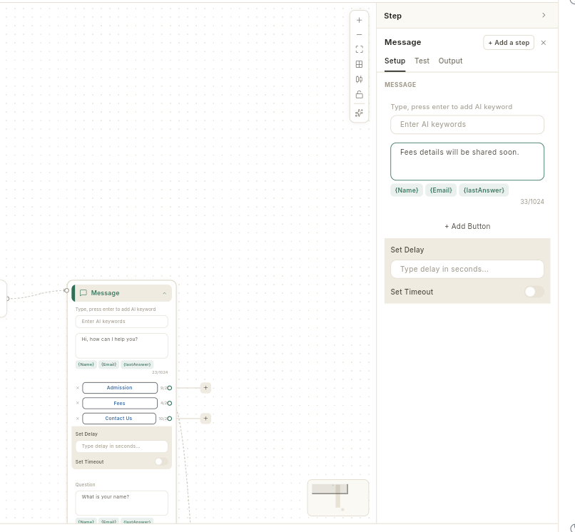

3. बाकी बटनों के लिए भी यही करें। जिन बटनों से कुछ नहीं जुड़ा, वे मुख्य कार्ड के अगले ब्लॉक पर जाते हैं।

    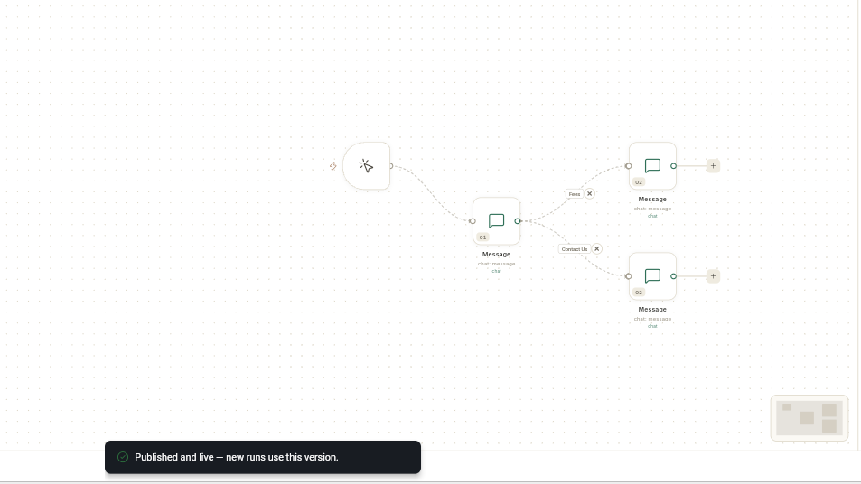

    बटन वाला कार्ड पूरा होने के बाद बातचीत मुख्य कार्ड पर लौट आती है और उसके अगले ब्लॉक से आगे चलती है।

    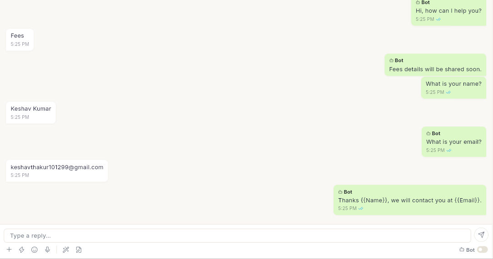

### सेव करें, जाँचें और पब्लिश करें { #save-check-and-publish }

13. **Save** पर क्लिक करें। स्टेटस चिप पर **DRAFT** लिखा दिखता है।
14. दाईं तरफ़ के पैनल में **Test** टैब खोलें। **A message a customer might send** के नीचे अपना कीवर्ड लिखें और **Check** पर क्लिक करें। नतीजे में **Yes — [your flow] would answer** दिखना चाहिए। अगर साथ में **Another chatbot answers this** भी लिखा आए, तो पब्लिश करने से पहले अपना कीवर्ड बदल लें।

    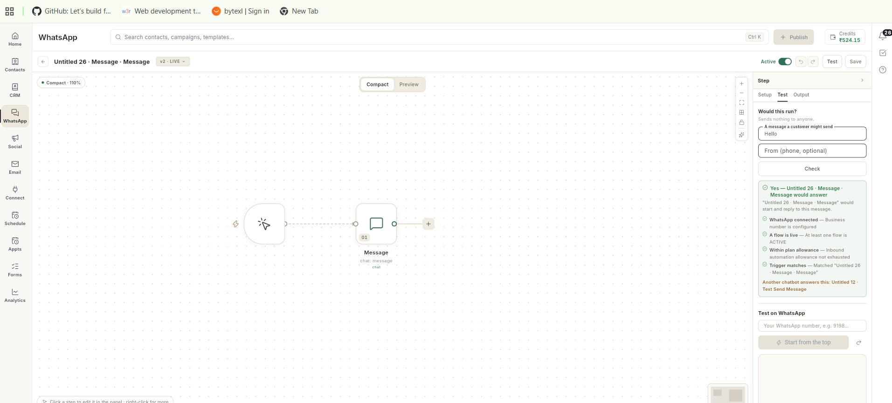

15. **Publish** पर क्लिक करें। **Published and live — new runs use this version** मैसेज आता है और **Active** स्विच चालू हो जाता है।

    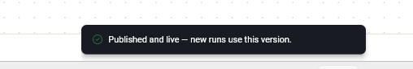

16. अपने टेस्ट फ़ोन से अपने बिज़नेस नंबर पर कीवर्ड भेजें। बॉट वेलकम मैसेज और बटन के साथ जवाब देगा। कोई बटन दबाएँ, नाम और ईमेल के सवालों के जवाब दें, और आखिरी मैसेज देखें।

    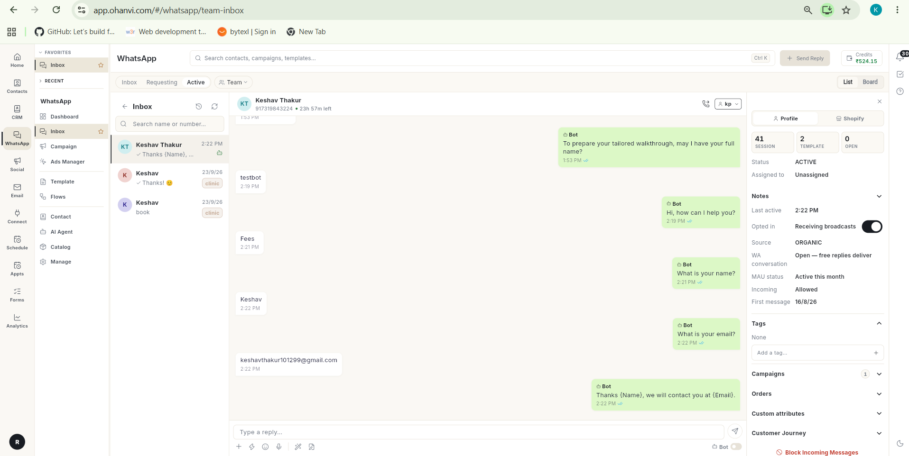

    यही बातचीत **WhatsApp → Inbox** में भी दिखती है। वहाँ बॉट के हर मैसेज पर **Bot** लिखा होता है।

## इसके बजाय AI से फ़्लो बनाएँ { #build-the-flow-with-ai-instead }

आप एक वाक्य लिखकर Ohanvi से वही फ़्लो ड्राफ़्ट करवा सकते हैं। फिर उसे देखकर पब्लिश कर दें।

1. **New flow** पर क्लिक करें, फिर **Build with AI** पर क्लिक करें। बाईं तरफ़ एक चैट पैनल खुलता है।

    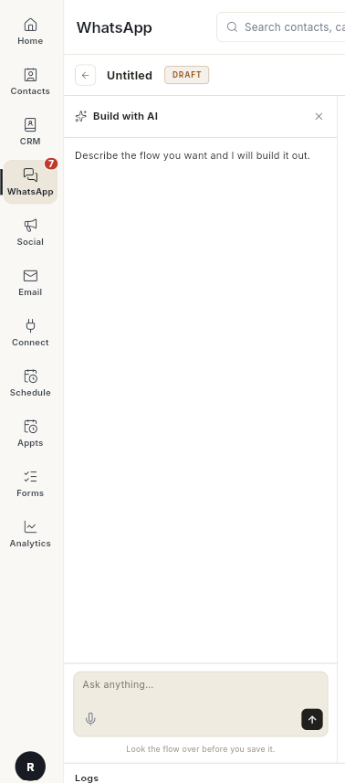

2. **Ask anything…** में बताएँ कि आपको कैसा बॉट चाहिए, और भेज दें। जैसे:

    ```text
    Create a WhatsApp welcome chatbot that starts when user says hi, sends a welcome message, asks for name, asks for email and then sends a thank-you message.
    ```

3. **It is on the canvas** दिखने तक रुकें। AI फ़्लो को नाम देता है और कार्ड बना देता है। हर ब्लॉक पढ़ने के लिए **Preview** पर क्लिक करें।

    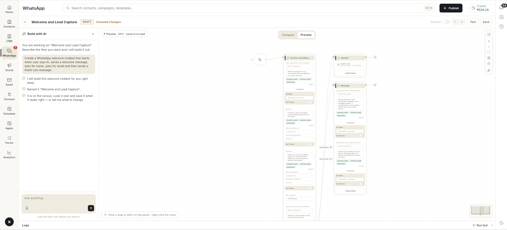

    AI कुछ एक्स्ट्रा स्टेप जोड़ सकता है, जैसे टैग या **Speak to Advisor** बटन। जो न चाहिए, उसे डिलीट कर दें।

4. अभी तक कुछ सेव नहीं हुआ है। **Save** पर क्लिक करें, अपने कीवर्ड के लिए **Test** टैब में जाँच चलाएँ, फिर **Publish** पर क्लिक करें।
5. अपने टेस्ट फ़ोन से कीवर्ड भेजें और हर सवाल का जवाब दें।

    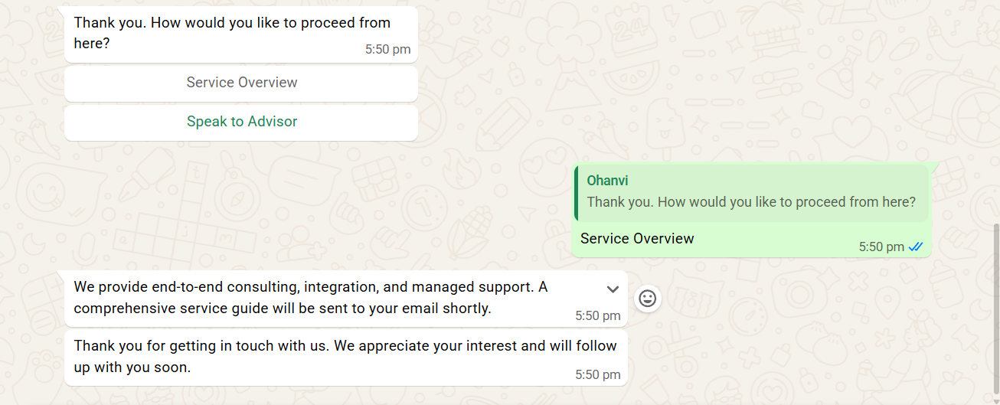

## वीडियो वॉकथ्रू { #video-walkthrough }

[VIDEO]

## समस्या का समाधान { #troubleshooting }

| समस्या | कारण | समाधान |
| --- | --- | --- |
| **Add at least one step before publishing** | फ़्लो में अभी कोई स्टेप नहीं है। | कोई स्टेप जोड़ें, जैसे **Send a message**, फिर **Publish** पर क्लिक करें। |
| **Add a step before testing** | आपने बिना किसी स्टेप वाले फ़्लो पर **Run test** पर क्लिक किया। | कम से कम एक स्टेप जोड़ें, फिर **Run test** पर दोबारा क्लिक करें। |
| **Could not publish — the step that needs fixing is marked on the canvas** | कोई स्टेप अधूरा है, जैसे बिना टेक्स्ट वाला मैसेज। कार्ड पर **Empty message** जैसी चेतावनी दिखती है। | निशान वाला कार्ड खोलें, जो हिस्सा छूटा है उसे भरें, फिर **Publish** पर दोबारा क्लिक करें। |
| पब्लिश नहीं होता और कार्ड पर **"[flow]" listens for "[keyword]", which already starts "[other flow]"** दिखता है | कोई और चैटबॉट पहले से यही कीवर्ड इस्तेमाल कर रहा है। पूरा मैसेज पढ़ने के लिए कार्ड की चेतावनी पर माउस ले जाएँ। | ऐसा कीवर्ड चुनें जो कोई और चैटबॉट इस्तेमाल न करता हो, फिर **Publish** पर दोबारा क्लिक करें। |
| WhatsApp पर कोई जवाब नहीं आता | कोई और चालू फ़्लो वही कीवर्ड इस्तेमाल करता है, इसलिए जवाब वही फ़्लो देता है। | **Test** टैब → **Check** खोलें। उसमें दूसरे चैटबॉट का नाम आए, तो अपना कीवर्ड बदलें और फिर से पब्लिश करें। |
| Inbox में **Bot stopped — its last message could not be delivered** दिखता है | जिस फ़्लो ने जवाब दिया, उसमें कोई मैसेज स्टेप खाली है या मैसेज सही नहीं है। | वह फ़्लो खोलें, हर खाली मैसेज भरें, सेव करें और पब्लिश करें। |
| आखिरी मैसेज में ग्राहक के नाम की जगह `{Name}` या `{{Name}}` दिखता है | प्लेसहोल्डर एट्रिब्यूट की के नाम जैसा होना चाहिए, यानी छोटे अक्षरों में और दोहरे ब्रैकेट में। | इसे `{{name}}` और `{{email}}` कर दें, सेव करें और पब्लिश करें। |
| बदला हुआ टेक्स्ट अब भी WhatsApp पर नहीं दिखता | बदलाव सेव हुआ, पर पब्लिश नहीं हुआ। चिप पर **LIVE · NOT PUBLISHED** लिखा है। | **Publish** पर क्लिक करें। जो ग्राहक बातचीत के बीच में हैं, उनकी बातचीत पुराने वर्शन पर ही पूरी होती है। |
| बॉट आपके टेस्ट नंबर को कभी जवाब नहीं देता | कॉन्टैक्ट किसी एजेंट को असाइन है, या **Requesting** में है। | **Inbox** में उस बातचीत को रिज़ॉल्व करें, फिर कीवर्ड दोबारा भेजें। |
| WhatsApp पर चौथा बटन नहीं दिखता | WhatsApp एक मैसेज में सिर्फ़ 3 रिप्लाई बटन देता है। | 3 से ज़्यादा ऑप्शन के लिए **List / Buttons** ब्लॉक इस्तेमाल करें। |
| बॉट **Which session?** पूछता है और फिर **Nothing is available right now. Please try again later.** कहता है | **Book a Demo** टेम्प्लेट अपने सेशन **Appts** → **Services** से उठाता है, और अभी तक कोई सर्विस जोड़ी नहीं गई है। | लेफ़्ट रेल में **Appts** खोलें, **Services** चुनें और **Add service** पर क्लिक करें। देखें [सर्विस जोड़ें](appointments/add-services.md)। फिर कीवर्ड दोबारा भेजें। |

## संबंधित गाइड { #related }

- [फ़्लो बिल्डर को समझें](whatsapp/understand-the-flow-builder.md)
- [चुनें कि फ़्लो कैसे शुरू हो](whatsapp/chatbot-flow-start-and-triggers.md)
- [चैटबॉट में टेक्स्ट और लिस्ट मैसेज भेजें](whatsapp/chatbot-text-and-list-blocks.md)
- [WhatsApp ब्रॉडकास्ट कैंपेन भेजें](whatsapp/send-broadcast-campaign.md)
- [WhatsApp टेम्प्लेट बनाएँ](whatsapp/create-message-template.md)
- [कॉन्टैक्ट इम्पोर्ट और सिंक करें](crm/import-and-sync-contacts.md)
