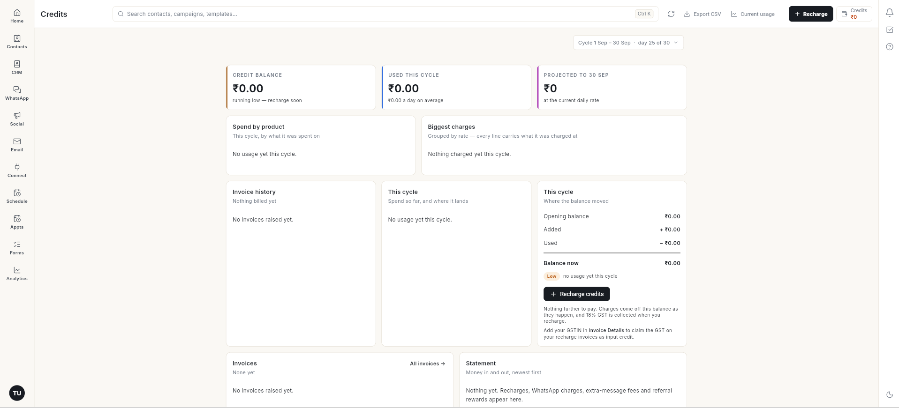

# Ohanvi में क्रेडिट और बिलिंग { #credits-and-billing-in-ohanvi }

Ohanvi प्रीपेड क्रेडिट पर चलता है। आप अपने अकाउंट में पैसे डालते हैं, वे क्रेडिट बन जाते हैं, और हर पेड काम पर उस बैलेंस से थोड़े-थोड़े क्रेडिट कटते हैं। **Credits** पेज पर दिखता है कि आपके पास कितने क्रेडिट हैं, कितने खर्च हुए, और हर रुपया कब आया और कब गया।

## क्रेडिट क्या हैं { #what-credits-are }

- **1 क्रेडिट = ₹1।**
- क्रेडिट **प्रीपेड** हैं। पहले आप उन्हें जोड़ते हैं (इसे रीचार्ज या "पैसे जोड़ना" कहते हैं)। फिर खर्च होने के साथ-साथ चार्ज बैलेंस से कटते जाते हैं।
- क्रेडिट **WhatsApp मैसेज, एक्स्ट्रा इस्तेमाल, ईमेल और AI** पर खर्च होते हैं।
- क्रेडिट जोड़ने की तारीख़ से **एक साल** तक चलते हैं।
- **18% GST** रीचार्ज करते समय लगता है, खर्च करते समय नहीं। देखें [अपने अकाउंट में पैसे जोड़ें](add-funds.md)।

## ग्राहक की चैट के अंदर के मैसेज { #messages-inside-a-customer-chat }

जब कोई ग्राहक आपको मैसेज करता है, तो WhatsApp 24 घंटे की विंडो खोल देता है। **1 October 2026** से, इस विंडो के अंदर भेजे गए कुछ मैसेज पर Meta चार्ज लेता है:

| मैसेज | कितना चार्ज लगता है |
| --- | --- |
| **विंडो के अंदर के जवाब**, चाहे आपकी टीम ने टाइप किए हों या बॉट ने भेजे हों | **हर कैलेंडर महीने के पहले 1,000 मुफ़्त हैं**। उसके बाद हर मैसेज पर Meta की दर लगती है, जो भारत में **11.5 पैसे** है। |
| **विंडो के अंदर भेजे गए यूटिलिटी टेम्प्लेट** | पहले मैसेज से ही Meta की दर लगती है, जो भारत में **11.5 पैसे** है। |
| **Click-to-WhatsApp ऐड से शुरू हुई बातचीत** | पूरी 72 घंटे की विंडो में अब भी मुफ़्त। |

जब तक किसी चैट की विंडो खुली है, उसके हेडर में दिखता है कि उस WhatsApp नंबर पर इस महीने के कितने मुफ़्त मैसेज बचे हैं, जैसे **844 of 1,000 free left**। मैसेज भेजते जाने पर यह संख्या घटती जाती है।

!!! note "यह Meta का चार्ज है, हमारा नहीं"
    ये चार्ज Meta के हैं। हम इन पर **कोई मार्कअप नहीं** लगाते। आपके क्रेडिट से सिर्फ़ Meta की दर के बराबर रकम कटती है, उससे ज़्यादा कुछ नहीं। मैसेज बॉट भेजे, तो आपके प्लान का **automated message** कोटा और दर पहले की तरह ही लागू रहते हैं।

## Google Reviews { #google-reviews }

आपके Google रिव्यू पेज का पेमेंट आपके क्रेडिट से इन कीमतों पर होता है:

| काम | कितना कटता है |
| --- | --- |
| **AI रिव्यू ड्राफ़्ट** (ग्राहक **Write my review** दबाए) | ड्राफ़्ट मिलने पर हर रिक्वेस्ट के **₹5 + GST**, जिसमें 3 तक ड्राफ़्ट मिलते हैं। **Google Reviews Annual Pack** वाली ब्रांच पर मुफ़्त। |
| **वॉइस इनपुट** (ग्राहक बोलकर रिव्यू दे) | हर वॉइस इनपुट (**Speak instead** का एक टैप) के **₹3 + GST**, या Annual Pack वाली ब्रांच पर **₹2 + GST**। बोली गई बात को ग्राहक का फ़ोन टेक्स्ट में बदले या हमारा AI, दोनों में चार्ज लगता है। |
| **Google Reviews Annual Pack** | हर ब्रांच के **₹1,000 + GST**, 1 साल के लिए। देखें [किसी ब्रांच के लिए Annual Pack खरीदें](google-reviews/buy-the-annual-pack.md)। |

GST पैसे जोड़ते समय ही भर दिया गया था, इसलिए क्रेडिट से GST के बिना वाली कीमत कटती है: ₹5, ₹3, ₹2 या ₹1,000। जिस रिक्वेस्ट पर कोई ड्राफ़्ट न मिले, उसका कुछ नहीं कटता। क्रेडिट कम हों, तो वॉइस इनपुट का विकल्प नहीं दिखता। **Suggest with AI** सवाल और AI फ़्लायर बैकग्राउंड मुफ़्त हैं। देखें [Add-on packs और इस्तेमाल की सीमाएँ](billing/packs-and-usage-limits.md)।

## शुरू करने से पहले { #before-you-start }

- आप Ohanvi में साइन इन हों। देखें [Ohanvi में साइन इन करें](sign-in.md)।

## Credits पेज खोलें { #open-the-credits-page }

1. ऊपर-दाएँ कोने में **Credits** बॉक्स पर क्लिक करें। उसमें आपका अभी का बैलेंस दिखता है, जैसे **₹0**।
2. **Credits** पेज खुलता है।

    

## Credits पेज को पढ़ना सीखें { #read-the-credits-page }

| सेक्शन | यह क्या बताता है |
| --- | --- |
| **Cycle** (ऊपर दाएँ) | आप कौन सी बिलिंग साइकिल देख रहे हैं, जैसे **Cycle 1 Sep – 30 Sep · day 25 of 30**। पिछली साइकिल देखने के लिए इस पर क्लिक करें। |
| **Credit balance** | अभी कितने क्रेडिट बचे हैं। अगर बैलेंस पूरी साइकिल नहीं चलेगा, तो **running low — recharge soon** दिखता है। |
| **Used this cycle** | इस साइकिल में कितने क्रेडिट खर्च हुए, और रोज़ का औसत कितना रहा। |
| **Projected to [date]** | अभी की रोज़ की रफ़्तार से साइकिल खत्म होने तक आपके कुल कितने क्रेडिट खर्च हो जाएँगे। |
| **Spend by product** | इस साइकिल का खर्च, इस हिसाब से बाँटकर कि वह किस चीज़ पर हुआ। |
| **Biggest charges** | चार्ज दर के हिसाब से ग्रुप किए गए हैं। हर लाइन में वह दर दिखती है जिस पर चार्ज लगा। |
| **Usage and limits** | हर पैक और प्लान की सीमा के लिए एक बार, जैसे मैसेज, कॉन्टैक्ट, टीम के मेंबर और स्टोरेज। साथ में **250 of 1,000 used** जैसे नंबर दिखते हैं। देखें [ऐड-ऑन पैक और इस्तेमाल की सीमाएँ](billing/packs-and-usage-limits.md)। |
| **Invoice history** / **Invoices** | आपके अकाउंट पर बने इनवॉइस: हर रीचार्ज का एक, और प्लान के इनवॉइस भी। **Invoice history** में हर साइकिल की कुल बिल रकम का चार्ट दिखता है। **Invoices** में सबसे नए इनवॉइस की लिस्ट होती है। पूरी लिस्ट देखने के लिए **All invoices** पर क्लिक करें। |
| **This cycle — Where the balance moved** | इस साइकिल का **Opening balance**, **Added**, **Used** और **Balance now**। |
| **Statement** | पैसे का हर लेन-देन, सबसे नया सबसे ऊपर: रीचार्ज, WhatsApp चार्ज, एक्स्ट्रा मैसेज की फ़ीस और रेफ़रल रिवॉर्ड। |

पेज के ऊपर ये बटन होते हैं:

- **Recharge** — क्रेडिट जोड़ें। देखें [अपने अकाउंट में पैसे जोड़ें](add-funds.md)।
- **Export CSV** — अपना स्टेटमेंट CSV फ़ाइल में डाउनलोड करें। इसमें पैसे का हर लेन-देन होता है: तारीख़, ब्योरा, आया पैसा, गया पैसा और उसके बाद का बैलेंस। कम से कम एक लेन-देन होने तक यह बटन स्लेटी रहता है।
- **Current usage** — अपना इस्तेमाल पूरी डिटेल में देखें।

!!! tip "GST को इनपुट क्रेडिट के रूप में क्लेम करें"
    **Invoice Details** में अपना GSTIN जोड़ें। तब आपके रीचार्ज इनवॉइस पर वह छपेगा और आप GST क्लेम कर पाएँगे।

## वीडियो वॉकथ्रू { #video-walkthrough }

[VIDEO]

## समस्या का समाधान { #troubleshooting }

| समस्या | कारण | समाधान |
| --- | --- | --- |
| बैलेंस पर **running low — recharge soon** दिखता है | आपके अभी के रोज़ के खर्च से बैलेंस साइकिल के आखिर तक नहीं चलेगा। अभी तक कोई खर्च न हुआ हो, तो यह तब दिखता है जब बैलेंस ₹0 हो। | अगला कैंपेन भेजने से पहले [पैसे जोड़ें](add-funds.md)। |
| **No usage yet this cycle** | इस साइकिल में अभी तक कोई पेड मैसेज नहीं गया। | नए अकाउंट पर यह आम बात है। पहला पेड मैसेज जाने के बाद इस्तेमाल दिखने लगता है। |
| **No invoices raised yet** | अभी तक कोई रीचार्ज नहीं हुआ। | हर रीचार्ज पर एक इनवॉइस बनता है। |
| रीचार्ज इनवॉइस पर GSTIN नहीं है | रीचार्ज से पहले GSTIN नहीं जोड़ा था। | अगले रीचार्ज से पहले **Invoice Details** में अपना GSTIN जोड़ें। |

## संबंधित गाइड { #related }

- [अपने अकाउंट में पैसे जोड़ें](add-funds.md)
- [ऐड-ऑन पैक और इस्तेमाल की सीमाएँ](billing/packs-and-usage-limits.md)
- [Ohanvi में साइन इन करें](sign-in.md)
