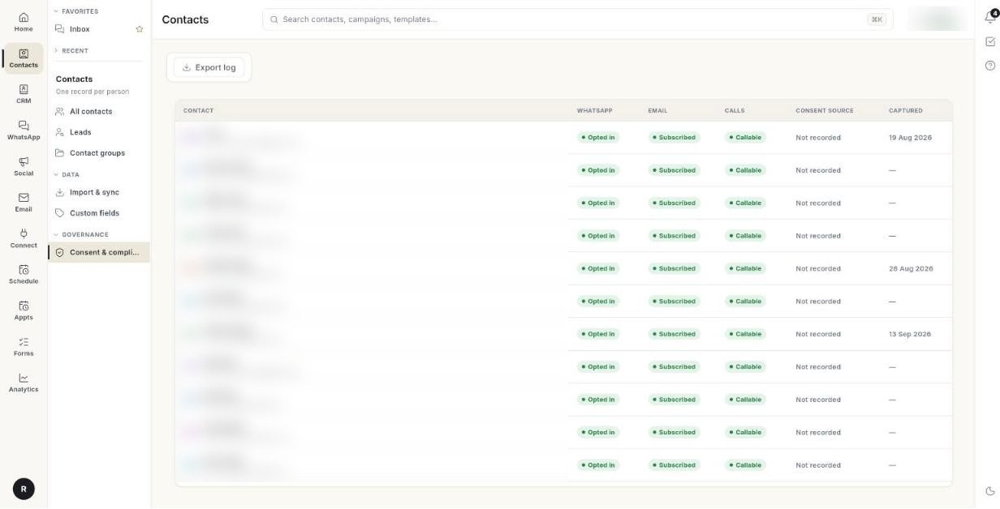

# संपर्क की सहमति ट्रैक करें { #track-contact-consent }

Ohanvi हर चैनल की अनुमति अलग-अलग दर्ज करता है: व्हाट्सऐप ऑप्ट-इन, ईमेल सब्सक्रिप्शन और कॉल की सहमति। एक की सहमति दूसरे की नहीं मानी जाती। इस पेज के अंत तक आप जाँच सकेंगे कि किसने किसके लिए हामी भरी है, किसी संपर्क की सहमति अपडेट कर सकेंगे और ऑडिट के लिए लॉग एक्सपोर्ट कर सकेंगे।

## शुरू करने से पहले { #before-you-start }

- आपको बाएँ रेल में **Contacts** दिखता हो और उसके पैनल में **Consent & compliance** हो। न दिखे तो अपने एडमिन से कहें कि आपके रोल को CRM संपर्कों का एक्सेस दें। देखें [सेटिंग्स का अवलोकन](../settings/index.md)।
- आपके पास संपर्क हों। देखें [संपर्क इम्पोर्ट और सिंक करें](import-and-sync-contacts.md)।

## चरण { #steps }

### सहमति की समीक्षा करें { #review-consent }

1. बाएँ रेल में **Contacts** खोलें, फिर **Consent & compliance** चुनें।

    

2. तालिका में हर संपर्क की एक पंक्ति होती है:

    | कॉलम | यह क्या दिखाता है |
    | --- | --- |
    | **Contact** | नाम, जिसके नीचे कंपनी, ईमेल या फ़ोन। |
    | **WhatsApp** | व्हाट्सऐप मैसेज के लिए **Opted in** या **Opted out**। |
    | **Email** | ईमेल के लिए **Subscribed** या **Unsubscribed**। |
    | **Calls** | **Callable** या **Do not call**। |
    | **Consent source** | सहमति कहाँ से ली गई, या **Not recorded**। |
    | **Captured** | सहमति दर्ज होने की तारीख। |

स्क्रीन और एक्सपोर्ट किए गए लॉग में पहले 5,000 संपर्क तक शामिल होते हैं। रिकॉर्ड लोड न हो सकें तो अधूरी सूची के बजाय **Retry** बटन के साथ **Consent records could not be loaded** दिखता है।

### सहमति लॉग एक्सपोर्ट करें { #export-the-consent-log }

1. **Export log** पर क्लिक करें।
2. Ohanvi `consent-log.csv` डाउनलोड करता है और **Consent log exported — N contact(s)** दिखाता है।

फ़ाइल में ये कॉलम होते हैं: **Contact**, **Email**, **Phone**, **WhatsApp**, **Email consent**, **Calls**, **Consent source** और **Captured**।

### एक संपर्क का व्हाट्सऐप ऑप्ट-इन बदलें { #change-whatsapp-opt-in-for-one-contact }

1. **Contacts** → **All contacts** खोलें और संपर्क पर क्लिक करें।
2. दाईं ओर के रिकॉर्ड में **WhatsApp** ब्लॉक खोलें।
3. **Opted in** स्विच (**broadcasts**) को चालू या बंद करें। एक मैसेज पुष्टि करता है: **Opted in to broadcasts.** या **Opted out of broadcasts.**

### कई संपर्कों की सहमति बदलें { #change-consent-for-many-contacts }

1. **Contacts** → **All contacts** खोलें और संपर्कों पर टिक करें।
2. सेलेक्शन बार में **More bulk actions** (**…** बटन) पर क्लिक करें।
3. एक चुनें:
    - **Opt in to marketing** या **Opt out of marketing** — व्हाट्सऐप ऑप्ट-इन बदलता है।
    - **Exclude from broadcasts** या **Include in broadcasts** — ऑप्ट-इन जैसा है वैसा रखता है पर संपर्क को ब्रॉडकास्ट से बाहर रखता है।
4. एक मैसेज नतीजे की पुष्टि करता है, जैसे **Opted out — 12 contacts.**

### डू-नॉट-कॉल और ईमेल ऑप्ट-आउट दर्ज करें { #record-do-not-call-and-email-opt-out }

1. संपर्क जोड़ते समय **Add Contact** फ़ॉर्म में **Personal & Consent** के नीचे **Do Not Call** या **Email Opt-out** पर टिक करें। देखें [संपर्क प्रबंधित करें](manage-contacts.md)।
2. जो लोग आपके ईमेल से अनसब्सक्राइब करते हैं, उन्हें अपने आप **Unsubscribed** चिह्नित कर दिया जाता है। देखें [ईमेल का अवलोकन](../email/index.md)।

!!! warning "इम्पोर्ट नए संपर्कों को ऑप्ट-इन चिह्नित करता है"
    फ़ाइल इम्पोर्ट से बने नए संपर्क व्हाट्सऐप के लिए **Opted in** चिह्नित होते हैं। सिर्फ़ उन्हीं लोगों को इम्पोर्ट करें जिन्होंने आपसे बात करने की हामी भरी है। जिन्होंने हामी नहीं भरी, उन्हें ऊपर बताए बल्क एक्शन से ऑप्ट-आउट करें।

## वीडियो वॉकथ्रू { #video-walkthrough }

[VIDEO]

## समस्या का समाधान { #troubleshooting }

| समस्या | कारण | समाधान |
| --- | --- | --- |
| **Nothing to show yet** | अभी कोई संपर्क नहीं है। | **Import contacts** पर क्लिक करें, या व्हाट्सऐप कनेक्ट करें ताकि लोग अपने आप आने लगें। |
| **Consent records could not be loaded** | संपर्क सूची पूरी तरह लोड नहीं हुई। | **Retry** पर क्लिक करें। Ohanvi अधूरी सूची दिखाने के बजाय कुछ नहीं दिखाता। |
| **Could not change the opt-in.** | स्विच का बदलाव सेव नहीं हुआ। | अपना कनेक्शन जाँचें और दोबारा कोशिश करें। |
| बल्क नतीजे में **… of … done, … failed.** लिखा है | कुछ संपर्क अपडेट नहीं हो सके। | फ़ेल हुए संपर्कों पर टिक लगा रहने दें और एक्शन दोबारा चलाएँ। |
| **Consent source** में **Not recorded** दिखता है | संपर्क बिना दर्ज स्रोत के आया, जैसे हाथ से जोड़ा गया। | कुछ ठीक करने की ज़रूरत नहीं। इन संपर्कों की सहमति का अपना सबूत सँभालकर रखें। |
| चौड़ी स्क्रीन पर संपर्क रिकॉर्ड में **Do Not Call** बदला नहीं जा सकता | रिकॉर्ड पैनल इसे दिखाता है पर एडिट नहीं करने देता [VERIFY]। | संपर्क को उसके अकाउंट से एडिट करें, या संकरी विंडो में **All contacts** से। |

## संबंधित गाइड { #related }

- [संपर्क प्रबंधित करें](manage-contacts.md)
- [संपर्क इम्पोर्ट और सिंक करें](import-and-sync-contacts.md)
- [संपर्क समूह बनाएँ और प्रबंधित करें](contact-groups.md)
- [CRM का अवलोकन](../crm/index.md)
