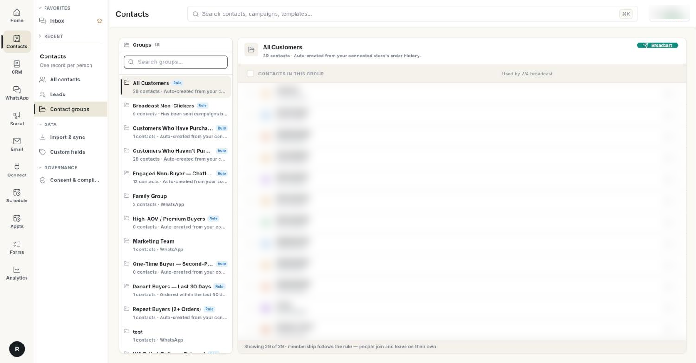

# कॉन्टैक्ट ग्रुप बनाएँ और मैनेज करें { #create-and-manage-contact-groups }

कॉन्टैक्ट ग्रुप लोगों की एक सेव की हुई लिस्ट होती है। हर मॉड्यूल इसे इस्तेमाल कर सकता है, जैसे WhatsApp Broadcast या CRM की कोई लिस्ट। इस पेज के अंत तक आपके पास एक ग्रुप होगा। उसे आपने हाथ से भरा होगा या किसी नियम से, और वह Broadcast के लिए तैयार होगा।

## शुरू करने से पहले { #before-you-start }

- लेफ़्ट रेल में आपको **Contacts** दिखे और उसके पैनल में **Contact groups** हो। न दिखे, तो अपने एडमिन से कहें कि आपके रोल को CRM सेगमेंट का एक्सेस दे दें। देखें [सेटिंग्स ओवरव्यू](../settings/index.md)।
- ग्रुप बनाने, एडिट करने या डिलीट करने के लिए आपके रोल के पास CRM सेगमेंट का सेव एक्सेस होना चाहिए। इसके बिना **New group**, **Edit** और **Delete** नहीं दिखते।
- आपके पास कुछ कॉन्टैक्ट होने चाहिए। देखें [कॉन्टैक्ट मैनेज करें](manage-contacts.md) या [कॉन्टैक्ट इम्पोर्ट और सिंक करें](import-and-sync-contacts.md)।

## स्टेप { #steps }

### अपने ग्रुप खोलें { #open-your-groups }

1. लेफ़्ट रेल में **Contacts** खोलें, फिर **Contact groups** चुनें।

    

2. बाईं ओर की लिस्ट में CRM और WhatsApp, दोनों के सारे ग्रुप दिखते हैं। कोई ग्रुप ढूँढना हो, तो **Search groups…** में टाइप करें।
3. किसी ग्रुप पर क्लिक करें। उसके सदस्य दाईं ओर दिखेंगे। साथ में एक लाइन बताती है कि कौन-से Campaign यह ग्रुप इस्तेमाल करते हैं, जैसे **Not used by a campaign yet**।

हर ग्रुप पर एक बैज बताता है कि वह कैसे अपडेट रहता है:

| बैज | मतलब |
| --- | --- |
| **Rule** | सदस्य नियम के हिसाब से चलते हैं। लोग अपने आप जुड़ते और हटते हैं। |
| **Auto** | अपने आप अपडेट होता रहता है, जैसे किसी कनेक्टेड स्टोर से। |
| कोई बैज नहीं | ग्रुप हाथ से बनाया गया है। |

### ग्रुप बनाएँ { #create-a-group }

1. **New group** पर क्लिक करें। **New group** डायलॉग खुलेगा।
2. **Name** में ग्रुप का नाम लिखें, जैसे `Wholesale partners`।
3. **What this group is** में लिखें कि इसमें कौन-से लोग आएँगे, जैसे `Account type: Wholesale`।
4. लोगों को हाथ से जोड़ना है, तो **Fill it from a rule** को बंद रहने दें।
5. **Save** पर क्लिक करें। **Group created.** मैसेज दिखेगा।

### नियम से ग्रुप भरें { #fill-a-group-from-a-rule }

जब सदस्य किसी फ़ील्ड के हिसाब से अपने आप जुड़ने चाहिए, तब नियम इस्तेमाल करें। जैसे, एक ही शहर के सारे लोग।

1. **New group** डायलॉग में **Fill it from a rule** चालू करें।
2. **Rule (criteria JSON)** में नियम लिखें। जैसे, सारे क्वालिफ़ाइड Lead के लिए:

    ```json
    {"memberType":"LEAD","filters":{"leadStatus":"QUALIFIED"}}
    ```

3. `memberType` को `CONTACT` या `LEAD` पर सेट करें। `filters` में एक या ज़्यादा फ़ील्ड लिखें और हर फ़ील्ड के आगे वह वैल्यू, जिससे मिलान करना है। कोई व्यक्ति तभी ग्रुप में आएगा, जब वह हर फ़िल्टर से मेल खाए।
    - कॉन्टैक्ट के लिए: `city`, `state`, `country`, `department`, `accountId`, `leadSourceId`।
    - Lead के लिए: `leadStatus`, `rating`, `city`, `state`, `country`, `industry`, `leadSourceId`।
4. **Save** पर क्लिक करें।

वैल्यू बिल्कुल सही मिलनी चाहिए, पर अक्षर छोटे हों या बड़े, इससे फ़र्क नहीं पड़ता। जैसे, `{"memberType":"CONTACT","filters":{"city":"Pune"}}` उन कॉन्टैक्ट को ढूँढता है जिनका शहर Pune या pune है।

### ग्रुप में लोगों को जोड़ें { #add-people-to-a-group }

1. लेफ़्ट रेल में **Contacts** खोलें, फिर **All contacts** चुनें।
2. हर व्यक्ति के बगल के चेकबॉक्स पर टिक करें। ऊपर एक बार दिखता है कि आपने कितने लोग चुने हैं।
3. **Add to segment** पर क्लिक करें। **Add to which group?** लिस्ट खुलेगी।
4. ग्रुप चुनें। **Added N to …** मैसेज आएगा।

यहाँ सिर्फ़ वही ग्रुप दिखते हैं जो हाथ से भरे जाते हैं। नियम वाला ग्रुप अपने सदस्य खुद तय करता है।

**WhatsApp** → **Contact** से इम्पोर्ट करते समय भी आप लोगों को जोड़ सकते हैं। वहाँ **Add to List** फ़ील्ड में कोई लिस्ट चुनें।

### ग्रुप से लोगों को हटाएँ { #remove-people-from-a-group }

1. **Contact groups** में ग्रुप खोलें।
2. किसी सदस्य के आगे हटाने वाले आइकन (**Remove from group**) पर क्लिक करें। कई सदस्य हटाने हों, तो उन पर टिक करें और **Remove from group** पर क्लिक करें।
3. कन्फ़र्मेशन में **Remove** पर क्लिक करें। कॉन्टैक्ट Ohanvi में बने रहते हैं। सिर्फ़ ग्रुप से उनका नाम हटता है।

नियम वाले ग्रुप में यह बटन नहीं होता। वहाँ **Membership follows the rule** दिखता है। ग्रुप में कौन रहे, यह बदलना हो तो नियम बदलें।

### ग्रुप को Broadcast भेजें { #broadcast-to-a-group }

1. ग्रुप पर **Broadcast** पर क्लिक करें। **Opening the broadcast composer for …** दिखेगा और WhatsApp Broadcast कंपोज़र खुल जाएगा।
2. कंपोज़र में ऑडियंस के तौर पर वही ग्रुप चुनें। ग्रुप अपने आप नहीं चुना जाता। देखें [WhatsApp Broadcast Campaign भेजें](../whatsapp/send-broadcast-campaign.md)।

### ग्रुप एडिट या डिलीट करें { #edit-or-delete-a-group }

1. ग्रुप खोलें और **Edit** पर क्लिक करें। नाम, डिस्क्रिप्शन या नियम बदलें, फिर **Save** पर क्लिक करें। **Group updated.** मैसेज दिखेगा।
2. ग्रुप हटाना हो, तो **Delete** पर क्लिक करें। फिर **Delete group** कन्फ़र्मेशन में **Delete** पर क्लिक करें।

!!! warning "डिलीट किया हुआ ग्रुप वापस नहीं आता"
    सेव की हुई लिस्ट उन सभी मॉड्यूल से हट जाती है जो उसे इस्तेमाल करते हैं। ग्रुप में जो लोग थे, वे आपके कॉन्टैक्ट में बने रहते हैं।

## वीडियो वॉकथ्रू { #video-walkthrough }

[VIDEO]

## समस्या का समाधान { #troubleshooting }

| समस्या | कारण | समाधान |
| --- | --- | --- |
| **Could not save the group.** | यह नाम किसी दूसरे ग्रुप ने ले रखा है, नाम खाली है, या नियम का JSON सही नहीं है। | अलग नाम रखें। देखें कि नियम में `memberType` की वैल्यू `LEAD` या `CONTACT` है और सिर्फ़ ऊपर बताए गए फ़िल्टर इस्तेमाल हुए हैं। |
| **No hand-picked group to add them to.** | आपके पास हाथ से भरा जाने वाला कोई ग्रुप नहीं है। | **Fill it from a rule** बंद रखकर एक ग्रुप बनाएँ। |
| किसी को हटाते समय **Membership follows the rule — …** दिखता है | नियम वाले ग्रुप में हाथ से चुने हुए सदस्य नहीं होते। | इसकी जगह नियम एडिट करें। |
| **CRM groups did not load** या **WhatsApp groups did not load** | ग्रुप के एक सोर्स से लिस्ट नहीं आ पाई। | बाकी ग्रुप चलते रहते हैं। थोड़ी देर बाद पेज रीलोड करें। |
| नियम वाला ग्रुप खाली है | कोई भी हर फ़िल्टर से मेल नहीं खाता, या किसी वैल्यू की स्पेलिंग अलग है। | कुछ कॉन्टैक्ट में सही वैल्यू देखें, फिर नियम एडिट करें। |

## संबंधित गाइड { #related }

- [कॉन्टैक्ट मैनेज करें](manage-contacts.md)
- [कॉन्टैक्ट इम्पोर्ट और सिंक करें](import-and-sync-contacts.md)
- [Leads के साथ काम करें](leads.md)
- [CRM ओवरव्यू](../crm/index.md)
