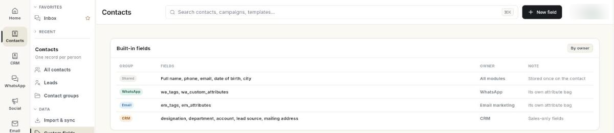

# कस्टम संपर्क फ़ील्ड जोड़ें { #add-custom-contact-fields }

कस्टम फ़ील्ड से आप संपर्क पर अपनी जानकारी रख सकते हैं, जैसे जन्मदिन या किराये की रकम, और मैसेज भेजते समय उन्हें मर्ज फ़ील्ड की तरह इस्तेमाल कर सकते हैं। अंत में आपके पास एक नया फ़ील्ड होगा जिसे आप इम्पोर्ट से भर सकते हैं।

## शुरू करने से पहले { #before-you-start }

- लेफ़्ट रेल में **Contacts** दिखता हो और उसके पैनल में **Custom fields** हो। अगर नहीं दिखता, तो अपने एडमिन से कहें कि आपके रोल को CRM संपर्कों का एक्सेस दें। देखें [सेटिंग्स का ओवरव्यू](../settings/index.md)।
- एक व्हाट्सऐप नंबर कनेक्ट हो। कस्टम फ़ील्ड व्हाट्सऐप फ़ील्ड कैटलॉग में सेव होते हैं। नंबर कनेक्ट न हो तो स्क्रीन पर **No field catalog for this workspace** दिखता है।

## चरण { #steps }

### बने-बनाए फ़ील्ड देखें { #see-the-built-in-fields }

1. लेफ़्ट रेल में **Contacts** खोलें, फिर **Custom fields** चुनें।

    

2. **Built-in fields** कार्ड दिखाता है कि संपर्क का रिकॉर्ड कैसे बना है, और हर हिस्सा किस मॉड्यूल का है, इसके हिसाब से समूह में बाँटा गया है:

    | समूह | फ़ील्ड | मालिक |
    | --- | --- | --- |
    | **Shared** | पूरा नाम, फ़ोन, ईमेल, जन्म तिथि, शहर | सभी मॉड्यूल |
    | **WhatsApp** | व्हाट्सऐप टैग और व्हाट्सऐप कस्टम एट्रिब्यूट | व्हाट्सऐप |
    | **Email** | ईमेल टैग और ईमेल एट्रिब्यूट | ईमेल मार्केटिंग |
    | **CRM** | पदनाम, विभाग, अकाउंट, लीड का स्रोत, मेलिंग पता | CRM |

साझा फ़ील्ड सिर्फ़ एक बार सेव होते हैं। CRM में फ़ोन नंबर बदलने पर व्हाट्सऐप भी नया नंबर इस्तेमाल करता है। टैग साझा नहीं होते: व्हाट्सऐप और ईमेल की टैग सूचियाँ अलग-अलग रहती हैं।

### कस्टम फ़ील्ड बनाएँ { #create-a-custom-field }

1. **New field** पर क्लिक करें। **New field** डायलॉग खुलता है।
2. **Field name** में छोटा सा नाम लिखें, जैसे `rent`। मर्ज फ़ील्ड के रूप में आप यही नाम इस्तेमाल करते हैं।
3. **Display label** में वह लेबल लिखें जो लोगों को दिखे, जैसे `Rent`। खाली छोड़ने पर Ohanvi फ़ील्ड का नाम इस्तेमाल करता है।
4. **Value type** में **Text**, **Number**, **Date** या **Yes / No** चुनें।
5. **Create** पर क्लिक करें। संदेश **Field created.** दिखता है, और फ़ील्ड **Your custom fields** के नीचे दिखने लगता है।

### कस्टम फ़ील्ड भरें { #fill-a-custom-field }

- **फ़ाइल से:** संपर्क इम्पोर्ट करते समय, मैपिंग वाले चरण में आपके कस्टम फ़ील्ड **YOUR CUSTOM ATTRIBUTES** के नीचे दिखते हैं। जिस कॉलम का नाम फ़ील्ड के नाम या लेबल से मेल खाता है, वह अपने-आप मैप हो जाता है। देखें [संपर्क इम्पोर्ट और सिंक करें](import-and-sync-contacts.md)।
- **एक-एक संपर्क करके:** संपर्क पर मान सेट करें, **WhatsApp** → **Contact** में [VERIFY: where a single contact's custom field value is edited]।

भरने के बाद, फ़ील्ड को व्हाट्सऐप मैसेज में मर्ज फ़ील्ड की तरह इस्तेमाल करें, जैसे `{{attribute.rent}}`। जिन संपर्कों का मान खाली है उनके लिए पाइप के बाद फ़ॉलबैक जोड़ें, जैसे `{{attribute.rent|your monthly rent}}`।

### कस्टम फ़ील्ड एडिट करें { #edit-a-custom-field }

1. **Your custom fields** के नीचे फ़ील्ड पर क्लिक करें।
2. Ohanvi **WhatsApp** → **Contact** खोलता है, जहाँ फ़ील्ड कैटलॉग प्रबंधित होता है। फ़ील्ड को वहीं बदलें या हटाएँ [VERIFY: exact place in WhatsApp → Contact]।

**Filled on** कॉलम में **—** दिखता है। Ohanvi अभी यह नहीं गिनता कि कितने संपर्कों में मान भरा है।

## वीडियो वॉकथ्रू { #video-walkthrough }

[VIDEO]

## समस्या का समाधान { #troubleshooting }

| समस्या | कारण | समाधान |
| --- | --- | --- |
| **Field name is required** | **Field name** खाली है। | फ़ील्ड का नाम लिखें, फिर **Create** पर क्लिक करें। |
| **A field with this name already exists** | किसी और फ़ील्ड का यही नाम है (अपर और लोअर केस का फ़र्क नहीं गिना जाता)। | कोई दूसरा नाम चुनें, या मौजूदा फ़ील्ड ही इस्तेमाल करें। |
| **Unable to create the field.** | सर्वर पर सेव नहीं हो पाया। | फिर कोशिश करें। बार-बार फ़ेल हो, तो देखें कि आपका व्हाट्सऐप नंबर अब भी कनेक्ट है या नहीं। |
| **No field catalog for this workspace** | कोई व्हाट्सऐप नंबर कनेक्ट नहीं है, या कैटलॉग पढ़ा नहीं जा सका। | व्हाट्सऐप नंबर कनेक्ट करें, फिर **Custom fields** दोबारा खोलें। |
| इम्पोर्ट करते समय फ़ील्ड का विकल्प नहीं मिल रहा | फ़ाइल उस फ़ील्ड के बनने से पहले स्कैन हुई थी। | इम्पोर्ट बंद करें, उसे फिर खोलें और फ़ाइल दोबारा चुनें। |

## संबंधित गाइड { #related }

- [संपर्क इम्पोर्ट और सिंक करें](import-and-sync-contacts.md)
- [संपर्क प्रबंधित करें](manage-contacts.md)
- [व्हाट्सऐप मैसेज टेम्प्लेट बनाएँ](../whatsapp/create-message-template.md)
- [CRM का ओवरव्यू](../crm/index.md)
