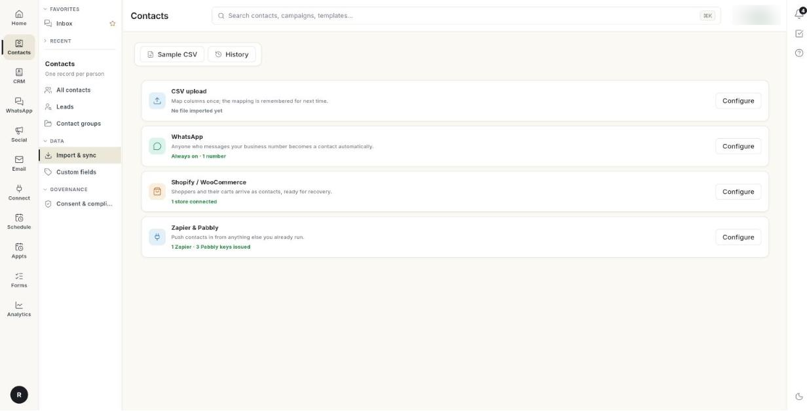

# कॉन्टैक्ट इम्पोर्ट और सिंक करें { #import-and-sync-contacts }

अपनी कॉन्टैक्ट लिस्ट को Excel या CSV फ़ाइल से Ohanvi में लाएँ। साथ ही वे सोर्स कनेक्ट करें जो अपने आप कॉन्टैक्ट जोड़ते हैं। हर व्यक्ति का एक ही कॉन्टैक्ट रिकॉर्ड बनता है। जो लोग Ohanvi में पहले से हैं, उन्हें दोबारा नहीं जोड़ा जाता। उन्हें मर्ज कर दिया जाता है।

## शुरू करने से पहले { #before-you-start }

- लेफ़्ट रेल में आपको **Contacts** दिखे और उसके पैनल में **Import & sync** हो। न दिखे, तो अपने एडमिन से कहें कि आपके रोल को CRM कॉन्टैक्ट का एक्सेस दे दें। देखें [सेटिंग्स ओवरव्यू](../settings/index.md)।
- आपकी लिस्ट `.xlsx` या `.csv` फ़ाइल में सेव होनी चाहिए। पुरानी `.xls` फ़ाइलें नहीं चलतीं। उन्हें पहले `.xlsx` में सेव करें।
- फ़ाइल में ज़्यादा से ज़्यादा 100,000 डेटा रो हो सकती हैं।
- आप जिन लोगों को इम्पोर्ट कर रहे हैं, उन सबने आपसे मैसेज पाने की हामी भरी होनी चाहिए। फ़ाइल से आने वाले नए कॉन्टैक्ट WhatsApp के लिए अपने आप ऑप्ट-इन हो जाते हैं। देखें [कॉन्टैक्ट की सहमति ट्रैक करें](consent-and-compliance.md)।

## स्टेप { #steps }

### अपने कॉन्टैक्ट सोर्स देखें { #see-your-contact-sources }

1. लेफ़्ट रेल में **Contacts** खोलें, फिर **Import & sync** चुनें।

    

2. **Import & sync** स्क्रीन पर 4 सोर्स दिखते हैं। हर सोर्स के साथ लाइव स्टेटस की एक लाइन और एक **Configure** बटन होता है:
    - **CSV upload** — आखिरी रन दिखाता है, जैसे **Last run today · 250 rows, 3 rejected**, या **No file imported yet**।
    - **WhatsApp** — जो भी आपके बिज़नेस नंबर पर मैसेज करता है, वह कॉन्टैक्ट बन जाता है। यहाँ **Always on · 1 number** या **No number connected** दिखता है।
    - **Shopify / WooCommerce** — खरीदार और उनकी कार्ट कॉन्टैक्ट बनकर आते हैं। यहाँ **1 store connected** या **No store connected** दिखता है।
    - **Zapier & Pabbly** — दूसरे टूल से कॉन्टैक्ट भेजें। यहाँ जारी की गई कीज़ दिखती हैं, या **No keys issued**।
3. किसी सोर्स को सेट करने के लिए उसके **Configure** पर क्लिक करें। WhatsApp के लिए **WhatsApp** → **Contact** खुलता है। Shopify / WooCommerce के लिए **Connect** → **Store Connections** खुलता है। Zapier & Pabbly के लिए **Connect** → **Zapier** खुलता है।

किसी लाइन में **Status unavailable** लिखा हो, तो Ohanvi अभी उस सोर्स को चेक नहीं कर पाया। इसका मतलब यह नहीं कि सोर्स बंद है।

### अपनी फ़ाइल तैयार करें { #prepare-your-file }

1. पहली रो में कॉलम के नाम लिखें। उसके नीचे हर रो में एक कॉन्टैक्ट रखें।
2. फ़ोन नंबर का एक कॉलम रखें। सिर्फ़ यही कॉलम ज़रूरी है। जिस रो में फ़ोन नंबर नहीं होता, उसे छोड़ दिया जाता है।
3. चाहें तो इनमें से कोई भी कॉलम जोड़ें: first name, last name, email, country code और tags।
4. एक सेल में कई टैग हों, तो उन्हें कॉमा या पाइप (`|`) से अलग करें, जैसे `Festive|VIP`।
5. भारतीय मोबाइल नंबर 10 अंकों में लिखें। आगे `91` या `+91` हो भी सकता है, नहीं भी। दूसरे देशों के नंबरों में कंट्री कोड जोड़ें, या उसे कंट्री कोड वाले कॉलम में रखें।

आपके कॉलम के नाम Ohanvi के नामों जैसे होने ज़रूरी नहीं। अगले स्टेप में आप उन्हें मैप करेंगे। Ohanvi आम नामों को अपने आप पहचान लेता है, जैसे **Mobile**, **WhatsApp number**, **Name**, **Surname** और **E-mail**।

Template से शुरू करना हो, तो इम्पोर्ट डायलॉग खोलें और **Download Sample CSV** पर क्लिक करें। इसमें 6 कॉलम हैं: **Phone Number**, **First Name**, **Last Name**, **Email**, **Country Code** और **Tags**।

!!! tip "दो सैंपल फ़ाइलें"
    Import & sync स्क्रीन का **Sample CSV** और **Import** मेनू का **Download sample CSV**, दोनों एक लंबा CRM Template (`contacts-template.csv`) डाउनलोड करते हैं। इसमें **Designation** और **Account Name** जैसे कॉलम हैं। इम्पोर्टर सिर्फ़ ऊपर वाले 6 कॉलम और आपके कस्टम फ़ील्ड पढ़ता है। बाकी कॉलम इम्पोर्ट नहीं होते [VERIFY: confirm the longer template is intended for this importer]।

### फ़ाइल अपलोड करें { #upload-the-file }

1. **Import & sync** पर **CSV upload** के **Configure** पर क्लिक करें। आप **All contacts** पर **Import** → **Import from CSV** से भी यहीं पहुँच सकते हैं। **Import contacts** डायलॉग खुलेगा।
2. **Choose an Excel or CSV file** पर क्लिक करें और अपनी फ़ाइल चुनें। नीचे **Reading file…** दिखेगा।
3. मैपिंग वाला स्टेप खुलेगा। उसमें आपकी फ़ाइल का नाम और कॉन्टैक्ट की गिनती दिखेगी, जैसे **250 contacts detected**। दूसरी फ़ाइल चुननी हो, तो **Change File** पर क्लिक करें।

### अपने कॉलम मैप करें { #map-your-columns }

1. **Header identifiers** के नीचे हर **ATTRIBUTE** के लिए **COLUMN IN YOUR FILE** का एक ड्रॉपडाउन होता है। जिन कॉलम को Ohanvi ने पहचान लिया है, वे पहले से चुने हुए मिलते हैं।
2. **Phone Number** (जिस पर **\*** लगा है) देखें। उस पर **Select a column** लिखा हो, तो अपना फ़ोन कॉलम चुनें। जब तक आप ऐसा नहीं करते, **Import** बंद रहता है।
3. बाकी हर एट्रिब्यूट के लिए उसका कॉलम चुनें, या **— Not in file —** ही रहने दें।
4. आपके कस्टम फ़ील्ड हों, तो वे **YOUR CUSTOM ATTRIBUTES** के नीचे दिखते हैं। उन्हें भी इसी तरह मैप करें। देखें [कस्टम कॉन्टैक्ट फ़ील्ड जोड़ें](custom-fields.md)।
5. **Options** के नीचे **Default Country Code** सेट करें। यह उन नंबरों के लिए है जिनमें अपना कंट्री कोड नहीं है। डिफ़ॉल्ट भारत (+91) है।
6. फ़ाइल के टैग कॉन्टैक्ट के पहले से मौजूद टैग की जगह लें, तो **Replace Tags** चालू करें। टैग को साथ में जोड़ना हो, तो इसे बंद रखें।

### इम्पोर्ट करें और नतीजे देखें { #import-and-review-the-results }

1. **Import** पर क्लिक करें। नीचे पहले **Validating contacts…** दिखेगा, फिर **Importing contacts…**।
2. इम्पोर्ट पूरा होने पर **Import complete** समरी खुलेगी। इसमें ये दिख सकता है:
    - **N new contacts added**
    - **N already in contacts — details merged**
    - **N repeated in the file — merged**
    - **N rows skipped (no phone number)**
3. **Done** पर क्लिक करें। नए कॉन्टैक्ट **All contacts** में दिखने लगेंगे।

**Import & sync** पर **CSV upload** की लाइन अब यही रन दिखाती है। पुराने हर अपलोड को **Total Rows**, **Processed Rows** और **Failed Rows** के साथ देखना हो, तो **History** पर क्लिक करें। इससे **Uploaded Documents** खुलता है। इसके लिए अलग अनुमति चाहिए।

### डुप्लिकेट कैसे संभाले जाते हैं { #how-duplicates-are-handled }

- Ohanvi लोगों को फ़ोन नंबर से पहचानता है। वह नंबर के आखिरी 10 अंक देखता है। `9820041122`, `919820041122` और `+91 98200 41122` एक ही व्यक्ति हैं।
- जिस रो का नंबर पहले से मौजूद है, वह उसी कॉन्टैक्ट में मर्ज हो जाती है। खाली नाम और ईमेल फ़ाइल से भर जाते हैं। पहले से मौजूद वैल्यू नहीं बदलतीं।
- फ़ाइल के टैग कॉन्टैक्ट के टैग में जुड़ जाते हैं। **Replace Tags** चालू हो, तो वे पुराने टैग की जगह ले लेते हैं।
- एक ही फ़ाइल में एक ही नंबर की 2 रो हों, तो 1 कॉन्टैक्ट बनता है।
- आपने जो कॉन्टैक्ट पहले डिलीट किया था, उसका नंबर दोबारा इम्पोर्ट करने पर वह वापस आ जाता है।

कुछ भी दो बार नहीं जुड़ता। इसलिए फ़ाइल ठीक करने के बाद आप उसी फ़ाइल को बेफ़िक्र होकर दोबारा इम्पोर्ट कर सकते हैं।

### इम्पोर्ट और फ़ॉलो-अप { #imports-and-follow-ups }

इम्पोर्ट ऊपर बताए अनुसार कॉन्टैक्ट जोड़ता है। वह उनके फ़ॉलो-अप शुरू नहीं करता। इम्पोर्ट में 1,00,000 लोग हो सकते हैं, और फ़ॉलो-अप मैसेज भेज सकते हैं, इसलिए वे कभी अचानक शुरू नहीं होते।

किसी व्यक्ति के फ़ॉलो-अप शुरू करने के लिए उसे **Add contact** से एक-एक करके जोड़ें। देखें [कॉन्टैक्ट मैनेज करें](manage-contacts.md#what-add-contact-does-with-follow-ups)। लोगों को पहली कॉल वाली Leads के रूप में लाने के लिए **CRM** → **Leads** पर **Import** इस्तेमाल करें। देखें [Leads और Deals इम्पोर्ट करें](import-leads-and-deals.md)।

!!! warning "सिर्फ़ उन्हीं लोगों को इम्पोर्ट करें जिन्होंने WhatsApp मैसेज के लिए हामी भरी है"
    टीम के किसी सदस्य का जोड़ा कॉन्टैक्ट अपने आप जाने वाले WhatsApp के लिए ऑप्ट-इन माना जाता है। सिर्फ़ उन्हीं लोगों को इम्पोर्ट करें जिन्होंने WhatsApp पर आपसे बात करने की हामी भरी है।

### छूटी हुई रो ठीक करें { #fix-skipped-rows }

समरी में छूटी हुई रो की गिनती दिखती है, पर उनकी लिस्ट नहीं दिखती। नीचे दिए कारणों के हिसाब से उन्हें अपनी फ़ाइल में ढूँढें, ठीक करें और फ़ाइल दोबारा इम्पोर्ट करें। जो रो पहले इम्पोर्ट हो चुकी हैं, वे बिना किसी बदलाव के मर्ज हो जाती हैं।

| रो छूटने का कारण | समाधान |
| --- | --- |
| **Phone number is required** | नंबर जोड़ें, या रो हटा दें। |
| **An Indian (+91) mobile number is exactly 10 digits — this one has 9** | नंबर सही करें। देखें कि कोई अंक छूटा तो नहीं और आगे एक्स्ट्रा `0` तो नहीं है। |
| **Phone number is too short — including the country code it must be at least 8 digits** | छूटे हुए अंक या कंट्री कोड जोड़ें। |
| **Phone number is too long — including the country code it cannot exceed 15 digits** | एक्स्ट्रा अंक हटाएँ, या एक सेल में लिखे 2 नंबरों को 2 रो में बाँटें। |
| **First name must not exceed 150 characters** (last name भी) | नाम छोटा करें, या कॉलम मैपिंग जाँचें। बहुत लंबी वैल्यू का मतलब अक्सर यह होता है कि कॉलम गलत मैप हुआ है। |
| **Email must not exceed 255 characters** | ईमेल सही करें। |
| **Phone number must not exceed 20 characters** | फ़ोन वाली सेल से टेक्स्ट या एक्स्ट्रा अक्षर हटाएँ। |

!!! note "ध्यान दें"
    समरी में हमेशा **(no phone number)** ही लिखा आता है, भले ही असली वजह गलत लंबाई का नंबर या बहुत लंबा फ़ील्ड हो।

## वीडियो वॉकथ्रू { #video-walkthrough }

[VIDEO]

## समस्या का समाधान { #troubleshooting }

| समस्या | कारण | समाधान |
| --- | --- | --- |
| **Could not read the file's column headers — make sure the first row of the file holds the column names.** | पहली रो खाली है या उसमें कॉलम के नाम नहीं हैं, या फ़ाइल खराब है। | रो 1 में कॉलम के नाम लिखें और फ़ाइल को दोबारा `.xlsx` या `.csv` में सेव करें। |
| **No importable rows found — check the Phone Number column mapping.** | हर रो फ़ेल हो गई। आमतौर पर इसकी वजह यह होती है कि **Phone Number** गलत कॉलम से मैप है। | **Phone Number** को उस कॉलम से मैप करें जिसमें नंबर हैं, फिर दोबारा **Import** पर क्लिक करें। |
| **The file has more than 100000 rows, which is the import limit.** | फ़ाइल बहुत बड़ी है। | उसे 100,000 या उससे कम रो वाली फ़ाइलों में बाँटें और हर फ़ाइल इम्पोर्ट करें। |
| **These contacts have already been imported — upload the file again to import it once more.** | आपने ऐसी फ़ाइल पर दोबारा **Import** दबा दिया जो पहले ही इम्पोर्ट हो चुकी है। | डायलॉग बंद करें, उसे फिर से खोलें और फ़ाइल चुनें। |
| नंबर गलत कंट्री कोड के साथ आ रहे हैं | फ़ाइल में कंट्री कोड नहीं था और **Default Country Code** गलत था। | **Country Code** कॉलम जोड़ें, या सही **Default Country Code** चुनें, फिर दोबारा इम्पोर्ट करें। |
| मेरी `.xls` फ़ाइल फ़ाइल पिकर में नहीं दिखती | सिर्फ़ `.xlsx` और `.csv` चलती हैं। | फ़ाइल को Excel में खोलें और `.xlsx` में सेव करें। |

## संबंधित गाइड { #related }

- [कॉन्टैक्ट मैनेज करें](manage-contacts.md)
- [कस्टम कॉन्टैक्ट फ़ील्ड जोड़ें](custom-fields.md)
- [कॉन्टैक्ट ग्रुप बनाएँ और मैनेज करें](contact-groups.md)
- [कॉन्टैक्ट की सहमति ट्रैक करें](consent-and-compliance.md)
- [WhatsApp Broadcast Campaign भेजें](../whatsapp/send-broadcast-campaign.md)
