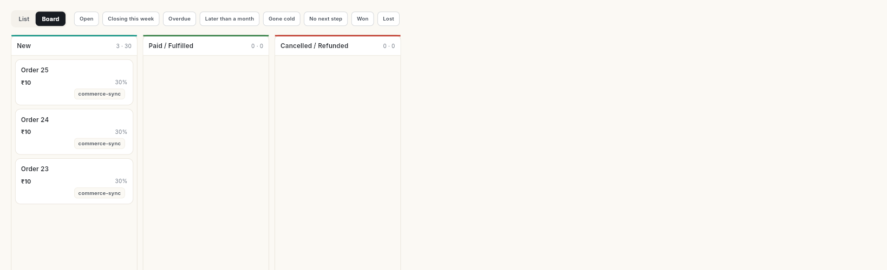

# CRM और कॉन्टैक्ट { #crm-and-contacts }

CRM में वे सभी लोग रहते हैं जिनसे आप बात करते हैं, और वे सभी Deals भी जिन पर आप काम करते हैं। **Contacts** में लोग रहते हैं। **CRM** उन्हीं लोगों से जुड़ी कंपनियाँ, Deals, एक्टिविटी और सेल्स के आँकड़े ट्रैक करता है।

## यह कहाँ मिलेगा { #where-to-find-it }

CRM लेफ़्ट रेल के दो आइकन में बँटा है:

| रेल आइकन | पैनल के आइटम |
| --- | --- |
| **Contacts** | **All contacts**, **Leads**, **Contact groups** · **Data** के नीचे: **Import & sync**, **Custom fields** · **Governance** के नीचे: **Consent & compliance** |
| **CRM** | **Dashboard** · **Deals**, **Accounts** · **Campaigns**, **Automations** · **Funnel**, **Forecast** |

कुछ CRM स्क्रीन पैनल में नहीं दिखतीं:

- **Deal Board**: **Deals** पर **List | Board** टॉगल।
- **Campaign Templates**: **Campaigns** पर **Templates** बटन।
- **Sales Quotas**: **Forecast** पर **Manage quotas**।
- **Activities**, **Activity Calendar**, **Notes** और **Sales reports**: ऊपर सर्च बॉक्स में नाम लिखें। या **Ctrl+K** (Mac पर **⌘K**) दबाएँ और **Go to…** में से चुनें।
- **Pipelines**, **Lead Sources** और **Products**: नीचे बाएँ अपने नाम के पहले अक्षरों पर क्लिक करें। फिर **Settings** → **CRM** पर जाएँ।

## शुरू करने से पहले { #before-you-start }

- आपके वर्कस्पेस में CRM मॉड्यूल होना चाहिए, और आपके रोल को CRM एक्सेस मिला होना चाहिए। नहीं तो **Contacts** और **CRM** आइकन नहीं दिखेंगे। अपने एडमिन से कहें। देखें [टीम, रोल और परमिशन मैनेज करें](../settings/roles-and-permissions.md)।
- चैट से कॉन्टैक्ट अपने आप आएँ, इसके लिए आपका WhatsApp नंबर कनेक्ट होना चाहिए।
- **Dashboard**, **Funnel**, **Forecast** और **Sales reports** के लिए CRM रिपोर्ट का एक्सेस चाहिए। **Automations** के लिए ऑटोमेशन का एक्सेस चाहिए।

## Contacts { #contacts }

इस हिस्से की सभी गाइड देखने के लिए [Contacts](contacts/index.md) खोलें।

| गाइड | कब इस्तेमाल करें |
| --- | --- |
| [कॉन्टैक्ट मैनेज करें](manage-contacts.md) | आप कॉन्टैक्ट जोड़ना, खोजना, फ़िल्टर करना, एडिट करना, टैग करना, मर्ज करना या एक्सपोर्ट करना चाहते हैं। |
| [कॉन्टैक्ट को कॉल करें और कॉल रिव्यू करें](call-contacts-and-review-calls.md) | आप किसी कॉन्टैक्ट को कॉल करते हैं और कॉल का नतीजा व फ़ॉलो-अप लिखना चाहते हैं। |
| [ऑटो कॉलिंग से एक साथ कई कॉन्टैक्ट को कॉल करें](auto-call-contacts.md) | आपके पास कॉन्टैक्ट की एक लिस्ट है, जिन्हें एक के बाद एक कॉल करना है। |
| [वेलकम ईमेल भेजें](send-a-welcome-email.md) | आप एक कॉन्टैक्ट को ब्रोशर अटैच करके ईमेल भेजना चाहते हैं। |
| [वेलकम ईमेल और ब्रोशर सेट करें](set-up-the-welcome-email.md) | आपको डिफ़ॉल्ट वेलकम मैसेज और सबके लिए साझा ब्रोशर लाइब्रेरी चाहिए। |
| [हाल के कॉन्टैक्ट पर वापस जाएँ](find-recent-contacts.md) | आप वे कॉन्टैक्ट देखना चाहते हैं जिन्हें आपने हाल में खोला या कॉल किया। |
| [Leads के साथ काम करें](leads.md) | आप नई पूछताछ को क्वालिफ़ाई करना, स्कोर देना और कन्वर्ट करना चाहते हैं। |
| [Commerce Leads से छोड़ी गई कार्ट वापस पाएँ](recover-abandoned-carts.md) | खरीदार पेमेंट किए बिना आपका ऑनलाइन स्टोर छोड़कर चले गए। |
| [कॉन्टैक्ट ग्रुप बनाएँ और मैनेज करें](contact-groups.md) | आपको कॉन्टैक्ट की एक सेव की हुई लिस्ट चाहिए, जिन्हें एक साथ मैसेज भेजा जा सके। |
| [कॉन्टैक्ट इम्पोर्ट और सिंक करें](import-and-sync-contacts.md) | आपके कॉन्टैक्ट किसी फ़ाइल में हैं, या आप चाहते हैं कि वे WhatsApp, स्टोर या Zapier से अपने आप आएँ। |
| [कस्टम कॉन्टैक्ट फ़ील्ड जोड़ें](custom-fields.md) | आपको कॉन्टैक्ट की ऐसी जानकारी रखनी है जिसके लिए बने-बनाए फ़ील्ड नहीं हैं। |
| [कॉन्टैक्ट की सहमति ट्रैक करें](consent-and-compliance.md) | आप देखना या बदलना चाहते हैं कि किसने आपसे मैसेज पाने की सहमति दी है, या सहमति का लॉग एक्सपोर्ट करना चाहते हैं। |

## CRM { #crm }

इस हिस्से की सभी गाइड देखने के लिए [CRM](sales/index.md) खोलें।

| गाइड | कब इस्तेमाल करें |
| --- | --- |
| [CRM Dashboard पढ़ें](track-sales-performance.md) | आप अपनी खुली Pipeline, जीती हुई Deals और ठंडी पड़ रही Deals देखना चाहते हैं। |
| [Deals बनाएँ और मैनेज करें](manage-deals.md) | आप Deal जोड़ना, उसे स्टेज दर स्टेज आगे बढ़ाना और बंद करना चाहते हैं। |
| [Accounts जोड़ें और मैनेज करें](manage-accounts.md) | आप उन कंपनियों को ट्रैक करना चाहते हैं जिन्हें आप बेचते हैं। |
| [एक्टिविटी और नोट्स लिखें](log-activities-and-notes.md) | आप कॉल और मीटिंग प्लान करना और कॉन्टैक्ट या Deal पर नोट्स रखना चाहते हैं। |
| [Campaigns और Campaign Templates ट्रैक करें](track-campaigns.md) | आप Campaign, उसकी ऑडियंस और उसके नतीजे दर्ज करना चाहते हैं। |
| [CRM Automations मैनेज करें](manage-automations.md) | आप Leads और Deals पर चल रहे रूल देखना, रोकना या फिर से शुरू करना चाहते हैं। |
| [फ़नल पढ़ें और बोर्ड पर Leads आगे बढ़ाएँ](read-the-funnel.md) | आप देखना चाहते हैं कि Leads कहाँ छूट रही हैं। |
| [सेल्स फ़ोरकास्ट पढ़ें](read-the-forecast.md) | आप Pipeline की तुलना अपने टारगेट से करना चाहते हैं। |
| [सेल्स रिपोर्ट चलाएँ](run-sales-reports.md) | आपको रिपोर्ट Excel या PDF फ़ाइल में चाहिए। |

## CRM को सेट करें { #configure-the-crm }

CRM को पहली बार सेट करते समय इन गाइड को देखें। देखें [CRM को सेट करें](configure/index.md)।

| गाइड | कब इस्तेमाल करें |
| --- | --- |
| [Pipelines सेट करें](set-up-pipelines.md) | आप वे स्टेज बनाते हैं जिनसे होकर Deal आगे बढ़ती है। |
| [Lead Sources मैनेज करें और देखें कि कौन से कन्वर्ट होते हैं](manage-lead-sources.md) | आप वे चैनल जोड़ते हैं जहाँ से आपकी Leads आती हैं। |
| [प्रोडक्ट जोड़ें](add-products.md) | आप जो बेचते हैं, उसे जोड़ते हैं। |
| [सेल्स कोटा सेट करें](set-sales-quotas.md) | आप हर सेल्सपर्सन को महीने का टारगेट देते हैं। |

## संबंधित गाइड { #related }

- [ईमेल](../email/index.md): अपने कॉन्टैक्ट को ईमेल से Campaign भेजें।
- [शेड्यूल](../schedule/index.md): CRM एक्टिविटी को बाकी शेड्यूल की गई चीज़ों के साथ देखें।
- [एनालिटिक्स](../analytics/index.md): देखें कि आपके WhatsApp Broadcast और स्टोर कैसा चल रहे हैं।
