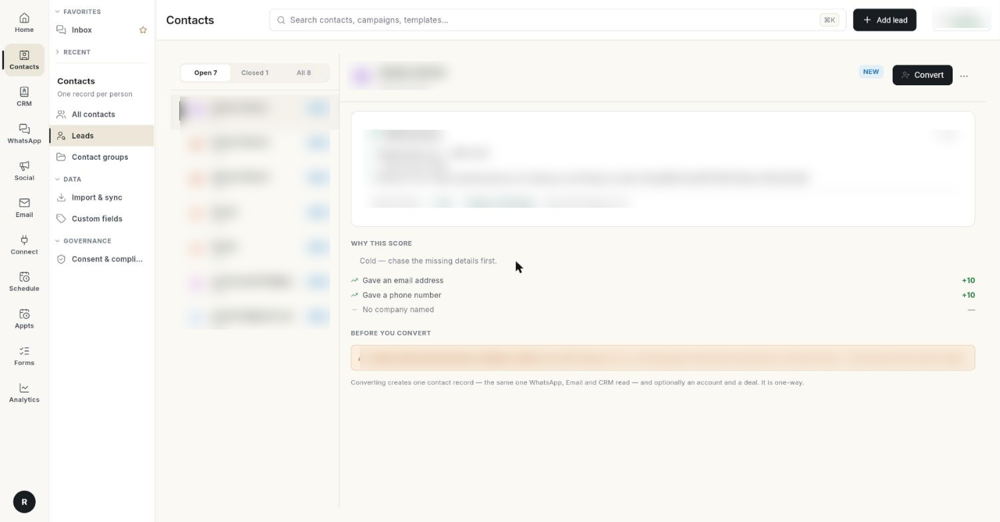

# Leads के साथ काम करें { #work-with-leads }

Lead वह संभावित ग्राहक है जिसे आप अभी परख रहे हैं। इस पेज में आप सीखेंगे कि Lead कैसे जोड़ें, उसे अलग-अलग स्टेटस में कैसे ले जाएँ, और अच्छी Lead को कॉन्टैक्ट में कैसे बदलें। कन्वर्ट करने के बाद Lead एक कॉन्टैक्ट रिकॉर्ड बन जाती है। आप चाहें, तो उसके साथ अकाउंट और Deal भी बन जाते हैं।

## शुरू करने से पहले { #before-you-start }

- लेफ़्ट रेल में **Contacts** दिखना चाहिए, और उसके पैनल में **Leads**। न दिखे, तो अपने एडमिन से कहें कि आपके रोल को CRM Leads का एक्सेस दें। देखें [सेटिंग्स का ओवरव्यू](../settings/index.md)।
- Lead पर **Lead Source** चुनना हो, तो CRM में सोर्स पहले से बने होने चाहिए। देखें [CRM का ओवरव्यू](../crm/index.md)।
- छोटी विंडो या फ़ोन पर **Leads** में यहाँ बताए ट्राइएज व्यू की जगह एक सादा ग्रिड दिखता है।

## स्टेप { #steps }

### अपनी Leads खोलें { #open-your-leads }

1. लेफ़्ट रेल में **Contacts** खोलें, फिर **Leads** चुनें।

    

2. बाईं ओर की लिस्ट में गिनती के साथ 3 टैब हैं: **Open**, **Closed** और **All**। **Open** में वे Leads दिखती हैं जो **NEW**, **CONTACTED**, **QUALIFIED** या **WORKING** हैं और अभी कन्वर्ट नहीं हुई हैं।
3. किसी Lead पर क्लिक करें। दाईं ओर उसकी डिटेल खुलती है। वहाँ उसका स्टेटस और स्कोर भी दिखता है।

अभी कोई Lead न हो, तो **No leads yet** और **Add lead** बटन दिखता है।

### Lead जोड़ें { #add-a-lead }

1. **Add lead** पर क्लिक करें। **Add Lead** फ़ॉर्म खुलता है।
2. **First Name** लिखें। सिर्फ़ यही फ़ील्ड ज़रूरी है।
3. जो जानकारी आपके पास है, वह भरें: **Last Name**, **Company**, **Designation**, **Email**, **Phone**, **Mobile** और **Website**।
4. **Lead Source** और **Rating** चुनें: **HOT**, **WARM** या **COLD**।
5. आपके पास हों, तो **Industry**, **Annual Revenue**, **Employees** और पते के फ़ील्ड भरें।
6. अगर व्यक्ति ने ईमेल न भेजने को कहा हो, तो **Email Opt-out** पर टिक करें।
7. **Submit** पर क्लिक करें। **Lead created** मैसेज दिखता है।

### Lead का स्कोर पढ़ें { #read-a-leads-score }

Lead का स्कोर एक नंबर के रूप में दिखता है। **Why this score** के नीचे Ohanvi बताता है कि स्कोर में क्या-क्या जुड़ा। जैसे:

- **Rated hot** या **Rated warm**
- **Gave an email address**, **Gave a phone number**, **Named their company**, **Has a website**
- **Turnover above ₹1 Cr**, **100 or more staff**
- **Qualified** या **Contacted**

जो जानकारी भरी नहीं है, वह भी लिस्ट में दिखती है। जैसे **No email address** या **No phone number**। इन्हें भरेंगे, तो स्कोर बढ़ेगा।

### Lead को दूसरे स्टेटस में ले जाएँ { #move-a-lead-to-another-status }

1. Lead चुनें और **More actions** (**…** बटन) पर क्लिक करें। फिर **Move Status** चुनें।
2. **Move "…" to** में **NEW**, **CONTACTED**, **QUALIFIED**, **UNQUALIFIED** या **LOST** चुनें। **Lead status updated** मैसेज दिखता है।

Lead **CONVERTED** तभी होती है जब आप उसे कन्वर्ट करें। स्टेटस बदलने से वह **CONVERTED** नहीं होती।

### Lead को कॉन्टैक्ट में बदलें { #convert-a-lead-into-a-contact }

1. Lead चुनें। **Before you convert** के नीचे डुप्लिकेट जाँच का नतीजा देखें:
    - **No matching contact** — कन्वर्ट करने पर नया व्यक्ति (कॉन्टैक्ट) बनता है।
    - **… is already a contact** — दूसरा कॉन्टैक्ट बनाने के बजाय Lead को उसी कॉन्टैक्ट से जोड़ें।
    - **Duplicate check unavailable** — कॉन्टैक्ट की लिस्ट लोड नहीं हुई। थोड़ा रुकें और Lead फिर से चुनें।
2. **Convert** पर क्लिक करें। **Convert Lead** डायलॉग खुलता है।
3. **Create a new contact** चुनें। अगर मैच मिला है, तो **Link the existing contact — …** चुनें।
4. Lead की कंपनी से अकाउंट बनाने के लिए **Create account "…"** पर टिक करें। अगर Lead में कंपनी नहीं है, तो यहाँ **Create account (lead has no company)** दिखता है।
5. Deal बनाने के लिए **Create deal in default pipeline** पर टिक करें। चाहें तो **Deal Name (optional)** लिखें।
6. **Convert** पर क्लिक करें।

!!! warning "कन्वर्ट करना वापस नहीं होता"
    Lead कॉन्टैक्ट बन सकती है, पर कॉन्टैक्ट वापस Lead नहीं बनता। Lead अपनी हिस्ट्री के साथ रहती है और **CONVERTED** हो जाती है। उसके बाद आप उसे एडिट नहीं कर सकते, और उसका स्टेटस भी नहीं बदल सकते।

### डुप्लिकेट Leads मर्ज करें { #merge-duplicate-leads }

1. जिस Lead को हटाना है, उसे चुनें। फिर **More actions** → **Merge into…** पर क्लिक करें। **Merge "…" into…** डायलॉग खुलता है।
2. **Surviving record** में वह Lead चुनें जिसे रखना है।
3. **Merge** पर क्लिक करें।

!!! warning "मर्ज वापस नहीं होता"
    जो Lead बचती है, उसके खाली फ़ील्ड दूसरी Lead से भर जाते हैं। दूसरी Lead के नोट्स, एक्टिविटी और मेंबरशिप भी इसमें आ जाती हैं। इसके बाद दूसरी Lead डिलीट हो जाती है।

### नोट्स और एक्टिविटी लिखें { #log-notes-and-activities }

1. Lead चुनें। फिर **More actions** → **Notes & Activities** पर क्लिक करें।
2. Lead के लिए नोट या एक्टिविटी जोड़ें। नोट्स और एक्टिविटी के बारे में जानने के लिए [CRM का ओवरव्यू](../crm/index.md) देखें।

### छोड़ी गई कार्ट पर फ़ॉलो-अप करें { #follow-up-on-abandoned-carts }

जो खरीदार आपके Shopify या WooCommerce स्टोर से बिना पेमेंट किए चले जाते हैं, वे कॉमर्स Leads के रूप में आते हैं। इनकी अपनी स्क्रीन और स्टेप हैं। देखें [Commerce Leads से छोड़ी गई कार्ट वापस पाएँ](recover-abandoned-carts.md)।

## वीडियो वॉकथ्रू { #video-walkthrough }

[VIDEO]

## समस्या का समाधान { #troubleshooting }

| समस्या | कारण | समाधान |
| --- | --- | --- |
| **Lead is already converted.** | Lead पहले ही कन्वर्ट हो चुकी है। | वह जो कॉन्टैक्ट बनी थी, उसे **All contacts** में खोलें। |
| **Lead is converted and can no longer change status.** | कन्वर्ट की गई Lead फ़्रीज़ हो जाती है। | इसके बजाय कॉन्टैक्ट, अकाउंट या Deal के साथ काम करें। |
| **Lead has no company — cannot create an account from it.** | जिस Lead में कंपनी नहीं है, उस पर **Create account** पर टिक किया गया। | टिक हटाएँ, या पहले Lead में **Company** जोड़ें। |
| **Duplicate check unavailable** | कॉन्टैक्ट की लिस्ट अभी लोड नहीं हुई थी। | कन्वर्ट करने से पहले कुछ सेकंड रुकें और Lead फिर से चुनें। |
| कॉमर्स Leads की स्क्रीन खाली है | कोई स्टोर कनेक्ट नहीं है, या अभी तक किसी ने कार्ट नहीं छोड़ी। | **Connect** → **Store Connections** में स्टोर कनेक्ट करें। खरीदार के जाते ही कार्ट दिखने लगती है। |

## संबंधित गाइड { #related }

- [कॉन्टैक्ट मैनेज करें](manage-contacts.md)
- [कॉन्टैक्ट ग्रुप बनाएँ और मैनेज करें](contact-groups.md)
- [कॉन्टैक्ट इम्पोर्ट और सिंक करें](import-and-sync-contacts.md)
- [Commerce Leads से छोड़ी गई कार्ट वापस पाएँ](recover-abandoned-carts.md)
- [Lead Sources मैनेज करें और देखें कि कौन से कन्वर्ट होते हैं](manage-lead-sources.md)
- [CRM का ओवरव्यू](../crm/index.md)
