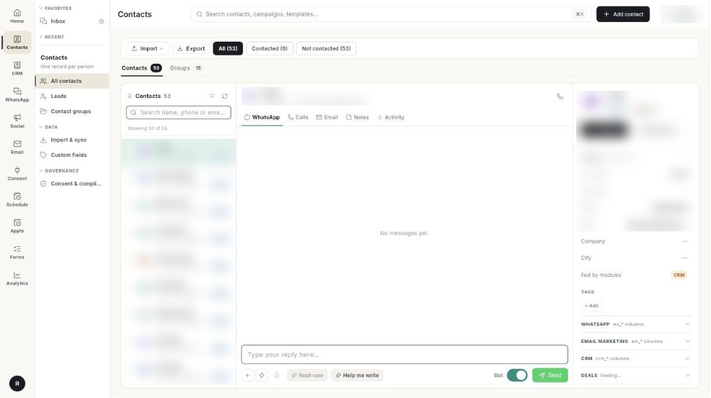

# कॉन्टैक्ट मैनेज करें { #manage-contacts }

लोगों को Ohanvi में जोड़ें, उन्हें जल्दी ढूँढें और हर रिकॉर्ड सही रखें। WhatsApp, ईमेल और CRM, तीनों एक ही रिकॉर्ड पढ़ते हैं। इस गाइड के बाद आपके कॉन्टैक्ट टैग और ग्रुप में होंगे, और कोई डुप्लिकेट नहीं बचेगा।

## शुरू करने से पहले { #before-you-start }

- लेफ़्ट रेल में **Contacts** दिखना चाहिए। न दिखे, तो अपने एडमिन से कहें कि आपके रोल को CRM कॉन्टैक्ट का एक्सेस दें। देखें [सेटिंग्स का ओवरव्यू](../settings/index.md)।
- कॉन्टैक्ट मर्ज करने के लिए आपके रोल को कॉन्टैक्ट अपडेट करने का एक्सेस भी चाहिए। यह न हो, तो **Merge into…** के आगे **(no permission)** दिखता है।
- छोटी विंडो या फ़ोन पर **All contacts** में यहाँ बताए तीन पैनल नहीं दिखते। उनकी जगह एक सादा ग्रिड दिखता है। वही सारे काम आप हर लाइन से कर सकते हैं।

## स्टेप { #steps }

### अपने कॉन्टैक्ट खोलें { #open-your-contacts }

1. लेफ़्ट रेल में **Contacts** खोलें, फिर **All contacts** चुनें।

    

2. स्क्रीन पर 3 पैनल दिखते हैं। बाईं ओर कॉन्टैक्ट की लिस्ट, बीच में बातचीत और दाईं ओर कॉन्टैक्ट का रिकॉर्ड।
3. लोगों की जगह सेव की हुई लिस्ट देखनी हो, तो ऊपर **Groups** टैब पर क्लिक करें। देखें [कॉन्टैक्ट ग्रुप बनाएँ और मैनेज करें](contact-groups.md)।

अभी कोई कॉन्टैक्ट न हो, तो **No contacts yet** के साथ **Import contacts** और **Connect WhatsApp** दिखते हैं। आपके कनेक्ट किए हुए WhatsApp नंबर पर जो भी मैसेज करता है, वह अपने-आप कॉन्टैक्ट बन जाता है।

### कॉन्टैक्ट जोड़ें { #add-a-contact }

1. ऊपर की बार में **Add contact** पर क्लिक करें। **Add Contact** फ़ॉर्म खुलता है।
2. **Basic Information** में **First Name** लिखें। सिर्फ़ यही फ़ील्ड ज़रूरी है।
3. ज़रूरत हो तो **Last Name**, **Email**, **Phone** और **Mobile** भरें।
4. अगर वह फ़ोन या ईमेल पहले से किसी और का है, तो ऊपर चेतावनी आती है, जैसे **+91 9820041122 already belongs to Priya Nair.** उस रिकॉर्ड को देखने के लिए **Open that contact** पर क्लिक करें।
5. **Work** की जानकारी भरें: **Designation**, **Department**, **Account** और **Lead Source**।
6. **Personal & Consent** में **Date of Birth** डालें। अगर उस व्यक्ति ने मना किया हो, तो **Do Not Call** या **Email Opt-out** पर टिक करें।
7. **Notes** में **Address** और कोई **Description** जोड़ें।
8. **Submit** पर क्लिक करें। **Contact created** मैसेज आता है और कॉन्टैक्ट लिस्ट में दिखने लगता है।

!!! note "ध्यान दें"
    डुप्लिकेट की चेतावनी आपको सेव करने से रोकती नहीं है, क्योंकि दो लोग एक ही ऑफ़िस फ़ोन इस्तेमाल कर सकते हैं। अगर गलती से डुप्लिकेट बन जाए, तो दोनों रिकॉर्ड मर्ज कर दें (नीचे देखें)।

### कॉन्टैक्ट ढूँढें { #find-a-contact }

1. लिस्ट के ऊपर **Search name, phone or email…** में टाइप करें। टाइप करते ही लिस्ट छोटी होती जाती है।
2. **All**, **Contacted** या **Not contacted** कॉन्टैक्ट देखने के लिए लिस्ट के ऊपर उस नाम की पिल पर क्लिक करें। हर पिल में उसकी गिनती भी दिखती है।
3. और फ़िल्टर चाहिए, तो फ़िल्टर आइकन (**Filter contacts**) पर क्लिक करें। **Filter Contacts** डायलॉग खुलता है।
4. **Last seen** या **Created at** के लिए समय चुनें: **In 24hr**, **This Week** या **This Month**। सिर्फ़ उन्हें देखना हो जिन्होंने WhatsApp मैसेज पाने की सहमति दी है, तो **Opted in** चालू करें।
5. **Apply** पर क्लिक करें। सारे फ़िल्टर हटाने के लिए लिस्ट के ऊपर **Clear filters** पर क्लिक करें।

### कॉन्टैक्ट देखें और बदलें { #read-and-edit-a-contact }

1. लिस्ट में किसी कॉन्टैक्ट पर क्लिक करें। बीच में उसकी WhatsApp चैट खुलती है और दाईं ओर उसका रिकॉर्ड।
2. उसका पूरा इतिहास देखने के लिए बीच वाले पैनल में **WhatsApp**, **Calls**, **Email**, **Notes** और **Activity** टैब पर जाएँ।
3. रिकॉर्ड में **Identity** ब्लॉक पहले से खुला होता है। **First name**, **Last name**, **Phone**, **Email** या **City** वहीं सीधे बदल दें।
4. कोई भी फ़ील्ड बदलते ही **Add contact** बटन **Update contact** बन जाता है। सेव करने के लिए **Update contact** पर क्लिक करें। **Contact updated.** मैसेज आएगा।
5. **Conversation status**, **Subscription** और **Owner** जैसी चैनल की जानकारी के लिए **WhatsApp**, **Email marketing** और **CRM** ब्लॉक खोलें। **Deals** और **Appointments** ब्लॉक में इस कॉन्टैक्ट से जुड़े रिकॉर्ड दिखते हैं।

सेव करने से पहले अगर आप दूसरे कॉन्टैक्ट पर क्लिक कर दें, तो **Unsaved changes** डायलॉग पूछता है कि अब क्या करना है: **Keep editing**, **Discard** या **Save & switch**।

### कॉन्टैक्ट का लेवल सेट करें { #set-a-contacts-level }

1. रिकॉर्ड के हेडर में लेवल बैज पर क्लिक करें, जैसे **New**।
2. **New**, **Awaiting reply**, **Replied**, **Customer** या **Cold** चुनें। **Level set to …** मैसेज आएगा।

### कॉन्टैक्ट को टैग करें { #tag-a-contact }

1. **Identity** ब्लॉक में **Tags** के नीचे **+ Add** पर क्लिक करें। **Add or remove a tag** डायलॉग खुलता है।
2. चुनें कि टैग किस लिस्ट का है: **WhatsApp** या **Email**। दोनों चैनलों की टैग लिस्ट अलग-अलग रहती हैं।
3. **Tag** में टैग लिखें, जैसे `Festive`।
4. **Add** पर क्लिक करें। टैग हटाना हो, तो **Remove** पर क्लिक करें।

### मैसेज करें, कॉल करें या एक्टिविटी दर्ज करें { #message-call-or-log-activity }

1. रिकॉर्ड के हेडर में WhatsApp मैसेज भेजने के लिए **Message** पर क्लिक करें। Broadcast लिखने की स्क्रीन खोलने के लिए **Broadcast** पर क्लिक करें।
2. बाकी कामों के लिए **More actions** (**…** बटन) पर क्लिक करें: **Call Now**, **Call on Mobile — send this number to your phone**, **Send Welcome Email**, **Send WhatsApp**, **WhatsApp Call** और **Notes & Activities**।
3. हर काम के स्टेप के लिए देखें [कॉन्टैक्ट को कॉल करें और अपनी कॉल देखें](call-contacts-and-review-calls.md), [ऑटो कॉलिंग से एक के बाद एक कई कॉन्टैक्ट को कॉल करें](auto-call-contacts.md) और [कॉन्टैक्ट को वेलकम ईमेल भेजें](send-a-welcome-email.md)।

### डुप्लिकेट कॉन्टैक्ट मर्ज करें { #merge-duplicate-contacts }

1. जिस कॉन्टैक्ट को हटाना है, उसे खोलें। फिर **More actions** → **Merge into…** पर क्लिक करें। **Merge "…" into…** डायलॉग खुलता है।
2. **Surviving record** में वह कॉन्टैक्ट चुनें जिसे रखना है।
3. नोट पढ़ें, फिर **Merge** पर क्लिक करें।

!!! warning "मर्ज वापस नहीं हो सकता"
    जो रिकॉर्ड बचता है, उसकी खाली फ़ील्ड दूसरे कॉन्टैक्ट से भर जाती हैं। दूसरे कॉन्टैक्ट के नोट, एक्टिविटी और ग्रुप भी इसी रिकॉर्ड में आ जाते हैं। इसके बाद दूसरा कॉन्टैक्ट डिलीट हो जाता है।

### कई कॉन्टैक्ट पर एक साथ काम करें { #act-on-many-contacts-at-once }

1. जिन कॉन्टैक्ट को चुनना है, उनके बगल के चेकबॉक्स पर टिक करें। लिस्ट के ऊपर एक बार दिखता है, जैसे **3 selected**।
2. इन्हें किसी ग्रुप में रखने के लिए **Add to segment** पर क्लिक करें। **Add to which group?** में कोई ग्रुप चुनें। **Added 3 to …** मैसेज आएगा। यहाँ सिर्फ़ वे ग्रुप दिखते हैं जिनमें आप हाथ से कॉन्टैक्ट जोड़ते हैं। किसी नियम से भरने वाले ग्रुप नहीं दिखते।
3. और विकल्पों के लिए **More bulk actions** (**…** बटन) पर क्लिक करें और **Add or remove a tag**, **Opt in to marketing**, **Opt out of marketing**, **Exclude from broadcasts** या **Include in broadcasts** चुनें।
4. सारे टिक हटाने के लिए **Clear** पर क्लिक करें।

### कॉन्टैक्ट एक्सपोर्ट करें { #export-contacts }

1. लिस्ट के ऊपर टूलबार में **Export** पर क्लिक करें।
2. `CrmContacts.xlsx` नाम की एक Excel फ़ाइल डाउनलोड हो जाती है।

!!! note "ध्यान दें"
    चुने हुए कॉन्टैक्ट वाले बार में **Export selected** भी पूरी कॉन्टैक्ट लिस्ट ही डाउनलोड करता है, सिर्फ़ टिक किए हुए कॉन्टैक्ट नहीं। कुछ ही कॉन्टैक्ट चाहिए हों, तो फ़ाइल को Excel में फ़िल्टर कर लें।

## वीडियो वॉकथ्रू { #video-walkthrough }

[VIDEO]

## समस्या का समाधान { #troubleshooting }

| समस्या | कारण | समाधान |
| --- | --- | --- |
| **Please fill the following required fields: First Name** | फ़ॉर्म बिना First Name के सबमिट हुआ। | **First Name** लिखें और फिर से **Submit** पर क्लिक करें। |
| फ़ॉर्म में **… already belongs to …** चेतावनी | किसी और कॉन्टैक्ट का फ़ोन या ईमेल यही है। | **Open that contact** पर क्लिक करें। अगर वह वही व्यक्ति है, तो नया फ़ॉर्म बंद करें और उसी रिकॉर्ड में बदलाव करें। |
| **Could not update the contact — please try again.** | आपका बदलाव सेव नहीं हुआ। | अपना कनेक्शन जाँचें, फिर **Update contact** पर दोबारा क्लिक करें। |
| **Merge into… (no permission)** ग्रे है | आपका रोल कॉन्टैक्ट अपडेट नहीं कर सकता। | अपने एडमिन से CRM कॉन्टैक्ट अपडेट करने का एक्सेस माँगें। |
| **No hand-picked group to add them to.** | आपके सारे ग्रुप किसी नियम से भरते हैं, या आपका कोई ग्रुप है ही नहीं। | पहले ऐसा ग्रुप बनाएँ जिसमें आप हाथ से कॉन्टैक्ट जोड़ सकें। देखें [कॉन्टैक्ट ग्रुप बनाएँ और मैनेज करें](contact-groups.md)। |
| बीच वाले पैनल में **No WhatsApp number** दिख रहा है | कॉन्टैक्ट का कोई फ़ोन या मोबाइल नंबर नहीं है। | **Identity** ब्लॉक में **Phone** जोड़ें, फिर **Update contact** पर क्लिक करें। |

## संबंधित गाइड { #related }

- [कॉन्टैक्ट को कॉल करें और अपनी कॉल देखें](call-contacts-and-review-calls.md)
- [ऑटो कॉलिंग से एक के बाद एक कई कॉन्टैक्ट को कॉल करें](auto-call-contacts.md)
- [कॉन्टैक्ट को वेलकम ईमेल भेजें](send-a-welcome-email.md)
- [वेलकम ईमेल और अपने ब्रोशर सेट करें](set-up-the-welcome-email.md)
- [हाल के कॉन्टैक्ट पर वापस जाएँ](find-recent-contacts.md)
- [कॉन्टैक्ट इम्पोर्ट और सिंक करें](import-and-sync-contacts.md)
- [कॉन्टैक्ट ग्रुप बनाएँ और मैनेज करें](contact-groups.md)
- [कॉन्टैक्ट की सहमति ट्रैक करें](consent-and-compliance.md)
- [लीड्स के साथ काम करें](leads.md)
- [CRM का ओवरव्यू](../crm/index.md)
