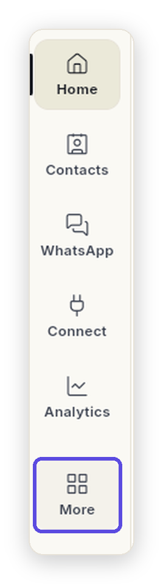
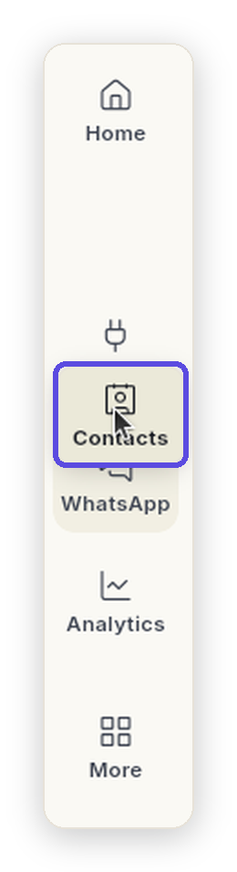
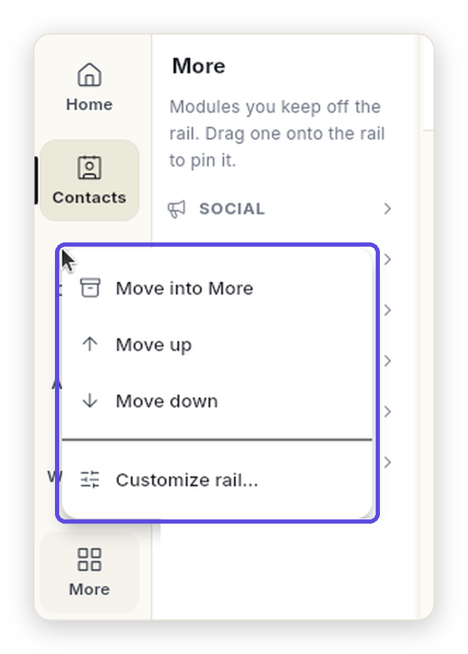
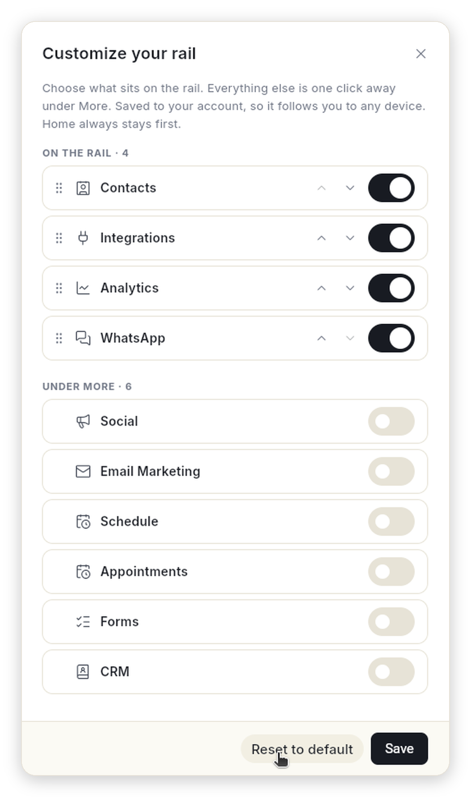

# लेफ़्ट रेल को अपने हिसाब से सेट करें { #customize-the-left-rail }

जो मॉड्यूल आप रोज़ इस्तेमाल करते हैं, उन्हें लेफ़्ट रेल पर रखें। बाकी को **More** में डाल दें। आप मॉड्यूल को रेल और More के बीच ड्रैग कर सकते हैं, उनका क्रम बदल सकते हैं, और रेल को डिफ़ॉल्ट पर वापस ला सकते हैं। आपकी रेल आपके अकाउंट में सेव होती है। इसलिए आप जिस भी डिवाइस से साइन इन करें, वह वैसी ही दिखती है।

## शुरू करने से पहले { #before-you-start }

- आप Ohanvi में साइन इन हों। साइन इन नहीं हैं तो देखें [Ohanvi में साइन इन करें](sign-in.md)।
- आप Ohanvi कंप्यूटर पर चला रहे हों। ड्रैग-एंड-ड्रॉप के लिए माउस या ट्रैकपैड चाहिए।

## रेल कैसे काम करती है { #how-the-rail-works }

रेल सबसे बाईं तरफ़ आइकन की एक कतार है। **Home** हमेशा सबसे ऊपर रहता है। उसके नीचे का हर मॉड्यूल रेल के बगल में अपना मेनू खोलता है।

**More** भी एक मॉड्यूल है। उस पर क्लिक करें, तो उसके मेनू में वे सारे मॉड्यूल दिखते हैं जिन्हें आपने रेल से हटा रखा है। हर मॉड्यूल एक सेक्शन के रूप में अपने पेजों के साथ दिखता है।

{ loading=lazy width="134" }

- **रोज़ के मॉड्यूल आगे रखें।** जो मॉड्यूल आप रोज़ खोलते हैं, उन्हें रेल पर रखें। तब वे हमेशा एक क्लिक पर मिलेंगे।
- **बाकी को More में रखें।** जिन मॉड्यूल की ज़रूरत कभी-कभी पड़ती है, वे अपने सारे पेजों के साथ वहीं रखे रहते हैं। ज़रूरत पड़े, तब खोल लें।
- **काम बदले तो रेल भी बदल लें।** अब रोज़ CRM इस्तेमाल करने लगे? उसे रेल पर ले आएँ। कोई चीज़ अब काम की नहीं रही? उसे More में डाल दें। यह आपके अकाउंट में सेव रहता है और हर डिवाइस पर आपके साथ चलता है।

## स्टेप { #steps }

### More में रखा मॉड्यूल खोलें { #open-a-module-that-is-under-more }

1. रेल पर **More** पर क्लिक करें। रेल के बगल में More मेनू खुलता है।
2. जो सेक्शन चाहिए, उस पर क्लिक करें, जैसे **CRM**। सेक्शन खुलकर अपने पेज दिखाता है।
3. कोई पेज चुनें। वह खुल जाता है। जब तक आप उस पेज पर हैं, रेल पर **More** हाइलाइट रहता है।

More के सेक्शन शुरू में बंद रहते हैं। आप जो सेक्शन खुले छोड़ते हैं, Ohanvi उन्हें याद रखता है।

### मॉड्यूल को रेल पर लाएँ { #move-a-module-onto-the-rail }

1. **More** पर क्लिक करके उसका मेनू खोलें।
2. सेक्शन के हेडिंग को, जैसे **CRM** को, रेल पर ड्रैग करें। एक लाइन दिखती है कि वह कहाँ जाकर रुकेगा।
3. उसे ड्रॉप करें। मॉड्यूल अब रेल पर उसी जगह आ गया।

दूसरा तरीका: सेक्शन के हेडिंग पर राइट-क्लिक करें और **Move out of More (show on rail)** पर क्लिक करें। मॉड्यूल रेल के सबसे आखिर में चला जाता है।

### मॉड्यूल को More में डालें { #move-a-module-into-more }

1. रेल पर मॉड्यूल के आइकन को, जैसे **Contacts** को, ड्रैग करें। ड्रैग करते समय आइकन उठ जाता है, और रेल पर उसकी जगह खाली रहती है।
2. उसे रेल पर **More** पर, या खुले हुए More मेनू पर ड्रॉप करें। वह More में एक सेक्शन बन जाता है।

दूसरा तरीका: रेल पर मॉड्यूल पर राइट-क्लिक करें और **Move into More** पर क्लिक करें।

{ loading=lazy width="130" }

- **उसे उठाएँ।** मॉड्यूल के आइकन को दबाएँ और माउस हिलाएँ। आइकन उठ जाता है और उसकी पुरानी जगह खाली रह जाती है।
- **लाइन देखें।** दो मॉड्यूल के बीच एक पतली लाइन दिखती है। वह बताती है कि मॉड्यूल ठीक कहाँ जाएगा।
- **छोड़ दें।** रेल पर रखना हो तो वहीं ड्रॉप करें। छिपाना हो तो **More** पर ड्रॉप करें। बस इतना ही, Save बटन की ज़रूरत नहीं है।

### क्रम बदलें { #change-the-order }

- रेल पर: मॉड्यूल को ऊपर या नीचे ड्रैग करें और जहाँ चाहें वहाँ ड्रॉप करें।
- More में: किसी सेक्शन के हेडिंग को दूसरे सेक्शन के ऊपर या नीचे ड्रैग करें।
- माउस से: मॉड्यूल या सेक्शन के हेडिंग पर राइट-क्लिक करें और **Move up** या **Move down** पर क्लिक करें।

### राइट-क्लिक मेनू इस्तेमाल करें { #use-the-right-click-menu }

ड्रैग किए बिना मॉड्यूल सँभालने के लिए, रेल के किसी भी मॉड्यूल पर या More के किसी भी सेक्शन हेडिंग पर राइट-क्लिक करें।

1. मॉड्यूल पर राइट-क्लिक करें, जैसे रेल पर **Contacts** पर। उसके बगल में एक मेनू खुलता है।
2. जो काम करना हो, उस पर क्लिक करें:

    | ऑप्शन | यह कहाँ दिखता है | यह क्या करता है |
    | --- | --- | --- |
    | **Move into More** | रेल का कोई मॉड्यूल | मॉड्यूल को रेल से हटाकर More में एक सेक्शन बना देता है। |
    | **Move out of More (show on rail)** | More का कोई सेक्शन हेडिंग | मॉड्यूल को वापस रेल पर, सबसे आखिर में रख देता है। |
    | **Move up** | रेल और More | उसे एक जगह ऊपर ले जाता है। पहले मॉड्यूल पर यह नहीं दिखता। |
    | **Move down** | रेल और More | उसे एक जगह नीचे ले जाता है। आखिरी मॉड्यूल पर यह नहीं दिखता। |
    | **Customize rail…** | रेल और More | **Customize your rail** खोलता है। उसके बारे में आगे बताया गया है। |

    { loading=lazy width="332" }

क्लिक करते ही बदलाव सेव हो जाता है। **Home** पर राइट-क्लिक मेनू नहीं आता, क्योंकि वह हमेशा सबसे पहले रहता है।

### Customize rail इस्तेमाल करें { #use-customize-rail }

**Customize rail** में सारे मॉड्यूल एक ही जगह दिखते हैं।

1. इसे इनमें से किसी भी तरीके से खोलें:
    - More मेनू के नीचे **Customize rail…** पर क्लिक करें
    - किसी मॉड्यूल या सेक्शन हेडिंग पर राइट-क्लिक करें, फिर **Customize rail…** पर क्लिक करें
    - रेल पर **More** पर राइट-क्लिक करें
2. **Customize your rail** में दोनों लिस्ट देखें:
    - **On the rail** — रेल के सारे मॉड्यूल, ऊपर से नीचे, और साथ में उनकी गिनती।
    - **Under More** — More के सारे मॉड्यूल, और साथ में उनकी गिनती।

    { loading=lazy width="440" }

3. मॉड्यूल को रेल पर रखना हो तो उसका स्विच ऑन करें। More में भेजना हो तो ऑफ़ करें। मॉड्यूल उसी पल दूसरी लिस्ट में चला जाता है।
4. **On the rail** के मॉड्यूल का क्रम बदलें:
    - लाइन को एक जगह खिसकाने के लिए उस पर ऊपर या नीचे वाले तीर पर क्लिक करें।
    - या लाइन के बाईं तरफ़ के बिंदियों वाले हैंडल को ऊपर या नीचे ड्रैग करें।
5. **Save** पर क्लिक करें। **Rail saved to your preferences.** मैसेज आता है और रेल बदल जाती है।

बिना कुछ बदले बाहर निकलना हो, तो ऊपर दाएँ कोने में **×** पर क्लिक करें। जब तक आप **Save** पर क्लिक नहीं करते, कुछ भी सेव नहीं होता।

!!! note "इस विंडो में मॉड्यूल के नाम"
    **Customize your rail** में हर मॉड्यूल का पूरा नाम दिखता है। रेल पर कुछ नाम छोटे होते हैं: **Integrations** की जगह **Connect**, **Appointments** की जगह **Appts** और **Email Marketing** की जगह **Email** दिखता है।

!!! tip "डिफ़ॉल्ट पर वापस जाएँ"
    **Customize your rail** में **Reset to default** पर क्लिक करें, फिर **Save** पर क्लिक करें। रेल डिफ़ॉल्ट पर लौट आती है।

## जानने लायक बातें { #things-to-know }

- **Home** हमेशा सबसे पहले रहता है। उसे More में नहीं डाला जा सकता और उसका क्रम भी नहीं बदला जा सकता।
- More में रखे किसी मॉड्यूल में बिना पढ़े आइटम हों, जैसे नए WhatsApp मैसेज, तो उनकी गिनती **More** पर और उस मॉड्यूल के सेक्शन हेडिंग पर दिखती है।
- आपकी रेल आपके रोल के हिसाब से सेव होती है। दूसरे रोल पर जाएँगे, तो उस रोल की अपनी रेल दिखेगी।
- मॉड्यूल को आगे-पीछे करने से उसके अंदर कुछ नहीं बदलता। बस इतना बदलता है कि आप उसे कहाँ से खोलते हैं।

## समस्या का समाधान { #troubleshooting }

| समस्या | कारण | समाधान |
| --- | --- | --- |
| कोई मॉड्यूल रेल पर नहीं दिख रहा | वह More में है। | **More** पर क्लिक करें और उसका सेक्शन ढूँढें। उसे वापस लाने के लिए उसके हेडिंग पर राइट-क्लिक करें और **Move out of More (show on rail)** पर क्लिक करें। |
| कोई मॉड्यूल न रेल पर है, न More में | आपका रोल उसे खोल नहीं सकता। | अपने वर्कस्पेस एडमिन से एक्सेस माँगें। देखें [टीम, रोल और परमिशन](settings/roles-and-permissions.md)। |
| दूसरे डिवाइस पर रेल अलग दिखती है | आपने वहाँ किसी दूसरे रोल से साइन इन किया है। | वही रोल चुनें जो पहले था। हर रोल की अपनी रेल होती है। |
| मॉड्यूल ड्रैग नहीं हो रहे | आपका वर्कस्पेस तब तक लॉक है, जब तक उसका प्लान चालू नहीं होता। | प्लान के ऑप्शन देखने के लिए किसी भी मॉड्यूल पर क्लिक करें, या अपने वर्कस्पेस एडमिन से पूछें। |
| आपने सब इधर-उधर कर दिया और पहले जैसी रेल चाहिए | — | **Customize rail…** खोलें, **Reset to default** पर क्लिक करें, फिर **Save** करें। |

## संबंधित गाइड { #related }

- [Ohanvi में साइन इन करें](sign-in.md)
- [सेटिंग्स खोलें](settings/open-settings.md)
- [टीम, रोल और परमिशन](settings/roles-and-permissions.md)
