# ईमेल मार्केटिंग शुरू करें { #get-started-with-email-marketing }

यह गाइड एक नए यूज़र के साथ चलती है, साइन अप से लेकर ग्राहक के इनबॉक्स में पहले ईमेल तक। इसमें आप भेजने का पता जोड़ते हैं, एक कॉन्टैक्ट जोड़ते हैं, ईमेल डिज़ाइन करते हैं और उसे भेजते हैं। फिर ऐसा वेलकम ईमेल सेट करते हैं जो अपने-आप जाता है। इसमें करीब 20 मिनट लगते हैं।

इस पेज की हर चीज़ ऐप में सचमुच करके देखी गई है, और हर तस्वीर असली स्क्रीन की है।

!!! example "हम जो उदाहरण इस्तेमाल करते हैं"
    हम एक काल्पनिक कॉफ़ी ब्रांड **Bloom & Brew** का उदाहरण लेते हैं। उसकी पहली ग्राहक **Riya Sharma** (`riya@bloomandbrew.in`) है। नीचे के सभी नाम और ईमेल टेक्स्ट सिर्फ़ उदाहरण हैं। आप अपने नाम और टेक्स्ट इस्तेमाल करें।

## आप क्या करेंगे { #what-you-will-do }

| # | स्टेप | कहाँ | समय |
| --- | --- | --- | --- |
| 1 | [अपना भेजने का पता कन्फ़र्म करें](#1-confirm-your-sending-address) | **Email → Campaigns** | 3 मिनट |
| 2 | [अपना पहला कॉन्टैक्ट जोड़ें](#2-add-your-first-contact) | **Email → Contacts** | 2 मिनट |
| 3 | [अपना ईमेल डिज़ाइन करें](#3-design-your-email) | **Email → Email Templates** | 5 मिनट |
| 4 | [अपना पहला कैंपेन भेजें](#4-send-your-first-campaign) | **Email → Campaigns** | 3 मिनट |
| 5 | [देखें किसे मिला](#5-see-who-got-it) | **Email → Manage → Send Logs** | 1 मिनट |
| 6 | [Flow से अपने ईमेल ऑटोमेट करें](#6-automate-your-emails-with-a-flow) | **Email → Flows** | 5 मिनट |

अगर आपकी स्क्रीन पर कुछ अलग दिखे, या कोई स्टेप पूरा न हो, तो [समस्या का समाधान](#troubleshooting) पर जाएँ। हर आम समस्या वहाँ उसके समाधान के साथ दी गई है।

---

## 1. अपना भेजने का पता कन्फ़र्म करें { #1-confirm-your-sending-address }

Ohanvi कुछ भी भेजने से पहले जाँचता है कि From पता सचमुच आपका है।

### पता जोड़ें { #add-the-address }

1. लेफ़्ट रेल में **Email** पर क्लिक करें। पहली बार पेज पर **Verify your sending address** लिखा दिखता है।
2. **Add a sending address** पर क्लिक करें।

    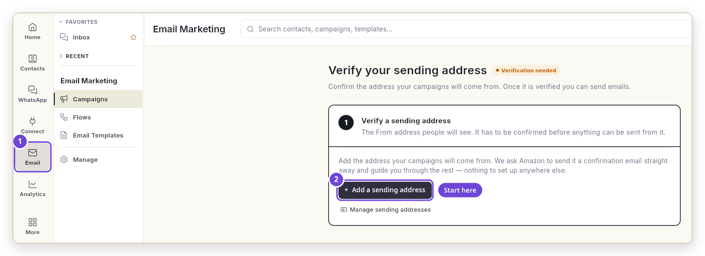{ loading=lazy }

3. **Add Sender Address** विंडो भरें:

    | # | फ़ील्ड | क्या लिखें | उदाहरण |
    | --- | --- | --- | --- |
    | 1 | **Email Address** | वह पता जिससे आपके ईमेल जाएँगे। | `hello@bloomandbrew.in` |
    | 2 | *(4 जाँचें)* | कुछ नहीं। Ohanvi आपका डोमेन खुद जाँचता है। चारों पर **In place** लिखा होना चाहिए। | — |
    | 3 | **Reply To (Optional)** | जवाब कहाँ आएँ। | `support@bloomandbrew.in` |
    | 4 | **From Name (Optional)** | इनबॉक्स में लोगों को दिखने वाला नाम। | `Bloom & Brew` |
    | 5 | **Add Sender Address** | इस पर क्लिक करें। | — |

    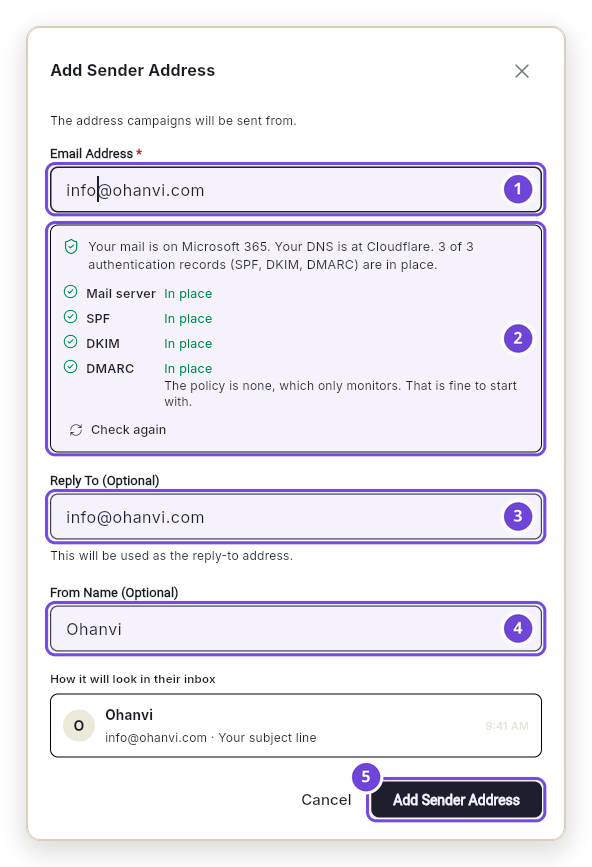{ loading=lazy }

    चारों जाँचें सिर्फ़ आपके अपने डोमेन के पते पर दिखती हैं। अगर इनमें से कोई **In place** नहीं है, तो बटन ग्रे रहता है। इसके लिए [कोई DNS जाँच "In place" नहीं दिखती](#a-dns-check-isnt-in-place) देखें।

### कोड लिखें { #type-the-code }

4. अब विंडो में **Sender Address Added** लिखा है। Ohanvi ने उस पते पर 6 अंकों का कोड ईमेल किया है।
5. वह इनबॉक्स खोलें। `info@ohanvi.com` से आया वह ईमेल खोजें जिसका सब्जेक्ट **Confirm hello@bloomandbrew.in on Ohanvi** है।
6. कोड को बॉक्स में लिखें और **Verify** पर क्लिक करें। या ईमेल में **Confirm this address** दबाएँ।

    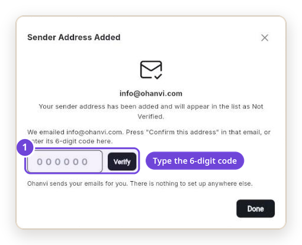{ loading=lazy }

    अगर आप पहले ही विंडो बंद कर दें, तो पेज वही 3 स्टेप दिखाता है (1)। कोड वहाँ लिखें (2), या ईमेल का बटन दबाने के बाद **Check now** (3) पर क्लिक करें।

    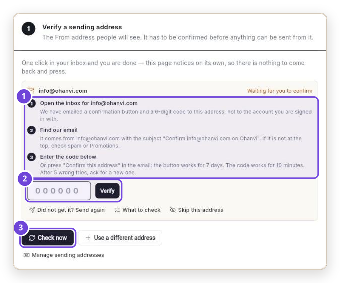{ loading=lazy }

### इसे अपना डिफ़ॉल्ट सेंडर बनाएँ { #make-it-your-default-sender }

7. कन्फ़र्म होने के बाद पते पर **Verified** दिखता है (1)। **Manage → Sender Identities** पर जाएँ, या [app.ohanvi.com/#/marketing/em-manage](https://app.ohanvi.com/#/marketing/em-manage) खोलें।
8. क्राउन आइकन (2) पर क्लिक करें, फिर **Set as Default** पर। आपको **Sender identity updated** दिखेगा, और पते पर **Default sender** का निशान लग जाएगा।

    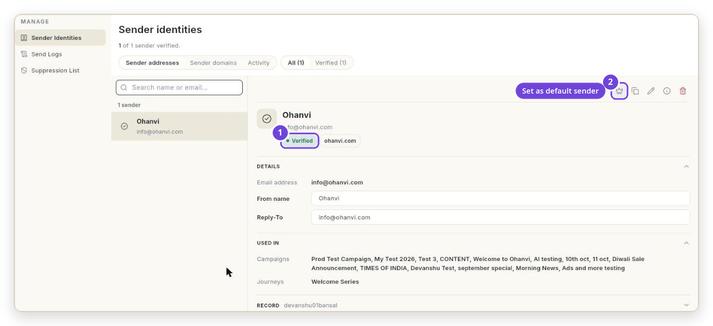{ loading=lazy }

!!! tip "डिफ़ॉल्ट सेट करना न भूलें"
    कैंपेन में आप हर बार सेंडर चुन सकते हैं, लेकिन ऑटोमेटेड Flow डिफ़ॉल्ट सेंडर इस्तेमाल करते हैं। डिफ़ॉल्ट के बिना Flow का हर ईमेल फ़ेल हो जाता है।

---

## 2. अपना पहला कॉन्टैक्ट जोड़ें { #2-add-your-first-contact }

आप सिर्फ़ उन्हीं लोगों को ईमेल भेज सकते हैं जो कॉन्टैक्ट के रूप में सेव हैं।

1. [app.ohanvi.com/#/marketing/em-contact](https://app.ohanvi.com/#/marketing/em-contact) खोलें। आप **More → Email Marketing** से भी वहाँ पहुँच सकते हैं।
2. ऊपर **Add Contact** पर क्लिक करें।
3. फ़ॉर्म भरें और **Submit** (5) पर क्लिक करें:

    | # | फ़ील्ड | उदाहरण | यह क्यों ज़रूरी है |
    | --- | --- | --- | --- |
    | 1 | **Email** | `riya@bloomandbrew.in` | यह ज़रूरी है। |
    | 2 | **First Name** | `Riya` | इससे आप लोगों को नाम लेकर बुला सकते हैं। |
    | 3 | **Subscription Status** | **SUBSCRIBED** | सिर्फ़ सब्सक्राइब किए हुए लोगों को मार्केटिंग ईमेल मिलते हैं। |
    | 4 | **Tags** | `newsletter` | यह ज़रूरी नहीं है। बाद में लोगों को खोजने में मदद करता है। |

    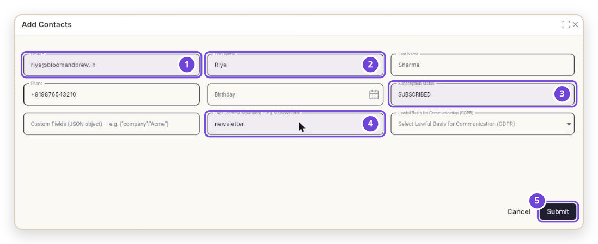{ loading=lazy }

4. करीब 1 मिनट रुकें। ईमेल भेजने से पहले Ohanvi जाँचता है कि हर नया पता सचमुच मौजूद है। तब तक कॉन्टैक्ट छिपा रहता है और पेज पर **1 email is hidden until confirmed to exist** लिखा रहता है।

!!! note "एक साथ कई लोगों को जोड़ना"
    फ़ाइल अपलोड करने के लिए उसी पेज पर **Bulk Import Contacts** इस्तेमाल करें। लोगों को किसी लिस्ट में रखने के लिए, जैसे `Newsletter`, वह लिस्ट खोलें और **Add or remove contacts** इस्तेमाल करें।

---

## 3. अपना ईमेल डिज़ाइन करें { #3-design-your-email }

टेम्प्लेट ऐसा ईमेल है जिसे आप एक बार डिज़ाइन करके बार-बार इस्तेमाल करते हैं।

1. Email पैनल में **Email Templates** खोलें, और **New template** पर क्लिक करें।
2. कोई लेआउट चुनें। प्रोडक्ट लॉन्च के लिए **Product update** अच्छा रहता है।

    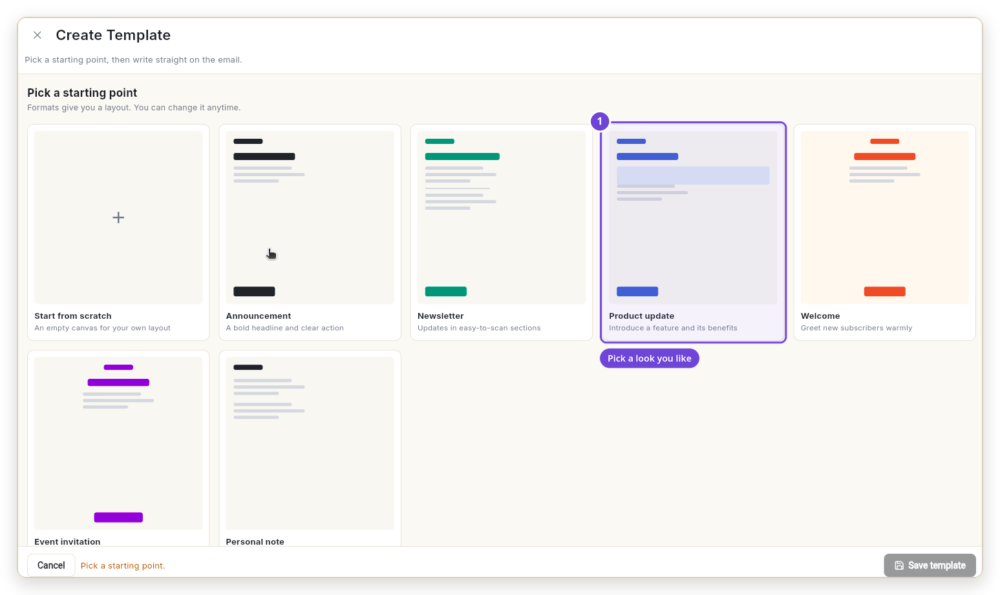{ loading=lazy }

3. ऊपर के 3 फ़ील्ड भरें (1)। हेडिंग, टेक्स्ट, इमेज, बटन, डिवाइडर या स्पेसर जोड़ने के लिए **Blocks** पैनल (2) इस्तेमाल करें।

    | फ़ील्ड | उदाहरण |
    | --- | --- |
    | **Template name** | `Hazelnut cold brew launch` |
    | **Subject line** | `Our new Hazelnut Cold Brew is here` |
    | **Preview text** | `Smooth, low in acid, and ready in your fridge overnight.` |

    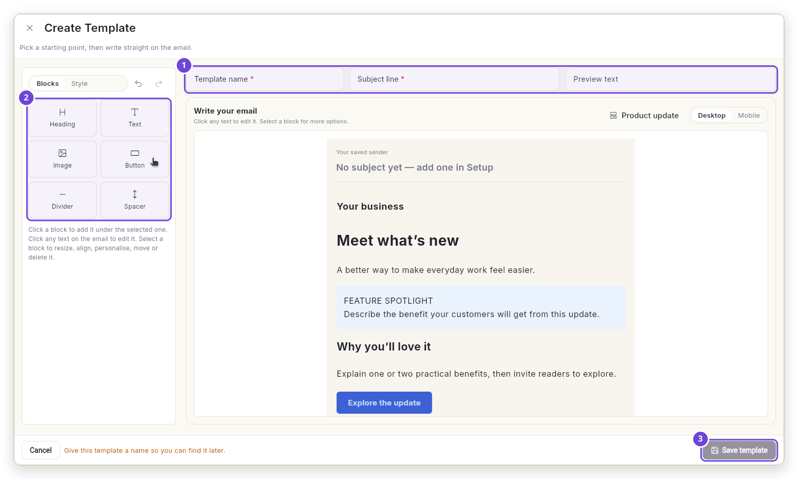{ loading=lazy }

4. ईमेल में किसी भी टेक्स्ट पर क्लिक करें और उसके ऊपर लिखें। लोगों को नाम लेकर बुलाने के लिए किसी लाइन पर क्लिक करें, छोटे टूलबार में **Personalise** खोलें और **First name** चुनें। टेक्स्ट में `{{firstName}}` दिखता है। हर व्यक्ति को अपना नाम दिखता है, जैसे *Hi Riya*।

    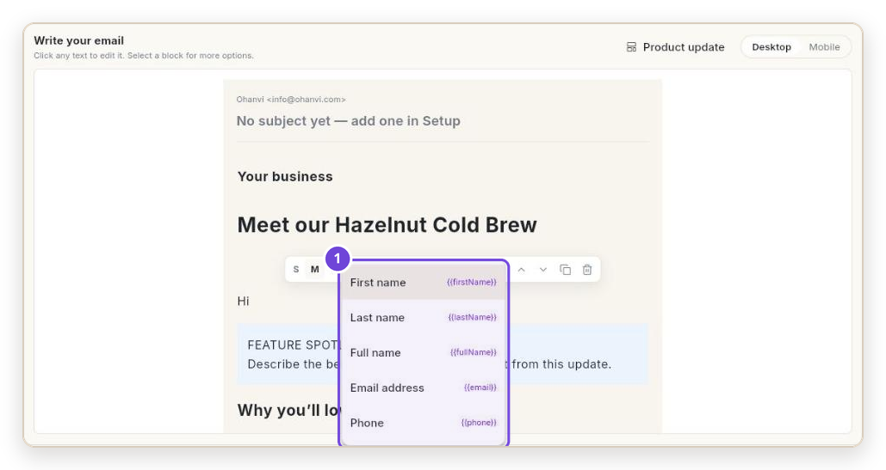{ loading=lazy }

5. बटन बदलने के लिए उस पर क्लिक करें, फिर उसके टूलबार में लिंक आइकन पर क्लिक करें। **Button text** (1) और **Link** (2) लिखें, फिर **Save** पर क्लिक करें।

    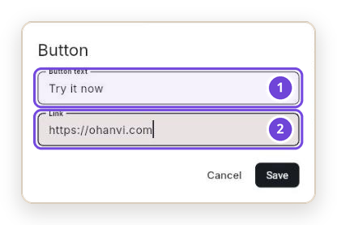{ loading=lazy }

    यह है Bloom & Brew का पूरा ईमेल:

    | ब्लॉक | टेक्स्ट |
    | --- | --- |
    | Heading | `Meet our Hazelnut Cold Brew` |
    | Text | `Hi {{firstName}}, we steeped our single-origin beans for 18 hours and added a hint of roasted hazelnut. The result is smooth, a little sweet, and never bitter.` |
    | Highlight box | `NEW THIS WEEK: Free shipping on your first bottle, until Sunday.` |
    | Heading | `Why you'll love it` |
    | Text | `Half the acidity of hot coffee. No sugar added. Keeps for 10 days in the fridge.` |
    | Button | `Try it now` → `https://bloomandbrew.in/cold-brew` |

6. **Style** पर क्लिक करें। **Logo text fallback** (1) में अपने ब्रांड का नाम लिखें, या अपना लोगो अपलोड करें। अगली बार यही लुक इस्तेमाल करने के लिए **Save as brand style** (2) पर क्लिक करें।

    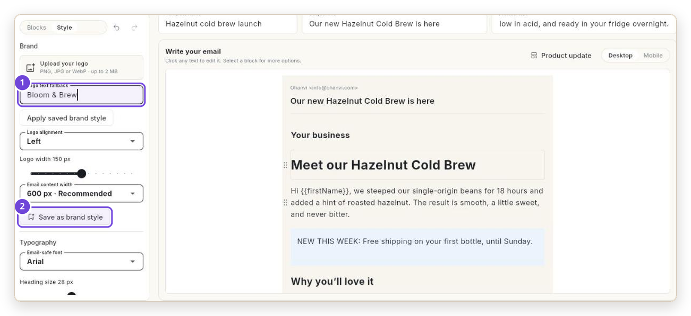{ loading=lazy }

7. ईमेल वैसा देखने के लिए जैसा ज़्यादातर लोग पढ़ेंगे, **Mobile** पर क्लिक करें।

    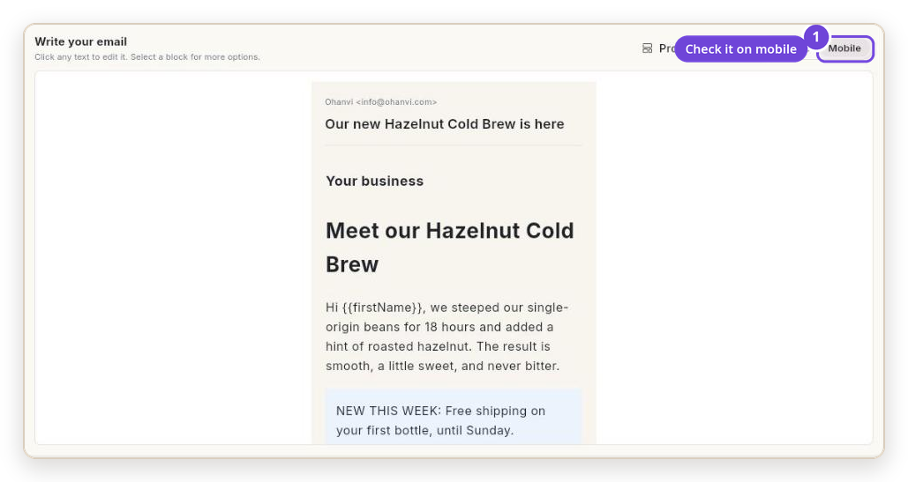{ loading=lazy }

8. **Save template** पर क्लिक करें। आपको **Template saved.** दिखेगा। टेम्प्लेट तुरंत इस्तेमाल के लिए तैयार है। किसी अप्रूवल की ज़रूरत नहीं।

---

## 4. अपना पहला कैंपेन भेजें { #4-send-your-first-campaign }

कैंपेन लोगों के एक ग्रुप को एक बार एक ईमेल भेजता है।

1. Email पैनल में **Campaigns** खोलें और **Create email** पर क्लिक करें।

    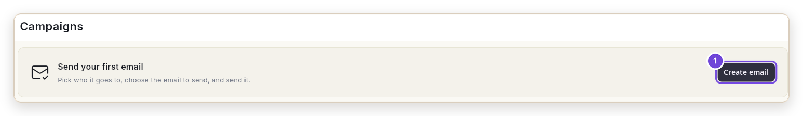{ loading=lazy }

2. **Setup.** **Campaign name** (1), **Subject line** (2) और **Preview text** (3) भरें। **From** (4) में आपका कन्फ़र्म किया हुआ सेंडर पहले से दिखता है। **Continue** (5) पर क्लिक करें।

    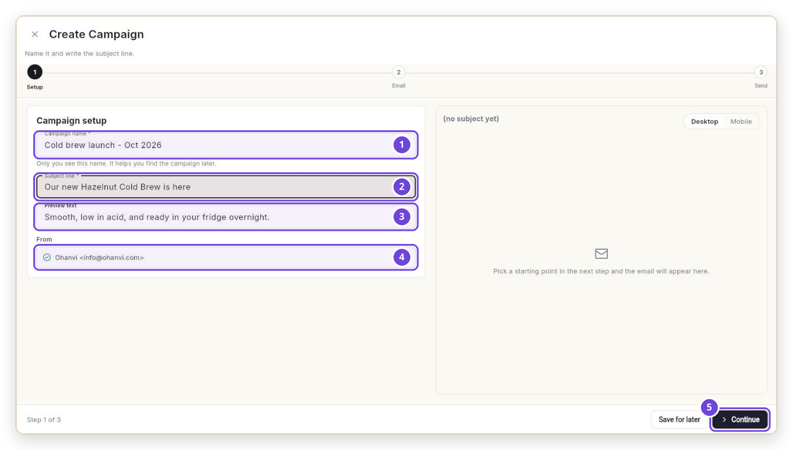{ loading=lazy }

3. **Email.** नीचे **Your templates** तक स्क्रॉल करें और **Hazelnut cold brew launch** पर क्लिक करें। ईमेल खुल जाता है (1)। आप चाहें तो यहाँ इसे सिर्फ़ इस कैंपेन के लिए अब भी बदल सकते हैं। **Continue** (2) पर क्लिक करें।

    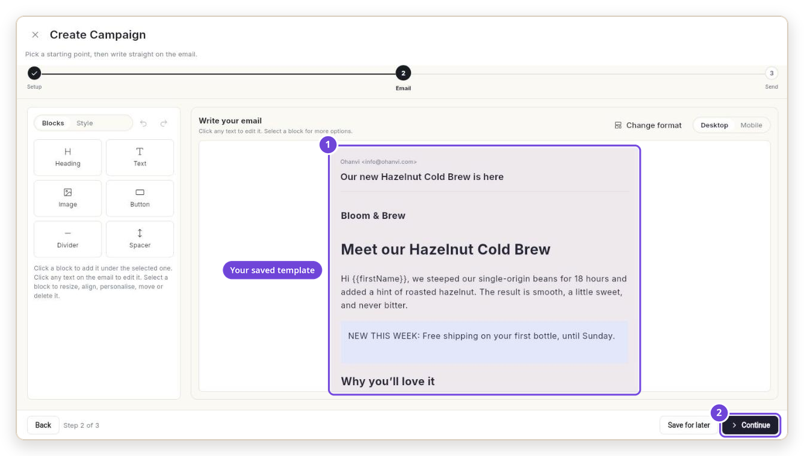{ loading=lazy }

4. **Send.** चुनें कि ईमेल किसे जाएगा (1):
    - **Email addresses**: किसी कॉन्टैक्ट का नाम या पता लिखना शुरू करें (2) और लिस्ट में से उन पर क्लिक करें।
    - **Email group**: कोई सेव की हुई लिस्ट या ग्रुप चुनें।
    - **Upload a file**: `.csv` फ़ाइल जिसमें हर लाइन में एक पता हो। Ohanvi उसे ग्रुप के रूप में सेव कर लेता है।

5. **Save Draft & Send Test** (3) पर क्लिक करें और खुद को टेस्ट ईमेल भेजें। यह सब्जेक्ट में **[TEST]** के साथ पहुँचता है। टेस्ट मुफ़्त हैं।
6. अभी भेजने के लिए **Schedule** (4) खाली छोड़ें, या तारीख और समय चुनें।
7. **Review & send** (5) पर क्लिक करें। **Launch Readiness** लिस्ट जाँचें, फिर **Send email** पर क्लिक करें, और फिर **Send this email?** में दोबारा **Send email** पर क्लिक करें। आपको **Your email is on its way** दिखेगा।

    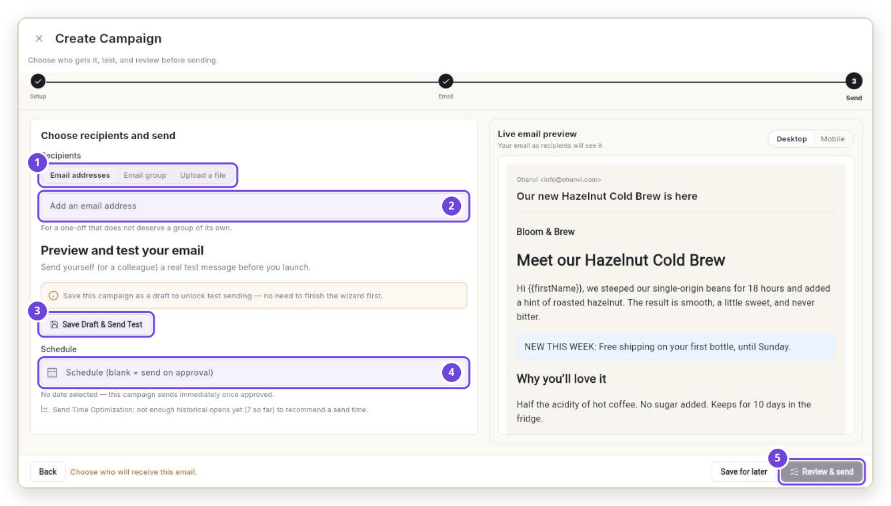{ loading=lazy }

इन लोगों को अपने-आप छोड़ दिया जाता है: जिन्होंने अनसब्सक्राइब किया है, जिनका ईमेल बाउंस हुआ है, जिन्होंने आपको स्पैम मार्क किया है, या जिनका पता जाँच में फ़ेल हुआ है।

---

## 5. देखें किसे मिला { #5-see-who-got-it }

1. **Manage → Send Logs** खोलें।
2. **Campaign** (2) में अपना कैंपेन चुनें। हर लाइन में दिखता है कि ईमेल कब भेजा गया और कब खोला गया (3)। सिर्फ़ **Opened**, **Clicked**, **Bounced** वगैरह देखने के लिए फ़िल्टर (1) इस्तेमाल करें।

    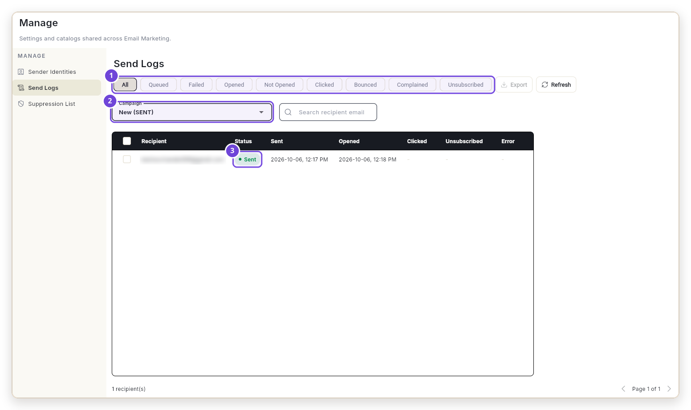{ loading=lazy }

नए ओपन और क्लिक देखने के लिए **Refresh** पर क्लिक करें।

---

## 6. Flow से अपने ईमेल ऑटोमेट करें { #6-automate-your-emails-with-a-flow }

Flow कुछ भी होने पर आपके लिए अपने-आप ईमेल भेजता है। आप इसे एक बार सेट करते हैं, और यह बैकग्राउंड में चलता रहता है।

ये कुछ चीज़ें हैं जिन्हें आप ऑटोमेट कर सकते हैं:

| जब यह हो | Flow यह कर सकता है |
| --- | --- |
| कोई कॉन्टैक्ट ईमेल लिस्ट से जुड़े | वेलकम ईमेल भेजे |
| कोई आपका फ़ॉर्म भरे | थैंक-यू ईमेल भेजे, और उसे किसी लिस्ट में जोड़े |
| कोई आपका ईमेल खोले या उसमें क्लिक करे | फ़ॉलो-अप भेजे, या उसे दिलचस्पी वाला टैग दे |
| किसी कॉन्टैक्ट को टैग मिले | उस ग्रुप के लिए बने ईमेल भेजे |
| शेड्यूल पर, जैसे रोज़ सुबह 9 बजे | रिमाइंडर या रिपोर्ट भेजे |

इनके बीच आप **Wait**, **Wait for email open**, **Tag contact**, **Add to a list** और **Unsubscribe** जैसे स्टेप जोड़ सकते हैं। इस तरह एक Flow ईमेल की पूरी सीरीज़ भेज सकता है।

नीचे हम सबसे आम Flow बनाते हैं: **Newsletter** लिस्ट से जुड़ने वाले हर व्यक्ति के लिए वेलकम ईमेल।

### वेलकम Flow { #the-welcome-flow }

1. Email पैनल में **Flows** खोलें और **New flow** पर क्लिक करें।
2. वेलकम Flow के लिए सिर्फ़ 2 कार्ड चाहिए: जो उसे शुरू करे (1), और जो ईमेल वह भेजे (2)।

    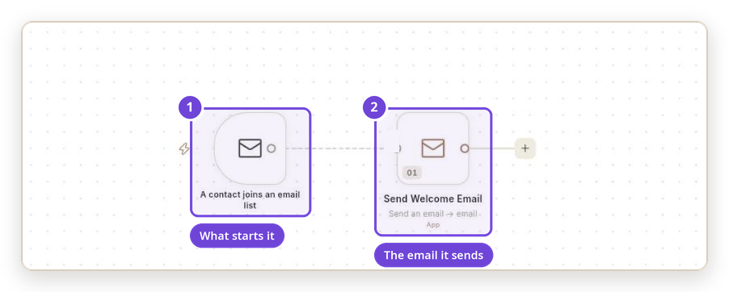{ loading=lazy }

    | # | कार्ड | यह क्या करता है |
    | --- | --- | --- |
    | 1 | **A contact joins an email list** | जैसे ही कोई आपकी लिस्ट में जुड़ता है, Flow शुरू कर देता है। |
    | 2 | **Send an email** | उस व्यक्ति को आपका वेलकम मैसेज ईमेल करता है। |

### 2 बातें जाँचें { #check-2-things }

3. **लिस्ट।** पहले कार्ड पर क्लिक करें। **When this runs** में **Which list** (1) में अपनी लिस्ट चुनें।

    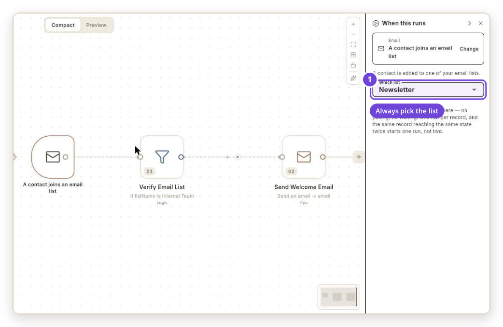{ loading=lazy }

    अगर आप **Which list** खाली छोड़ते हैं, तो Flow **हर** लिस्ट के लिए चलता है।

4. **ईमेल।** ईमेल वाले कार्ड पर क्लिक करें और दायाँ पैनल पढ़ें:

    | # | फ़ील्ड | उसमें क्या लिखा होना चाहिए |
    | --- | --- | --- |
    | 1 | **Their email** | `{{trigger.email}}`, यानी जो व्यक्ति जुड़ा। इसे वैसा ही रहने दें। |
    | 2 | **Kind of email** | **Marketing — subscribed contacts only** |
    | 3 | **Subject** | आपका सब्जेक्ट, जैसे `Welcome to Bloom & Brew` |
    | 4 | **Email** | ईमेल का टेक्स्ट। Flow में नाम `{{trigger.firstName}}` की तरह लिखे जाते हैं। |

    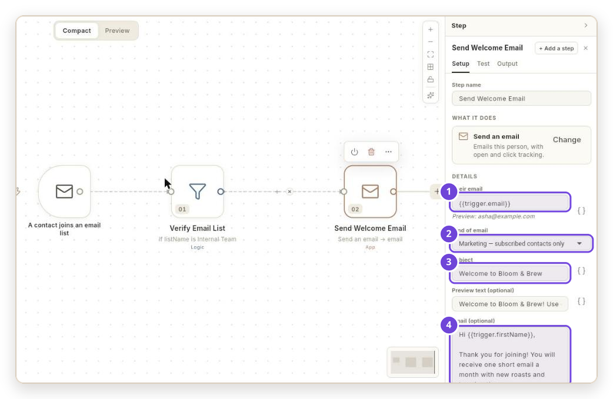{ loading=lazy }

### पब्लिश करें और टेस्ट करें { #publish-and-test }

5. ऊपर Flow का नाम बदलें, जैसे `Newsletter welcome`, और **Save** पर क्लिक करें।
6. **Publish** पर क्लिक करें, फिर विंडो में दोबारा **Publish** पर क्लिक करें। Flow पर **v1 · LIVE** (1) दिखेगा और वह अपने-आप **Active** (2) हो जाएगा।

    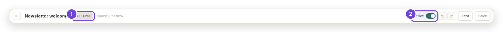{ loading=lazy }

7. **Test** पर क्लिक करें, फिर **Run test** पर क्लिक करें। **Test data for this run** में **Their email** (1) में अपना पता और **First name** (2) में अपना नाम लिखें। **Continue** (3) पर क्लिक करें।

    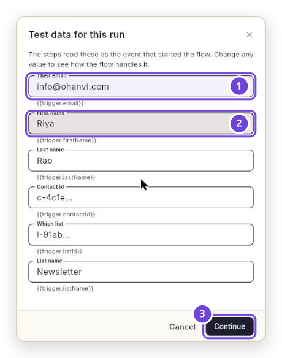{ loading=lazy }

8. टेस्ट का नतीजा दाईं ओर (1) और नीचे **Logs** (2) में दिखता है। **OUTGOING** में `"sent": true` का मतलब है कि ईमेल चला गया।

    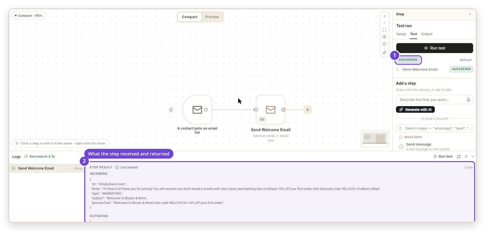{ loading=lazy }

!!! note "टेस्ट असली भेजना है"
    टेस्ट असली ईमेल भेजता है, लेकिन सिर्फ़ ऐसे पते पर जो पहले से सब्सक्राइब किया हुआ और जाँचा हुआ कॉन्टैक्ट हो। हर व्यक्ति को वेलकम ईमेल सिर्फ़ एक बार मिलता है। लिस्ट में दोबारा जुड़ने पर यह फिर नहीं भेजा जाता।

---

## सब कुछ एक साथ कैसे जुड़ता है { #how-it-all-fits-together }

| हिस्सा | यह क्या है | जानने लायक बात |
| --- | --- | --- |
| **Sending address** | From पता। | इसे कोड से कन्फ़र्म करना ज़रूरी है। Flow **Default sender** इस्तेमाल करते हैं। |
| **Contact** | एक व्यक्ति जिसे आप ईमेल कर सकते हैं। | नए पतों को ईमेल भेजने से पहले करीब एक मिनट जाँचा जाता है। |
| **List** | `Newsletter` जैसे नाम वाला ग्रुप। | किसी लिस्ट से जुड़ने पर Flow शुरू हो सकता है। |
| **Template** | सेव किया हुआ ईमेल डिज़ाइन। | सेव होते ही इस्तेमाल के लिए तैयार। |
| **Campaign** | कई लोगों को एक बार भेजा गया एक ईमेल। | अभी भेजा जा सकता है या शेड्यूल किया जा सकता है। |
| **Flow** | कुछ होने पर अपने-आप चलने वाला काम। | **Publish** के बाद ही चलता है, और सिर्फ़ तब तक जब तक **Active** है। |
| **Send Logs** | हर ईमेल का रिकॉर्ड। | भेजे गए, खोले गए, क्लिक किए गए, बाउंस हुए और अनसब्सक्राइब हुए ईमेल दिखाता है। |
| **Wallet** | ईमेल का खर्च चुकाता है। | सिर्फ़ डिलीवर हुए ईमेल का चार्ज लगता है। टेस्ट मुफ़्त हैं। |

हर ईमेल के हेडर में एक-क्लिक अनसब्सक्राइब लिंक होता है, इसलिए Gmail और Yahoo आपके नाम के पास **Unsubscribe** दिखाते हैं। जिन्होंने अनसब्सक्राइब किया है, उन्हें दोबारा कभी ईमेल नहीं भेजा जाता।

---

## समस्या का समाधान { #troubleshooting }

### साइन इन करना और अपना पता कन्फ़र्म करना { #signing-in-and-confirming-your-address }

| आपको क्या दिखता है | कारण | क्या करें |
| --- | --- | --- |
| लेफ़्ट रेल में **Email** नहीं है | आपके रोल को Email Marketing का एक्सेस नहीं है। | अपने एडमिन से कहें कि आपके रोल को एक्सेस दें। |
| कोड वाला ईमेल कभी नहीं आता | वह Spam या Promotions में है, या किसी कंपनी फ़िल्टर ने उसे रोक लिया। | इनबॉक्स में `ohanvi` खोजें। अपनी IT टीम से `info@ohanvi.com` को अनुमति देने को कहें। फिर **Did not get it? Send again** पर क्लिक करें। |
| **That code has expired. Ask for a new one.** | कोड सिर्फ़ 10 मिनट तक चलते हैं। | **Did not get it? Send again** पर क्लिक करें और नया कोड तुरंत इस्तेमाल करें। |
| **That code is not right.** | टाइपिंग की गलती, या पुराना कोड। | सबसे नए ईमेल का कोड इस्तेमाल करें। 5 बार गलत होने पर नया कोड माँगें। |
| आपने **Confirm this address** दबाया, लेकिन पेज पर अब भी **Waiting for you to confirm** लिखा है | क्लिक अभी Ohanvi तक नहीं पहुँचा, या वह किसी पुराने ईमेल से आया था। | **Check now** पर क्लिक करें। फिर भी इंतज़ार दिखे, तो 6 अंकों का कोड लिखें। वह हमेशा काम करता है। |
| **Add Sender Address** ग्रे रहता है | चारों DNS जाँचों में से कोई **In place** नहीं है। | अगला सेक्शन देखें। |

### कोई DNS जाँच "In place" नहीं दिखती { #a-dns-check-isnt-in-place }

चारों जाँचें सिर्फ़ आपके अपने डोमेन पर लागू होती हैं। हर जाँच आपके डोमेन के DNS में एक रिकॉर्ड है। पैनल बताता है कि आपका DNS कहाँ है, जैसे *"Your DNS is at Cloudflare"*।

रिकॉर्ड जोड़ने के लिए:

1. अपना DNS प्रोवाइडर खोलें और साइन इन करें:

    | आपका DNS यहाँ है | रिकॉर्ड कहाँ जोड़ें |
    | --- | --- |
    | Cloudflare | [dash.cloudflare.com](https://dash.cloudflare.com) → your domain → **DNS** → **Records** → **Add record** |
    | GoDaddy | [dcc.godaddy.com/control/portfolio](https://dcc.godaddy.com/control/portfolio) → your domain → **DNS** |
    | Hostinger | [hpanel.hostinger.com/domains](https://hpanel.hostinger.com/domains) → **Manage** → **DNS / Nameservers** |
    | Namecheap | [ap.www.namecheap.com/domains/list](https://ap.www.namecheap.com/domains/list) → **Manage** → **Advanced DNS** |
    | Amazon Route 53 | [console.aws.amazon.com/route53/v2/hostedzones](https://console.aws.amazon.com/route53/v2/hostedzones) |

2. Ohanvi से **Type**, **Name** और **Value** कॉपी आइकन से कॉपी करें, और रिकॉर्ड जोड़ें।
3. वापस आएँ और **Check again** पर क्लिक करें। ज़्यादातर बदलाव 15 मिनट में दिख जाते हैं।

| जाँच | स्टेटस | समाधान |
| --- | --- | --- |
| **Mail server** | **Missing** | डोमेन ईमेल नहीं पा सकता। ऐसा पता इस्तेमाल करें जिस पर पहले से ईमेल आते हैं। |
| **SPF** | **Missing** | **TXT** रिकॉर्ड जोड़ें, Name `@`। Google Workspace: `v=spf1 include:_spf.google.com ~all`। Microsoft 365: `v=spf1 include:spf.protection.outlook.com -all`। Zoho: `v=spf1 include:zoho.com ~all`। |
| **SPF** | **Needs a look** | आपके पास 2 SPF रिकॉर्ड हैं। उन्हें 1 में मिलाएँ: एक `v=spf1` रखें, हर `include:` उसी में डालें, और अंत में एक `~all` रखें। |
| **DKIM** | **Missing** | अपने मेल प्रोवाइडर में DKIM चालू करें। Google: [admin.google.com → Gmail → Authenticate email](https://admin.google.com/ac/apps/gmail/authenticateemail)। Microsoft: [security.microsoft.com → DKIM](https://security.microsoft.com/authentication?viewid=DKIM), फिर वहाँ दिखने वाले दोनों CNAME रिकॉर्ड जोड़ें। |
| **DKIM** | **Cannot tell** | आपका प्रोवाइडर अपना DKIM रिकॉर्ड छिपाता है। यह ठीक है। इससे आप रुकते नहीं। |
| **DMARC** | **Missing** | **TXT** रिकॉर्ड जोड़ें, Name `_dmarc`, Value `v=DMARC1; p=none; rua=mailto:you@yourdomain.com`। |

!!! tip "Gmail, Yahoo या Outlook इस्तेमाल कर रहे हैं?"
    मुफ़्त पतों पर ये चारों जाँचें नहीं होतीं। आपके ईमेल आपके नाम के साथ Ohanvi के पते से जाते हैं, और जवाब फिर भी आपके पास आते हैं। अपना पता दिखाने के लिए अपने डोमेन का पता इस्तेमाल करें।

### कॉन्टैक्ट { #contacts }

| आपको क्या दिखता है | कारण | क्या करें |
| --- | --- | --- |
| रिसीवर जोड़ते समय **No contact matches that.** | **Email addresses** बॉक्स सिर्फ़ सेव किए हुए कॉन्टैक्ट खोजता है। | पहले उस व्यक्ति को **Contacts** में जोड़ें, एक मिनट रुकें, फिर दोबारा खोजें। या **Upload a file** इस्तेमाल करें। |
| **1 email is hidden until confirmed to exist** | नए पतों को ईमेल भेजने से पहले जाँचा जाता है। | करीब 1 मिनट रुकें और रीफ़्रेश करें। |
| कोई कॉन्टैक्ट **waiting on their trial email** के साथ छिपा रहता है | Ohanvi पते की पुष्टि नहीं कर सका, इसलिए उसने 1 ट्रायल ईमेल भेजा और देख रहा है कि वह डिलीवर होता है या नहीं। | ट्रायल ईमेल के डिलीवर होने का इंतज़ार करें। अगर वह बाउंस हो जाए, तो पता सप्रेस हो जाता है। स्पेलिंग जाँचें। |
| लिस्ट में सदस्य बताए जाते हैं, लेकिन **Add or remove contacts** में कोई नहीं दिखता | उन सदस्यों ने अभी पते की जाँच पास नहीं की है। | थोड़ा रुकें, फिर लिस्ट दोबारा खोलें। |
| **Create New List…** के बाद **Create List failed** | लिस्ट आमतौर पर फिर भी बन जाती है। | लिस्ट चुनने वाला दोबारा खोलें। अगर आपकी लिस्ट वहाँ है, तो उसे चुनें। |

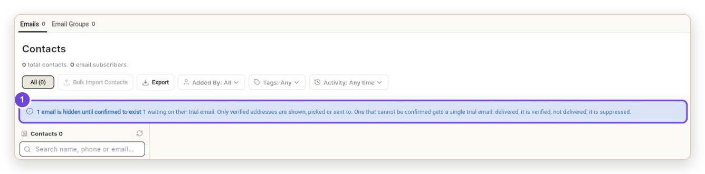{ loading=lazy }

### टेम्प्लेट { #templates }

| आपको क्या दिखता है | कारण | क्या करें |
| --- | --- | --- |
| **Save template** ग्रे है | कोई ज़रूरी चीज़ खाली है। | उसके पास की लाइन पढ़ें, जैसे **Give this template a name so you can find it later.** |
| बिना नाम के *Hi ,* | कॉन्टैक्ट का पहला नाम सेव नहीं है। | अपने कॉन्टैक्ट में पहले नाम जोड़ें, या बिना नाम वाला अभिवादन लिखें। |
| **Full name** खाली आता है | ईमेल के लिए अभी भरा नहीं गया है। | इसकी जगह **First name** और **Last name** इस्तेमाल करें। |
| `{{firstname}}` खाली आता है | मर्ज फ़ील्ड में अक्षर ठीक वैसे ही कैपिटल होने चाहिए। | `{{firstName}}` लिखें। |

### कैंपेन { #campaigns }

| आपको क्या दिखता है | कारण | क्या करें |
| --- | --- | --- |
| **Continue** या **Review & send** ग्रे है | कोई ज़रूरी फ़ील्ड खाली है। | फ़ुटर की लाइन पढ़ें, जैसे **Write a subject line.** |
| **Your wallet balance is empty.** | वॉलेट ₹0 पर है। | **Billing** में पैसे जोड़ें। इसके लिए [क्रेडिट और बिलिंग](../credits-and-billing.md) देखें। |
| **Send email** पर परमिशन की एरर | आपका रोल कैंपेन बना सकता है, भेज नहीं सकता। | किसी एडमिन से इसे भेजने को कहें, या अपने रोल को भेजने की अनुमति देने को कहें। |
| किसी व्यक्ति को छोड़ दिया गया | उन्होंने अनसब्सक्राइब किया, उनका ईमेल बाउंस हुआ, या उनका पता अब भी जाँचा जा रहा है। | **Send Logs** में उनकी लाइन देखें। |

### Flow { #flows }

| आपको क्या दिखता है | कारण | क्या करें |
| --- | --- | --- |
| टेस्ट स्टेप **FAILED** और **Validation failed** | कोई डिफ़ॉल्ट सेंडर सेट नहीं है। | **Manage → Sender Identities** पर जाएँ, क्राउन आइकन पर क्लिक करें, फिर **Set as Default** पर। टेस्ट दोबारा चलाएँ। |
| **OUTGOING** में `"skipped": "UNVERIFIED"` दिखता है | टेस्ट वाले पते ने अभी पते की जाँच पास नहीं की है। | जाँच पूरी होने तक रुकें, या ऐसे कॉन्टैक्ट से टेस्ट करें जो पहले से वेरिफ़ाई है। |
| पब्लिश करते समय *"'subject' refers to 'firstName'…"* | Flow में नामों के आगे `trigger.` लगाना पड़ता है। | `{{firstName}}` को `{{trigger.firstName}}` कर दें। |
| वेलकम ईमेल दूसरी लिस्ट के लोगों को जा रहा है | **Which list** खाली है। | पहले कार्ड पर क्लिक करें और लिस्ट चुनें। |
| Flow कभी ईमेल नहीं भेजता | वह पब्लिश नहीं है, या स्विच बंद है। | **Publish** पर क्लिक करें, और जाँचें कि हेडर में **LIVE** और **Active** दिख रहा है। |

### नतीजे { #results }

| आपको क्या दिखता है | कारण | क्या करें |
| --- | --- | --- |
| उम्मीद से ज़्यादा ओपन | Apple Mail और कुछ Gmail सेटअप ईमेल खुद ही खोल देते हैं। | **Opened** से ज़्यादा भरोसा **Clicked** पर करें। |
| **Not Opened** में वे लोग भी हैं जिन्हें अभी ईमेल भेजा नहीं गया | वह फ़िल्टर हर उस व्यक्ति को दिखाता है जिसने ईमेल नहीं खोला। | किन्हें ईमेल नहीं भेजा गया, यह देखने के लिए **Queued** और **Failed** इस्तेमाल करें। |
| नए ओपन नहीं दिखते | Send Logs अपने-आप रीफ़्रेश नहीं होता। | **Refresh** पर क्लिक करें। |

## संबंधित गाइड { #related }

- [भेजने वाले का पता सेट करें और अपना डोमेन वेरिफ़ाई करें](set-up-sender-identity.md)
- [ईमेल कॉन्टैक्ट, लिस्ट और सेगमेंट जोड़ें](manage-email-contacts.md)
- [ईमेल टेम्प्लेट बनाएँ](create-email-template.md)
- [ईमेल कैंपेन भेजें](send-email-campaign.md)
- [भेजने के लॉग पढ़ें](read-send-logs.md)
