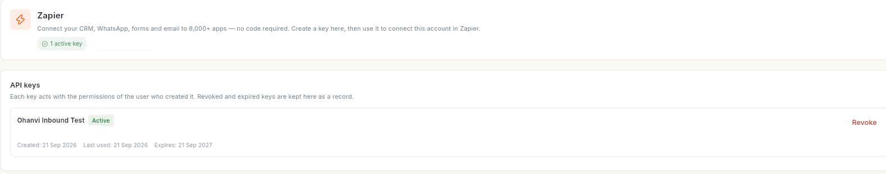

# ऑटोमेशन फ़्लो बनाएँ { #build-an-automation-flow }

ऐसा फ़्लो बनाएँ जो कुछ होने पर, शेड्यूल के हिसाब से, या आपके शुरू करने पर अपने आप चले। आखिर में आपके पास एक पब्लिश किया हुआ ऑटोमेशन होता है, जिसमें ट्रिगर है, ट्रिगर के डेटा का इस्तेमाल करने वाले चरण हैं, और एक लाइव वर्शन है जो असली इवेंट पर चलता है।

## शुरू करने से पहले { #before-you-start }

- आप **Flows** खोल सकते हैं और **New flow** देख सकते हैं। देखें [फ़्लो और फ़्लो की सूची को समझें](flows-overview-and-list.md)।
- फ़्लो जिस भी चीज़ का इस्तेमाल करता है, वह पहले कनेक्ट हो: आपका व्हाट्सऐप नंबर, आपका स्टोर, Google अकाउंट या कोई कनेक्टर ऐप। देखें [कोई ऐप कनेक्ट करें और फ़्लो में इस्तेमाल करें](connect-apps-for-flows.md)।
- फ़्लो जो व्हाट्सऐप टेम्प्लेट भेजता है, वे Meta से Approved हों। उन्हें **WhatsApp** → **Template** में जाँचें।
- ग्राहक से बात करने वाले व्हाट्सऐप चैटबॉट के लिए इसके बजाय [व्हाट्सऐप चैटबॉट फ़्लो बनाएँ](../create-whatsapp-flow.md) फ़ॉलो करें।

## ट्रिगर जो आप चुन सकते हैं { #triggers-you-can-choose }

**When this runs** पैनल में 6 ट्रिगर मिलते हैं:

| ट्रिगर | फ़्लो तब शुरू होता है जब |
| --- | --- |
| **When something happens here** | Ohanvi में कोई इवेंट होता है, जैसे स्टोर ऑर्डर, फ़ॉर्म, टैग। इसे **Which event** में चुनें। |
| **Run by hand** | आप सूची या बिल्डर में **Run test** पर क्लिक करते हैं। |
| **When a record appears** | किसी कनेक्टर ऐप में नया रिकॉर्ड आता है। Ohanvi टाइमर पर ऐप की जाँच करता है। |
| **When a webhook arrives** | कोई कनेक्टर ऐप Ohanvi को वेबहुक भेजता है। |
| **When Zapier/Pabbly sends data** | कोई Zap या Pabbly वर्कफ़्लो इस फ़्लो को कॉल करता है। |
| **On a schedule** | आपका तय किया हुआ समय आता है, जैसे हर दिन 09:00 बजे। |

**Which event** में ये इवेंट शामिल हैं:

- **A form is submitted**, **A Google Form gets a new response**, **A contact is added in Google Contacts**
- **A WhatsApp conversation finishes**
- **A contact joins an email list**, **A contact is tagged**
- **Someone becomes a customer of the store**, **A new store order is placed**, **A shopper leaves a checkout unfinished**, **An order payment fails**, **An order ships**, **A parcel is out for delivery**, **A parcel is delivered**, **A shopper looks at a product on the storefront**, **An order is cancelled**, **A refund is issued**
- **A post is ready to publish**, **A post is created as a draft**, **A post finished publishing**, **A new comment arrives on a published post**

## चरण { #steps }

### फ़्लो बनाएँ और ट्रिगर चुनें { #create-the-flow-and-choose-a-trigger }

1. लेफ़्ट रेल में **WhatsApp** खोलें, फिर **Flows** चुनें।
2. **New flow** पर क्लिक करें। एक प्लेसहोल्डर नाम के साथ खाली कैनवास खुलता है।
3. टूलबार में नाम पर क्लिक करें और नया नाम लिखें, जैसे `Order follow-up`।
4. **Add first step…** पर क्लिक करें। **How does this flow start?** मेन्यू खुलता है।
5. शुरुआत का तरीका चुनें:
    - इन इवेंट के लिए **Form submitted**, **Google Form response** या **New Google contact**।
    - जब कोई लिस्ट में जुड़े या उसे टैग मिले, तब **Email journey**।
    - किसी भी दूसरे ट्रिगर के लिए **Run by hand**। इसे आप अगले चरण में बदलते हैं।
    - पूरे उदाहरण वाले फ़्लो के लिए **Start from a recipe**।

    दाईं ओर **When this runs** पैनल खुलता है।

6. पैनल के ऊपर का ड्रॉप-डाउन खोलें और ट्रिगर चुनें। ऊपर की तालिका देखें।
7. ट्रिगर जो फ़ील्ड दिखाता है, उन्हें भरें:
    - **When something happens here**: **Which event** चुनें। **A contact joins an email list** के लिए **Which list** भी चुनें। **A contact is tagged** के लिए **Which tag** लिखें।
    - **On a schedule**: **Runs every day at** के बगल में समय पर क्लिक करें, फिर **Timezone** चुनें। दूसरे पैटर्न के लिए 6 फ़ील्ड वाला **Cron expression (advanced)** लिखें।
    - **When a record appears**: **Trigger operation** और **Connection** चुनें।
    - **When a webhook arrives**: **Connection** में कनेक्शन की id लिखें। देखें [कोई ऐप कनेक्ट करें और फ़्लो में इस्तेमाल करें](connect-apps-for-flows.md)।
    - **When Zapier/Pabbly sends data**: नीचे "Zapier या Pabbly से फ़्लो शुरू करें" देखें।

ट्रिगर को बाद में बदलने के लिए कैनवास की शुरुआत में ट्रिगर नोड पर क्लिक करें।

### चरण जोड़ें { #add-steps }

1. ट्रिगर के बाद या किसी भी चरण के बाद **+** पर क्लिक करें। **Add a step after** मेन्यू खुलता है।
2. **COMMON** के नीचे से कोई चरण चुनें, या हर समूह देखने के लिए **All steps** पर क्लिक करें। आप **Search** में भी लिख सकते हैं।
3. नए चरण पर क्लिक करें। उसकी सेटिंग्स दाईं ओर **Step** पैनल में, **Setup** टैब पर खुलती हैं।
4. उसकी फ़ील्ड भरें। हर चरण के लिए यही दोहराएँ।

ऑटोमेशन के लिए ये चरण काम के हैं:

| चरण | कहाँ मिलेगा | यह क्या करता है |
| --- | --- | --- |
| **Wait** | **COMMON** | फ़्लो को रोकता है। **Wait for** को मिनट, घंटे या दिन में सेट करें। |
| **Save to CRM** | **COMMON** | CRM में संपर्क बनाता या अपडेट करता है। |
| **Action** | **All steps** → **Advanced** | एक एक्शन चलाता है। **This step will** में चुनें, जैसे **Send a WhatsApp template**, **Send a WhatsApp message**, **Create a CRM lead**, **Enrol in an email journey**, **Post to social**, Google Sheets या Calendar का एक्शन, या कनेक्टर ऑपरेशन। |
| **Continue only if…** | **All steps** → **Advanced** | कंडीशन पूरी न होने पर रन रोक देता है। |
| **Many paths by rule** | **All steps** → **Advanced** | रन को उस पहले रास्ते पर भेजता है जिसकी कंडीशन मेल खाती है। |
| **For each** | **All steps** → **Advanced** | सूची के हर आइटम के लिए अगले चरण दोहराता है। |
| **Sub-flow** | **All steps** → **Advanced** | दूसरा फ़्लो चलाता है, फिर आगे बढ़ता है। |
| **Parallel** और **Join** | **All steps** → **Advanced** | कई रास्ते एक साथ चलाता है, फिर सबके पूरे होने का इंतज़ार करता है। |
| Google Sheets, Calendar, Meet और Contacts के चरण | **All steps** | जैसे **Add a row** या **Create event**। |

**Send a WhatsApp message** सिर्फ़ उन्हीं लोगों तक पहुँचता है जिन्होंने पिछले 24 घंटों में आपको मैसेज किया है। बाकी किसी तक पहुँचने के लिए **Send a WhatsApp template** इस्तेमाल करें।

### कंडीशन जोड़ें { #add-a-condition }

1. **Continue only if…** चरण जोड़ें।
2. **Only continue if** के नीचे **Add condition** पर क्लिक करें।
3. **Field**, तुलना (जैसे **is**, **contains**, **is empty**) और **Value** चुनें।
4. ज़रूरत हो तो और कंडीशन जोड़ें। **Continue when** को **all match** या **any match** पर सेट करें।

जो रन इस चरण पर रुकता है, वह **Filtered** के रूप में खत्म होता है। यह सामान्य नतीजा है, फ़ेल होना नहीं।

कई रास्तों के लिए **Many paths by rule** इस्तेमाल करें। **Add two paths** पर क्लिक करें, हर रास्ते का नियम सेट करें, और **If nothing matches, take** चुनें।

### ट्रिगर या पिछले चरण का डेटा इस्तेमाल करें { #use-data-from-the-trigger-or-an-earlier-step }

1. चरण चुनें और किसी फ़ील्ड में क्लिक करें, जैसे **Send to**।
2. उसके बगल में फ़ील्ड आइकन पर क्लिक करें (टूलटिप **Use a field from the trigger or an earlier step**)।
3. कोई फ़ील्ड चुनें, जैसे ग्राहक का फ़ोन। Ohanvi उसे एक्सप्रेशन के रूप में डाल देता है।

एक्सप्रेशन में दोहरे कर्ली ब्रैकेट होते हैं:

- `{{trigger.phone}}`: फ़्लो शुरू करने वाले इवेंट का एक फ़ील्ड।
- `{{2.meetLink}}`: चरण 2 के आउटपुट का एक फ़ील्ड।

आप एक्सप्रेशन को टेक्स्ट के साथ मिला सकते हैं, जैसे `Hi {{trigger.firstName}}, your order is on its way.` कोई चरण सिर्फ़ अपने से पहले चलने वाले चरणों का इस्तेमाल कर सकता है।

### Zapier या Pabbly से फ़्लो शुरू करें { #start-the-flow-from-zapier-or-pabbly }

1. पहले **Save** पर क्लिक करें। एंडपॉइंट सेव किए हुए फ़्लो के लिए बनता है।
2. ट्रिगर नोड पर क्लिक करें और **When Zapier/Pabbly sends data** चुनें।
3. **Which platform sends the data** में **Zapier** या **Pabbly Connect** चुनें, फिर **Create endpoint** पर क्लिक करें।
4. **URL (POST)**, **Header X-Api-Key** और **Body (JSON)** को अपने Zap या Pabbly वर्कफ़्लो में कॉपी करें।
5. Zapier या Pabbly से टेस्ट भेजें। उसकी फ़ील्ड **Sample** के नीचे दिखती हैं, जो आपके चरणों में इस्तेमाल के लिए तैयार हैं।
6. वैकल्पिक: **Field that identifies one event (optional)** में `order.id` जैसी फ़ील्ड लिखें। एक ही मान दो बार आने पर फ़्लो एक ही बार शुरू होता है।

API key **Connect** → **Zapier** या **Connect** → **Pabbly** से मिलती है। वहाँ **API keys** हर key को उसके स्टेटस के साथ दिखाता है, और ऊपर दाईं ओर **Create key** नई key बनाता है। हर key उसी यूज़र की अनुमतियों से काम करती है जिसने उसे बनाया है।

### सेव और पब्लिश करें { #save-and-publish }

1. **Save** पर क्लिक करें। टूलबार में **Saved just now** दिखता है। वर्शन चिप पर **DRAFT** लिखा होता है, और उसके आगे वर्शन नंबर होता है, जैसे **v1 · DRAFT**।
2. ऊपरी बार में **Publish** पर क्लिक करें।
3. अगर कुछ चरण अधूरे हैं, तो एक विंडो उन्हें गिनाती है। वापस जाने के लिए **Fix the steps** पर क्लिक करें, या **Publish without them** चुनें।
4. संदेश पढ़ें। **Published and live — new runs use this version.** का मतलब है कि फ़्लो चल रहा है। टूलबार का स्विच **Active** दिखाता है।
5. अगर संदेश **Published. This flow is turned off, so it will not run yet.** है, तो **Turn on** पर क्लिक करें।

पब्लिश होने से रोकने वाला चरण कैनवास पर चिह्नित होता है। वजह पढ़ने के लिए उसे चुनें।

!!! warning "पब्लिश किया हुआ फ़्लो असली डेटा पर काम करता है"
    अब से हर मेल खाता इवेंट एक रन शुरू करता है। उसके भेजे मैसेज वापस नहीं लिए जा सकते। पहले छोटी ऑडियंस पर टेस्ट करें।

### पब्लिश किया हुआ फ़्लो बदलें { #change-a-published-flow }

1. फ़्लो खोलें और उसे एडिट करें। सेव करने के बाद वर्शन चिप पर **LIVE · NOT PUBLISHED** लिखा होता है।
2. **Publish** पर क्लिक करें। नए रन नए वर्शन का इस्तेमाल करते हैं। जो रन पहले से चल रहे हैं, वे उसी वर्शन पर पूरे होते हैं जिस पर शुरू हुए थे।
3. पुराने वर्शन पर वापस जाने के लिए वर्शन चिप पर क्लिक करें, पंक्ति का **More** मेन्यू खोलें और **Make this live** पर क्लिक करें।

## AI से बनाएँ { #build-with-ai }

1. खाली कैनवास पर **Build with AI** पर क्लिक करें। चैट पैनल खुलता है।
2. **Ask anything…** में फ़्लो का वर्णन लिखकर भेजें, जैसे `When a new store order is placed, wait 1 hour, then send my order follow-up template`।
3. कैनवास पर बने चरणों की समीक्षा करें, जो छूटा हो उसे ठीक करें, फिर **Save** और **Publish** पर क्लिक करें।

## वीडियो वॉकथ्रू { #video-walkthrough }

[VIDEO]

## समस्या का समाधान { #troubleshooting }

| समस्या | कारण | समाधान |
| --- | --- | --- |
| **Which event** खाली है और **The list of triggers could not be loaded…** दिखता है | इवेंट की सूची लोड नहीं हुई। | फ़्लो बंद करके दोबारा खोलें। |
| **Could not publish — the step that needs fixing is marked on the canvas.** | किसी चरण में मान नहीं है, जैसे **'to' has no value. Fill it in, or remove it.** | चिह्नित चरण चुनें, फ़ील्ड भरें, सेव और पब्लिश करें। |
| **'text' refers to step 3, which runs after this one.** | कोई फ़ील्ड ऐसे चरण का इस्तेमाल करती है जो अभी चला नहीं है। | पहले के किसी चरण की फ़ील्ड चुनें। |
| **A scheduled flow needs a cron expression.** | **On a schedule** में कोई समय सेट नहीं है। | **Runs every day at** के बगल में समय पर क्लिक करें, या cron एक्सप्रेशन लिखें। |
| **An event flow needs the event it listens for.** | **When something happens here** में कोई इवेंट नहीं है। | **Which event** चुनें। |
| शेड्यूल किया हुआ फ़्लो कभी नहीं चलता | शेड्यूल तभी चलते हैं जब आपके वर्कस्पेस के लिए शेड्यूल स्कैनर चालू हो। | अपने एडमिन या सपोर्ट से इसे जाँचने को कहें। |

## संबंधित गाइड { #related }

- [फ़्लो और फ़्लो की सूची को समझें](flows-overview-and-list.md)
- [कोई ऐप कनेक्ट करें और फ़्लो में इस्तेमाल करें](connect-apps-for-flows.md)
- [फ़्लो से स्टोर के संदेश ऑटोमेट करें](store-journeys.md)
- [फ़्लो टेस्ट करें और फ़ेल रन ठीक करें](test-and-monitor-flows.md)
- [व्हाट्सऐप चैटबॉट फ़्लो बनाएँ](../create-whatsapp-flow.md)
