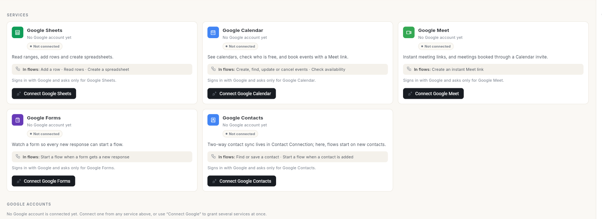
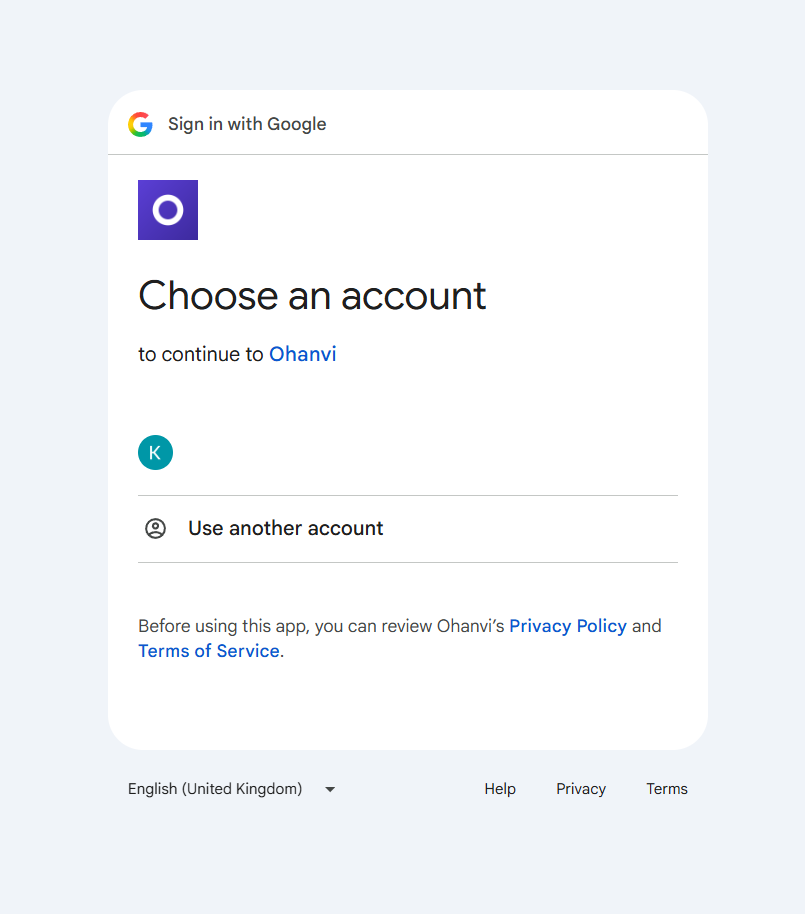

# कोई ऐप कनेक्ट करें और उसे फ़्लो में इस्तेमाल करें { #connect-an-app-and-use-it-in-a-flow }

कनेक्टर कैटलॉग से कोई बाहरी ऐप कनेक्ट करें, जैसे स्टोर या CRM, और उसे अपने फ़्लो में इस्तेमाल करें। इस गाइड के आख़िर में आपके पास एक टेस्ट किया हुआ कनेक्शन होगा। साथ ही एक फ़्लो स्टेप होगा, जो उसी कनेक्शन से लॉगिन करके ऐप का कोई ऑपरेशन चलाता है।

## शुरू करने से पहले { #before-you-start }

- **Connect** पैनल में आपको **Connectors** दिखना चाहिए। यह स्क्रीन डिफ़ॉल्ट रूप से सिर्फ़ एडमिन के लिए है। न दिखे, तो अपने एडमिन से पूछें।
- आपके पास ऐप के क्रेडेंशियल हों, जैसे API key। या फिर आप ऐप में साइन इन करके एक्सेस की मंज़ूरी दे सकते हों।
- ऐप कैटलॉग की लिस्ट में हो। Ohanvi में पहले से बने ऐप, जैसे आपका स्टोर, WhatsApp और Google Workspace, अपनी-अपनी स्क्रीन से कनेक्ट होते हैं। इनके लिए कैटलॉग नहीं चाहिए। Google ऐप के लिए नीचे "Google ऐप कनेक्ट करें" देखें।

## कनेक्टर कैसे काम करते हैं { #how-connectors-work }

- **कनेक्टर** (कैटलॉग में दिखने वाला ऐप) बताता है कि कोई बाहरी ऐप क्या-क्या कर सकता है। ये काम **ऑपरेशन** कहलाते हैं, जैसे "ग्राहक खोजें" या "ऑर्डर बनाएँ"।
- **कनेक्शन** में उस ऐप के लिए आपके अकाउंट के क्रेडेंशियल रहते हैं। क्रेडेंशियल एन्क्रिप्ट करके रखे जाते हैं।
- फ़्लो स्टेप में आप एक ऑपरेशन चुनते हैं, और वह कनेक्शन भी जिससे वह साइन इन करेगा। पब्लिश किए हुए फ़्लो उसी ऑपरेशन वर्शन पर रहते हैं जिस पर उन्हें बनाया गया था। इसलिए कैटलॉग में बदलाव होने पर भी वे नहीं बदलते।

## स्टेप { #steps }

### Google ऐप कनेक्ट करें { #connect-a-google-app }

Google Sheets, Google Calendar, Google Meet, Google Forms और Google Contacts Ohanvi में पहले से बने हैं। इसलिए ये कनेक्टर कैटलॉग से नहीं जुड़ते।

1. लेफ़्ट रेल में **Connect** खोलें, फिर **Connectors** के नीचे **Google Workspace** चुनें।
2. हर कार्ड पढ़ें। **In flows** बताता है कि वह ऐप फ़्लो में क्या कर सकता है, जैसे Google Sheets के लिए **Add a row · Read rows · Create a spreadsheet**। साइन इन करने तक कार्ड पर **Not connected** दिखता है।

    

3. जो ऐप चाहिए, उसके कार्ड का बटन दबाएँ, जैसे **Connect Google Sheets**। **Sign in with Google** विंडो खुलती है।
4. अपना Google अकाउंट चुनें और एक्सेस की अनुमति दें। हर ऐप सिर्फ़ अपने लिए एक्सेस माँगता है।

    

इसके बाद जुड़ा हुआ अकाउंट **Google accounts** के नीचे दिखता है। कई ऐप को एक साथ एक्सेस देना हो, तो **Connect Google** इस्तेमाल करें।

Ohanvi सिर्फ़ वही स्प्रेडशीट और फ़ॉर्म खोलता है जो आप उसके लिए **Choose from Google Drive** से चुनते हैं। इसके अलावा वे स्प्रेडशीट, जो वह ख़ुद बनाता है। डिस्कनेक्ट करने समेत सारे विकल्प देखने के लिए पढ़ें [Google Workspace कनेक्ट करें](../settings/connect-google-workspace.md)।

### कनेक्टर कैटलॉग खोलें { #open-the-connector-catalog }

1. लेफ़्ट रेल में **Connect** खोलें, फिर **Connectors** के नीचे **Connectors** चुनें। **Connectors** स्क्रीन खुलती है।
2. **Search connectors** में टाइप करें। या लाइफ़साइकल (**Published**, **Draft**, **Deprecated**) और स्कोप (**Shared catalog**, **Private connector**) से फ़िल्टर करें।
3. ऐप के कार्ड पर **Manage** पर क्लिक करें। ऐप खुलता है, जिसमें **Overview**, **Operations** और **Connections** टैब होते हैं। ऐप में वेबहुक हों, तो **Webhooks** टैब भी होता है।

### कनेक्शन जोड़ें { #add-a-connection }

1. **Connections** टैब खोलें।
2. **Add connection** पर क्लिक करें। ऐप के नाम के साथ **Connect** विंडो खुलती है।
3. **Label** में ऐसा नाम लिखें जिससे इस अकाउंट की पहचान हो जाए, जैसे `Main store`। एक ऐप के लिए हर लेबल अलग होना चाहिए।
4. ऐप जो भी फ़ील्ड माँगे, उन्हें भरें, जैसे शॉप का पता। ज़रूरी फ़ील्ड पर निशान लगा होता है।
5. **Credentials (JSON)** में key उसी फ़ॉर्मैट में पेस्ट करें जो वहाँ दिखाया गया है, जैसे `{"apiKey": "…"}`। जो ऐप OAuth से साइन इन करते हैं, उनके लिए इसे खाली छोड़ें।
6. **Who can build on this** में **Only me**, **Everyone in this organisation** या **A specific role** चुनें। रोल चुना हो, तो उसका नाम **Role** में लिखें।
7. **Connect** पर क्लिक करें। **Connection saved.** मैसेज आता है और कनेक्शन लिस्ट में दिखने लगता है।

### OAuth ऐप में साइन इन करें { #sign-in-to-an-oauth-app }

1. कनेक्शन की रो में **Connect account** पर क्लिक करें। ऐप की मंज़ूरी वाली स्क्रीन नई विंडो में खुलती है।
2. ऐप में साइन इन करें और वहीं एक्सेस की मंज़ूरी दें।
3. Ohanvi पर वापस आएँ। **Approve in the other window** मैसेज में **Done** पर क्लिक करें।
4. आने वाला मैसेज देखें। **Connected.** का मतलब है कि ऐप ने अपना टोकन भेज दिया है।

मंज़ूरी का लिंक 15 मिनट बाद ख़त्म हो जाता है। लिंक ख़त्म हो जाए, तो **Connect account** पर दोबारा क्लिक करें।

### कनेक्शन टेस्ट करें { #test-the-connection }

1. कनेक्शन की रो में **Test connection** पर क्लिक करें।
2. आने वाला मैसेज पढ़ें। **Looks good.** का मतलब है कि ऐप ने क्रेडेंशियल मान लिए हैं। रो में समय के साथ **Last tested** दिखता है।

किसी एक ऑपरेशन को असल में चलाकर देखना हो, तो **Operations** टैब खोलें और उस ऑपरेशन के प्ले आइकन (टूलटिप **Test run**) पर क्लिक करें। कोई **Connection** चुनें, **Input (JSON)** लिखें और **Run** पर क्लिक करें। **Test result** विंडो में HTTP स्टेटस और रिस्पॉन्स दिखता है।

!!! warning "टेस्ट रन असली कॉल होता है"
    टेस्ट रन ऐप को सच में कॉल करते हैं। जिस ऑपरेशन पर **Not retry-safe — a retry would duplicate its effect** लिखा है, वह हर बार चलाने पर एक असली रिकॉर्ड बना देता है।

### फ़्लो स्टेप में ऑपरेशन इस्तेमाल करें { #use-an-operation-in-a-flow-step }

1. फ़्लो को बिल्डर में खोलें। देखें [ऑटोमेशन फ़्लो बनाएँ](build-automation-flow.md)।
2. किसी स्टेप के बाद **+** पर क्लिक करें, फिर **All steps** पर क्लिक करें, और **Advanced** के नीचे **Action** पर क्लिक करें।
3. **Step** पैनल में **This step will** खोलें और ऑपरेशन चुनें। कनेक्टर के ऑपरेशन इस तरह दिखते हैं: ऐप का नाम, एक बिंदु, फिर ऑपरेशन, जैसे `Acme CRM · Find customer`।
4. **Connection** के नीचे **Signs in as** में अकाउंट चुनें।
5. **Advanced** पर क्लिक करें और **Input mapping (JSON)** में भेजी जाने वाली वैल्यू भरें, जैसे `{ "email": "{{trigger.email}}" }`।
6. **Save** पर क्लिक करें, फिर **Publish** पर क्लिक करें।

मैपिंग की वैल्यू में ट्रिगर और पिछले स्टेप का डेटा लिया जा सकता है। इसके लिए [ऑटोमेशन फ़्लो बनाएँ](build-automation-flow.md) में "Use data from the trigger or an earlier step" देखें।

### किसी ऐप से फ़्लो शुरू करें { #start-a-flow-from-an-app }

- **New records:** फ़्लो के **When this runs** पैनल में **When a record appears** चुनें। **Trigger operation** और **Connection** चुनें। पहली बार की जाँच सिर्फ़ यह निशान लगाती है कि शुरुआत कहाँ से करनी है। इसलिए जो रिकॉर्ड पहले से मौजूद हैं, उनसे रन शुरू नहीं होते।
- **Webhooks:** कनेक्टर के **Webhooks** टैब पर **Connection** चुनें और किसी इवेंट के बगल में **Subscribe** पर क्लिक करें। फ़्लो में **When a webhook arrives** चुनें और **Connection** में वही कनेक्शन भरें। रो में **Registered locally** लिखा हो, तो उसका कॉलबैक URL ऐप में पेस्ट करें। उसे कॉपी करने के लिए कॉपी आइकन (टूलटिप **Copy callback URL**) पर क्लिक करें।

### कनेक्शन ठीक करें या हटाएँ { #fix-or-remove-a-connection }

1. किसी रो में **needs re-auth** या **error** दिखे, तो उसके नीचे लिखा नोट पढ़ें।
2. टोकन रीफ़्रेश करने के लिए **Reconnect** पर क्लिक करें। एक्सेस की मंज़ूरी दोबारा देनी हो, तो **Connect account** पर क्लिक करें।
3. लेबल या क्रेडेंशियल बदलने के लिए उस रो का **More** मेनू खोलें और **Edit** पर क्लिक करें।
4. कनेक्शन का इस्तेमाल बंद करना हो, तो **Revoke** (क्रेडेंशियल मिटाता है) या **Delete** (कनेक्शन हटा देता है) पर क्लिक करें।

!!! warning "इस कनेक्शन वाले फ़्लो चलना बंद कर देते हैं"
    **Revoke** या **Delete** के बाद जो स्टेप इस कनेक्शन से साइन इन करते हैं, वे फ़ेल हो जाते हैं। इस कनेक्शन पर रजिस्टर किए गए वेबहुक भी बंद हो जाते हैं। पुराने रन की हिस्ट्री बनी रहती है।

## वीडियो वॉकथ्रू { #video-walkthrough }

[VIDEO]

## समस्या का समाधान { #troubleshooting }

| समस्या | कारण | समाधान |
| --- | --- | --- |
| Step पैनल में **No connections yet. Connect the app under Integrations → Connectors before this step can authenticate.** लिखा है | इस ऐप का ऐसा कोई कनेक्शन नहीं है जिसे आप इस्तेमाल कर सकें। | कनेक्शन जोड़ें, फिर फ़्लो दोबारा खोलें। |
| **This step will** में सिर्फ़ Ohanvi के अपने एक्शन दिख रहे हैं | कोई कनेक्टर ऐप सेट नहीं है, या कैटलॉग लोड नहीं हुआ। | **Connect** → **Connectors** में ऐप सेट करें, फिर फ़्लो दोबारा खोलें। |
| **No token arrived yet. If you approved, press Connect account again…** | आपने मंज़ूरी पूरी नहीं की, या लिंक ख़त्म हो गया। | **Connect account** पर दोबारा क्लिक करें और 15 मिनट के अंदर मंज़ूरी दें। |
| **The provider rejected the stored credential. Use Connect account to consent again.** | ऐप में key या टोकन की मियाद पूरी हो गई, या उसे कैंसिल कर दिया गया। | **Connect account** पर क्लिक करें, या **Edit** पर क्लिक करके नई key पेस्ट करें। |
| **You cannot publish a flow that uses a connection you do not have access to.** | स्टेप ऐसे कनेक्शन से साइन इन करता है जो सिर्फ़ किसी और के साथ शेयर किया गया है। | **Signs in as** में अपना कनेक्शन चुनें, या उसके ओनर से उसे शेयर करने को कहें। |
| **The connection this step uses no longer exists.** | कनेक्शन डिलीट कर दिया गया था। | **Signs in as** में कोई दूसरा कनेक्शन चुनें, फिर पब्लिश करें। |

## संबंधित गाइड { #related }

- [ऑटोमेशन फ़्लो बनाएँ](build-automation-flow.md)
- [फ़्लो टेस्ट करें और फ़ेल हुए रन ठीक करें](test-and-monitor-flows.md)
- [फ़्लो और फ़्लो की लिस्ट को समझें](flows-overview-and-list.md)
- [अपनी या Ohanvi की मैनेज की हुई सेवाएँ चुनें](../settings/choose-connectors.md)
