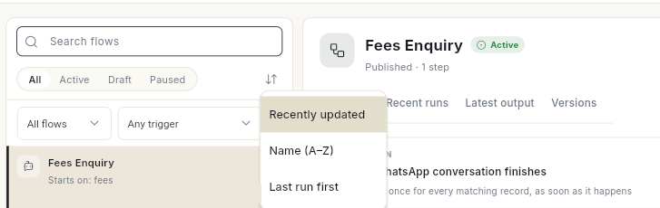
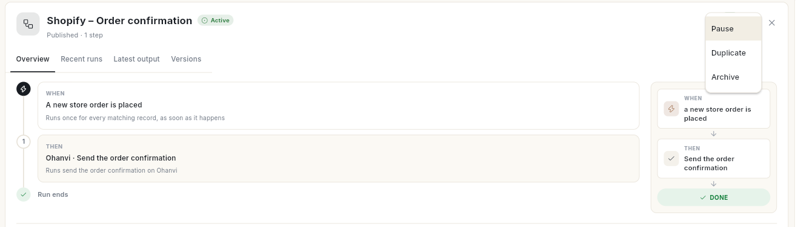
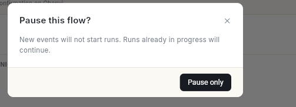
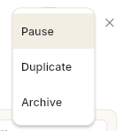
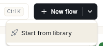
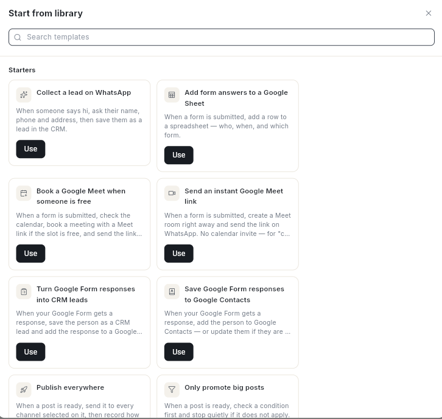

# फ़्लो और फ़्लो की लिस्ट को समझें { #understand-flows-and-the-flows-list }

आपके वर्कस्पेस के सारे चैटबॉट, ऑटोमेशन और ईमेल जर्नी एक ही स्क्रीन पर मिल जाते हैं। इस गाइड के बाद आप पढ़ पाएँगे कि हर फ़्लो किससे शुरू होता है, वह चल रहा है या नहीं, और उसका पिछला रन कैसा रहा। आप उसे पब्लिश, पॉज़, डुप्लिकेट या डिलीट भी कर पाएँगे।

## शुरू करने से पहले { #before-you-start }

- आपको **WhatsApp** पैनल या **Connect** पैनल में **Flows** दिखना चाहिए। दोनों में न दिखे, तो अपने एडमिन से एक्सेस माँगें। देखें [रोल और अनुमतियाँ](../settings/roles-and-permissions.md)।
- **Connect** → **Flows** एंट्री डिफ़ॉल्ट रूप से सिर्फ़ एडमिन के लिए है, क्योंकि फ़्लो का हर स्टेप फ़्लो के ओनर की तरह चलता है।
- फ़्लो बनाने या बदलने के लिए आपके रोल को फ़्लो सेव करने का एक्सेस चाहिए। एक्सेस न हो, तो आप फ़्लो खोल सकते हैं, पर एडिट नहीं कर सकते।

## फ़्लो क्या है { #what-a-flow-is }

फ़्लो एक ट्रिगर से शुरू होता है। फिर वह अपने स्टेप एक-एक करके क्रम से चलाता है। एक ही कैनवास पर 3 तरह के फ़्लो बनते हैं:

| प्रकार | इसे क्या शुरू करता है | गाइड |
| --- | --- | --- |
| **Chatbot** | कोई ग्राहक WhatsApp पर कीवर्ड भेजता है। | [WhatsApp चैटबॉट फ़्लो बनाएँ](../create-whatsapp-flow.md) |
| **Automation** | Ohanvi या किसी कनेक्ट किए हुए ऐप में कुछ होता है, कोई शेड्यूल आता है, कोई वेबहुक आता है, या आप उसे ख़ुद चलाते हैं। | [ऑटोमेशन फ़्लो बनाएँ](build-automation-flow.md) |
| **Journey** | कोई कॉन्टैक्ट ईमेल लिस्ट में जुड़ता है या उसे टैग मिलता है। | [ऑटोमेशन फ़्लो बनाएँ](build-automation-flow.md) |

हर फ़्लो के दो रूप होते हैं। एक ड्राफ़्ट, जिसे आप एडिट करते हैं। दूसरा पब्लिश किया हुआ वर्शन, जो असल में चलता है। आप जब तक दोबारा पब्लिश नहीं करते, आपके बदलावों से पब्लिश किया हुआ वर्शन नहीं बदलता।

## स्टेप { #steps }

### फ़्लो की लिस्ट खोलें { #open-the-flows-list }

1. लेफ़्ट रेल में **WhatsApp** खोलें, फिर **Flows** चुनें। **Automation flows** स्क्रीन खुलती है।
2. या लेफ़्ट रेल में **Connect** खोलें, फिर **Integration** के नीचे **Flows** चुनें। यही स्क्रीन खुलती है।

आप किसी भी रास्ते से आएँ, लिस्ट में आपके वर्कस्पेस के सारे फ़्लो दिखते हैं।

### फ़्लो खोजें { #find-a-flow }

1. **Search flows** में टाइप करें। सर्च फ़्लो के नाम, उसके ट्रिगर और उसके स्टेप के नामों में ढूँढती है।
2. लिस्ट छोटी करने के लिए किसी स्टेटस पिल पर क्लिक करें: **All**, **Active**, **Draft** या **Paused**।
3. फ़्लो का प्रकार चुनने के लिए पहला ड्रॉप-डाउन खोलें: **All flows**, **Chatbots**, **Automations** या **Journeys**।
4. ट्रिगर चुनने के लिए दूसरा ड्रॉप-डाउन खोलें, जैसे **On a schedule**। चुना हुआ ट्रिगर हटाने के लिए **Any trigger** चुनें।
5. सॉर्ट आइकन (टूलटिप **Sort**) पर क्लिक करें और **Recently updated**, **Name (A–Z)** या **Last run first** चुनें।

    

कुछ न मिले, तो **Clear filters** पर क्लिक करें।

### फ़्लो की रो पढ़ें { #read-a-flows-row }

हर रो में 3 चीज़ें दिखती हैं:

- **नाम और स्टेटस आइकन:** **Active**, **Draft**, **Paused** या **Archived**। दूसरा आइकन **Not published** बताता है कि कुछ बदलाव अभी लाइव नहीं हैं।
- **इसे क्या शुरू करता है:** चैटबॉट में **Starts on:** और उसके आगे कीवर्ड दिखते हैं। बाकी फ़्लो में ट्रिगर के बारे में एक लाइन लिखी होती है।
- **पिछला रन:** जैसे **Succeeded 2 hours ago**, या **Never run**। **Stuck** का मतलब है कि कोई रन 6 घंटे से ज़्यादा से चल रहा है।

रो में **Reconnect needed** या **Connection problem** भी दिख सकता है। देखें [कोई ऐप कनेक्ट करें और उसे फ़्लो में इस्तेमाल करें](connect-apps-for-flows.md)।

**Not yet migrated** के नीचे की रो पुराने चैटबॉट या ईमेल जर्नी की हैं। उन्हें अपने फ़्लो में लाने के लिए उनमें से कोई एक खोलें।

### फ़्लो का प्रीव्यू पैनल खोलें { #open-a-flows-preview-panel }

1. किसी रो पर क्लिक करें। लिस्ट के बगल में एक पैनल खुलता है।
2. **Overview** टैब पढ़ें। इसमें स्टेप टाइमलाइन में और आसान शब्दों में लिखे दिखते हैं।

    

3. **Last run**, **Owner**, **Trigger**, **Current version**, **Steps** और **Flow ID** देखने के लिए **Version, owner & technical** खोलें।
4. नतीजे जाँचने के लिए बाकी टैब देखें: **Recent runs**, **Latest output** और **Versions**। देखें [फ़्लो टेस्ट करें और फ़ेल रन ठीक करें](test-and-monitor-flows.md)।
5. फ़्लो को कैनवास पर एडिट करने के लिए **Open builder** पर क्लिक करें।

    

### लिस्ट से ड्राफ़्ट पब्लिश करें { #publish-a-draft-from-the-list }

1. फ़्लो की रो पर क्लिक करें।
2. **Publish & turn on** पर क्लिक करें। जो फ़्लो पहले से लाइव है, उसमें बटन पर **Publish changes** लिखा होता है।
3. आने वाला मैसेज पढ़ें। **Published and live.** का मतलब है कि फ़्लो अब चल रहा है। **Published.** का मतलब है कि फ़्लो पब्लिश हो गया है, पर बंद है।

### फ़्लो चालू या बंद करें { #turn-a-flow-on-or-off }

1. फ़्लो की रो पर क्लिक करें। फ़्लो के नाम के बगल में **On**/**Off** स्विच होता है। यह फ़्लो को एक बार पब्लिश करने के बाद ही दिखता है।
2. फ़्लो रोकने के लिए स्विच पर क्लिक करें। **Pause this flow?** विंडो खुलती है।

    

3. **Pause only** पर क्लिक करें। इसके बाद नए इवेंट से रन शुरू नहीं होंगे। जो रन पहले से चल रहे हैं, वे पूरे हो जाएँगे।
4. अभी कोई रन चल रहा हो, तो आप **Pause and stop runs** पर भी क्लिक कर सकते हैं। इससे चल रहे रन भी कैंसिल हो जाते हैं।
5. दोबारा चालू करने के लिए स्विच पर क्लिक करें, या **Resume** पर क्लिक करें। मैसेज **Flow resumed. New events start runs again.** दिखता है।

!!! warning "रन रोकने से भेजा हुआ मैसेज वापस नहीं होता"
    जो स्टेप चल रहा है, वह पूरा हो जाता है। वह जो मैसेज पहले भेज चुका है, उन्हें वापस नहीं लिया जा सकता।

### फ़्लो डुप्लिकेट करें { #duplicate-a-flow }

1. फ़्लो की रो पर क्लिक करें, फिर **More** मेनू (**…**) पर क्लिक करें। इसमें **Pause**, **Duplicate** और **Delete** मिलते हैं। जो फ़्लो Ohanvi ने आपके लिए बनाया है, उसमें **Delete** की जगह **Archive** मिलता है।

    

2. **Duplicate** पर क्लिक करें। बिल्डर में एक कॉपी खुलती है, जिसका नाम **Copy of** और उसके आगे फ़्लो का नाम होता है।

कॉपी ड्राफ़्ट होती है। उसे चलाने से पहले पब्लिश करें।

### फ़्लो डिलीट करें { #delete-a-flow }

1. फ़्लो की रो पर क्लिक करें, फिर **More** मेनू (**…**) पर क्लिक करें।
2. **Delete** पर क्लिक करें। **Delete this flow?** विंडो खुलती है।
3. **Delete** पर क्लिक करें। मैसेज **Flow deleted.** दिखता है।

जो फ़्लो Ohanvi ने आपके लिए बनाए हैं, जैसे स्टोर ऑटोमेशन, उनके मेनू में **Archive** लिखा होता है। नतीजा वही रहता है।

!!! warning "डिलीट किया हुआ फ़्लो वापस नहीं आता"
    फ़्लो चलना बंद हो जाता है और लिस्ट से हट जाता है। पूरे हो चुके रन की हिस्ट्री बनी रहती है। आपने जो स्टोर ऑटोमेशन आर्काइव किया है, वह दोबारा नहीं बनेगा।

### नया फ़्लो बनाएँ { #create-a-new-flow }

1. **New flow** पर क्लिक करें। खाली कैनवास खुलता है।
2. पहले से बने फ़्लो से शुरू करना हो, तो **New flow** के दाईं तरफ़ वाले तीर (**⌄**) पर क्लिक करें, फिर **Start from library** पर क्लिक करें।

    

3. **Start from library** में **Search templates** से खोजें, या **Starters** या **Chatbot templates** में से कोई फ़्लो चुनें। फिर उस पर **Use** पर क्लिक करें। सारे स्टार्टर और टेम्प्लेट देखने के लिए पढ़ें [टेम्प्लेट से फ़्लो शुरू करें](use-flow-templates.md)।

    

आगे के स्टेप के लिए देखें [ऑटोमेशन फ़्लो बनाएँ](build-automation-flow.md) या [WhatsApp चैटबॉट फ़्लो बनाएँ](../create-whatsapp-flow.md)।

## वीडियो वॉकथ्रू { #video-walkthrough }

[VIDEO]

## समस्या का समाधान { #troubleshooting }

| समस्या | कारण | समाधान |
| --- | --- | --- |
| **New flow** नहीं दिख रहा | आपका रोल फ़्लो देख सकता है, पर बना नहीं सकता। खाली लिस्ट में **Your role can view flows but not create them.** लिखा होता है। | अपने एडमिन से फ़्लो सेव करने का एक्सेस माँगें। |
| **Connect** पैनल में **Flows** नहीं है | वह एंट्री डिफ़ॉल्ट रूप से सिर्फ़ एडमिन के लिए है। | **WhatsApp** → **Flows** खोलें, या अपने एडमिन से कहें। |
| रो में **Active** के बगल में **Not published** दिखता है | आपने बदलाव सेव किए, पर पब्लिश नहीं किए। लाइव वर्शन अभी पुराना ही चल रहा है। | रो पर क्लिक करें, फिर **Publish changes** पर क्लिक करें। |
| रो में **Stuck** दिखता है | कोई रन 6 घंटे से ज़्यादा से इंतज़ार में है या चल रहा है। | **Recent runs** खोलकर रन पढ़ें। देखें [फ़्लो टेस्ट करें और फ़ेल रन ठीक करें](test-and-monitor-flows.md)। |
| पैनल में **On**/**Off** स्विच नहीं है | फ़्लो अभी तक पब्लिश नहीं हुआ। | **Publish & turn on** पर क्लिक करें। |
| **The flow could not be copied.** | सर्वर पर कॉपी नहीं बन पाई। | दोबारा कोशिश करें। फिर भी न बने, तो **Flow ID** नोट करें और सपोर्ट से संपर्क करें। |

## संबंधित गाइड { #related }

- [ऑटोमेशन फ़्लो बनाएँ](build-automation-flow.md)
- [फ़्लो से स्टोर के मैसेज ऑटोमेट करें](store-journeys.md)
- [फ़्लो टेस्ट करें और फ़ेल रन ठीक करें](test-and-monitor-flows.md)
- [WhatsApp चैटबॉट फ़्लो बनाएँ](../create-whatsapp-flow.md)
- [CRM ऑटोमेशन मैनेज करें](../crm/manage-automations.md)
- [टेम्प्लेट से फ़्लो शुरू करें](use-flow-templates.md)
- [किसी फ़्लो के वर्शन देखें](review-flow-versions.md)
