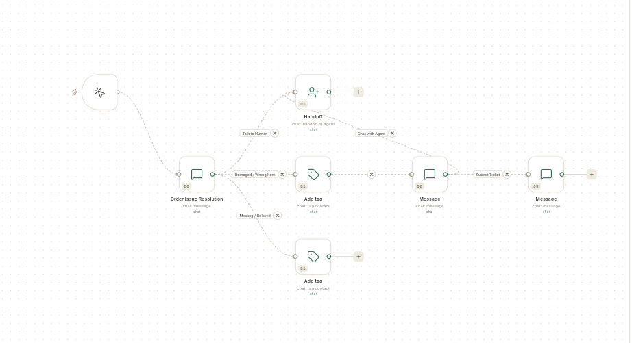

# फ़्लो { #flows }

कुछ होने पर फ़्लो अपने आप स्टेप चला देता है। जैसे ग्राहक कोई कीवर्ड भेजे, ऑर्डर आए, कोई कॉन्टैक्ट जुड़े, या तय समय आ जाए। WhatsApp चैटबॉट, ऑटोमेशन और स्टोर जर्नी, तीनों एक ही **Flows** कैनवास पर बनते हैं।

## यह कहाँ मिलेगा { #where-to-find-it }

**Flows** दो जगह से खुलता है। दोनों जगह से एक ही **Automation flows** स्क्रीन खुलती है।

- **WhatsApp** → **Flows** — चैटबॉट और WhatsApp स्टोर मैसेज के लिए।
- **Connect** → **Flows** (**Integration** ग्रुप में, Zapier और Pabbly के बगल में) — कनेक्ट किए हुए ऐप्स वाले ऑटोमेशन के लिए। यह एंट्री डिफ़ॉल्ट रूप से सिर्फ़ एडमिन के लिए है, क्योंकि हर स्टेप फ़्लो के ओनर की तरह चलता है।

बाहरी ऐप्स कनेक्ट करने वाला कनेक्टर कैटलॉग **Connect** → **Connectors** में है।

## शुरू करने से पहले { #before-you-start }

- आपको **WhatsApp** या **Connect** के नीचे **Flows** दिखना चाहिए। फ़्लो बनाने या बदलने के लिए आपके रोल को फ़्लो सेव करने का एक्सेस भी चाहिए। एक्सेस न हो तो स्क्रीन पर **Your role can view flows but not create them.** लिखा आता है।
- फ़्लो जो भी इस्तेमाल करता है, वह पहले से कनेक्ट होना चाहिए। जैसे आपका WhatsApp नंबर, आपका स्टोर, या वह ऐप जिसे आपको कॉल करना है।
- फ़्लो जो WhatsApp टेम्प्लेट भेजता है, वे Meta से अप्रूव हो चुके हों। देखें [WhatsApp मैसेज टेम्प्लेट बनाएँ](../whatsapp/create-message-template.md)।

## गाइड { #guides }

गाइड उसी क्रम में हैं जिस क्रम में स्क्रीन ऐप में आती हैं।

| गाइड | कब पढ़ें |
| --- | --- |
| [फ़्लो और फ़्लो की लिस्ट को समझें](flows-overview-and-list.md) | आप फ़्लो में नए हैं, या किसी फ़्लो को पॉज़, कॉपी या डिलीट करना चाहते हैं। |
| [टेम्प्लेट से फ़्लो शुरू करें](use-flow-templates.md) | आप खाली कैनवास की जगह तैयार स्टार्टर या चैटबॉट टेम्प्लेट से शुरू करना चाहते हैं। |
| [फ़्लो पैनल](flow-panel/index.md) | आप किसी फ़्लो के रन, आउटपुट और वर्शन देखना चाहते हैं। |
| [फ़्लो टेस्ट करें और फ़ेल रन ठीक करें](test-and-monitor-flows.md) | आप जाँचना चाहते हैं कि फ़्लो चल रहा है या नहीं, या कोई रन फ़ेल हुआ है। |
| [किसी रन का आउटपुट विस्तार से पढ़ें](read-a-runs-output.md) | आप देखना चाहते हैं कि हर स्टेप से क्या नतीजा आया। |
| [किसी फ़्लो के वर्शन देखें](review-flow-versions.md) | आप देखना चाहते हैं कि कौन-सा वर्शन लाइव है। |
| [ऑटोमेशन फ़्लो बनाएँ](build-automation-flow.md) | आप चाहते हैं कि कोई घटना होते ही स्टेप अपने आप चलें। |
| [फ़्लो से स्टोर के मैसेज ऑटोमेट करें](store-journeys.md) | आप WhatsApp पर ऑर्डर, कार्ट और डिलीवरी के मैसेज भेजना चाहते हैं। |
| [कोई ऐप कनेक्ट करें और उसे फ़्लो में इस्तेमाल करें](connect-apps-for-flows.md) | किसी स्टेप को बाहरी ऐप से बात करनी है। |

चैटबॉट की गाइड, जैसे [WhatsApp चैटबॉट फ़्लो बनाएँ](../create-whatsapp-flow.md) और [फ़्लो बिल्डर को समझें](../whatsapp/understand-the-flow-builder.md), **WhatsApp** → **Flows** में हैं।

## संबंधित गाइड { #related }

- [WhatsApp](../whatsapp/index.md)
- [CRM ऑटोमेशन मैनेज करें](../crm/manage-automations.md) — **CRM** → **Automations** के लीड और डील नियम एक अलग स्क्रीन हैं।
- [जर्नी से ईमेल ऑटोमेट करें](../email/create-email-automation.md)
