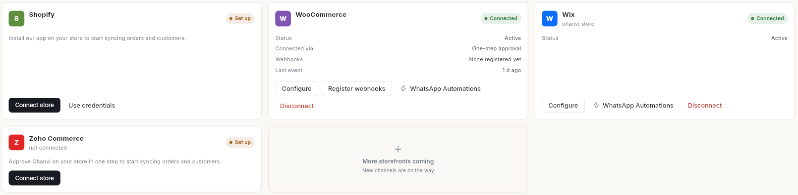

# Automate store messages with flows

Send WhatsApp messages to shoppers when something happens in your store, such as a new order or an unfinished checkout. At the end, the store automations you want are checked, tested and running on real orders.

## Before you start

- Your Shopify or WooCommerce store is connected in **Connect** → **Store Connections**. A connected store shows **Connected** and a **WhatsApp Automations** link.

    

- Your WhatsApp number is connected.
- The WhatsApp templates each automation sends are approved by Meta. Check them in **WhatsApp** → **Template**.
- You can open **Flows** and publish flows. See [Understand flows and the Flows list](flows-overview-and-list.md).

## The ready-made store automations

When you open **Flows**, Ohanvi adds 15 store automations as drafts. They send nothing until you publish them. Each one works for Shopify and WooCommerce stores.

| Automation | What it does |
| --- | --- |
| **Welcome new customer** | Welcomes a shopper the first time they become a store customer. |
| **Browse nudge** | Nudges a shopper about a product they looked at and did not buy. |
| **Order confirmation** | Sends the order confirmation when a new order is placed. |
| **Payment received** | Confirms the payment when an order placed unpaid, such as cash on delivery or a bank transfer, is marked paid. |
| **Abandoned checkout recovery** | Messages a shopper 45 minutes after they leave a checkout, then after a day and 2 more days. Stops as soon as they order. |
| **Payment failed** | Tells the shopper their payment did not go through. |
| **Order shipped** | Sends tracking details when the order is fulfilled. |
| **Out for delivery** | Tells the shopper their parcel is out for delivery today. |
| **Delivered confirmation** | Confirms delivery once the carrier reports it. |
| **Delivery attempt failed** | Tells the shopper the courier could not deliver, so they can sort out the next attempt. |
| **COD verification** | Asks the shopper to confirm a cash-on-delivery order before dispatch. |
| **Cancellation update** | Tells the shopper their order was cancelled. |
| **Refund update** | Tells the shopper a refund was issued on their order, and the amount refunded. |
| **Review request** | Asks for a review 3 days after delivery. |
| **Reorder reminder** | Reminds the shopper to reorder a month after delivery. |

**Welcome new customer**, **Browse nudge** and **Reorder reminder** are marketing messages. Send them only to contacts who opted in.

**Payment received** runs only when an order changes from unpaid to paid. A card order that is paid when it is placed gets **Order confirmation** only.

!!! note "Added to existing accounts"
    If your account already had the store automations, **Payment received**, **Refund update** and **Delivery attempt failed** are added as drafts the next time you open **Flows**. Your existing automations keep their names, so the cancellation one may still read **Cancellation and refund update**. It sends cancellations only.

## Steps

### Find the store automations

1. Open **WhatsApp** in the left rail, then select **Flows**.
2. Open the kind drop-down and choose **Automations**.
3. Click the **Draft** pill. The store automations are listed with the other drafts.

If your store or WhatsApp is not connected yet, the row's status reads **Inactive**. Its panel shows a note, such as **Connect WhatsApp to turn these automations on.**, and a **Connect store** or **Connect WhatsApp** button.

### Check and finish an automation

1. Click the automation's row, then click **Open builder**.
2. Click each step and read its **Setup** tab. Check the template name and the values it sends.
3. Fill in any field that is empty. For example, **Review request** needs your review link, and **Welcome new customer** needs your store name. Copy the review link with **Copy link** on **Google Reviews** → **Review page**. See [Get more Google reviews](../google-reviews/get-more-google-reviews.md#share-the-qr-code-or-link).
4. For **COD verification**, check that the condition matches how your checkout names cash on delivery. The draft looks for `Cash on Delivery`.
5. Click **Save**.

### Publish and turn it on

1. Click **Publish** in the top bar.
2. Read the message. **Published and live — new runs use this version.** means it now runs on real orders.
3. Repeat for each automation you want.

You can also publish from the list: click the row, then click **Publish & turn on**.

!!! warning "Live automations message real shoppers"
    From now on, each matching store event sends a WhatsApp message. Messages already sent cannot be taken back.

### Build your own store automation

1. Click **New flow**, then **Add first step…**, then **Run by hand**.
2. In **When this runs**, choose **When something happens here**.
3. In **Which event**, choose a store event, for example **A new store order is placed**, **An order is paid**, **A refund is issued** or **A shopper leaves a checkout unfinished**. The panel shows which store the event comes from.
4. Add an **Action** step and choose **Send a WhatsApp template**. Set **Send to** to the shopper's phone from the trigger, and type the **Template name**.
5. Add a **Wait** or a **Continue only if…** step if you need one. To check that the shopper has not ordered since, add **Check if they ordered recently** before the condition.
6. Save and publish. See [Build an automation flow](build-automation-flow.md).

### Use store actions inside a chatbot

A chatbot can look up orders during a WhatsApp conversation. In the builder, click **All steps** and look under **Store actions**:

- **Order status**, **Cancel order**, **Reorder**, **Confirm address**, **COD check**, **COD to prepaid**, **Book appointment**

Each one has an outcome for each result, such as found or not found, that you wire to the next message. To let the customer pick an order first, add **Pick a recent order** or **Pick an open order** from **Advanced**. For building the chatbot, see [Create a WhatsApp chatbot flow](../create-whatsapp-flow.md).

## Video walkthrough

[VIDEO]

## Troubleshooting

| Issue | Cause | Fix |
| --- | --- | --- |
| **Connect WhatsApp before publishing — this flow sends a WhatsApp message and there is no WhatsApp number to send it from.** | WhatsApp is not connected. | Click **Connect WhatsApp** in the flow's panel, connect, then publish. |
| **Connect your store before publishing — nothing raises this flow's trigger until a store is connected.** | No store is connected. | Click **Connect store**, connect Shopify or WooCommerce, then publish. |
| **The template '…' is not approved by Meta yet, so this flow cannot send it. Wait for approval, then publish.** | The template is missing or waiting for Meta. | Create or fix the template in **WhatsApp** → **Template**, wait for approval, then publish. |
| **Out for delivery**, **Delivered confirmation**, **Delivery attempt failed**, **Review request** or **Reorder reminder** never run | These run only when your courier reports delivery updates to the store, or a shipping integration sends them. Many couriers report only that the order was shipped. | Use **Order shipped** instead, or use a courier or shipping integration that reports delivery. |
| **Payment received** does not run for a paid order | The order was already paid when it was placed. | No fix needed. That shopper gets **Order confirmation**. |
| **The template '…' is not approved by Meta yet…** on **Payment received** or **Delivery attempt failed** | The templates `wa_ecom_payment_received` and `wa_ecom_delivery_issue` are new and still waiting for Meta. | Check them in **WhatsApp** → **Template**, wait for approval, then publish. |
| COD shoppers do not get the COD message | Your checkout names cash on delivery differently. | Open **COD verification**, change the condition's value to match your checkout, then publish. |
| A deleted store automation does not come back | Archived automations are not created again. | Build it yourself from the store event, or duplicate a similar one. |

## Related

- [Build an automation flow](build-automation-flow.md)
- [Test a flow and fix failed runs](test-and-monitor-flows.md)
- [Understand flows and the Flows list](flows-overview-and-list.md)
- [Read store analytics](../analytics/read-store-analytics.md)
- [Get more Google reviews](../google-reviews/get-more-google-reviews.md)
