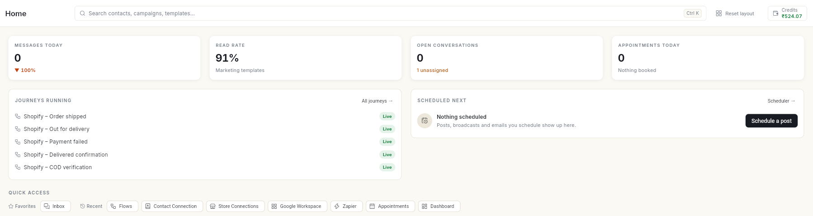

# Ohanvi हेल्प सेंटर { #ohanvi-help-center }

कैंपेन चलाने, ऑटोमेशन बनाने और ग्राहकों से बातचीत करने के लिए Ohanvi की स्टेप-बाय-स्टेप गाइड।

  
हेल्प सेंटर

  <h2>Ohanvi इस्तेमाल करने वालों के लिए गाइड</h2>
  
हर मॉड्यूल की शुरुआत में एक ओवरव्यू है, जो बताता है कि वह ऐप में कहाँ है, शुरू करने से पहले आपको क्या चाहिए, और किस क्रम में कौन-सी गाइड पढ़नी है। हर गाइड के अंत में उन समस्याओं का हल दिया गया है जो लोगों को सबसे ज़्यादा आती हैं।

  
<a class="primary-button" href="sign-up/">शुरू करें</a>

## मॉड्यूल के अनुसार देखें { #browse-by-module }

मॉड्यूल उसी क्रम में दिए गए हैं जिस क्रम में वे ऐप के लेफ़्ट रेल में दिखते हैं।

  <a class="doc-card" href="crm/"><strong>CRM और संपर्क</strong>संपर्क, लीड, ग्रुप, इम्पोर्ट, डील, अकाउंट, गतिविधियाँ और सेल्स रिपोर्ट।</a>
  <a class="doc-card" href="whatsapp/"><strong>व्हाट्सऐप</strong>नंबर सेटअप, इनबॉक्स, टेम्प्लेट, ब्रॉडकास्ट, कैटलॉग, विज्ञापन और AI एजेंट।</a>
  <a class="doc-card" href="flows/"><strong>फ़्लो</strong>चैटबॉट, ऑटोमेशन, जुड़े हुए ऐप और स्टोर जर्नी।</a>
  <a class="doc-card" href="social/"><strong>सोशल</strong>जुड़े हुए अकाउंट, कंपोज़र, शेड्यूलिंग, अप्रूवल और इनसाइट्स।</a>
  <a class="doc-card" href="email/"><strong>ईमेल</strong>सेंडर सेटअप, लिस्ट, टेम्प्लेट, कैंपेन, जर्नी और नतीजे।</a>
  <a class="doc-card" href="appointments/"><strong>अपॉइंटमेंट</strong>सर्विस, प्रोवाइडर, बुकिंग के नियम और व्हाट्सऐप बुकिंग।</a>
  <a class="doc-card" href="schedule/"><strong>शेड्यूल</strong>सभी मॉड्यूल में जो कुछ भी शेड्यूल है, एक ही कैलेंडर में।</a>
  <a class="doc-card" href="analytics/"><strong>एनालिटिक्स</strong>ब्रॉडकास्ट और स्टोर का प्रदर्शन, अगले कदम के सुझावों के साथ।</a>
  <a class="doc-card" href="tasks/"><strong>टास्क</strong>टास्क प्रोजेक्ट, बोर्ड, ज़िम्मेदार व्यक्ति, कमेंट और स्प्रिंट।</a>
  <a class="doc-card" href="settings/"><strong>सेटिंग्स</strong>आपकी प्रोफ़ाइल, टीम, रोल, नोटिफ़िकेशन और डेवलपर एक्सेस।</a>
  <a class="doc-card" href="billing/"><strong>बिलिंग और क्रेडिट</strong>क्रेडिट, रीचार्ज, इस्तेमाल, इनवॉइस, GST की जानकारी और आपका प्लान।</a>

## यहाँ से शुरू करें { #start-here }

| गाइड | किसलिए |
| --- | --- |
| [Ohanvi पर साइन अप करें](sign-up.md) | अपना अकाउंट बनाने के लिए। |
| [Ohanvi में साइन इन करें](sign-in.md) | पासवर्ड, Google या ईमेल कोड से साइन इन करने के लिए। |
| [अपना व्हाट्सऐप नंबर कनेक्ट करें](whatsapp/connect-whatsapp-number.md) | अपना WhatsApp Business नंबर जोड़ने के लिए। |
| [संपर्क इम्पोर्ट और सिंक करें](crm/import-and-sync-contacts.md) | अपने ग्राहकों को Ohanvi में लाने के लिए। |
| [लिंक भेजकर टीम के सदस्यों को बुलाएँ](settings/invite-teammates.md) | अपनी टीम को जोड़ने के लिए। |
| [अपने अकाउंट में पैसे जोड़ें](add-funds.md) | पहला पेड मैसेज भेजने से पहले क्रेडिट रीचार्ज करने के लिए। |
