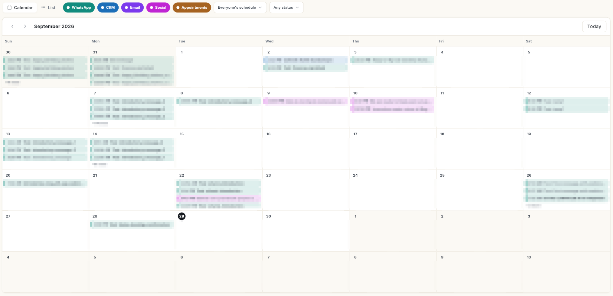

# शेड्यूल { #schedule }

शेड्यूल में वह सब कुछ दिखता है जो बाद में होने के लिए तय है, हर मॉड्यूल से, एक ही कैलेंडर या सूची में। आप आइटम अपने-अपने मॉड्यूल में बनाते हैं; शेड्यूल वह जगह है जहाँ आप उन्हें एक साथ देखते और बदलते हैं।

## कहाँ मिलेगा { #where-to-find-it }

लेफ़्ट रेल में **Schedule** खोलें। पैनल में ये दिखते हैं:

- **All schedules**, **Today**, **Upcoming**, **Drafts**
- चैनल के अनुसार: **WhatsApp**, **CRM**, **Email**, **Social**, **Appointments**
- **Recurring**

## शुरू करने से पहले { #before-you-start }

- आपके रोल के पास शेड्यूल का एक्सेस हो। डिफ़ॉल्ट रूप से यह सिर्फ़ **Super Admin** रोल के पास होता है।
- आपने किसी दूसरे मॉड्यूल में कुछ शेड्यूल किया हो, जैसे व्हाट्सऐप ब्रॉडकास्ट या सोशल पोस्ट।
- रीशेड्यूल, रद्द या डिलीट करने के लिए इतनी चौड़ी विंडो इस्तेमाल करें कि डिटेल्स पैनल दिखे। छोटी स्क्रीन पर एक्शन बटन छिप जाते हैं।

## गाइड { #guides }

| गाइड | कब इस्तेमाल करें |
| --- | --- |
| [जो कुछ भी शेड्यूल है, सब देखें](view-schedule.md) | आप देखना चाहते हैं कि आज या इस हफ़्ते क्या जाने वाला है, और कैलेंडर फ़िल्टर करना चाहते हैं। |
| [शेड्यूल किया हुआ आइटम रीशेड्यूल, रद्द या डिलीट करें](reschedule-cancel-delete.md) | योजना बदल गई है और किसी आइटम को खिसकाना या रोकना है। |
| [देखें कि आज क्या शेड्यूल है](view-todays-schedule.md) | आप सिर्फ़ आज के आइटम देखना चाहते हैं। |
| [देखें कि आगे क्या आने वाला है](view-upcoming-schedule.md) | आप अगले कुछ दिनों की योजना बनाना चाहते हैं। |
| [ड्राफ़्ट खोजें और पूरे करें](find-and-finish-drafts.md) | आपने कुछ सेव किया था और उसे पूरा करना चाहते हैं। |
| [अपने शेड्यूल किए व्हाट्सऐप मैसेज देखें](view-whatsapp-schedule.md) | आप सिर्फ़ व्हाट्सऐप के आइटम देखना चाहते हैं। |
| [अपनी शेड्यूल की हुई CRM गतिविधियाँ देखें](view-crm-schedule.md) | आप सिर्फ़ CRM गतिविधियाँ देखना चाहते हैं। |
| [अपने शेड्यूल किए ईमेल कैंपेन देखें](view-email-schedule.md) | आप सिर्फ़ ईमेल कैंपेन देखना चाहते हैं। |
| [अपनी शेड्यूल की हुई सोशल पोस्ट देखें](view-social-schedule.md) | आप सिर्फ़ सोशल पोस्ट देखना चाहते हैं। |
| [अपने शेड्यूल किए अपॉइंटमेंट देखें](view-appointments-schedule.md) | आप सिर्फ़ बुकिंग देखना चाहते हैं। |
| [बार-बार चलने वाले शेड्यूल प्रबंधित करें](manage-recurring-schedules.md) | आपका कोई दोहराया जाने वाला व्हाट्सऐप भेजना है जिसे जाँचना, रोकना या खत्म करना है। |

## संबंधित गाइड { #related }

- [पोस्ट शेड्यूल करें और कतार प्रबंधित करें](../social/schedule-social-posts.md)
- [ईमेल कैंपेन भेजें](../email/send-email-campaign.md)
- [गतिविधियाँ और नोट्स लॉग करें](../crm/log-activities-and-notes.md)
- [अपॉइंटमेंट प्रबंधित करें](../appointments/manage-appointments.md)
