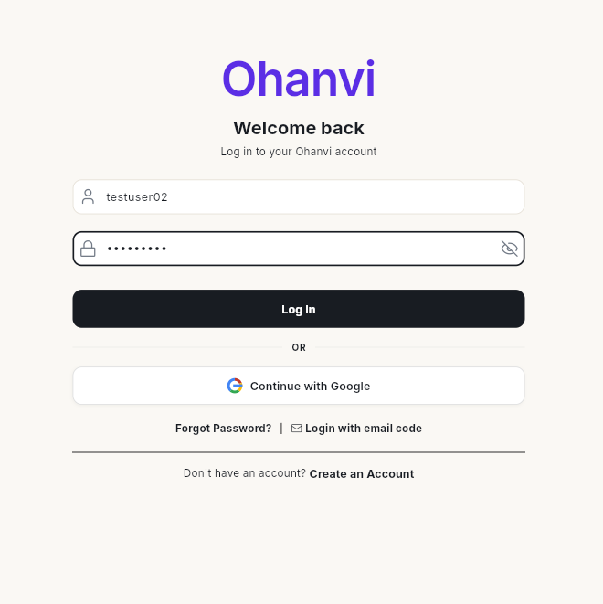
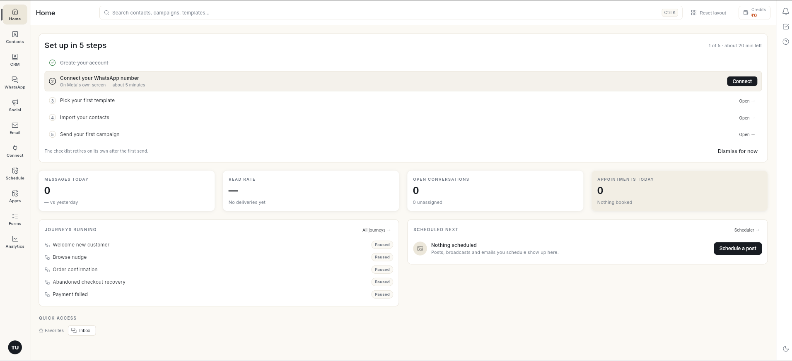
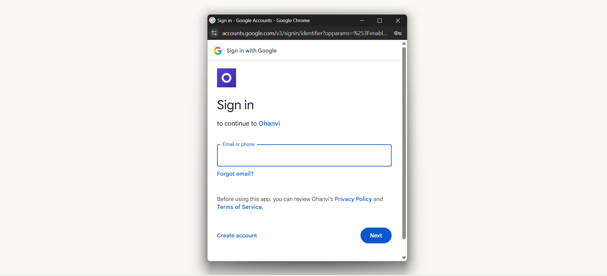
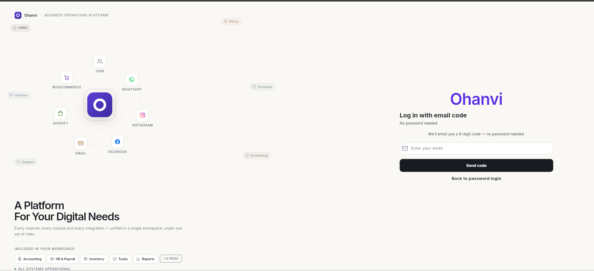
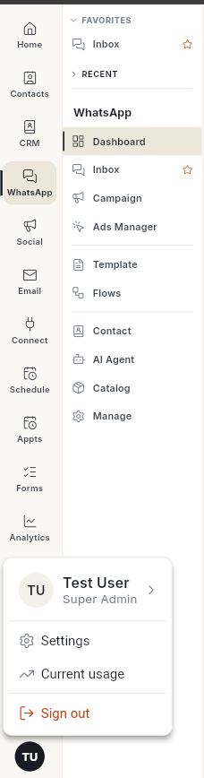

# Ohanvi में साइन इन करें { #sign-in-to-ohanvi }

अपने वर्कस्पेस में यूज़रनेम और पासवर्ड से, Google अकाउंट से, या ईमेल पर आए कोड से साइन इन करें। आप **Home** पर पहुँचते हैं, जहाँ सेटअप चेकलिस्ट और आज के आँकड़े आपका इंतज़ार कर रहे होते हैं।

## शुरू करने से पहले { #before-you-start }

- आपका Ohanvi अकाउंट हो। अगर नहीं है, तो पहले [Ohanvi पर साइन अप करें](sign-up.md)।
- आपको अपना **username** (या ईमेल) और **password** पता हो, या आप अपने अकाउंट से जुड़े ईमेल इनबॉक्स को खोल सकें।

## चरण { #steps }

### यूज़रनेम और पासवर्ड से साइन इन करें { #sign-in-with-username-and-password }

1. [app.ohanvi.com](https://app.ohanvi.com) पर जाएँ।
2. **Username or email** में अपना यूज़रनेम या साइन अप करते समय इस्तेमाल किया ईमेल लिखें।
3. **Enter your password** में अपना पासवर्ड लिखें। उसे दिखाने या छिपाने के लिए आँख के आइकन पर क्लिक करें।

    

4. **Log In** पर क्लिक करें। Ohanvi **Home** खोल देता है।

    

### Google से साइन इन करें { #sign-in-with-google }

1. लॉगिन पेज पर **Continue with Google** पर क्लिक करें। **Sign in with Google** विंडो खुलती है।

    

2. उसी Google अकाउंट से साइन इन करें जिसका ईमेल आपके Ohanvi अकाउंट का ईमेल है। Ohanvi **Home** खोल देता है।

!!! note "ध्यान दें"
    **Continue with Google** सिर्फ़ मौजूदा अकाउंट में साइन इन करता है। Google से नया अकाउंट बनाने के लिए साइन-अप फ़ॉर्म पर **Sign up with Google** का इस्तेमाल करें। देखें [Ohanvi पर साइन अप करें](sign-up.md)।

### ईमेल कोड से साइन इन करें { #sign-in-with-an-email-code }

जब आपको अपना पासवर्ड याद न हो, तब इसका इस्तेमाल करें।

1. लॉगिन पेज पर **Login with email code** पर क्लिक करें। **Log in with email code** स्क्रीन खुलती है।
2. **Enter your email** में अपने अकाउंट से जुड़ा ईमेल लिखें, फिर **Send code** पर क्लिक करें।

    

3. अपना ईमेल खोलें, 6 अंकों का कोड कॉपी करें, उसे डालें और **Verify** पर क्लिक करें। कोड 10 मिनट तक काम करता है।

सामान्य लॉगिन फ़ॉर्म पर वापस जाने के लिए **Back to password login** पर क्लिक करें। अगर आप **Send code** पर क्लिक कर चुके हैं, तो उसकी जगह **Use a different email** पर क्लिक करें।

### साइन आउट करें { #sign-out }

1. नीचे बाएँ कोने में अपने नाम के पहले अक्षरों पर क्लिक करें।
2. **Sign out** पर क्लिक करें। **Logged out successfully** संदेश आता है और लॉगिन पेज खुल जाता है।

    

## वीडियो वॉकथ्रू { #video-walkthrough }

[VIDEO]

## समस्या का समाधान { #troubleshooting }

| समस्या | कारण | समाधान |
| --- | --- | --- |
| यूज़रनेम या पासवर्ड गलत होने का संदेश | टाइपिंग की गलती, या Caps Lock चालू है। | पासवर्ड जाँचने के लिए आँख के आइकन पर क्लिक करें, फिर दोबारा कोशिश करें। |
| आप पासवर्ड भूल गए | — | लॉगिन पेज पर **Forgot Password?** पर क्लिक करें और ईमेल पर आए कोड से उसे रीसेट करें। देखें [अपना पासवर्ड रीसेट करें](reset-password.md)। आप **Login with email code** से भी साइन इन कर सकते हैं। |
| **No account found for this email. Please sign up first.** | उस ईमेल से कोई Ohanvi अकाउंट नहीं है। | ईमेल जाँचें, या [Ohanvi पर साइन अप करें](sign-up.md)। |
| **Continue with Google** के बाद **No account found for this email. Please sign up first.** | उस Google ईमेल से कोई Ohanvi अकाउंट नहीं है। | वह Google अकाउंट चुनें जिसमें आपका Ohanvi ईमेल है, या साइन-अप फ़ॉर्म पर **Sign up with Google** का इस्तेमाल करें। |
| इनबॉक्स में कोड नहीं आया | ईमेल स्पैम या प्रमोशन में चला गया। | वे फ़ोल्डर देखें और नया कोड माँगने से पहले 1–2 मिनट रुकें। |

## संबंधित गाइड { #related }

- [अपना पासवर्ड रीसेट करें](reset-password.md)
- [Ohanvi पर साइन अप करें](sign-up.md)
- [व्हाट्सऐप चैटबॉट फ़्लो बनाएँ](create-whatsapp-flow.md)
