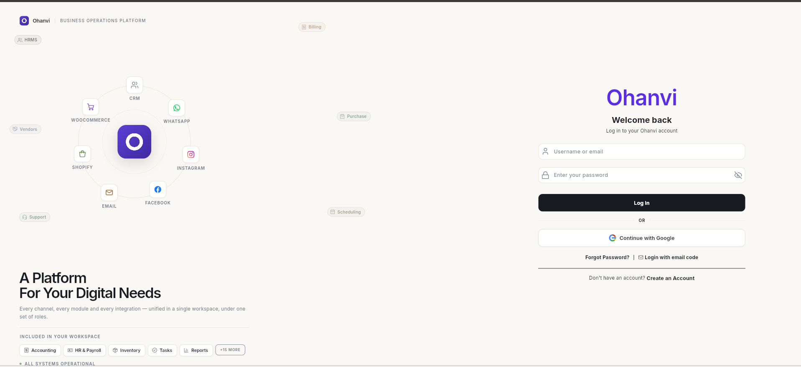
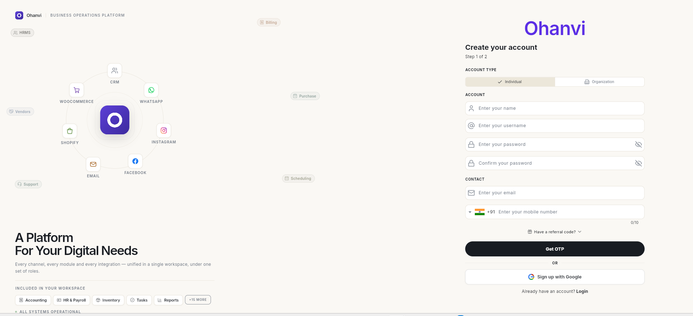
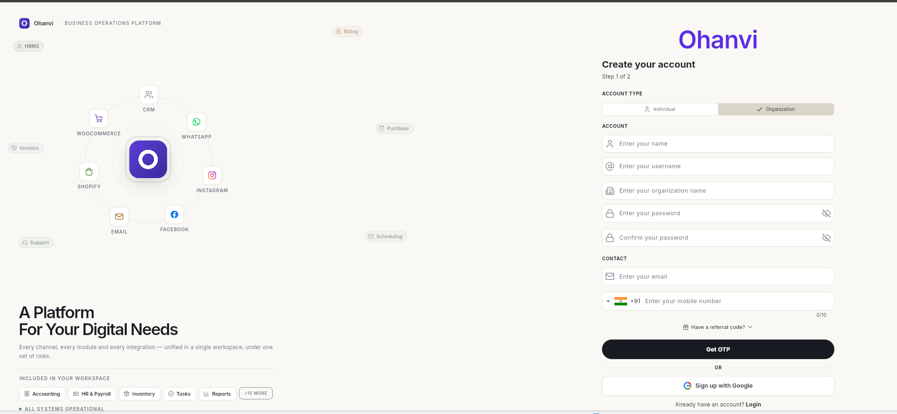
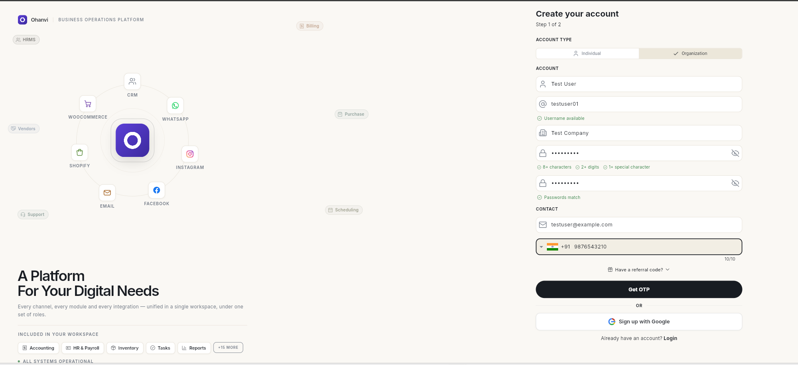
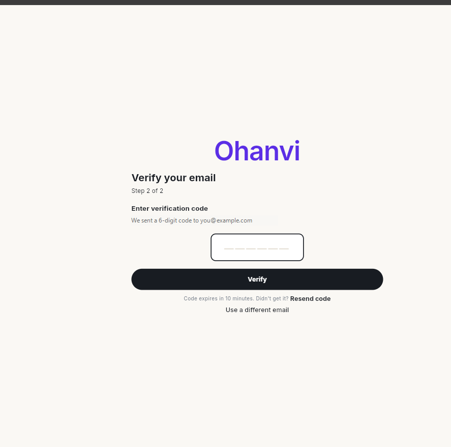
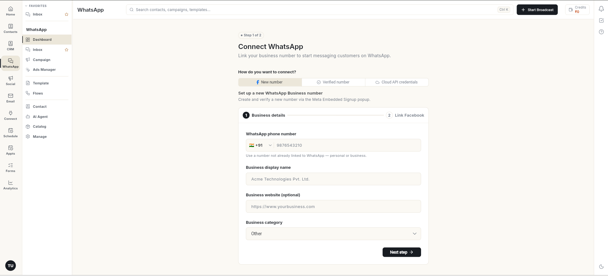

# Ohanvi पर साइन अप करें { #sign-up-for-ohanvi }

अपना Ohanvi अकाउंट दो चरणों में बनाएँ: पहले अपनी जानकारी भरें, फिर 6 अंकों के कोड से अपना ईमेल सत्यापित करें। इसके बाद आप अपने नए वर्कस्पेस में पहुँच जाते हैं, जहाँ से व्हाट्सऐप कनेक्ट करना बस एक कदम दूर है।

## शुरू करने से पहले { #before-you-start }

- आपके पास ऐसा ईमेल पता हो जिसे आप अभी खोल सकें। सत्यापन कोड वहीं आएगा।
- आपके पास मोबाइल नंबर हो (भारत के लिए 10 अंकों का)।
- आपको पता हो कि आप अपने लिए (**Individual**) साइन अप कर रहे हैं या किसी व्यवसाय के लिए (**Organization**)।

## चरण { #steps }

### साइन-अप फ़ॉर्म खोलें { #open-the-sign-up-form }

1. [app.ohanvi.com](https://app.ohanvi.com) पर जाएँ।
2. लॉगिन फ़ॉर्म के नीचे **Create an Account** पर क्लिक करें।

    

### अकाउंट का प्रकार चुनें { #choose-the-account-type }

3. **Account type** में से एक चुनें:
    - **Individual**: अपने लिए। आप बाद में टीम के सदस्य जोड़ सकते हैं।
    - **Organization**: किसी व्यवसाय के लिए। इसमें एक अतिरिक्त फ़ील्ड, **organization name**, जुड़ जाती है।

    

    

### अपनी जानकारी भरें { #fill-in-your-details }

4. अपना **name** और **username** लिखें। यूज़रनेम खाली होने पर फ़ॉर्म में **Username available** दिखता है।
5. संगठन के लिए **organization name** लिखें।
6. **password** लिखें और उसे **Confirm your password** में दोबारा लिखें। पासवर्ड में ये होना ज़रूरी है:
    - 8 या उससे ज़्यादा अक्षर
    - 2 या उससे ज़्यादा अंक
    - कम से कम 1 विशेष चिह्न

    टाइप करते समय हर जाँच हरी होती जाती है, और दोनों फ़ील्ड मेल खाने पर **Passwords match** दिखता है।

7. **Contact** में अपना **email** और **mobile number** लिखें।
8. अगर किसी ने आपको रेफ़रल कोड दिया है, तो **Have a referral code?** पर क्लिक करके उसे डालें।

    

9. **Get OTP** पर क्लिक करें।

### अपना ईमेल सत्यापित करें { #verify-your-email }

10. अपना ईमेल खोलें और Ohanvi का भेजा 6 अंकों का कोड कॉपी करें।
11. कोड को बॉक्स में डालें और **Verify** पर क्लिक करें। कोड 10 मिनट तक काम करता है।

    

    !!! tip "सुझाव"
        **Get OTP** पर क्लिक करने से पहले ईमेल को दूसरे टैब में खोलकर रखें, ताकि कोड आते ही आप उसे डाल सकें।

12. आपका अकाउंट बन जाता है और आप साइन इन हो जाते हैं। Ohanvi **Connect WhatsApp** खोलता है, जो आपके वर्कस्पेस का पहला सेटअप चरण है।

    

## इसके बजाय Google से साइन अप करें { #sign-up-with-google-instead }

1. साइन-अप फ़ॉर्म पर **Sign up with Google** पर क्लिक करें और अपने Google अकाउंट से साइन इन करें। आपका Ohanvi अकाउंट उसी Google ईमेल से बनता है, और यूज़रनेम ईमेल पते से बनाया जाता है।
2. अपना ईमेल देखें। Ohanvi आपको यूज़रनेम और पासवर्ड भेजता है, ताकि आप बिना Google के भी साइन इन कर सकें।

!!! note "ध्यान दें"
    Google से साइन अप करने पर हमेशा **Individual** अकाउंट बनता है, भले ही **Organization** चुना गया हो। संगठन के रूप में साइन अप करने के लिए फ़ॉर्म भरें और **Get OTP** पर क्लिक करें।

## वीडियो वॉकथ्रू { #video-walkthrough }

[VIDEO]

## समस्या का समाधान { #troubleshooting }

| समस्या | कारण | समाधान |
| --- | --- | --- |
| **Username available** नहीं दिख रहा | वह यूज़रनेम पहले से किसी और ने ले रखा है। | कोई दूसरा यूज़रनेम आज़माएँ। |
| **Get OTP** पर **Enter a valid mobile number.** जैसा संदेश आता है | कोई फ़ील्ड खाली या गलत है, या पासवर्ड का कोई नियम पूरा नहीं हुआ। | संदेश में बताई गई फ़ील्ड ठीक करें। संगठन के लिए **organization name** भी भरें। |
| इनबॉक्स में कोड नहीं आया | ईमेल स्पैम या प्रमोशन में चला गया। | वे फ़ोल्डर देखें और 1–2 मिनट रुकें। |
| **OTP has expired. Please request a new one.** | 10 मिनट से ज़्यादा हो गए। | [app.ohanvi.com](https://app.ohanvi.com) से साइन-अप फिर शुरू करें और नया कोड जल्दी डालें। |
| **Resend code** या **Verify** के बाद **No account found for this email. Please sign up first.** | Ohanvi के पास आपकी साइन-अप जानकारी अब नहीं है, इसलिए कोड से साइन-अप पूरा नहीं हो सकता। | टैब बंद करें, [app.ohanvi.com](https://app.ohanvi.com) नई विंडो में खोलें और शुरू से दोबारा साइन अप करें। |

## संबंधित गाइड { #related }

- [Ohanvi में साइन इन करें](sign-in.md)
- [व्हाट्सऐप चैटबॉट फ़्लो बनाएँ](create-whatsapp-flow.md)
- [व्हाट्सऐप टेम्प्लेट बनाएँ](whatsapp/create-message-template.md)
