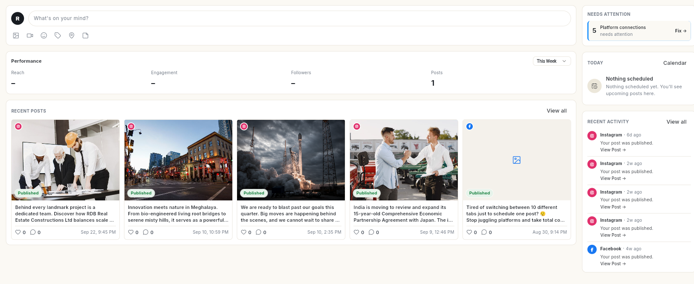

# सोशल { #social }

Social में एक ही कंपोज़र से आप कई नेटवर्क पर पोस्ट पब्लिश कर सकते हैं। अपने अकाउंट कनेक्ट करें, पोस्ट एक बार लिखें, उसे शेड्यूल करें और देखें कि वह कैसी चली।

## यह कहाँ मिलेगा { #where-to-find-it }

लेफ़्ट रेल में **Social** खोलें। पैनल में ये मिलते हैं:

- **Home** — आज आपको किन चीज़ों पर ध्यान देना है।
- **Insights** — आपकी पोस्ट कैसा चल रही हैं।
- **Publish** — पोस्ट की कतार। इसमें **Queue**, **Drafts**, **Approvals** और **Sent** टैब हैं, और **List** / **Calendar** स्विच है।
- **Templates** — बने-बनाए और सेव किए हुए पोस्ट टेम्प्लेट।
- **Business Info** — आपकी Google Business Profile की जानकारी।

पैनल में एक **New** बटन (**Post**, **Connect a new channel**) और आपके कनेक्टेड अकाउंट की **Channels** लिस्ट भी है।

अकाउंट लेफ़्ट रेल में **Connect** → **Social Connections** में कनेक्ट होते हैं।

## शुरू करने से पहले { #before-you-start }

- आपके रोल को Social का एक्सेस मिला हो। पैनल की हर चीज़ की अपनी अनुमति होती है, इसलिए हो सकता है आपको उनमें से कुछ ही दिखें।
- कम से कम 1 नेटवर्क कनेक्ट हो। देखें [सोशल अकाउंट कनेक्ट करें](connect-social-accounts.md)।
- Facebook Page या LinkedIn कंपनी पेज के लिए आप उस पेज के एडमिन हों। Instagram के लिए अकाउंट प्रोफ़ेशनल (Business या Creator) हो।

## गाइड { #guides }

| गाइड | कब इस्तेमाल करें |
| --- | --- |
| [सोशल अकाउंट कनेक्ट करें](connect-social-accounts.md) | आप Social शुरू कर रहे हैं, या कोई कनेक्शन एक्सपायर हो गया है। |
| [सोशल साइडबार का इस्तेमाल करें](use-the-social-sidebar.md) | आप पैनल से पोस्ट शुरू करना या कोई एक चैनल खोलना चाहते हैं। |
| [सोशल होम का इस्तेमाल करें](use-social-home.md) | आप देखना चाहते हैं कि आज किस काम की ज़रूरत है, और कमेंट का जवाब देना चाहते हैं। |
| [सोशल इनसाइट्स पढ़ें](view-social-insights.md) | आप देखना चाहते हैं कि क्या कारगर रहा। |
| [इनसाइट्स के चार्ट और एक चैनल देखें](explore-insights-charts.md) | आप फ़ॉलोअर और पोस्ट के चार्ट, और किसी एक चैनल के मेट्रिक्स देखना चाहते हैं। |
| [सोशल पोस्ट बनाएँ और पब्लिश करें](create-social-post.md) | आप अभी पोस्ट करना चाहते हैं, या ड्राफ़्ट सेव करना चाहते हैं। |
| [कंपोज़र में AI असिस्टेंट का इस्तेमाल करें](use-ai-assistant-in-the-composer.md) | आप चाहते हैं कि AI कैप्शन लिखे या इमेज ढूँढे। |
| [पोस्ट शेड्यूल करें और कतार मैनेज करें](schedule-social-posts.md) | आप चाहते हैं कि पोस्ट बाद में जाए, या शेड्यूल की हुई पोस्ट में बदलाव करना है। |
| [Publish के फ़िल्टर, ओवरव्यू और पोस्ट की डिटेल](use-publish-filters-and-extras.md) | आप फ़िल्टर लगाना, पोस्ट का लिंक कॉपी करना या देखना चाहते हैं कि कौन-सा चैनल फ़ेल हुआ। |
| [पब्लिश होने से पहले पोस्ट चेक करें](approve-social-posts.md) | पोस्ट लाइव होने से पहले किसी दूसरे व्यक्ति की मंज़ूरी चाहिए। |
| [पोस्ट टेम्प्लेट का इस्तेमाल करें](use-post-templates.md) | आप बने-बनाए पोस्ट से शुरू करना चाहते हैं। |
| [अपनी Google Business Profile मैनेज करें](manage-google-business-profile.md) | आप अपनी लिस्टिंग की जानकारी, समय या लिंक अपडेट करना चाहते हैं। |
| [Google रिव्यू का जवाब दें](reply-to-google-reviews.md) | आप Google रिव्यू का जवाब देना या उन्हें ट्रैक करना चाहते हैं। |

## संबंधित गाइड { #related }

- [शेड्यूल](../schedule/index.md) — शेड्यूल की हुई पोस्ट बाकी सब चीज़ों के साथ देखें।
- [एनालिटिक्स](../analytics/index.md)
