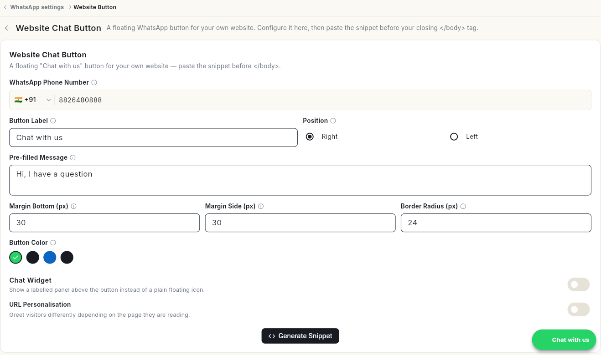

# अपनी वेबसाइट पर व्हाट्सऐप चैट बटन जोड़ें { #add-a-whatsapp-chat-button-to-your-website }

अपनी वेबसाइट पर फ़्लोटिंग व्हाट्सऐप बटन लगाएँ, ताकि विज़िटर एक क्लिक में आपको मैसेज कर सकें। आख़िर में आपके पास आपके लेबल, रंग और शुरुआती मैसेज वाला बटन होगा, और अपनी साइट में पेस्ट करने के लिए तैयार स्निपेट।

## शुरू करने से पहले { #before-you-start }

- आपका व्हाट्सऐप नंबर कनेक्ट हो। देखें [अपना व्हाट्सऐप नंबर कनेक्ट करें](connect-whatsapp-number.md)।
- आप अपनी वेबसाइट का HTML एडिट कर सकते हों, या आपकी टीम में कोई कर सकता हो।

## चरण { #steps }

### बटन की सेटिंग्स खोलें { #open-the-button-settings }

1. नीचे बाएँ कोने में अपने नाम के पहले अक्षर पर क्लिक करें, फिर **Settings** पर क्लिक करें।
2. **WhatsApp** चुनें, फिर **Website Button**। **Website Chat Button** पेज खुलता है।

आप इसे व्हाट्सऐप **Dashboard** से भी खोल सकते हैं: **Quick Actions** के तहत **Website Chat Widget** पर क्लिक करें।

### बटन सेट करें { #set-up-the-button }

1. **WhatsApp Phone Number** जाँचें। इसमें आपका कनेक्टेड नंबर पहले से भरा होता है।
2. **Button Label** में बटन पर दिखने वाला टेक्स्ट लिखें। शुरू में यह **Chat with us** होता है।
3. **Position** के तहत **Right** या **Left** चुनें।
4. **Pre-filled Message** में वह पहला मैसेज लिखें जो विज़िटर भेजेगा। शुरू में यह **Hi, I have a question** होता है।
5. बटन की जगह और आकार तय करने के लिए **Margin Bottom (px)**, **Margin Side (px)** और **Border Radius (px)** सेट करें। ये **30**, **30** और **24** से शुरू होते हैं।
6. एक **Button Color** चुनें।
7. वैकल्पिक: सादे आइकन की जगह बटन के ऊपर लेबल वाला पैनल दिखाने के लिए **Chat Widget** चालू करें।
8. वैकल्पिक: विज़िटर जो पेज पढ़ रहा है उसके हिसाब से अलग अभिवादन दिखाने के लिए **URL Personalisation** चालू करें।

नीचे दाएँ कोने का प्रीव्यू बटन दिखाता है कि वह कैसा दिखेगा।

### बटन को अपनी वेबसाइट में जोड़ें { #add-the-button-to-your-website }

1. **Generate Snippet** पर क्लिक करें।
2. स्निपेट को अपनी वेबसाइट के HTML में, बंद करने वाले `</body>` टैग से ठीक पहले पेस्ट करें।

## वीडियो वॉकथ्रू { #video-walkthrough }

[VIDEO]

## संबंधित गाइड { #related }

- [व्हाट्सऐप डैशबोर्ड पढ़ें](whatsapp-dashboard.md)
- [अपना व्हाट्सऐप नंबर कनेक्ट करें](connect-whatsapp-number.md)
- [व्हाट्सऐप इनबॉक्स का इस्तेमाल करें](use-whatsapp-inbox.md)
