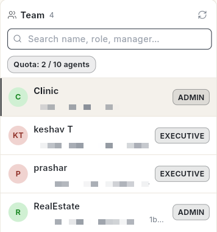
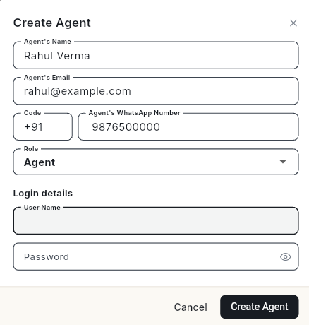
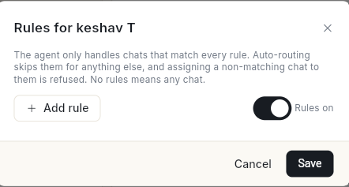
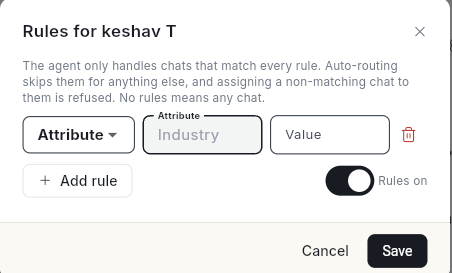

# व्हाट्सऐप एजेंट जोड़ें { #add-whatsapp-agents }

उन लोगों को जोड़ें जो व्हाट्सऐप चैट का जवाब देते हैं, हर एक को अपने लॉगिन के साथ। अंत में आपके एजेंट और मैनेजर साइन इन करके इनबॉक्स से जवाब दे सकते हैं, और चैट के नियम तय करते हैं कि हर एजेंट कौन सी बातचीत ले सकता है।

## शुरू करने से पहले { #before-you-start }

- आप संगठन के एडमिन हों। सिर्फ़ एडमिन एजेंट बना सकता है।
- **WhatsApp** पैनल में आपको **Manage** दिखता हो। न दिखे तो अपने एडमिन से कहें। देखें [टीम के सदस्य, रोल और अनुमतियाँ प्रबंधित करें](../settings/roles-and-permissions.md)।
- आपके पास एक खाली सीट हो। **Quota** चिप इस्तेमाल हुई सीटें दिखाता है, जैसे **Quota: 3 / 10 agents**।

## चरण { #steps }

### अपनी टीम खोलें { #open-your-team }

1. लेफ़्ट रेल में **WhatsApp** खोलें, फिर **Manage** चुनें।
2. **Agents** चुनें। आपकी टीम की सूची खुलती है, जिसमें हर व्यक्ति का रोल दिखता है। ऊपर का चिप दिखाता है कि आपके प्लान में से कितने एजेंट इस्तेमाल हो रहे हैं, जैसे **Quota: 2 / 10 agents**। किसी व्यक्ति का ब्योरा दाईं ओर देखने के लिए उस पर क्लिक करें।

    

2 रोल होते हैं:

| रोल | वे क्या देखते हैं |
| --- | --- |
| **Manager** | अपने एग्ज़ीक्यूटिव की चैट और डेटा। |
| **Agent** (**Executive** के रूप में दिखता है) | सिर्फ़ अपनी चैट। उनके **WhatsApp** पैनल में सिर्फ़ **Inbox** दिखता है। |

### एजेंट जोड़ें { #add-an-agent }

1. **Add Agent** पर क्लिक करें। **Create Agent** खुलता है।
2. **Agent's Name**, **Agent's Email**, देश का **Code** और **Agent's WhatsApp Number** भरें।
3. **Role** में **Agent** या **Manager** चुनें।
4. एजेंट के लिए **Manager (optional)** चुनें। यह फ़ील्ड तभी दिखता है जब आपकी टीम में कोई मैनेजर हो।
5. **Login details** के नीचे **User Name** और **Password** लिखें।

    

6. **Create Agent** पर क्लिक करें। संदेश **Agent created — they can sign in now.** दिखता है।
7. यूज़र नेम और पासवर्ड एजेंट को बताएँ।

पासवर्ड 8 से 64 अक्षरों का हो, जिसमें एक अपरकेस अक्षर, एक लोअरकेस अक्षर, 2 अंक और एक विशेष चिह्न हो। उसमें यूज़र नेम, नाम या ईमेल नहीं होना चाहिए।

किसी को अपना पासवर्ड खुद सेट करने देने के लिए **Invite via Link** पर क्लिक करें। देखें [लिंक से टीम के सदस्यों को बुलाएँ](../settings/invite-teammates.md)।

### अपनी टीम इम्पोर्ट करें { #import-your-team }

1. **Import Team** पर क्लिक करें। **WhatsApp Team** अपलोड खुलता है।
2. सैंपल फ़ाइल डाउनलोड करें। उसमें ये कॉलम हैं: **Name**, **Username**, **Email**, **Password**, **Country Code**, **Phone Number**, **Role**, **Manager Username** और **Organisation**।
3. हर व्यक्ति के लिए एक पंक्ति भरें। **Role** के लिए **MANAGER** या **EXECUTIVE** इस्तेमाल करें।
4. फ़ाइल अपलोड करें।

### चैट के नियम तय करें { #set-chat-rules }

चैट के नियम एजेंट को सिर्फ़ उन चैट तक सीमित करते हैं जो हर नियम से मेल खाती हैं। कोई नियम न हो तो एजेंट कोई भी चैट ले सकता है।

1. एजेंट पर क्लिक करें, फिर ऊपर **Set chat rules** पर क्लिक करें। **Rules for** और उसके बाद नाम वाली विंडो खुलती है।

    

2. **Add rule** पर क्लिक करें। एक नियम की पंक्ति आती है, जो शुरू में **Attribute** पर सेट होती है। ड्रॉप-डाउन खोलकर **Tag** चुनें और टैग लिखें, या **Attribute** रखकर एट्रिब्यूट और उसकी **Value** लिखें। नियम हटाने के लिए डस्टबिन आइकन पर क्लिक करें।

    

3. पक्का करें कि स्विच **Rules on** दिखा रहा है।
4. **Save** पर क्लिक करें। संदेश **Rules saved for** और उसके बाद नाम दिखता है।

मेल न खाने वाली चैट के लिए ऑटो-रूटिंग एजेंट को छोड़ देती है। मेल न खाने वाली चैट उन्हें असाइन करना मना है।

### एजेंट को बदलें या हटाएँ { #change-or-remove-an-agent }

1. एजेंट पर क्लिक करें।
2. रोल या मैनेजर बदलने के लिए **Change role / manager** पर क्लिक करें, बदलाव करें, फिर **Save** पर क्लिक करें।
3. एजेंट को हटाने के लिए **Remove agent** पर क्लिक करें। **Remove agent** से पुष्टि करें।

!!! warning "एजेंट को हटाना"
    उनका लॉगिन बंद हो जाता है और उनके रोल वापस ले लिए जाते हैं। उन्हें असाइन की गई चैट बिना असाइन वाली कतार में लौट जाती हैं।

## वीडियो वॉकथ्रू { #video-walkthrough }

[VIDEO]

## समस्या का समाधान { #troubleshooting }

| समस्या | कारण | समाधान |
| --- | --- | --- |
| **Agent quota reached (10/10). Remove an agent or request a higher quota to add more.** | सारी सीटें इस्तेमाल हो चुकी हैं। | ऐसा एजेंट हटाएँ जिसकी अब ज़रूरत नहीं, या ज़्यादा कोटा माँगें। |
| **This username is already taken. Please choose another.** | किसी और लॉगिन का यही यूज़र नेम है। | कोई दूसरा **User Name** चुनें। |
| **Name, username and password are required.** | कोई ज़रूरी फ़ील्ड खाली है। | नाम, **User Name** और **Password** भरें। |
| **Password must contain an uppercase letter, at least 2 digits, a special character.** | पासवर्ड कमज़ोर है। संदेश बताता है कि क्या कमी है। | संदेश में जो माँगा गया है, वह जोड़ें। |
| **This password is too common and easy to guess (like Password@123).** | पासवर्ड आम पासवर्ड की सूची में है। | कुछ बेमेल शब्द इस्तेमाल करें, जैसे **Mango#River42Lamp**। |
| **Only the organisation admin can create agents.** | आप एडमिन नहीं हैं। | अपने संगठन के एडमिन से एजेंट जोड़ने को कहें। |

## संबंधित गाइड { #related }

- [व्हाट्सऐप इनबॉक्स का इस्तेमाल करें](use-whatsapp-inbox.md)
- [व्हाट्सऐप संपर्क प्रबंधित करें](manage-whatsapp-contacts.md)
- [लिंक से टीम के सदस्यों को बुलाएँ](../settings/invite-teammates.md)
- [टीम के सदस्य, रोल और अनुमतियाँ प्रबंधित करें](../settings/roles-and-permissions.md)
