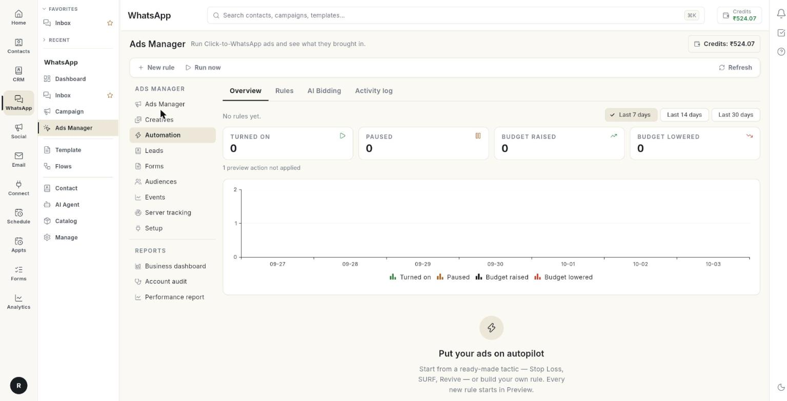

# अपने विज्ञापन ऑटोमेट करें { #automate-your-ads }

**Automation** में एक नियम बनाएँ। यह नियम हर 30 मिनट में आपके विज्ञापन जाँचता है। शर्तें मेल खाएँ, तो वह अपना काम कर देता है। आख़िर में आपका नियम **Preview** में चल चुका होगा और आपने देख लिया होगा कि वह क्या करेगा। फिर आप उसे लाइव कर सकते हैं, या AI बिडिंग से बजट संभाल सकते हैं।

## शुरू करने से पहले { #before-you-start }

- आपका Facebook अकाउंट, पेज और ऐड अकाउंट **Setup** में कनेक्ट हों। देखें [Ads Manager सेट करें](set-up-ads-manager.md)।
- आपके ऐड अकाउंट में कम से कम 1 कैंपेन, ऐड सेट या विज्ञापन हो।
- **WhatsApp** पैनल में आपको **Ads Manager** दिखना चाहिए। न दिखे, तो अपने एडमिन से कहें।

## नियम क्या होता है { #what-a-rule-is }

नियम एक सीधी बात होती है: **If** कुछ शर्तें सही हैं, **then** एक काम करो। जैसे, अगर किसी ऐड सेट ने आज तय रकम से ज़्यादा खर्च किया और 1 से कम नतीजा आया, तो उसे रोक दो।

- नियम हर 30 मिनट में जाँच करता है। सेव किए हुए नियम में एडिटर के नीचे **Checked every 30 minutes.** लिखा दिखता है।
- हर नया नियम **Preview** में शुरू होता है। वह बस लिख लेता है कि क्या करता। Meta पर वह कुछ नहीं बदलता।
- आप **live** जाते हैं, तो नियम सच में Meta पर आपके विज्ञापन बदलने लगता है। हर बदलाव **Activity log** में लिखा जाता है।

!!! warning "चेतावनी"
    लाइव नियम आपसे पूछे बिना विज्ञापन रोक देता है और बजट बदल देता है। **Go live** पर क्लिक करने से पहले नियम को **Preview** में चलाएँ और **Activity log** पढ़ लें।

## Automation के टैब { #the-automation-tabs }

**Ads Manager** के बाएँ कॉलम में **Automation** चुनें। इसमें 4 टैब हैं।

| टैब | इसमें क्या दिखता है |
| --- | --- |
| **Overview** | नियमों ने कितने काम किए, रोज़ का चार्ट और **Recent activity**। |
| **Rules** | हर नियम का एक कार्ड, जिसमें उसका मोड और स्विच होता है। |
| **AI Bidding** | बजट को कॉस्ट-पर-रिज़ल्ट या ROAS के टारगेट की तरफ़ ले जाना। देखें [AI बिडिंग से बजट चलाएँ](#steer-budgets-with-ai-bidding)। |
| **Activity log** | नियम ने जो-जो काम किया, या **Preview** में जो करता। |

ऊपर की पट्टी में **New rule**, **Run now** और **Refresh** हैं।

## स्टेप { #steps }

### तैयार रणनीति से नियम बनाएँ { #create-a-rule-from-a-ready-made-tactic }

1. लेफ़्ट रेल में **WhatsApp** खोलें, फिर **Ads Manager** चुनें।
2. बाएँ कॉलम में **Automation** चुनें।

    

3. **New rule** पर क्लिक करें। **New rule** विंडो खुल जाएगी।
4. **Tactics** या **Strategies** में से कोई कार्ड चुनें। या **Start from scratch** पर क्लिक करें।

    

5. एडिटर में कोई भी संख्या बदल सकते हैं। ऊपर लिखा होता है **From "[card name]" — change any number you like.**
6. **Create rule** पर क्लिक करें। मैसेज **Rule created in Preview. It logs what it would do — go live when you are happy.** दिखेगा।

!!! note "शुरुआती संख्याएँ"
    हर कार्ड में खर्च, कॉस्ट-पर-रिज़ल्ट और नतीजों की कुछ शुरुआती संख्याएँ पहले से भरी होती हैं। सेव करने से पहले उन्हें अपने बजट से मिलाकर देख लें। [VERIFY: starting amounts are in the currency of your ad account]

तैयार कार्ड ये हैं:

| कार्ड | लेवल | क्या करता है |
| --- | --- | --- |
| **Stop Loss** | Ad set level, Ad level | आज जिसने बिना नतीजे के खर्च किया, उसे रोक देता है। रीसेट के समय पर उसे वापस चालू कर देता है। |
| **SURF** | Ad set level, Campaign level | जिसका आज का दिन सस्ता जा रहा है, उसका बजट आपकी अधिकतम सीमा तक बढ़ाता है। रीसेट के समय पर बजट पहले जितना कर देता है। |
| **Sunsetting** | Ad set level | ऐड सेट जितने दिन महँगा चलता रहता है, हर दिन उसका बजट थोड़ा घटाता है। बजट आपकी न्यूनतम सीमा से नीचे नहीं जाता। |
| **Revive** | Ad set level, Ad level | रुका हुआ आइटम वापस चालू करता है, जब उसके हाल के आँकड़े दिखाएँ कि वह ठीक चल रहा था। |
| **Scale winning campaigns** | Campaign level | जो कैंपेन एक हफ़्ता सस्ते रहे, उनमें हर दिन एक कदम बजट जोड़ता है। बजट आपकी अधिकतम सीमा तक जाता है। |
| **Scale winning ad sets** | Ad set level | यही काम, ऐड सेट के लिए। |
| **Downscale losing campaigns** | Campaign level | जो कैंपेन हफ़्ते भर महँगे चले, उनका बजट घटाता है। बजट आपकी न्यूनतम सीमा से नीचे नहीं जाता। |
| **Downscale losing ad sets** | Ad set level | यही काम, ऐड सेट के लिए। |
| **Stop Loss for expensive ads with no clicks** | Ad level | जिन विज्ञापनों पर एक भी क्लिक के बिना खर्च हो रहा है, उन्हें आज के लिए बंद कर देता है। |
| **Pause losing ads for today** | Ad level | आज जो विज्ञापन महँगे चल रहे हैं, उन्हें रोक देता है। रीसेट के समय पर उन्हें वापस चालू कर देता है। |
| **Pause losing ads permanently** | Ad level | जो विज्ञापन तीन दिन महँगे रहे, उन्हें रोक देता है। अगर देर से आए नतीजे दिखाएँ कि वे ठीक थे, तो उन्हें वापस चालू कर देता है। |

### नियम का नाम रखें और चुनें कि वह किस पर काम करे { #name-the-rule-and-choose-what-it-works-on }

1. **New rule** एडिटर में **Rule name** लिखें, जैसे "Stop loss — ad sets"। नाम 120 अक्षरों तक का हो सकता है।
2. **Works on** में **Campaigns**, **Ad sets** या **Ads** चुनें। इसे बदलेंगे, तो आपके चुने हुए एसेट हट जाएँगे।

!!! note "ध्यान दें"
    **Ads** के लिए बजट वाले काम नहीं मिलते। एडिटर में लिखा आता है **Ads have no budget of their own.** बजट के लिए ऐड सेट या कैंपेन लेवल चुनें।

### शर्तें जोड़ें { #add-the-conditions }

1. **If … of these are true** में **all** या **any** चुनें। **all** का मतलब है कि हर शर्त मेल खानी चाहिए। **any** का मतलब है कि 1 शर्त भी काफ़ी है।
2. शर्त में एक **Metric** चुनें। लिस्ट नीचे दी है।
3. एक **Period** चुनें। लिस्ट नीचे दी है।
4. **Is** चुनें: **is more than**, **is at least**, **is less than** या **is at most**।
5. **Compared with** चुनें: **a fixed value**, **% of account average** या **% of its previous period**।
6. **Value** लिखें। % वाली तुलना हो, तो 0 से ऊपर का **Percent** लिखें, जैसे 130।
7. दूसरी शर्त जोड़ने के लिए **Add condition** पर क्लिक करें।

एक नियम में ज़्यादा से ज़्यादा 6 शर्तें लग सकती हैं।

जो **Metrics** आप चुन सकते हैं: **Spend**, **Impressions**, **Link clicks**, **CTR (link, %)**, **Cost per link click**, **CPM**, **Frequency**, **Results**, **Cost per result**, **Conversations**, **Leads**, **Purchases**, **Revenue**, **ROAS** और **Daily budget**।

जो **Periods** आप चुन सकते हैं: **Today**, **Yesterday**, **Last 3 days** और **Last 7 days**।

### काम चुनें { #choose-the-action }

1. **Then** में एक **Action** चुनें। लिस्ट नीचे दी है।
2. बजट वाले काम के लिए **By** में 1 से 100 के बीच का प्रतिशत भरें। या **New daily budget** में रकम भरें।
3. **Max daily budget** भरें। बजट इससे ऊपर कभी नहीं बढ़ेगा। **Increase budget by %** के लिए यह भरना ज़रूरी है।
4. **Min daily budget** भरें। बजट इससे नीचे कभी नहीं घटेगा। बजट घटाने वाले कार्ड के लिए यह भरना ज़रूरी है।

| Action | क्या करता है |
| --- | --- |
| **Pause** | आइटम को रोक देता है। |
| **Turn on** | आइटम को चालू कर देता है। |
| **Increase budget by %** | रोज़ का बजट बढ़ाता है। इसके लिए **Max daily budget** चाहिए। |
| **Decrease budget by %** | रोज़ का बजट घटाता है। |
| **Set daily budget** | रोज़ का नया बजट तय करता है। |
| **Notify me** | सिर्फ़ आपको अलर्ट भेजता है। Meta पर कुछ नहीं बदलता। |

### तय करें कि नियम कब और कितनी बार काम करे { #set-when-and-how-often-the-rule-acts }

1. बेल नोटिफ़िकेशन, पुश और ईमेल पाने के लिए **Notify me when it acts** चालू करें। हर जाँच पर आपको एक सारांश मिलेगा, और वह भी तभी, जब नियम लाइव हो।
2. **Wait between actions (hours)** भरें। यहाँ 1 घंटे से 30 दिन के बीच की कोई भी वैल्यू डाल सकते हैं। खाली छोड़ेंगे, तो बजट वाले कामों के लिए 4 घंटे और बाकी कामों के लिए 24 घंटे माने जाएँगे।
3. **Reset at (HH:mm)** भरें। उस समय रुका हुआ आइटम वापस चालू हो जाएगा, या बजट पहले जितना हो जाएगा। खाली छोड़ेंगे, तो बदलाव वैसा ही रहेगा।
4. **Turn it back on if late results show it was fine** चालू करें। यह उस रोक के लिए है, जिसमें रीसेट का समय नहीं डाला। Meta कुछ नतीजे एक-दो दिन देर से बताता है।
5. **Keep checking for** चुनें: **1 day**, **2 days**, **3 days**, **5 days** या **7 days**।
6. **When it runs** में **Mon** से **Sun** तक के दिन चुनें। कोई दिन न चुनें, तो नियम हर दिन चलेगा।
7. नियम किन घंटों में काम करे, यह सीमित करने के लिए **From (HH:mm)** और **To (HH:mm)** भरें। दोनों भरें, या दोनों खाली छोड़ें। खाली छोड़ेंगे, तो नियम पूरे दिन चलेगा।
8. **Timezone** चुनें: **Account default (India)** या लिस्ट में से कोई और ज़ोन। **Reset at** में भी यही टाइमज़ोन चलता है।

### चुनें कि नियम किन आइटम पर लगे { #choose-which-items-the-rule-covers }

1. **Apply to** में **All [ad sets]** या **Only the [ad sets] I pick** चुनें। ये शब्द आपके **Works on** वाले चुनाव के हिसाब से बदलते हैं।
2. **Only the … I pick** चुना है, तो आइटम पर टिक करें।
3. **All** चुना है, तो कुछ आइटम को नियम से बाहर रखने के लिए **Skip some [ad sets]** में उन्हें चुनें।
4. **Create rule** पर क्लिक करें। नया नियम **Preview** में शुरू होगा। नियम को एडिट कर रहे हों, तो **Save changes** पर क्लिक करें।

### Overview टैब पढ़ें { #read-the-overview-tab }

1. **Overview** टैब चुनें।
2. सारांश की लाइन पढ़ें, जैसे **3 rules · 1 live · checked every 30 minutes**।
3. तारीख़ों की रेंज चुनें: **Last 7 days**, **Last 14 days** या **Last 30 days**।
4. टाइल देखें: **Turned on**, **Paused**, **Budget raised** और **Budget lowered**।
5. टाइल के नीचे की धूसर लाइन पढ़ें। उसमें दिखता है कि कितने Preview वाले काम लागू नहीं हुए और कितने फ़ेल हुए।
6. रोज़ का चार्ट देखें, फिर **Recent activity** पढ़ें।
7. **Activity log** खोलने के लिए **See all** पर क्लिक करें।

आपका कोई नियम न हो, तो टैब में **Put your ads on autopilot** दिखता है। **Create your first rule** पर क्लिक करें।

### अपने नियम मैनेज करें { #manage-your-rules }

1. **Rules** टैब चुनें। हर नियम एक कार्ड है, जिसमें उसका नाम, **Live** या **Preview** बैज, उसका लेवल और एक सारांश होता है।
2. धूसर लाइन पढ़ें। उसमें 48 घंटे के काम, 7 दिन के काम, **last checked** और नियम बनाने वाले का नाम होता है।
3. नियम को चालू या बंद करने के लिए कार्ड का स्विच दबाएँ। बंद होने पर बैज में **Off** दिखता है।
4. कार्ड पर **More** मेन्यू खोलें।
5. एडिटर खोलने के लिए **Edit** पर क्लिक करें। बदलाव **Save changes** से सेव करें।
6. नियम को असली बनाने के लिए **Go live** पर क्लिक करें। एक विंडो पूछेगी **Turn "[name]" live?**
7. लाइव नियम को वापस टेस्ट मोड में लाना हो, तो **Back to preview** पर क्लिक करें। नियम फिर सिर्फ़ लिखेगा, बदलेगा कुछ नहीं।
8. इस नियम को अभी जाँचना हो, तो **Run now** पर क्लिक करें।
9. इस नियम का **Activity log** खोलने के लिए **See activity** पर क्लिक करें।
10. नियम बंद करने के लिए **Delete** पर क्लिक करें। पुरानी गतिविधि बनी रहती है। नियम ने जो कुछ रोका था, वह रुका ही रहता है।

### Preview में टेस्ट करें, फिर लाइव जाएँ { #test-in-preview-then-go-live }

1. नियम बनाएँ। वह **Preview** में शुरू होगा।
2. ऊपर की पट्टी में **Run now** पर क्लिक करें, या अगली जाँच का इंतज़ार करें। इनमें से कोई एक मैसेज दिखेगा:
    - **No enabled rules to check.**
    - **Checked N rules — nothing matched.**
    - **Checked N rules — N actions. See the Activity log.**
3. **Activity log** खोलें। जिन लाइनों में नतीजा **Preview only** है, वे बताती हैं कि नियम क्या करता।
4. लाइनें सही लगें, तो नियम पर **More** खोलें और **Go live** पर क्लिक करें।
5. **Turn "[name]" live?** विंडो में **Go live** पर क्लिक करें। मैसेज **Rule is live.** दिखेगा।

    

### Activity log पढ़ें { #read-the-activity-log }

1. **Activity log** टैब चुनें।
2. कोई **Rule** चुनें, या **All rules**।
3. **Last 7 days**, **Last 14 days** या **Last 30 days** चुनें।
4. कॉलम पढ़ें। नीचे की टेबल देखें।

| कॉलम | क्या दिखाता है |
| --- | --- |
| **WHEN** | काम की तारीख़ और समय, आपके अपने समय में। |
| **RULE** | नियम का नाम। |
| **ON** | लेवल, और कैंपेन, ऐड सेट या विज्ञापन का नाम। |
| **ACTION** | **Paused**, **Turned on**, **Budget raised**, **Budget lowered**, **Budget set**, **Flagged**, **Turned back on** या **Budget put back**। बजट वाले कामों में पुराना और नया बजट दिखता है। |
| **RESULT** | **Done**, **Preview only** या **Failed**। |
| **WHY** | वजह, कोई एरर, और रीसेट कब होना है। |

टैब खाली हो, तो उसमें लिखा आता है **Nothing yet. Every time a rule acts — or, in Preview, would have acted — it shows here.**

### AI बिडिंग से बजट चलाएँ { #steer-budgets-with-ai-bidding }

AI बिडिंग आपके चुने कैंपेन या ऐड सेट का रोज़ का बजट आपके टारगेट की तरफ़ ले जाती है। हर बार वह टारगेट और मौजूदा बजट के बीच का आधा फ़र्क़ मिटाती है। यह सब आपकी न्यूनतम और अधिकतम सीमा के अंदर होता है। वह हर घंटे जाँच करती है।

1. **AI Bidding** टैब चुनें।
2. **New AI bidding** पर क्लिक करें।
3. नाम लिखें, जैसे "Scale Diwali ad sets"।
4. **Steer the budget of** में **Campaigns (campaign budget)** या ऐड सेट चुनें। 50 तक चुन सकते हैं।
5. लक्ष्य चुनें: **At most** के साथ **Cost per result**, या **At least** के साथ **ROAS**।
6. **Minimum** भरें। बजट इससे नीचे कभी नहीं घटेगा।
7. **Maximum** भरें। बजट इससे ऊपर कभी नहीं बढ़ेगा।
8. **Biggest step** चुनें: **10%**, **15%**, **20%** या **30%**।
9. **Judge on** चुनें: **Last 3 days** या **Last 7 days**।
10. **Wait between changes** चुनें: **2**, **4**, **6**, **12** या **24 hours**।
11. **Create** पर क्लिक करें। वह **Preview** में शुरू होती है और हर घंटे दिखाती है कि वह क्या करती। मैसेज आता है **AI bidding created in Preview — it shows what it would do and changes nothing yet.**
12. तैयार हों, तब कार्ड पर **More** खोलें और **Go live** पर क्लिक करें।

हर जाँच के बाद स्थिति इनमें से कोई एक होती है: **Raised**, **Lowered**, **Would raise**, **Would lower**, **Failed**, **Not found** और **Holding**। आइटम अभी सीख रहा हो, या उसका बजट खर्च न हो रहा हो, तब टूल रुका रहता है।

!!! warning "2 टूल को एक ही ऐड सेट पर न लगाएँ"
    बजट वाले नियम और AI बिडिंग को एक ही ऐड सेट पर न लगाएँ। दोनों एक ही बजट बदलने लगेंगे।

## समस्या का समाधान { #troubleshooting }

| समस्या | कारण | समाधान |
| --- | --- | --- |
| **Give the rule a name.** | **Rule name** खाली है। | नाम लिखें। |
| **Every condition needs a number.** | कोई **Value** खाली है या उसमें संख्या नहीं है। | हर शर्त में संख्या भरें। |
| **A "% of" condition needs a percent above zero, e.g. 130.** | तुलना प्रतिशत की है और वैल्यू 0 या खाली है। | 0 से ऊपर का प्रतिशत लिखें। |
| **Set a maximum daily budget so the rule cannot overspend.** | काम बजट बढ़ाने का है और **Max daily budget** खाली है। | **Max daily budget** भरें। |
| **Ads have no budget — change budgets at ad set or campaign level.** | **Ads** पर बजट वाला काम सेट है। | **Works on** को **Ad sets** या **Campaigns** करें। |
| **Pick at least one campaign, ad set or ad, or apply the rule to all.** | **Only the … I pick** में कुछ भी टिक नहीं है। | कम से कम 1 आइटम पर टिक करें, या **All** चुनें। |
| नियम कभी कोई काम नहीं करता | वह **Preview** में है, बंद है, या कोई आइटम मेल नहीं खा रहा। | **Live** बैज और स्विच देखें। **Run now** पर क्लिक करें और **Activity log** पढ़ें। |

## संबंधित गाइड { #related }

- [अपने विज्ञापन मैनेज करें](manage-your-ads.md)
- [विज्ञापन क्रिएटिव का इस्तेमाल करें](use-ad-creatives.md)
- [अकाउंट ऑडिट चलाएँ](run-an-account-audit.md)
- [परफ़ॉर्मेंस रिपोर्ट पढ़ें](read-the-performance-report.md)
- [Click-to-WhatsApp विज्ञापन चलाएँ](../click-to-whatsapp-ads.md)
