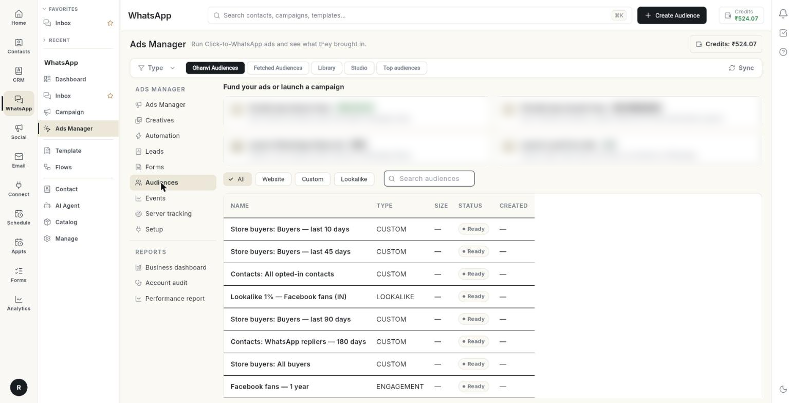

# विज्ञापन ऑडियंस बनाएँ { #build-ad-audiences }

आपके विज्ञापन किन तक पहुँचें और किन्हें छोड़ें, यह चुनने के लिए **Audiences** टैब खोलें। आख़िर में आपके पास Meta पर एक ऑडियंस होगी, जिसे **Create Ad** में चुना जा सकता है। आप **Library** से बनी-बनाई ऑडियंस कॉपी भी कर सकते हैं और ऑडियंस को प्रति नतीजा लागत के हिसाब से रैंक कर सकते हैं। पहली ऑडियंस में 5 से 10 मिनट लगते हैं।

## शुरू करने से पहले { #before-you-start }

- आपका Facebook अकाउंट, पेज और ऐड अकाउंट **Setup** में कनेक्ट हों। देखें [Click-to-WhatsApp विज्ञापन चलाएँ](../click-to-whatsapp-ads.md)।
- **Custom** ऑडियंस के लिए आपके पास फ़ोन नंबर या ईमेल वाले संपर्क हों। देखें [व्हाट्सऐप संपर्क प्रबंधित करें](../manage-whatsapp-contacts.md)।
- **Website** ऑडियंस के लिए आपके पास विज़िट रिकॉर्ड करने वाला डेटासेट (पिक्सल) हो। देखें [वेबसाइट इवेंट ट्रैक करें](track-website-events.md)।
- **Lookalike** ऑडियंस के लिए आपके पास कॉपी करने के लिए कम से कम 1 कस्टम या वेबसाइट ऑडियंस हो।
- इस ऐड अकाउंट के लिए Meta की **Custom Audience terms** स्वीकार की गई हों। अगर नहीं हैं, तो एरर में Meta का लिंक दिखता है। इस ऐड अकाउंट में लॉग इन रहते हुए उसे खोलें और शर्तें स्वीकार करें।

## ऑडियंस के प्रकार और व्यू { #audience-types-and-views }

| प्रकार | इसमें कौन होता है |
|------|--------------|
| **Custom** | आपकी अपनी संपर्कों, फ़ोन नंबरों या ईमेल की सूची के लोग। |
| **Website** | वे लोग जो आपकी वेबसाइट पर आए और पिक्सल ने जिन्हें रिकॉर्ड किया। |
| **Lookalike** | वे लोग जो किसी कस्टम या वेबसाइट ऑडियंस से मिलते-जुलते हैं। |

**Audiences** टैब में पाँच व्यू हैं। ऊपर की पट्टी से एक चुनें।

| व्यू | इसमें क्या रहता है |
|------|---------------|
| **Ohanvi Audiences** | वे ऑडियंस जो आपने Ohanvi में बनाईं। |
| **Fetched Audiences** | वे ऑडियंस जो आपके Meta ऐड अकाउंट में पहले से हैं। उन्हें लाने के लिए **Sync** पर क्लिक करें। |
| **Library** | फ़नल के चरण के हिसाब से ग्रुप की गई बनी-बनाई ऑडियंस, और आपके अपने डेटा से सिंक रखे गए ग्रुप। |
| **Studio** | रुचियों, व्यवहार और ऑडियंस नियमों का बिल्डर, साथ में रुचि इनसाइट्स। |
| **Top audiences** | आपकी इस्तेमाल की हुई ऑडियंस की प्रति नतीजा लागत के हिसाब से रैंकिंग। |

पहले दो व्यू तालिका दिखाते हैं।

| कॉलम | यह क्या दिखाता है |
|--------|---------------|
| **NAME** | ऑडियंस का नाम। |
| **TYPE** | **Custom**, **Website** या **Lookalike**। |
| **SIZE** | लोगों की अनुमानित संख्या। Meta के गिनने तक **—** दिखता है। |
| **STATUS** | ऑडियंस का स्टेटस, जैसे **READY**। |
| **CREATED** | बनने की तारीख। |

## चरण { #steps }

### ऑडियंस खोजें { #find-an-audience }

1. लेफ़्ट रेल में **WhatsApp** खोलें, फिर **Ads Manager** चुनें।
2. **Audiences** पर क्लिक करें।

    

3. सूची छोटी करने के लिए किसी प्रकार के चिप पर क्लिक करें: **All**, **Website**, **Custom** या **Lookalike**।
4. या **Search audiences** बॉक्स में टाइप करें।
5. जो ऑडियंस Meta पर पहले से हैं, उनके लिए **Fetched Audiences** खोलें और **Sync** पर क्लिक करें। अगर सूची कभी सिंक नहीं हुई, तो टैब में **No audiences fetched from the Meta ad account yet — tap Sync to pull the ones that already exist there.** दिखता है।

### कस्टम ऑडियंस बनाएँ { #create-a-custom-audience }

1. **Audiences** पर क्लिक करें, फिर **Create Audience** पर क्लिक करें। **Create Audience** विंडो खुलती है।
2. **Audience name \*** लिखें। ऐसा नाम रखें जो बताए कि इसमें कौन हैं, जैसे `Buyers last 90 days`।
3. **Type** के तहत **Custom** चुनें।
4. **Who goes in this list** के तहत फ़ोन नंबर या ईमेल वाले हर संपर्क को जोड़ने के लिए **My contacts** चुनें। या **Paste a list** चुनें।
5. **Paste a list** के लिए **Phone numbers or emails** में टाइप करें या पेस्ट करें। हर लाइन में एक फ़ोन नंबर या ईमेल रखें।
6. वैकल्पिक: **Description (optional)** लिखें।
7. **Create** पर क्लिक करें। विंडो में **Collecting your customers…** और **Sending 120 people to Meta…** जैसी प्रगति दिखती है। ऑडियंस बन जाने पर वह बंद हो जाती है।

    

पेस्ट की गई सूची के नियम:

- कॉमा और स्पेस अनदेखे किए जाते हैं।
- डुप्लिकेट हटा दिए जाते हैं।
- नंबर और ईमेल Ohanvi से बाहर जाने से पहले स्क्रैम्बल कर दिए जाते हैं। Meta को सिर्फ़ मिलान दिखता है, नंबर या ईमेल खुद नहीं।

Meta को ऑडियंस बनाने में कुछ घंटे लगते हैं। बहुत छोटी सूची शायद कभी इतने लोगों से मेल न खाए कि इस्तेमाल लायक बने।

### वेबसाइट ऑडियंस बनाएँ { #create-a-website-audience }

1. **Audiences** पर क्लिक करें, फिर **Create Audience** पर क्लिक करें।
2. **Audience name \*** लिखें।
3. **Type** के तहत **Website** चुनें।
4. **Meta Pixel \*** के तहत वह पिक्सल (डेटासेट) चुनें जिसके विज़िटर तक आप दोबारा पहुँचना चाहते हैं। अगर सूची खाली है, तो पहले **Events** में डेटासेट बनाएँ।
5. **Include visitors who \*** के तहत **Viewed any page**, **Viewed a product or service**, **Added to cart** या **Purchased** चुनें।
6. **Keep visitors for** के तहत 7, 14, 30, 60, 90 या 180 दिन चुनें। इस अवधि के बाद Meta व्यक्ति को हटा देता है।
7. वैकल्पिक: **Description (optional)** लिखें।
8. **Create** पर क्लिक करें।

### लुकअलाइक ऑडियंस बनाएँ { #create-a-lookalike-audience }

1. **Audiences** पर क्लिक करें, फिर **Create Audience** पर क्लिक करें।
2. **Audience name \*** लिखें।
3. **Type** के तहत **Lookalike** चुनें।
4. **Modelled on \*** के तहत वह ऑडियंस चुनें जिसे Meta कॉपी करे। सिर्फ़ कस्टम और वेबसाइट ऑडियंस दिखती हैं।
5. **Audience size** स्लाइडर को 1% से 20% के बीच खिसकाएँ।
6. **Country to find similar people in** के तहत 2 अक्षरों का देश कोड लिखें। डिफ़ॉल्ट **IN** है।
7. वैकल्पिक: **Description (optional)** लिखें।
8. **Create** पर क्लिक करें।

स्लाइडर तय करता है कि मिलान कितना करीबी हो:

- 1% सबसे छोटी और सबसे मिलती-जुलती ऑडियंस है।
- 2% से 3% संतुलित है।
- 10% या ज़्यादा चौड़ा, ढीला मिलान है।

### Library से बनी-बनाई ऑडियंस इस्तेमाल करें { #use-a-ready-made-audience-from-the-library }

**Library** में ऐसी ऑडियंस हैं जिन्हें आप 1 क्लिक में बना सकते हैं। वे फ़नल के चरण के हिसाब से ग्रुप की गई हैं।

1. **Audiences** पर क्लिक करें, फिर **Library** पर क्लिक करें।
2. एक चरण का टैब चुनें:
    - **Prospecting**: नए लोग जो आपके सबसे अच्छे ग्राहकों जैसे दिखते हैं।
    - **Re-engagement**: वे लोग जो आपको जानते हैं पर न आए, न खरीदा।
    - **Retargeting**: वे लोग जिन्होंने रुचि दिखाई पर खरीदा नहीं।
    - **Retention**: आपके अपने ग्राहक, उन्हें वापस लाने और उनका खर्च बढ़ाने के लिए।
3. हर चरण की सबसे ज़्यादा इस्तेमाल हुई ऑडियंस देखने के लिए **Popular** पर क्लिक करें।
4. सभी चरणों में खोजने के लिए **Search audiences** में टाइप करें।
5. किसी कार्ड पर **Create** पर क्लिक करें। कुछ कार्ड पहले एक मान माँगते हैं:
    - **Number of days (1–365)**, जैसे 45। वेबसाइट कार्ड 1 से 180 दिन मानते हैं।
    - **Part of the page URL**, जैसे `/collections/shoes`।
    - **Pixel event name**, जैसे `Subscribe`।
6. संदेश **"Name" created on Meta, with its exclusions.** का इंतज़ार करें। अब कार्ड पर **Created** टैग दिखता है।
7. इस ऑडियंस के साथ भरा हुआ **Create Ad** खोलने के लिए **Use in ad** पर क्लिक करें।

    

कार्ड पर ये ब्योरे दिख सकते हैं:

- **Leaves out:** वे ग्रुप जिन्हें ऑडियंस बाहर रखती है, जैसे पुराने खरीदार।
- **Modelled on 5,000 people** या **5,000 people in the group**: स्रोत ग्रुप का आकार।
- **Add another**: मान वाला कार्ड एक से ज़्यादा वर्शन रख सकता है, जैसे 30 दिन और 90 दिन।
- पीला नोट: वजह कि कार्ड अभी क्यों नहीं बन सकता, जैसे स्रोत डेटा न होना।

#### Library से ऑडियंस हटाएँ { #remove-an-audience-from-the-library }

1. कार्ड खोजें।
2. बिन आइकन (**Remove from library**) पर क्लिक करें।
3. संदेश **Removed from the library. The audience stays on Meta for running ads.** पढ़ें।

#### कई ऑडियंस एक साथ लॉन्च करें { #launch-several-audiences-at-once }

1. हर मनचाहे कार्ड पर बॉक्स टिक करें, या **Select all in this view** पर क्लिक करें।
2. **Launch selected (3)** पर क्लिक करें। **Launch 3 audiences** विंडो खुलती है।
3. जो ऐड सेट आप पहले से चला रहे हैं उसे कॉपी करने के लिए **One ad set per audience** चुनें। सिर्फ़ ऑडियंस बदलती है। ऐड सेट पॉज़ की हालत में बनते हैं।
4. **Ad set to copy** के तहत ऐड सेट चुनें।
5. या सभी ऑडियंस और उनके एक्सक्लूज़न भरे हुए **Create Ad** को खोलने के लिए **All together in one new ad** चुनें।
6. **Create paused ad sets** या **Open Create Ad** पर क्लिक करें।
7. तैयार होने पर **Ads Manager** में ऐड सेट चालू करें।

आप एक बार में ज़्यादा से ज़्यादा 10 ऑडियंस लॉन्च कर सकते हैं।

### संपर्कों के किसी ग्रुप को सिंक में रखें { #keep-a-group-of-contacts-in-sync }

**Synced from your data** **Library** के सबसे ऊपर रहता है। यह Meta की ऑडियंस को आपके अपने ग्रुप के साथ अपडेट रखता है।

1. **Sync a group** पर क्लिक करें। **Sync a group to Meta** विंडो खुलती है।
2. **Where the people come from** के तहत स्रोत चुनें।
3. **Group** के तहत ग्रुप चुनें। जो ग्रुप पहले से सिंक हैं उन पर **(synced)** दिखता है।
4. **Create and sync** पर क्लिक करें।

ऑडियंस बनती है और भर जाती है। यह हर रात दोबारा सिंक होती है। सिर्फ़ वही लोग भेजे जाते हैं जिन्होंने ऑप्ट-आउट नहीं किया है। फ़ोन और ईमेल Meta तक पहुँचने से पहले हैश कर दिए जाते हैं।

सिंक किए गए ग्रुप को प्रबंधित करने के लिए उसके बगल के आइकन इस्तेमाल करें:

1. तुरंत सिंक करने के लिए **Sync now** पर क्लिक करें।
2. रात का सिंक रोकने के लिए **Pause nightly sync** पर क्लिक करें। उसे फिर शुरू करने के लिए **Resume nightly sync** पर क्लिक करें।
3. सिंक बंद करने और ऑडियंस को Meta पर रखने के लिए **Stop syncing (the Meta audience stays)** पर क्लिक करें।

हर सिंक किया हुआ ग्रुप एक स्टेटस दिखाता है:

| स्टेटस | मतलब |
|--------|---------|
| **Synced** | पिछला सिंक सफल रहा। |
| **No one yet** | ग्रुप में भेजने के लिए कोई नहीं है। |
| **Failed** | पिछला सिंक फ़ेल हुआ। एरर नाम के नीचे दिखता है। |
| **Pending** | पहला सिंक अभी नहीं चला। |

### Studio में टार्गेटिंग डिज़ाइन करें { #design-targeting-in-the-studio }

ऐसी टार्गेटिंग बनाने के लिए **Studio** का इस्तेमाल करें जो किसी एक विज्ञापन से बँधी न हो।

1. **Audiences** पर क्लिक करें, फिर **Studio** पर क्लिक करें। **Builder** व्यू खुलता है।
2. वैकल्पिक: पिछला सेटअप लोड करने के लिए **Start from a saved audience** चुनें।
3. **Countries** लिखें, जैसे `IN, AE`।
4. **Include — people matching any of** के तहत रुचियाँ, व्यवहार और डेमोग्राफ़िक्स खोजें और उन्हें जोड़ें। ऑडियंस ऐसे व्यक्ति से मेल खाती है जो उनमें से कम से कम 1 पर खरा उतरे।
5. वैकल्पिक: **Narrow further ("and must also match")** पर क्लिक करें। व्यक्ति को इस अतिरिक्त बॉक्स से भी मेल खाना होगा।
6. **Your audiences** के तहत **Reach** में ऑडियंस चुनें। **Reach** में सूची के सभी लोग शामिल होते हैं।
7. **Your audiences** के तहत **Exclude** में ऑडियंस चुनें। **Exclude** उन्हें हटा देता है।
8. **Monthly reach** पढ़ें। यह 1.2M – 1.8M लोगों जैसा अनुमान दिखाता है।
9. **Audience name** लिखें, फिर **Save audience** पर क्लिक करें। संदेश **Saved. Pick "Name" in Create Ad → Audience.** दिखता है।
10. या इस टार्गेटिंग के साथ **Create Ad** खोलने के लिए **Use in ad** पर क्लिक करें।

!!! note "Meta अब रुचि के आधार पर बाहर रखने की अनुमति नहीं देता"
    लोगों को बाहर रखने के लिए **Your audiences** के तहत अपनी किसी ऑडियंस को एक्सक्लूड करें।

### सबसे कम लागत वाली रुचियाँ खोजें { #find-the-interests-that-cost-least }

1. **Studio** में **Interest insights** पर क्लिक करें।
2. कॉलम पढ़ें: **INTEREST**, **AD SETS**, **SPEND**, **RESULTS**, **COST / RESULT** और **VS AVERAGE**।
3. किसी रुचि को इस्तेमाल करने के लिए उसकी पंक्ति में ऐड आइकन (**Add to builder**) पर क्लिक करें।

रुचि के आँकड़े अनुमान हैं। Meta रुचि के हिसाब से नतीजे नहीं बताता।

### देखें कि कौन-सी ऑडियंस सबसे अच्छा प्रदर्शन करती हैं { #see-which-audiences-perform-best }

1. **Audiences** पर क्लिक करें, फिर **Top audiences** पर क्लिक करें।
2. ऊपर से तारीख की सीमा और फ़िल्टर चुनें।
3. हर ऑडियंस को **AD SETS**, **SPEND**, **RESULTS**, **COST / RESULT**, **TREND**, **VS AVERAGE** और **EXCLUDED IN** के साथ देखने के लिए **Audiences** खोलें।
4. **VS AVERAGE** में नतीजा पढ़ें: **Better than average**, **About average**, **Worse than average** या **No results**। **Excluded only** का मतलब है कि ऑडियंस सिर्फ़ लोगों को बाहर रखने के लिए इस्तेमाल हुई।
5. चरण के हिसाब से खर्च **% OF SPEND** में और **LIVE / CREATED** ऐड सेट देखने के लिए **Funnel** खोलें।
6. उम्र, क्षेत्र और प्लेसमेंट के हिसाब से कौन जवाब देता है और टॉप लैंडिंग पेज देखने के लिए **Breakdowns** खोलें।
7. किसी ऑडियंस को दोबारा इस्तेमाल करने के लिए पंक्ति पर **Use in ad** पर क्लिक करें।

ऐड सेट अपनी शामिल हर ऑडियंस के लिए पूरा गिना जाता है। तारा (*) उन ऑडियंस को चिह्नित करता है जिन्होंने ऐड सेट साझा किए।

## समस्या का समाधान { #troubleshooting }

| समस्या | कारण | समाधान |
|-------|-------|-----|
| **Audience name is required.** | नाम का बॉक्स खाली है। | नाम लिखें और फिर **Create** पर क्लिक करें। |
| **Pick the audience this lookalike should be modelled on.** | **Modelled on \*** खाली है। | स्रोत ऑडियंस चुनें। |
| **No Custom Audience is available yet. Create a customer-list audience first, then refresh.** | लुकअलाइक के लिए कोई स्रोत ऑडियंस नहीं है। | **Custom** ऑडियंस बनाएँ, फिर **Refresh source audiences** पर क्लिक करें। |
| **Choose the Pixel whose visitors you want to retarget.** | **Website** ऑडियंस के लिए कोई पिक्सल नहीं चुना गया। | पिक्सल चुनें। सूची खाली हो, तो **Events** में डेटासेट बनाएँ। |
| **Paste at least one phone number or email, one per line.** | **Paste a list** खाली है। | अपनी सूची पेस्ट करें। |
| **No contacts with a phone number or email were found.** | **My contacts** में इस्तेमाल लायक कोई संपर्क नहीं है। | संपर्क जोड़ें, या **Paste a list** इस्तेमाल करें। |
| **Custom Audience terms are still not active for this exact Meta ad account.** | इस ऐड अकाउंट के लिए Meta की शर्तें स्वीकार नहीं की गई हैं। | इस ऐड अकाउंट में लॉग इन रहते हुए Meta का दिया लिंक खोलें, शर्तें स्वीकार करें, कुछ मिनट रुकें, Meta Ads को दोबारा कनेक्ट करें और फिर कोशिश करें। |
| **No audiences fetched from the Meta ad account yet — tap Sync to pull the ones that already exist there.** | **Fetched Audiences** सिंक नहीं हुआ है। | **Sync** पर क्लिक करें। |
| **Could not load audiences** | सूची लोड नहीं हुई। | **Retry** पर क्लिक करें। |

## संबंधित गाइड { #related }

- [विज्ञापन बनाएँ](create-an-ad.md)
- [वेबसाइट इवेंट ट्रैक करें](track-website-events.md)
- [परफ़ॉर्मेंस रिपोर्ट पढ़ें](read-the-performance-report.md)
- [अपने विज्ञापन ऑटोमेट करें](automate-your-ads.md)
- [Click-to-WhatsApp विज्ञापन चलाएँ](../click-to-whatsapp-ads.md)
