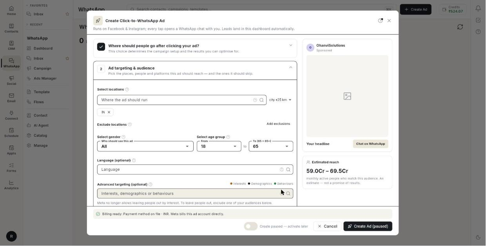

# विज्ञापन बनाएँ { #create-an-ad }

**Create Click-to-WhatsApp Ad** फ़ॉर्म भरें, प्रीव्यू देखें, और विज्ञापन लॉन्च करें या उसे रोककर सेव करें। आखिर में आपका विज्ञापन Meta के पास **In review** होता है, या रोककर सेव होता है। फ़ॉर्म में 5 सेक्शन हैं और इसमें करीब 15 मिनट लगते हैं। Meta विज्ञापन की समीक्षा करता है, आमतौर पर 24 घंटे के अंदर।

## शुरू करने से पहले { #before-you-start }

- **Setup** पूरा हो चुका है। Ads Manager पेज पर **Setup complete** दिखता है। देखें [Ads Manager सेट करें](set-up-ads-manager.md)।
- आपके पास विज्ञापन क्रेडिट हैं, या Meta ad account पर पेमेंट का तरीका जुड़ा है। देखें [Ads Manager सेट करें](set-up-ads-manager.md#pay-for-the-ads)।
- आपके पास विज्ञापन के लिए इमेज या वीडियो है। चौकोर इमेज इस्तेमाल करें, या Stories और Reels के लिए 1080×1920 की इमेज।
- Sales विज्ञापन के लिए आपके पास पिक्सेल या प्रोडक्ट कैटलॉग है। देखें [वेबसाइट इवेंट ट्रैक करें](track-website-events.md)।
- लीड फ़ॉर्म विज्ञापन के लिए आपके पास प्राइवेसी पॉलिसी का पेज है जो https:// से शुरू होता है।

## फ़ॉर्म कैसे काम करता है { #how-the-form-works }

- **Ads Manager** में **Create Ad** पर क्लिक करें। फ़ॉर्म खुलता है और उसके बगल में लाइव प्रीव्यू दिखता है। प्रीव्यू Instagram फ़ीड की पोस्ट जैसा दिखता है। इसमें आपकी पूरी तस्वीर दिखती है, उसके नीचे की पट्टी में हेडलाइन और बटन, और टेक्स्ट करीब 125 अक्षरों के बाद मुड़ जाता है।
- फ़ॉर्म को बाद के लिए रखने के लिए कभी भी **Save draft** पर क्लिक करें। देखें [ड्राफ़्ट सेव करें](#save-a-draft)।
- फ़ॉर्म में 5 क्रमांकित सेक्शन हैं। किसी सेक्शन को खोलने के लिए उस पर क्लिक करें। उसे पूरा करके अगला खोलने के लिए **Next** पर क्लिक करें। पूरे हो चुके सेक्शन पर सही का निशान दिखता है।
- किसी फ़ील्ड के बगल में छोटा **(i)** आइकन एक छोटा सुझाव खोलता है।
- सेक्शन 5 विज्ञापन के प्रकार के हिसाब से बदलता है। वह **Greeting & icebreakers (optional)**, **Landing page** या **Lead form** होता है।

## पहले क्या चुनें { #what-you-choose-first }

**Ad type** तय करता है कि कोई विज्ञापन पर टैप करे तो क्या होगा। यह भी तय करता है कि आप कौन से उद्देश्य और लक्ष्य चुन सकते हैं। इसे सबसे पहले चुनें।

### विज्ञापन का प्रकार चुनें { #choose-an-ad-type }

| विज्ञापन का प्रकार | टैप करने पर क्या होता है | आप कौन से उद्देश्य चुन सकते हैं |
|---------|---------------------|-------------------------|
| **Click to WhatsApp** | बटन आपके साथ चैट खोलता है। | **Awareness**, **Traffic**, **Engagement**, **Sales** |
| **Website** | ट्रैफ़िक को आपकी साइट पर भेजता है। | **Awareness**, **Traffic**, **Sales** |
| **WhatsApp Status** | Status और स्टोरीज़ में चलता है। | **Awareness**, **Traffic**, **Engagement**, **Sales** |
| **Lead form** | Meta के अंदर फ़ॉर्म भरवाता है। | सिर्फ़ **Leads** |
| **Website to WhatsApp** | चैट बटन के साथ साइट विज़िट। | **Awareness**, **Traffic**, **Sales** |

### उद्देश्य और लक्ष्य चुनें { #choose-an-objective-and-goal }

**Ad objective** वह है जो आप Meta से खरीदते हैं। **Performance goal** वह सटीक कार्रवाई है जिसके लिए Meta ऑप्टिमाइज़ करता है। उद्देश्य बदलने पर लक्ष्य की सूची नए सिरे से बनती है।

| उद्देश्य | परफ़ॉर्मेंस लक्ष्य के विकल्प | Meta क्या करता है |
|-----------|--------------------------|----------------|
| **Awareness** | **Maximise reach**, **Maximise impressions** | **Maximise reach** विज्ञापन को आपकी ऑडियंस के ज़्यादा से ज़्यादा लोगों को दिखाता है। **Maximise impressions** दिखने और बार-बार दिखाने के लिए ऑप्टिमाइज़ करता है, क्लिक या लीड के लिए नहीं। |
| चैट विज्ञापन पर **Traffic** | **Maximise number of link clicks** | सबसे सस्ते क्लिक खरीदता है। टैप ज़्यादा और असली चैट कम मिलेंगी। |
| चैट विज्ञापन पर **Engagement** | **Maximise number of conversations**, **Maximise number of link clicks** | **Maximise number of conversations** ऐसे लोगों को खोजता है जो आपको मैसेज कर सकते हैं। |
| वेबसाइट विज्ञापन पर **Traffic** | **Maximise landing page views**, **Maximise number of link clicks** | **Maximise landing page views** के लिए साइट पर पिक्सेल चाहिए। |
| **Sales** | **Maximise number of conversions** | ऐसे लोगों को खोजता है जो खरीद सकते हैं। पिक्सेल या प्रोडक्ट कैटलॉग चाहिए। |
| **Leads** | **Maximise number of leads** | नतीजा सबमिट किया गया फ़ॉर्म है। |

!!! tip "सुझाव"
    इम्प्रेशन वाले विज्ञापन के लिए **Awareness** चुनें, फिर **Maximise impressions**। **Suggested first ad** बॉक्स में **Apply this setup** पर क्लिक न करें। वह सेटअप कन्वर्सेशन लक्ष्य और ₹100/दिन का टेस्ट इस्तेमाल करता है।

## चरण { #steps }

### चुनें कि क्लिक कहाँ जाए { #choose-where-the-click-goes }

1. लेफ़्ट रेल में **WhatsApp** खोलें, फिर **Ads Manager** चुनें।
2. **Create Ad** पर क्लिक करें। **Create Click-to-WhatsApp Ad** फ़ॉर्म खुलता है, बगल में प्रीव्यू के साथ।

    

3. सेक्शन 1, **Where should people go after clicking your ad?** खोलें।
4. **Special ad category** के नीचे **Is this ad about credit, jobs, housing or politics?** का जवाब दें। ज़्यादातर विज्ञापनों के लिए **No — a regular ad** चुनें।
5. अगर विज्ञापन नियंत्रित श्रेणी का है, तो **Credit (loans, cards, finance)**, **Employment (jobs, hiring)**, **Housing (property, rentals)** या **Social issues, elections or politics** चुनें। फ़ॉर्म उम्र, लिंग, विस्तृत और ऑडियंस टार्गेटिंग साफ़ कर देता है।
6. **Ad type** के नीचे एक कार्ड पर क्लिक करें: **Click to WhatsApp**, **Website**, **WhatsApp Status**, **Lead form** या **Website to WhatsApp**। उद्देश्य और लक्ष्य की सूचियाँ बदल जाती हैं।

खास श्रेणी की सीमाएँ:

- क्रेडिट, नौकरी और आवास के लिए लोकेशन कम से कम 24 किमी को कवर करें।
- **Social issues, elections or politics** के लिए विज्ञापन चलने से पहले Page के पास Meta की विज्ञापन अनुमति होनी चाहिए।
- सही श्रेणी चुनें। जो नियंत्रित विज्ञापन श्रेणी नहीं बताते, उन्हें Meta हटा देता है।

!!! note "ध्यान दें"
    **Website** प्रकार के लिए उद्देश्य के नीचे **Destination** ब्लॉक दिखता है। **Website URL** लिखें (यह `https://` से शुरू होना चाहिए) और **Button** चुनें, जैसे **Learn more** या **Shop now**। **Website to WhatsApp** प्रकार में अभी ऐसी कोई फ़ील्ड नहीं दिखती, इसलिए **Next** ऐसा वेबसाइट URL माँगता है जो आप डाल नहीं सकते।

### उद्देश्य और लक्ष्य चुनें { #pick-the-objective-and-goal }

1. **Ad objective** के नीचे **Awareness**, **Traffic**, **Engagement** या **Sales** चुनें। लीड फ़ॉर्म विज्ञापन में सिर्फ़ **Leads** होता है, इसलिए चुनने को कुछ नहीं होता।
2. **Performance goal** के नीचे फ़ॉर्म का चुना हुआ लक्ष्य रहने दें, जब तक दूसरा ज़रूरी न हो। ऊपर लक्ष्य की तालिका देखें।
3. दोनों फ़ील्ड के नीचे की लाइन पढ़ें। उसमें लिखा होता है कि Meta आपके चुनाव का क्या करेगा।
4. **Buying type: Auction** से शुरू होने वाली लाइन पढ़ें। यह सिर्फ़ पढ़ने के लिए है। **Click to WhatsApp** विज्ञापन में **Placements: Facebook & Instagram (automatic)** दिखता है। **WhatsApp Status** विज्ञापन में **Placements: WhatsApp Status, plus Facebook and Instagram stories** दिखता है।
5. **Next** पर क्लिक करें। सेक्शन 2 खुलता है।

लक्ष्य के बारे में नोट:

- **Traffic** टैप खरीदता है, ग्राहक नहीं। रिपोर्ट में यह सस्ता दिखता है और सबसे कम असली चैट लाता है।
- उद्देश्य बदलने पर जो लक्ष्य लागू नहीं रहता, वह बदल दिया जाता है। हर बदलाव के बाद लक्ष्य फिर जाँचें।

### Sales विज्ञापन सेट करें { #set-up-a-sales-ad }

यह तब करें जब आपने **Sales** चुना हो।

1. **Pixel** के नीचे कोई पिक्सेल चुनें, या अगर सिर्फ़ कैटलॉग इस्तेमाल करते हैं तो **Choose a pixel** रहने दें। पिक्सेल या प्रोडक्ट कैटलॉग के बिना Sales विज्ञापन लॉन्च नहीं होता।
2. **Conversion event** के नीचे **Purchase**, **Add to cart**, **Checkout started**, **Lead** या **Registration** चुनें। नए पिक्सेल पर ऐसा इवेंट चुनें जो अक्सर होता हो, जैसे **Add to cart**।
3. **Product catalogue** के नीचे कैटलॉग चुनें। अगर कैटलॉग विज्ञापन नहीं चलाते, तो उसे **No catalogue** पर रहने दें। कैटलॉग न हो तो **Create a catalogue and add products** पर क्लिक करें।
4. वैकल्पिक: **Product set (optional)** के नीचे कैटलॉग का एक हिस्सा चुनें।

Sales की सीमाएँ:

- सिर्फ़ प्रोडक्ट सेट देना मंज़ूर नहीं होता। कैटलॉग भी भरें।
- जब तक आप एक नहीं चुनते, फ़ॉर्म **Pick a pixel for website conversions or a product catalogue for catalogue sales.** कहता रहता है।

### Website विज्ञापन सेट करें { #set-up-a-website-ad }

यह तब करें जब आपने **Website** चुना हो।

1. **Website URL \*** के नीचे वह पेज लिखें जो टैप से खुलेगा, जैसे `https://yourshop.com/offer`। अगर वह https:// से शुरू नहीं होता तो फ़ॉर्म **The URL must start with https://** दिखाता है।
2. **Button** के नीचे **Learn more**, **Shop now**, **Sign up**, **Book now**, **Get quote**, **Apply now**, **Contact us** या **Download** चुनें। डिफ़ॉल्ट **Learn more** है।
3. वैकल्पिक: **Pixel (optional)** के नीचे **No pixel** चुनें, या कोई पिक्सेल चुनें। पिक्सेल के बिना Meta क्लिक खरीदता है। पिक्सेल के साथ वह लैंडिंग पेज व्यू खरीदता है।

### WhatsApp Status विज्ञापन सेट करें { #set-up-a-whatsapp-status-ad }

यह तब करें जब आपने **WhatsApp Status** चुना हो।

1. सेक्शन 2 खोलें। **Platforms & placements** खोजें।
2. जाँचें कि **WhatsApp** **Status** और **Instagram** **Stories** चुने हुए हैं। आप इन्हें बदल नहीं सकते। Meta दोनों माँगता है।
3. सेक्शन 4 में वर्टिकल 9:16 की इमेज या वीडियो अपलोड करें। Status और Stories फ़ुल स्क्रीन होते हैं।

### लोकेशन चुनें { #choose-locations }

1. सेक्शन 2, **Ad targeting & audience** खोलें। आपके चुनते ही फ़ॉर्म के बगल में **Estimated reach** अपडेट होता है।

    

2. **Select locations** के नीचे **Where the ad should run** में लिखें। शहर, क्षेत्र, देश या पिन कोड खोजें, फिर सूची से चुनें। जितने चाहें उतने जोड़ें।
3. बॉक्स के बगल की सूची से दायरा चुनें: **city +17 km**, **city +25 km**, **city +40 km**, **city +60 km** या **city +80 km**। यह अगले जोड़े जाने वाले शहर पर लागू होता है।
4. वैकल्पिक: **Add exclusions** पर क्लिक करें। **Where the ad must not run** के नीचे हटाने वाली जगहें खोजकर चुनें। बंद करने के लिए **Hide** पर क्लिक करें। इन जगहों के लोग विज्ञापन नहीं देखते।

लोकेशन के बारे में नोट:

- खाली छोड़ने का मतलब पूरा भारत है। दुकान के लिए उसके आसपास के पिन कोड जोड़ें।
- दायरा सिर्फ़ शहरों पर लागू होता है। क्षेत्र, देश और पिन कोड अपनी-अपनी सीमाएँ इस्तेमाल करते हैं।

### उम्र, लिंग और रुचियाँ सेट करें { #set-age-gender-and-interests }

1. **Who should see this ad** में **Select gender** के नीचे **All**, **Men** या **Women** चुनें। जब तक प्रोडक्ट किसी एक समूह के लिए न हो, **All** रहने दें।
2. **Select age group** के नीचे **From** और **To (65 = 65+)** चुनें। सीमा 13 से 65 तक है। उदाहरण के लिए, 25 से 55।
3. वैकल्पिक: **Language (optional)** के नीचे कोई भाषा खोजें, जैसे Hindi।
4. वैकल्पिक: **Advanced targeting (optional)** के नीचे **Interests, demographics or behaviours** खोजें, जैसे ऑनलाइन शॉपिंग या नए माता-पिता। दो-तीन चुनें। चिप्स रंगीन होते हैं: **Interests**, **Demographics**, **Behaviours**।
5. वैकल्पिक: **Your audiences (optional)** के नीचे **Reach this audience** या **Exclude this audience** पर क्लिक करें, फिर कोई लिस्ट चुनें।
6. अभी लिस्ट बनानी हो तो **Create custom or lookalike** पर क्लिक करें। **Audiences** टैब खुलता है।
7. **Audience expansion** चालू करें। जब Meta को सस्ते नतीजे की उम्मीद होती है, तो वह आपकी रुचियों से आगे जा सकता है।

टार्गेटिंग की सीमाएँ:

- चौड़ी उम्र सीमा संकरी सीमा से बेहतर डिलीवर होती है।
- **Language (optional)** तब तक खाली रखें जब तक विज्ञापन का टेक्स्ट सिर्फ़ एक भाषा में न चले। भाषा चुनने से ऑडियंस बहुत घट सकती है।
- बहुत सारी रुचियाँ ऑडियंस को बहुत छोटा कर देती हैं। दो-तीन काफ़ी हैं।
- Meta अब रुचि के आधार पर लोगों को बाहर रखने नहीं देता। इसके बजाय अपनी कोई ऑडियंस एक्सक्लूड करें।
- Meta अब आपके Page को पसंद करने वालों को छोड़ने नहीं देता। अपने ग्राहकों को छोड़ने के लिए **Your audiences** के नीचे ग्राहक लिस्ट एक्सक्लूड करें।
- **Audience expansion** चालू होने पर भी आपकी लोकेशन, उम्र और लिंग लागू रहते हैं।

!!! note "खास विज्ञापन श्रेणियाँ"
    क्रेडिट, नौकरी और आवास के विज्ञापनों के लिए फ़ॉर्म उम्र, लिंग, विस्तृत टार्गेटिंग और ऑडियंस साफ़ कर देता है, और **Your audiences** छिपा देता है। उम्र, लिंग और विस्तृत टार्गेटिंग की फ़ील्ड छिपी रहती हैं।

### प्लेसमेंट और ब्रांड सेफ़्टी चुनें { #choose-placements-and-brand-safety }

1. **Placements** के नीचे डिफ़ॉल्ट रहने दें। Meta विज्ञापन को वहाँ लगाता है जहाँ नतीजे मिलते हैं।
2. जगहें खुद चुननी हों, तो **Choose manually** पर क्लिक करें। **Placements (optional)** के नीचे **Facebook feed**, **Facebook stories**, **Facebook reels**, **Marketplace**, **Instagram feed**, **Instagram stories**, **Instagram reels**, **Instagram explore** या **Audience Network** पर टिक करें।
3. अगर जमे तो शॉर्टकट इस्तेमाल करें: **Instagram only** या **Facebook only**।
4. वापस जाने के लिए **Back to automatic** पर क्लिक करें।
5. **Brand safety** के नीचे **Video & Reels**, **Audience Network** और **Feeds** में से हर एक के लिए स्तर चुनें: **Meta default**, **Relaxed**, **Standard** या **Strict**।
6. वैकल्पिक: **Publisher block list IDs (optional)** के नीचे Meta की ब्लॉक लिस्ट ID कॉमा से अलग करके लिखें। अगर आपके पास कोई लिस्ट नहीं है तो खाली छोड़ें।

प्लेसमेंट के बारे में नोट:

- खुद चुनने पर आमतौर पर हर नतीजे की लागत ज़्यादा आती है।
- Stories और Reels वर्टिकल होते हैं। चौकोर इमेज ऊपर और नीचे पट्टियों के साथ दिखती है।
- ज़्यादा सख़्त ब्रांड सेफ़्टी स्तर पहुँच घटाते हैं। **Meta default** वही रखता है जो ad account पहले से इस्तेमाल करता है।

### ऑडियंस सेव करें और दोबारा इस्तेमाल करें { #save-and-reuse-the-audience }

1. **Save this audience as** के नीचे नाम लिखें, जैसे `Indore home-decor buyers`। नाम में लिखें कि वह किन लोगों की है।
2. **Save** पर क्लिक करें। इस स्क्रीन के सभी चुनावों के साथ ऑडियंस सेव हो जाती है।
3. अगली बार **Saved audiences** के नीचे **Load a saved audience** इस्तेमाल करके उसे चुनें।
4. **Next** पर क्लिक करें। सेक्शन 3 खुलता है।

### बजट सेट करें { #set-the-budget }

1. सेक्शन 3, **Ad budget** खोलें।
2. बजट प्रकार के नीचे **Daily budget** या **Lifetime budget** चुनें। शीर्षक **Select per day budget** या **Select total budget** में बदल जाता है।
3. **Budget amount** ₹ में लिखें, जैसे रोज़ के बजट के लिए `500`।
4. बॉक्स के नीचे **Meta minimum** पढ़ें। अगर आपकी रकम उससे कम है तो उसे बढ़ाएँ।

बजट के बारे में नोट:

- **Daily budget** हर दिन लगभग उतनी रकम खर्च करता है। न्यूनतम रकम Meta की **प्रति दिन** की न्यूनतम रकम है, जैसे `Meta minimum: ₹89/day`।
- **Lifetime budget** एक तय कुल रकम है जो आपकी तारीखों में बँटती है। इसकी न्यूनतम रकम चलने वाले **हर दिन** के लिए Meta की रोज़ की न्यूनतम रकम है, इसलिए दिन बढ़ने पर यह बढ़ती है। पहले **End date** चुनें, फिर बॉक्स पढ़ें: जैसे `Meta minimum: ₹623 for 7 days (₹89/day)`। अंतिम तारीख चुनने से पहले उसमें `Pick an end date to see the total` लिखा होता है।
- Meta की न्यूनतम रकम से कम होने पर विज्ञापन डिलीवर नहीं होता, और फ़ॉर्म उसे ज़रूरी रकम बताकर मना कर देता है।

### तारीखें सेट करें { #set-the-dates }

1. **Start date** के नीचे **Today** रहने दें, या बाद की तारीख चुनें। **Today** के साथ, विज्ञापन Meta की मंज़ूरी के बाद शुरू होता है, आमतौर पर कुछ घंटों में। बाद की तारीख के साथ, विज्ञापन इंतज़ार करता है और उसी दिन शुरू होता है। यह **Daily budget** और **Lifetime budget** दोनों पर काम करता है।
2. **Set an end date** पर टिक करें, फिर **End date** चुनें।
3. वैकल्पिक: **Lifetime budget** पर **Run ads on a custom schedule** चालू करें। घंटों के ग्रिड पर टैप करें या ड्रैग करें।
4. **Viewer's time zone** या **Ad account's time zone** चुनें। अपने खुलने के समय के लिए ad account की घड़ी इस्तेमाल करें।
5. सेक्शन के नीचे का समरी बॉक्स पढ़ें। उसमें कुल खर्च दिखता है, जैसे **Total estimated budget**। आगे बढ़ने से पहले उसे जाँच लें।
6. **Next** पर क्लिक करें। सेक्शन 4 खुलता है।

तारीखों की सीमाएँ:

- **Lifetime budget** के लिए अंतिम तारीख शुरू होने के कम से कम एक दिन बाद की होनी चाहिए। बीती तारीख मंज़ूर नहीं होती।
- तारीखें आपके अपने टाइम ज़ोन में होती हैं। 5 अक्टूबर की शुरुआत का मतलब वहाँ 5 अक्टूबर की शुरुआत है जहाँ आप हैं, जहाँ ad account है वहाँ नहीं।
- कस्टम शेड्यूल सिर्फ़ **Lifetime budget** पर काम करता है। डेली बजट के साथ स्विच बंद रहता है और **Ad scheduling is only available on a lifetime budget** दिखाता है।
- ग्रिड पर कुछ भी न चुना हो तो इसका मतलब है कोई भी घंटा।

### विज्ञापन का टेक्स्ट लिखें { #write-the-ad-text }

1. सेक्शन 4, **Ad creative** खोलें। आप जैसे-जैसे लिखते हैं, फ़ॉर्म के बगल का प्रीव्यू अपडेट होता है।
2. वैकल्पिक: **Write it for me** के नीचे एक ब्रीफ़ लिखें, जैसे `monsoon sale on rain jackets, 30% off`। **Draft** पर क्लिक करें। टेक्स्ट और हेडलाइन भर जाते हैं। उन्हें एडिट करें। कुछ भी लॉन्च नहीं होता।
3. वैकल्पिक: सेव किया हुआ प्रीसेट दोबारा इस्तेमाल करने के लिए **Load preset** पर क्लिक करें। प्रीसेट में प्राइमरी टेक्स्ट, हेडलाइन, विवरण, बटन और इमेज सेव रहते हैं। अपना प्रीसेट सेव करने के लिए **Save as preset** पर क्लिक करें।
4. **Ad name** लिखें। यह ज़रूरी है, और इसे सिर्फ़ आप देखते हैं। जैसे `Monsoon sale — Indore`।
5. **Primary text** लिखें। ऑफ़र और जगह पहली लाइन में रखें।
6. वैकल्पिक: **Headline (optional)** लिखें, जैसे `Chat on WhatsApp`।
7. वैकल्पिक: **Description (optional)** लिखें।
8. पिछले 30 दिनों में आपके अपने अकाउंट में क्या अच्छा चल रहा है, यह देखने के लिए **Competitor inspiration** खोलें: प्लेसमेंट, उम्र और लिंग, क्षेत्र और आपके सबसे अच्छे विज्ञापन। यह दूसरे विज्ञापनदाताओं का डेटा नहीं दिखाता, क्योंकि Meta उसे प्रकाशित नहीं करता।
9. **Facebook Page \*** चुनें। अगर सूची खाली है, तो **Facebook Page ID \*** लिखें।
10. वैकल्पिक: देश कोड के साथ और सिर्फ़ अंकों में **WhatsApp number (optional)** लिखें, जैसे `919812345678`।
11. पूरा करने के बाद, इन फ़ील्ड को दोबारा इस्तेमाल करने के लिए **Save as preset** पर क्लिक करें।

12. वैकल्पिक: टेस्ट के लिए टेक्स्ट का दूसरा वर्शन जोड़ें। **Primary text** के नीचे **Add another primary text** (5 तक) पर क्लिक करें, या **Test another version (optional)** के नीचे **Add version** पर क्लिक करें और **Version 2 text** और **Version 2 headline (optional)** लिखें। Meta जो वर्शन बेहतर चलता है उसे ज़्यादा बार दिखाता है।
13. प्रीव्यू देखें। अगर आपने वर्शन जोड़े हैं, तो हर एक पढ़ने के लिए उसके ऊपर **Version 1**, **Version 2** वगैरह पर क्लिक करें।

टेक्स्ट की सीमाएँ:

- **Ad name**: 255 अक्षर तक।
- **Primary text**: 2,200 अक्षर तक। यह ज़रूरी है, जब तक मीडिया **Existing post** न हो। **See more** से पहले सिर्फ़ दो लाइन दिखती हैं।
- **Headline (optional)**: 40 अक्षर तक। खाली रहने पर Meta आपके Page का नाम दिखाता है।
- **Description (optional)**: 30 अक्षर तक। यह हमेशा नहीं दिखती।
- चैट विज्ञापनों के लिए Page से एक व्हाट्सऐप नंबर जुड़ा होना चाहिए। दूसरे Page पर **no WhatsApp number** दिखता है।
- **WhatsApp number (optional)**: खाली रहने पर **Setup** का नंबर इस्तेमाल होता है।

### तस्वीर या वीडियो जोड़ें { #add-the-picture-or-video }

1. **Media** के नीचे एक टैब चुनें: **Image**, **Carousel**, **Video** या **Existing post**। अपनी मीडिया लाइब्रेरी से अपलोड करें, URL पेस्ट करें, या AI से बनवाएँ। **WhatsApp Status** विज्ञापनों में सिर्फ़ **Image** और **Video** दिखते हैं।
2. **Image** के लिए एक तस्वीर अपलोड करें, या **Choose from library** पर क्लिक करें।
3. वैकल्पिक: **Story & Reels image (optional)** के नीचे 1080×1920 की इमेज अपलोड करें। हटाने के लिए **Remove** पर क्लिक करें।
4. **Carousel** के लिए हर कार्ड के लिए **Add card** पर क्लिक करें। हर कार्ड में इमेज जोड़ें। किसी कार्ड को हटाने के लिए **Remove this card** पर क्लिक करें।
5. हर कार्ड के लिए **Card headline** लिखें। ज़रूरत हो तो **Card description (optional)** और **Card link (optional)** लिखें। **Card link (optional)** सिर्फ़ वेबसाइट विज्ञापनों में दिखता है; खाली रहने पर यह विज्ञापन का URL इस्तेमाल करता है।
6. **Video** के लिए वीडियो फ़ाइल अपलोड करें। फिर थंबनेल इमेज जोड़ें।
7. **Existing post** के लिए **Facebook** या **Instagram** चुनें, फिर सूची से कोई हाल की पोस्ट चुनें। पोस्ट अपने लाइक और कमेंट के साथ रहती है, और उसका अपना टेक्स्ट और तस्वीर इस्तेमाल होती है।
8. वैकल्पिक: **Generate the picture with AI** के नीचे तस्वीर का वर्णन करें। **Product photo** और **Logo** जोड़ें। टोन चुनें: **General**, **Festive**, **Premium**, **Playful** या **Minimal**। **Generate image** पर क्लिक करें।
9. पहले की इमेज देखने के लिए **History** पर क्लिक करें। इस्तेमाल करने के लिए एक चुनें।
10. वैकल्पिक: **Test another version (optional)** के नीचे **Add version** पर क्लिक करें। **Version 2 text** और **Version 2 headline (optional)** भरें।
11. वैकल्पिक: वेबसाइट विज्ञापन के लिए **Tracking (optional)** के नीचे **UTM parameters** लिखें, जैसे `utm_source=meta&utm_campaign=monsoon`।
12. मीडिया के नीचे की लाइन पढ़ें। उसमें बटन दिखता है: चैट विज्ञापनों के लिए **Call to action: Send Message (WhatsApp)**। दूसरे विज्ञापनों में सेक्शन 1 का बटन दिखता है।
13. **Next** पर क्लिक करें। सेक्शन 5 खुलता है।

मीडिया की सीमाएँ:

- चौकोर इमेज इस्तेमाल करें। Status और Stories के लिए वर्टिकल 9:16 की इमेज चाहिए।
- **Story & Reels image (optional)** के बिना चौकोर इमेज ऊपर और नीचे पट्टियों के साथ दिखती है।
- **Carousel**: 2 से 10 कार्ड, हर एक में इमेज। **Card headline** 40 अक्षर तक। **Card description (optional)** 30 अक्षर तक।
- थंबनेल के बिना वीडियो विज्ञापन अस्वीकार हो जाता है। Meta कोई फ़्रेम खुद नहीं चुनता।
- AI बटन दिखाता है कि आज कितनी इमेज बची हैं। जब तक आप इमेज नहीं चुनते, कुछ भी पब्लिश नहीं होता।
- हर अतिरिक्त वर्शन उसी बजट और ऑडियंस पर अपने अलग विज्ञापन की तरह चलता है। Meta खर्च को बेहतर वर्शन की ओर ले जाता है। हर वर्शन में एक ही चीज़ बदलें।
- **UTM parameters** सिर्फ़ वेबसाइट विज्ञापनों के लिए चाहिए।

### ग्रीटिंग और आइसब्रेकर लिखें { #write-the-greeting-and-icebreakers }

यह **Click to WhatsApp**, **WhatsApp Status** और **Website to WhatsApp** विज्ञापनों के लिए करें। सेक्शन 5 **Greeting & icebreakers (optional)** है।

1. वैकल्पिक: **Use a saved set** के नीचे सेव किया हुआ ग्रीटिंग और आइसब्रेकर चुनें।
2. **Greeting message** लिखें। जैसे `Hi! Thanks for tapping our ad. What are you looking for?`। जब ग्राहक विज्ञापन पर टैप करता है, तो यह उसके व्हाट्सऐप में पहले से भरा आता है।
3. **Icebreakers (up to 4)** के नीचे टैप करने लायक सवाल लिखें, जैसे `Show me offers`। 4 तक जोड़ें।
4. वैकल्पिक: आइसब्रेकर के बगल की फ़्लो सूची में कोई चैटबॉट फ़्लो चुनें, या **No flow**।
5. वैकल्पिक: सेट सेव करने के लिए **Set name (to save it for later)** लिखें, जैसे `Store enquiries`। **Save set** पर क्लिक करें।

ग्रीटिंग की सीमाएँ:

- **Greeting message**: 1,000 अक्षर तक। अभिवादन करें, ऑफ़र का नाम बताएँ और एक सवाल पूछें। खाली रहने पर Meta एक डिफ़ॉल्ट मैसेज भेजता है।
- **Icebreakers**: हर एक 80 अक्षर तक। लोग टाइप करने के बजाय टैप करते हैं।
- आइसब्रेकर पर टैप होते ही फ़्लो शुरू होता है। आइसब्रेकर का टेक्स्ट फ़्लो में कीवर्ड के रूप में जुड़ जाता है।
- **No flow** होने पर एजेंट इनबॉक्स में जवाब देता है।

### लीड फ़ॉर्म विज्ञापन सेट करें { #set-up-a-lead-form-ad }

यह तब करें जब आपने **Lead form** चुना हो। सेक्शन 5 **Lead form** है। वेबसाइट विज्ञापन में इसकी जगह **Landing page** होता है। उसमें **Destination**, **Button** और **Measured with** के साथ **Where the click goes** दिखता है, और कोई ग्रीटिंग नहीं होती। इसके बजाय चैट खोलनी हो तो सेक्शन 1 में **Click to WhatsApp** या **Website to WhatsApp** चुनें।

1. **Use an existing form** के नीचे अपने Page से कोई फ़ॉर्म चुनें, या **Create a new form** चुनें।
2. **What to ask for** के नीचे **Name**, **Phone**, **Email**, **City** या **Company** पर टिक करें।
3. वैकल्पिक: **Custom survey question (optional)** लिखें, जैसे `What product are you interested in?`।
4. **Privacy policy URL \*** लिखें, जैसे `https://your-site.com/privacy`।

लीड फ़ॉर्म की सीमाएँ:

- पुराना फ़ॉर्म दोबारा इस्तेमाल करने से लीड एक ही जगह रहती हैं।
- कम से कम एक फ़ील्ड पर टिक रहता है। हर अतिरिक्त फ़ील्ड पर कुछ लोग छूट जाते हैं।
- वही सवाल पूछें जो लीड को परखे।
- प्राइवेसी पॉलिसी URL के बिना Meta लीड फ़ॉर्म मंज़ूर नहीं करता।
- जब कोई फ़ॉर्म सबमिट करता है तो लीड **Ads Manager** → **Leads** में आती हैं।

### विज्ञापन वैसे देखें जैसे Meta दिखाता है { #check-the-ad-as-meta-shows-it }

1. प्रीव्यू के नीचे **See it as Meta shows it** खोजें। पहले तस्वीर जोड़ें।
2. किसी प्लेसमेंट चिप पर क्लिक करें। **Placements** ऑटोमैटिक होने पर आपको **Facebook feed**, **Instagram feed** और **Instagram story** दिखते हैं। प्लेसमेंट चुनने पर वही दिखते हैं।
3. Meta विज्ञापन को अपने क्रॉप और लेआउट में बनाता है। अगर आपने प्रीव्यू के ऊपर टेक्स्ट का कोई वर्शन चुना है, तो Meta वही वर्शन दिखाता है।
4. अगर फ़्रेम खाली रहे, तो **Open in a new tab** पर क्लिक करें।

हर क्लिक Meta से प्रीव्यू माँगता है, इसलिए एक बार में एक प्लेसमेंट पर क्लिक करें।

### ड्राफ़्ट सेव करें { #save-a-draft }

1. फ़ॉर्म के नीचे **Save draft** पर क्लिक करें। **Draft saved. Open Create Ad again to resume it.** संदेश आता है।
2. फ़ॉर्म बंद करें। बाद में **Create Ad** पर फिर क्लिक करें।
3. जो कुछ आपने लिखा था, टार्गेटिंग, बजट, तारीखें, टेक्स्ट, वर्शन और ग्रीटिंग समेत, वह सब वापस लाने के लिए नीचे **Resume draft from …** पर क्लिक करें। ड्राफ़्ट डिलीट करने के लिए **Discard** पर क्लिक करें।

ड्राफ़्ट सिर्फ़ इसी ब्राउज़र में रखा जाता है। वह दूसरे डिवाइस पर नहीं दिखता। विज्ञापन लॉन्च करने पर वह हट जाता है।

### विज्ञापन लॉन्च करें { #launch-the-ad }

1. बिलिंग पट्टी देखें। पेमेंट के तरीके के साथ **Billing ready** का मतलब है कि Meta अकाउंट को बिल कर सकता है।
2. अगर पट्टी में **No payment method on the Meta ad account** लिखा है, तो **Open Meta Billing** पर क्लिक करें। कार्ड या UPI जोड़ें। आप फिर भी विज्ञापन रोककर बना सकते हैं।
3. स्विच इस्तेमाल करें। **Create paused — activate later** डिफ़ॉल्ट है। **Goes live after Meta approves** विज्ञापन को समीक्षा के लिए भेजता है और मंज़ूरी मिलते ही उसे अपने आप शुरू कर देता है।
4. **Launch Ad** पर क्लिक करें। अगर स्विच बंद है, तो बटन पर **Create Ad (paused)** लिखा होता है।

इनमें से एक संदेश आता है:

- **Ad launched — it is now live on Meta (Ad ID …).**
- **Ad created in paused state (Ad ID …). Activate it when you are ready to spend.**

Meta विज्ञापन की समीक्षा करता है, आमतौर पर 24 घंटे के अंदर। तब तक वह **In review** दिखाता है।

!!! warning "चेतावनी"
    चालू विज्ञापन पैसे खर्च करता है। **Goes live after Meta approves** तभी चुनें जब बजट, तारीखें और ऑडियंस सही हों। चल रहे विज्ञापन में इन्हें बदलने पर Meta डिलीवरी दोबारा शुरू करता है।

## वीडियो वॉकथ्रू { #video-walkthrough }

[VIDEO]

## समस्या का समाधान { #troubleshooting }

| समस्या | कारण | समाधान |
|-------|-------|-----|
| **Select a Facebook Page for the ad.** | सेक्शन 4 में कोई Page नहीं चुना गया है। | **Facebook Page \*** के नीचे Page चुनें। |
| **Pick an end date for a run-once ad.** | **Lifetime budget** में अंतिम तारीख नहीं है। | शुरू होने के कम से कम एक दिन बाद की **End date** चुनें। |
| **Meta's minimum on this account is ₹…** | डेली बजट Meta की प्रति दिन की न्यूनतम रकम से कम है। | रकम को बॉक्स के नीचे दिखाई गई न्यूनतम रकम तक बढ़ाएँ। |
| **Meta's minimum for a … day run on this account is …** | लाइफ़टाइम बजट रोज़ की न्यूनतम रकम गुणा दिनों की संख्या से कम है। | कुल रकम बढ़ाएँ, या **End date** को पास लाकर अवधि छोटी करें। |
| विज्ञापन आपकी चुनी **Start date** से पहले शुरू हो गया। | आपने फ़ॉर्म का पुराना वर्शन इस्तेमाल किया, जो डेली बजट पर शुरू होने की तारीख अनदेखी करता था। | Ohanvi अपडेट करें। चुनी हुई शुरू होने की तारीख अब दोनों बजट प्रकारों पर लागू होती है। अगर विज्ञापन बहुत जल्दी शुरू हो गया है, तो उसे रोकें। |
| **The URL must start with https://** | **Website URL \*** में http:// है। | उसे https:// वाले पते में बदलें। |
| वीडियो विज्ञापन पर लॉन्च रुक जाता है। | वीडियो में थंबनेल नहीं है। | वीडियो के नीचे थंबनेल इमेज जोड़ें। |
| लॉन्च करते समय **Connections are no longer available**। | पुराने फ़ॉर्म ने Page फ़ॉलोअर्स को छोड़ दिया था, और Meta अब यह स्वीकार नहीं करता। | Ohanvi अपडेट करें। वह सेटिंग हट चुकी है। इसके बजाय **Your audiences** के नीचे ग्राहक लिस्ट एक्सक्लूड करें। |
| विज्ञापन **Not approved** दिखा रहा है। | Meta ने विज्ञापन अस्वीकार कर दिया। | टेक्स्ट या इमेज को Meta के विज्ञापन नियमों के अनुसार बदलें। विज्ञापन फिर से बनाएँ। |
| **Connect your Facebook account in Setup before creating an ad.** | Setup पूरा नहीं हुआ है। | **Setup** पूरा करें। देखें [Ads Manager सेट करें](set-up-ads-manager.md)। |

## संबंधित गाइड { #related }

- [Ads Manager सेट करें](set-up-ads-manager.md)
- [Click-to-WhatsApp विज्ञापन चलाएँ](../click-to-whatsapp-ads.md)
- [ब्रॉडकास्ट कैंपेन भेजें](../send-broadcast-campaign.md)
- [क्रेडिट और बिलिंग](../../credits-and-billing.md)
