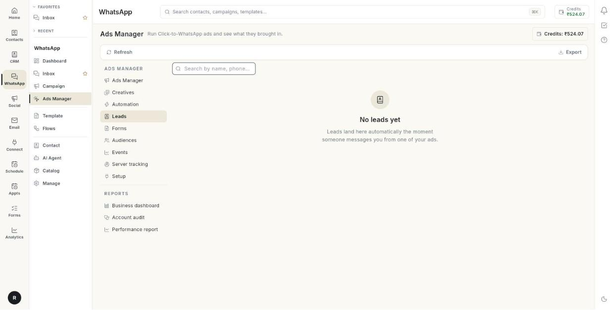

# विज्ञापन से आई लीड्स मैनेज करें { #manage-ad-leads }

आपके किसी भी विज्ञापन से जिस-जिसने आपको मैसेज किया, उन सबको देखने के लिए **Leads** टैब खोलें। इस गाइड के अंत तक आप लिस्ट में खोज पाएँगे, देख पाएँगे कि आपके मैसेज डिलीवर हुए और पढ़े गए या नहीं, लिस्ट को Excel फ़ाइल में डाउनलोड कर पाएँगे, और **Inbox** से जवाब दे पाएँगे। इसमें करीब 2 मिनट लगते हैं।

## शुरू करने से पहले { #before-you-start }

- आपका Facebook अकाउंट, Page, ad account और WhatsApp नंबर **Setup** में कनेक्ट हैं। देखें [Click-to-WhatsApp विज्ञापन चलाएँ](../click-to-whatsapp-ads.md)।
- कम से कम 1 विज्ञापन लाइव है और किसी ने उस पर टैप किया है। देखें [विज्ञापन बनाएँ](create-an-ad.md)।
- आपको **WhatsApp** पैनल में **Ads Manager** दिखता है। न दिखे तो अपने एडमिन से पूछें।

## Leads टैब में क्या दिखता है { #what-the-leads-tab-shows }

लीड अपने आप आ जाती हैं। आपको उन्हें हाथ से जोड़ना नहीं पड़ता। जैसे ही कोई आपके विज्ञापन से मैसेज करता है, उसकी लीड यहाँ दिख जाती है।

| कॉलम | क्या दिखता है |
|--------|---------------|
| **LEAD** | उस व्यक्ति का नाम। नाम न हो तो फ़ोन नंबर दिखता है। |
| **PHONE** | देश का कोड और फ़ोन नंबर। |
| **AD** | उस विज्ञापन का नाम जिस पर व्यक्ति ने टैप किया। |
| **LEAD DATE** | जिस तारीख को व्यक्ति ने आपको मैसेज किया। |
| **ASSIGNED TO** | जिस टीम मेंबर को यह लीड दी गई है। किसी को न दी हो तो **—** दिखता है। |
| **SENT** | आपने इस लीड को कितने मैसेज भेजे। |
| **DELIVERED** | उनमें से कितने मैसेज लीड के फ़ोन तक पहुँचे। |
| **READ** | उनमें से कितने मैसेज लीड ने खोलकर पढ़े। |
| **REPLIED** | लीड ने कितनी बार जवाब दिया। |

आखिरी चार कॉलम मैसेज का पूरा सफ़र दिखाते हैं: पहले भेजा, फिर डिलीवर हुआ, फिर पढ़ा गया, फिर जवाब आया। जिस लीड का **SENT** ज़्यादा है और **READ** 0 है, उसने आपके मैसेज खोले ही नहीं हैं।

## स्टेप { #steps }

### लिस्ट खोलें { #open-the-list }

1. लेफ़्ट रेल में **WhatsApp** खोलें, फिर **Ads Manager** चुनें।
2. **Leads** पर क्लिक करें। लीड की लिस्ट खुल जाती है। एक बार में 25 पंक्तियाँ दिखती हैं।

    

    

3. सबसे नई लीड देखने के लिए **Refresh** पर क्लिक करें।

### लीड खोजें { #find-a-lead }

1. **Search by name, phone or ad** बॉक्स पर क्लिक करें।
2. नाम का कोई हिस्सा, फ़ोन नंबर या विज्ञापन का नाम लिखें। जैसे-जैसे आप लिखते हैं, टेबल छँटती जाती है।
3. सारी लीड दोबारा देखने के लिए बॉक्स खाली कर दें।

!!! note "ध्यान दें"
    खोज सिर्फ़ उस पेज की पंक्तियों में होती है जिस पर आप हैं। ज़्यादा लीड में खोजना हो तो **Rows per page** बढ़ाएँ या अगले पेज पर जाएँ।

### पेज बदलें { #move-between-pages }

1. टेबल के सबसे नीचे देखें। वहाँ **Rows per page:** और **1–25 of 140** जैसी गिनती दिखती है।
2. एक साथ ज़्यादा लीड देखनी हों तो **Rows per page:** बदलें।
3. अगले या पिछले पेज पर जाने के लिए पेज के तीर दबाएँ। [VERIFY: exact arrow labels]

### मैसेज की डिलीवरी जाँचें { #check-message-delivery }

1. टेबल में लीड खोजें।
2. आपने कितने मैसेज भेजे, यह **SENT** में देखें।
3. कितने मैसेज फ़ोन तक पहुँचे, यह **DELIVERED** में देखें।
4. लीड ने कितने मैसेज खोले, यह **READ** में देखें।
5. लीड ने कितनी बार जवाब दिया, यह **REPLIED** में देखें।

### लिस्ट डाउनलोड करें { #download-the-list }

1. ऊपर की बार में **Export** पर क्लिक करें। जिस पेज पर ऊपर की बार नहीं है, वहाँ बटन का नाम **Download Report** होता है।
2. अपने डाउनलोड फ़ोल्डर में जाकर **ad_leads.xlsx** फ़ाइल खोलें।

डाउनलोड करने के लिए कोई लीड न हो तो बटन धूसर रहता है।

### लीड को जवाब दें { #reply-to-a-lead }

1. **WhatsApp** पैनल से **Inbox** खोलें।
2. उस लीड की चैट खोजें। उसका पहला मैसेज वहाँ पहले से मौजूद है।
3. जैसे किसी भी दूसरी चैट में जवाब देते हैं, वैसे ही जवाब दें।

    

### लीड को टीम मेंबर को दें { #assign-a-lead-to-a-team-member }

1. **Inbox** में लीड की चैट खोलें।
2. चैट को किसी टीम मेंबर को असाइन करें।
3. **Leads** पर वापस आएँ और **Refresh** पर क्लिक करें। **ASSIGNED TO** में उसका नाम दिख जाएगा।

इस टैब में **ASSIGNED TO** कॉलम सिर्फ़ देखने के लिए है। यहाँ से इसे बदला नहीं जा सकता।

## समस्या का समाधान { #troubleshooting }

| समस्या | कारण | समाधान |
|-------|-------|-----|
| **Set up now** बटन के साथ **Connect your Meta ad account** दिखता है | सेटअप पूरा नहीं हुआ है और अभी कोई लीड नहीं है। | **Set up now** पर क्लिक करें और **Setup** के 3 स्टेप पूरे करें। |
| **No leads yet** | अभी तक किसी ने विज्ञापन से आपको मैसेज नहीं किया। | देखें कि आपका विज्ञापन **Ads Manager** में **Active** है। जैसे ही कोई मैसेज करेगा, लीड यहाँ आ जाएगी। |
| **Could not load leads** | लिस्ट लोड नहीं हुई। | **Retry** पर क्लिक करें। फिर भी न हो तो पेज रीलोड करें। |
| **Could not download the leads report.** | Excel फ़ाइल नहीं बन पाई। | **Download Report** पर फिर से क्लिक करें। दो बार भी न बने तो पहले **Refresh** पर क्लिक करें। |
| **ASSIGNED TO** में **—** दिखता है | यह लीड किसी टीम मेंबर को नहीं दी गई है। | **Inbox** से चैट असाइन करें। |
| कई लीड के लिए **READ** 0 है | लीड ने आपके मैसेज नहीं खोले हैं, या उनके रीड रिसीट बंद हैं। | **Inbox** में अपना मैसेज देखें और एक छोटा फ़ॉलो-अप भेजें। |

## संबंधित गाइड { #related }

- [विज्ञापन बनाएँ](create-an-ad.md)
- [लीड फ़ॉर्म मैनेज करें](manage-lead-forms.md)
- [अपने विज्ञापन मैनेज करें](manage-your-ads.md)
- [Click-to-WhatsApp विज्ञापन चलाएँ](../click-to-whatsapp-ads.md)
