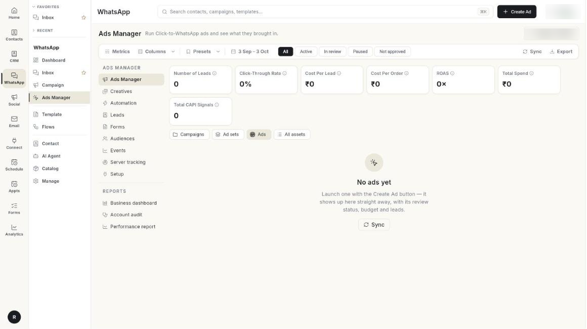

# अपने विज्ञापन Ads Manager में मैनेज करें { #manage-your-ads-in-ads-manager }

**Ads Manager** टैब में आपको अपने Meta ad account का हर विज्ञापन दिखता है। यहाँ आप उसका स्टेटस, खर्च और लीड देख सकते हैं। Ohanvi छोड़े बिना उसे पॉज़ कर सकते हैं, उसका नाम बदल सकते हैं या बजट बदल सकते हैं। इस गाइड के अंत तक आप कोई भी विज्ञापन खोज पाएँगे, उसके आँकड़े पढ़ पाएँगे और एक ही टेबल से उसमें बदलाव कर पाएँगे। सीखने में करीब 5 मिनट लगते हैं।

## शुरू करने से पहले { #before-you-start }

- आपका Facebook अकाउंट, Page, ad account और WhatsApp नंबर कनेक्ट हैं। देखें [Click-to-WhatsApp विज्ञापन चलाएँ](../click-to-whatsapp-ads.md)।
- आपको **WhatsApp** पैनल में **Ads Manager** दिखता है। न दिखे तो अपने एडमिन से कहें।
- आपने कम से कम 1 विज्ञापन बनाया है। देखें [विज्ञापन बनाएँ](create-an-ad.md)।

## टैब में क्या दिखता है { #what-the-tab-shows }

**Ads Manager** टैब में ऊपर से नीचे 5 हिस्से हैं।

| हिस्सा | इसमें क्या है |
|------|---------------|
| कमांड बार | **Create Ad**, **Sync**, **Export**, **Metrics**, **Columns**, **Presets** और तारीख की सीमा। |
| स्टेटस फ़िल्टर | **All**, **Active**, **Completed**, **In review**, **Paused** और **Not approved**। |
| मेट्रिक कार्ड | चुनी हुई तारीखों के कुल आँकड़े, जैसे **Total Spend** और **Number of Leads**। |
| लेवल चिप | **Campaigns**, **Ad sets**, **Ads** और **All assets**। |
| टेबल | हर कैंपेन, ऐड सेट या विज्ञापन की एक पंक्ति। इसमें चेकबॉक्स और **ACTIONS** मेन्यू होता है। विज्ञापन की पंक्ति पर माउस ले जाने से क्विक एक्शन भी दिखते हैं। |

!!! note "बटन कहाँ हैं"
    कुछ लेआउट में कमांड बार पेज के टाइटल के नीचे बटनों की एक पंक्ति होती है। इन पर **Sync**, **Download Report**, **Customize Metrics**, **Columns** और **Presets** लिखा होता है। तारीख की सीमा इनके बगल में रहती है। ये सब वही काम करते हैं।

## स्टेप { #steps }

### अपने मनचाहे विज्ञापन खोजें { #find-the-ads-you-want }

1. लेफ़्ट रेल में **WhatsApp** खोलें, फिर **Ads Manager** चुनें।

    

2. तारीख की सीमा पर क्लिक करें, जैसे **7 Aug – 6 Sep**।
3. शुरू और खत्म होने की तारीख चुनें। आप ज़्यादा से ज़्यादा 2 साल पीछे तक जा सकते हैं। डिफ़ॉल्ट पिछले 30 दिन है। कार्ड और टेबल दोबारा लोड होते हैं।
4. कोई स्टेटस फ़िल्टर चुनें: **All**, **Active**, **Completed**, **In review**, **Paused** या **Not approved**।
5. विज्ञापन को नाम या ID से खोजने के लिए **Search by Ad name** में लिखें।
6. Meta से ताज़ा विज्ञापन और आँकड़े लाने के लिए **Sync** पर क्लिक करें। जब तक यह पूरा नहीं होता, बटन पर **Syncing…** लिखा रहता है।

हर स्टेटस फ़िल्टर Meta की असली डिलीवरी स्थिति दिखाता है, और वही शब्द इस्तेमाल करता है जो Meta के अपने Ads Manager में होते हैं। जो विज्ञापन रिव्यू में है या रिजेक्ट हो गया है, वह **Active** में कभी नहीं दिखता। **In review** में वे विज्ञापन भी आते हैं जो बिलिंग जानकारी का इंतज़ार कर रहे हैं। **Not approved** में वे विज्ञापन आते हैं जिन्हें Meta ने रिजेक्ट किया या जिनमें कोई समस्या बताई।

अगर किसी विज्ञापन, ऐड सेट या कैंपेन की खत्म होने की तारीख निकल चुकी है, तो वह Meta की तरह ग्रे बिंदु के साथ **Completed** दिखता है। अब वह **Active** में नहीं गिना जाता।

### कैंपेन, ऐड सेट और विज्ञापन के बीच बदलें { #switch-between-campaigns-ad-sets-and-ads }

1. टेबल के ऊपर **Campaigns**, **Ad sets**, **Ads** या **All assets** पर क्लिक करें।
2. कैंपेन की पंक्ति में नाम पर क्लिक करें, या **ACTIONS** खोलकर **Show its ad sets** चुनें। **In campaign: Monsoon sale** जैसा चिप दिखता है।
3. ऐड सेट की पंक्ति में नाम पर क्लिक करें, या **Show its ads** चुनें। चिप बदलकर **In ad set: …** हो जाता है।
4. **Back to all** पर लौटने के लिए चिप के **x** पर क्लिक करें।

कैंपेन और ऐड सेट की पंक्तियों में उनके अंदर के सभी विज्ञापनों के आँकड़े जुड़कर दिखते हैं। अगर बजट एक लेवल ऊपर या नीचे तय है, तो उनके **Daily Budget** सेल में **Ad set budgets** या **Campaign budget** लिखा होता है।

### चुनें कि कौन-से मेट्रिक कार्ड दिखें { #choose-which-metric-cards-you-see }

1. **Metrics** या **Customize Metrics** पर क्लिक करें।
2. जो कार्ड चाहिए, उन पर टिक करें। कम से कम 1 कार्ड चालू रहता है।
3. **Done** पर क्लिक करें।
4. किसी कार्ड का मतलब पढ़ने के लिए उसके इन्फ़ो आइकन पर माउस ले जाएँ।

अभी कोई डेटा न हो, तो कार्ड पर **₹0** या **0×** दिखता है।

| कार्ड | यह क्या गिनता है |
|------|----------------|
| **Number of Leads** | चुनी हुई तारीखों में आपके विज्ञापनों से आई लीड। इसमें दो गिनतियों में से बड़ी गिनती ली जाती है: Ohanvi ने जितने कॉन्टैक्ट किसी विज्ञापन से आते देखे, और Meta के हिसाब से विज्ञापनों ने जितनी बातचीत शुरू कीं। |
| **Click-Through Rate** | ad account पर क्लिक को इम्प्रेशन से भाग देने पर जो आता है। |
| **Cost Per Lead** | कुल खर्च को लीड की संख्या से भाग देने पर जो आता है। |
| **Cost Per Order** | विज्ञापन के खर्च को, Meta को वापस बताई गई खरीदारियों से भाग देने पर जो आता है। |
| **ROAS** | मंज़ूर हुए कन्वर्ज़न इवेंट से मिली आमदनी को विज्ञापन के खर्च से भाग देने पर जो आता है। |
| **Total Spend** | Meta ad account ने जितना पैसा खर्च किया। |
| **Total CAPI Signals** | Meta को वापस भेजे गए कन्वर्ज़न इवेंट। |

### चुनें कि कौन-से कॉलम दिखें { #choose-which-columns-you-see }

1. **Columns** पर क्लिक करें।
2. किसी कॉलम पर टिक लगाएँ या हटाएँ। कम से कम 1 कॉलम चालू रहता है।
3. जो कॉलम आपने जोड़ा, उसे पढ़ें। डैश (—) का मतलब है कि Meta ने वह आँकड़ा अभी नहीं भेजा।

 [VERIFY: "Choose which columns you see" स्टेप के बाद जोड़ें]

| कॉलम | क्या दिखता है |
|--------|---------------|
| **Ad Name** | विज्ञापन का नाम, उसकी ID और थंबनेल। कैंपेन और ऐड सेट व्यू में इसका नाम **Name** होता है। |
| **Start Date** | विज्ञापन किस तारीख को शुरू हुआ। |
| **Status** | Meta की डिलीवरी स्थिति: **Active**, **Completed**, **In review**, **Rejected**, **Preparing**, **Campaign off** या **Ad set off**। इसके बगल के लाल घेरे में Meta के रिजेक्ट करने के कारण होते हैं। उन्हें पढ़ने के लिए घेरे पर टैप करें। |
| **Ad Type** | विज्ञापन का प्रकार। कैंपेन की पंक्ति पर यह objective दिखाता है। ऐड सेट की पंक्ति पर यह ऑप्टिमाइज़ेशन का लक्ष्य दिखाता है। |
| **Daily Budget** | ऐड सेट का रोज़ का बजट। लाइफ़टाइम बजट हो तो कुल रकम के साथ **total** शब्द दिखता है। |
| **Impressions** | विज्ञापन कितनी बार दिखाया गया। |
| **Spend** | चुनी हुई तारीखों में खर्च हुआ पैसा। |
| **Leads** | जिन लोगों ने विज्ञापन से आपको मैसेज किया। यह दो गिनतियों में से बड़ी गिनती है: Ohanvi ने जितने कॉन्टैक्ट विज्ञापन से आते देखे, और Meta के हिसाब से विज्ञापन ने जितनी बातचीत शुरू कीं। **Number of Leads** और **Cost Per Lead** में भी यही नियम लगता है। |
| **Performance overtime** | पिछले 7 दिनों का छोटा चार्ट। बार खर्च दिखाते हैं और हरी लाइन नतीजे। हर दिन का आँकड़ा देखने के लिए माउस ले जाएँ। |
| **Latest actions** | विज्ञापन में हुआ आखिरी बदलाव, किसने किया और कब। बोल्ट आइकन का मतलब है कि बदलाव ऑटोमेशन रूल ने किया। |
| **Active optimization** | इस पंक्ति पर नज़र रखने वाले ऑटोमेशन रूल। हरा हो तो रूल चालू है। एम्बर हो तो सिर्फ़ प्रीव्यू है। **Automation** खोलने के लिए इस पर क्लिक करें। |

### विज्ञापन की पंक्ति पर क्विक एक्शन इस्तेमाल करें { #use-the-quick-actions-on-an-ad-row }

1. विज्ञापन के नाम पर माउस ले जाएँ। ID वाली लाइन की जगह **Charts**, **Edit**, **Duplicate** और **⋯** बटन आ जाते हैं।
2. [परफ़ॉर्मेंस रिपोर्ट](read-the-performance-report.md) खोलने के लिए **Charts** पर क्लिक करें।
3. विज्ञापन में बदलाव करने के लिए **Edit** पर क्लिक करें। देखें [विज्ञापन एडिट करें](#edit-an-ad)।
4. उसी ऐड सेट में विज्ञापन की कॉपी बनाने के लिए **Duplicate** पर क्लिक करें। कॉपी पॉज़ रहती है और उसके नाम में **— copy** जुड़ जाता है। जब तैयार हों, तब उसे चालू करें।
5. और विकल्पों के लिए **⋯** पर क्लिक करें:
    - **Analyze** से [अकाउंट ऑडिट चलाएँ](run-an-account-audit.md) खुलता है।
    - **Pin** से विज्ञापन टेबल में सबसे ऊपर रहता है। उसके नाम के बगल में पिन आइकन दिखता है। हटाने के लिए **Unpin** चुनें।
    - **View history** से उस विज्ञापन के बदलाव और नतीजे दिन-दर-दिन खुलते हैं।
    - **Rules** से [अपने विज्ञापन ऑटोमेट करें](automate-your-ads.md) खुलता है।

पिन सिर्फ़ इसी ब्राउज़र में सेव रहते हैं।

### विज्ञापन का प्रीव्यू देखें { #preview-an-ad }

1. विज्ञापन की छोटी तस्वीर पर माउस ले जाएँ। एक बड़ी तस्वीर दिखती है, जिसके साथ **Open ad preview** और **Analyze ad** होते हैं।
2. **Open ad preview** पर क्लिक करें (या **ACTIONS** मेन्यू में **Preview ad** चुनें)।
3. **Ad** टैब में प्लेसमेंट चुनें: **Facebook feed**, **Instagram feed**, **Instagram story** या **Instagram reels**। Meta विज्ञापन बनाकर दिखाता है। फ़्रेम खाली दिखे तो **Open in a new tab** पर क्लिक करें।
4. **Destination** टैब पर क्लिक करें। यहाँ वह WhatsApp चैट दिखती है जिसमें व्यक्ति पहुँचता है। इसमें विज्ञापन कार्ड, ग्रीटिंग और आइसब्रेकर दिखते हैं।

नया विज्ञापन बनाकर दिखाने में Meta को करीब एक मिनट लगता है। कुछ न दिखे तो थोड़ी देर बाद फिर कोशिश करें।

### विज्ञापन एडिट करें { #edit-an-ad }

1. विज्ञापन की पंक्ति में **Edit** पर क्लिक करें। विज्ञापन में वह सब कुछ दिखता है जो उसे बनाते समय भरा गया था।
2. **Edit** टैब में ऊपर से नीचे पाँचों हिस्से देखें:
    - **Ad**: **Ad name** और ID। जो चीज़ें यहाँ नहीं बदल सकते, उनके लिए **Open in Meta Ads Manager** है।
    - **What people see**: हर **Primary text**, **Headline** और **Description**, बटन, **Greeting message** और **Ice breakers**।
    - **Budget and schedule**: बजट, **Starts** और **Ends**।
    - **Delivery**: objective, विज्ञापन किस लक्ष्य के लिए ऑप्टिमाइज़ है, बिड स्ट्रैटेजी, और कैप वाली बिड हो तो **Bid / cost cap**।
    - **Who sees it**: देश, उम्र, जेंडर, रुचियाँ, ऑडियंस और प्लेसमेंट।
3. जो बदलना है, बदलें। आप नाम, टेक्स्ट, ग्रीटिंग, ज़्यादा से ज़्यादा 4 आइसब्रेकर, बजट, **Ends** की तारीख और बिड कैप बदल सकते हैं। **Starts** की तारीख तब तक बदल सकते हैं जब तक विज्ञापन शुरू न हो जाए।
4. **Save changes** पर क्लिक करें। अगर आपने कोई शब्द बदला है, तो विज्ञापन आपसे कन्फ़र्म करने को कहता है, क्योंकि Meta उसे दोबारा रिव्यू करता है।
5. Meta में विज्ञापन कैसा दिखेगा, यह देखने के लिए **Review** टैब पर क्लिक करें।

यहाँ ये चीज़ें सिर्फ़ देखने के लिए हैं: तस्वीरें और वीडियो, बटन, ऑडियंस और objective। तस्वीरें बदलनी हों तो [विज्ञापन क्रिएटिव का इस्तेमाल करें](use-ad-creatives.md) में जाएँ या Meta Ads Manager में बदलें।

जिस विज्ञापन में कई टेक्स्ट या तस्वीरें हैं, उसमें वे सब बनी रहती हैं। एक हेडलाइन बदलने पर बाकी हेडलाइन, तस्वीरें और विज्ञापन की बाकी सेटिंग्स वैसी ही रहती हैं। कैरोसेल या कैटलॉग विज्ञापन Meta Ads Manager में एडिट होता है, और पेज पर यह लिखा आता है।

बजट और तारीखें ऐड सेट की होती हैं, इसलिए वे उस ऐड सेट के हर विज्ञापन पर लागू होती हैं। विज्ञापन के शब्द, ग्रीटिंग या आइसब्रेकर बदलने पर Meta उसे दोबारा रिव्यू में भेज देता है। चल रहे विज्ञापन को एडिट करने पर Meta डिलीवरी भी दोबारा शुरू कर सकता है।

अगर पेज पर **Showing what the list already knows** दिखे, तो पूरा विज्ञापन लोड नहीं हो पाया। आप बजट और तारीखें फिर भी बदल सकते हैं। शब्द तब तक सिर्फ़ देखने के लिए रहते हैं जब तक आप विज्ञापन दोबारा नहीं खोलते।

### ऐड सेट का बजट या खत्म होने की तारीख बदलें { #change-the-budget-or-end-date-of-an-ad-set }

1. **Daily Budget** या **Ends** कॉलम में पेंसिल पर क्लिक करें।
2. बजट बदलना हो तो नया **Daily budget** लिखें। बॉक्स के नीचे Ohanvi दिखाता है कि आप एक दिन में और एक हफ़्ते में ज़्यादा से ज़्यादा कितना खर्च कर सकते हैं।
3. खत्म होने की तारीख बदलनी हो तो **End** की तारीख और समय चुनें। **Start** सिर्फ़ जानकारी के लिए दिखता है।
4. Meta पर अभी बदलने के लिए **Publish** पर क्लिक करें। बाद के लिए रखना हो तो **Save to draft** पर क्लिक करें।
5. ड्राफ़्ट वाले सेल में **Draft** दिखता है। टेबल के ऊपर एक बैनर में **N unpublished changes saved as draft.** लिखा आता है। सब कुछ पब्लिश करने के लिए **Review and publish** पर क्लिक करें, या हटाने के लिए **Discard** पर।

ड्राफ़्ट सिर्फ़ इसी ब्राउज़र में सेव रहते हैं।

### एक विज्ञापन को पॉज़ करें, चालू करें, नाम बदलें या प्रीव्यू देखें { #pause-activate-rename-or-preview-one-ad }

1. विज्ञापन की पंक्ति के **ACTIONS** कॉलम में तीन बिंदुओं पर क्लिक करें।
2. विज्ञापन वैसा देखना हो जैसा लोग देखते हैं, तो **Preview ad** चुनें। Meta का अपना प्रीव्यू खुलता है।
3. दिन-दर-दिन बदलाव और नतीजे देखने हों, तो **Storyline** चुनें।
4. खर्च रोकने के लिए **Pause** चुनें। **Paused — this ad will stop spending.** मैसेज आता है।
5. खर्च फिर से शुरू करने के लिए **Activate** चुनें। **Ad activated.** मैसेज आता है।
6. नाम बदलने के लिए **Rename** चुनें। **Rename ad** में नया **Ad name** लिखें और **Save** पर क्लिक करें।
7. इस विज्ञापन से किसने आपको मैसेज किया, यह देखने के लिए **View leads** चुनें।

!!! warning "Activate करते ही खर्च शुरू हो जाता है"
    मंज़ूर हो चुका विज्ञापन **Activate** पर क्लिक करते ही लाइव हो जाता है। Meta उसे दोबारा रिव्यू नहीं करता। जो विज्ञापन अभी **In review** है, उसे चालू नहीं किया जा सकता।

### कैंपेन या ऐड सेट का बजट बदलें { #change-the-budget-of-a-campaign-or-ad-set }

1. **Campaigns** या **Ad sets** पर जाएँ।
2. उस पंक्ति के **ACTIONS** कॉलम में तीन बिंदुओं पर क्लिक करें।
3. **Change daily budget** चुनें।
4. **Change budget** विंडो में **Set daily budget**, **Increase by %** या **Decrease by %** चुनें।
5. **New daily budget** (या **Percent**) में रकम लिखें, फिर **Apply** पर क्लिक करें।

**Change daily budget** सिर्फ़ उन पंक्तियों में मिलता है जिनका अपना रोज़ का बजट है। कैंपेन और ऐड सेट की पंक्तियों में **Show its ad sets** या **Show its ads**, **Storyline**, और **Pause** या **Activate** भी मिलते हैं।

### कई पंक्तियाँ एक साथ बदलें { #change-many-rows-at-once }

1. हर पंक्ति के चेकबॉक्स पर टिक करें। पूरा पेज चुनना हो तो हेडर के बॉक्स पर टिक करें।
2. ऊपर की बार देखें। उसमें **2 selected** (या जितनी पंक्तियाँ चुनी हैं, उतनी गिनती) दिखती है, और साथ में **Turn on**, **Pause** और **Change budget** होते हैं।
3. **Turn on** या **Pause** पर क्लिक करें और कन्फ़र्म करें। **Turn on** पूछता है **Turn on 2 rows?** और चेतावनी देता है कि मंज़ूर हुए विज्ञापन तुरंत खर्च करना शुरू कर देंगे।
4. बजट बदलने के लिए **Change budget** पर क्लिक करें।
5. **Increase by %**, **Decrease by %** या **Set daily budget** चुनें।
6. **Percent** या **New daily budget** लिखें।
7. **Apply** पर क्लिक करें।
8. चुनी हुई पंक्तियाँ हटाने के लिए **Clear** पर क्लिक करें।

एक साथ बदलाव की सीमाएँ:

- एक बार में ज़्यादा से ज़्यादा 50 पंक्तियाँ।
- बजट ज़्यादा से ज़्यादा 500% तक बढ़ा सकते हैं।
- बजट ज़्यादा से ज़्यादा 90% तक घटा सकते हैं।
- सिर्फ़ वही ऐड सेट बदलते हैं जिनका अपना रोज़ का बजट है।

बदलाव Meta पर तुरंत लागू हो जाता है। कुछ पंक्तियाँ फ़ेल हों, तो एक विंडो खुलती है, जैसे **3 updated · 1 not changed**। उसमें हर फ़ेल पंक्ति और Meta का बताया कारण दिखता है।

### व्यू को प्रीसेट के रूप में सेव करें { #save-a-view-as-a-preset }

1. लेवल, स्टेटस फ़िल्टर, सर्च टेक्स्ट, कॉलम और मेट्रिक कार्ड अपनी पसंद से सेट करें।
2. **Presets** पर क्लिक करें, फिर **Save current view…** पर।
3. **Preset name** लिखें।
4. **Save** पर क्लिक करें। यह नाम पहले से हो, तो बटन पर **Replace** लिखा होता है।
5. बाद में इस्तेमाल करने के लिए **Presets** पर क्लिक करें और नाम चुनें। **Preset “…” applied.** मैसेज आता है।
6. कोई प्रीसेट हटाना हो तो **Presets** पर क्लिक करें, फिर **Manage presets…**, फिर डिलीट आइकन।

!!! warning "प्रीसेट शेयर होते हैं"
    डिलीट किया हुआ प्रीसेट आपकी पूरी टीम के लिए हट जाता है। प्रीसेट में तारीख की सीमा सेव नहीं होती।

### रिपोर्ट डाउनलोड करें { #download-the-report }

1. तारीख की सीमा चुनें।
2. **Export** या **Download Report** पर क्लिक करें।
3. Excel फ़ाइल खोलें। उसका नाम `ads_report_` से शुरू होता है, फिर शुरू और खत्म होने की तारीखें आती हैं।

टेबल खाली हो तो बटन बंद रहता है।

## समस्या का समाधान { #troubleshooting }

| समस्या | कारण | समाधान |
|-------|-------|-----|
| **Connect and Setup Meta Ad Account to continue!** | सेटअप पूरा नहीं हुआ है। | मैसेज पर क्लिक करके **Setup** खोलें, फिर सारे स्टेप पूरे करें। |
| **Could not load ads**, साथ में **Could not fetch ads from the Meta ad account.** | Meta से जवाब नहीं आया, या कनेक्शन की मियाद खत्म हो गई। | **Retry** पर क्लिक करें। बार-बार हो तो **Setup** में दोबारा कनेक्ट करें। |
| **No ads yet** | ad account में अभी कोई विज्ञापन नहीं है। | **Create Ad** पर क्लिक करें। नया विज्ञापन यहाँ तुरंत दिख जाता है। |
| **Nothing matches this filter** | स्टेटस फ़िल्टर या सर्च की वजह से कोई पंक्ति नहीं दिख रही। | **All** पर क्लिक करें और सर्च बॉक्स खाली करें। |
| **Status** के बगल में लाल घेरा | Meta को विज्ञापन में कोई समस्या मिली है। | घेरे पर टैप करें, Meta का बताया कारण पढ़ें, विज्ञापन ठीक करें और दोबारा बनाएँ। |
| **Nothing ticked has a daily budget of its own to change.** | जिन पंक्तियों पर आपने टिक किया, उनका अपना रोज़ का बजट नहीं है। | रोज़ के बजट वाले ऐड सेट चुनें, या कैंपेन में बजट बदलें। |
| **This ad has no ad set id yet. Sync and try again.** | विज्ञापन अभी-अभी बना है और उसका ऐड सेट लोड नहीं हुआ है। | **Sync** पर क्लिक करें, फिर बजट या खत्म होने की तारीख दोबारा बदलें। |
| **Could not duplicate the ad.** | Meta ने कॉपी बनाने से मना कर दिया। | Meta का मैसेज पढ़ें और उसमें जो चीज़ बताई है, उसे ठीक करें। |
| **Could not update the ad.** | Meta ने बदलाव मना कर दिया, जैसे बजट अकाउंट के न्यूनतम बजट से कम होने पर। | साथ में दिखा Meta का मैसेज पढ़ें और वैल्यू ठीक करें। |
| खत्म होने की तारीख निकल चुकी है, फिर भी विज्ञापन **Active** दिखता है। | आप टेबल का पुराना वर्शन इस्तेमाल कर रहे हैं। | Ohanvi अपडेट करें। अब वह Meta की तरह **Completed** दिखाता है। |
| आपके बनाए विज्ञापन में **Ice breakers** खाली हैं। | विज्ञापन बिना आइसब्रेकर के बना था, इसलिए Meta अपनी डिफ़ॉल्ट ग्रीटिंग इस्तेमाल करता है। | **Edit** पर क्लिक करें, **Ice breakers** में 4 तक जोड़ें और सेव करें। |
| **Could not download the report.** | एक्सपोर्ट पूरा नहीं हुआ। | **Export** पर फिर से क्लिक करें। |

## संबंधित गाइड { #related }

- [Ads Manager सेट करें](set-up-ads-manager.md)
- [विज्ञापन बनाएँ](create-an-ad.md)
- [परफ़ॉर्मेंस रिपोर्ट पढ़ें](read-the-performance-report.md)
- [बिज़नेस डैशबोर्ड पढ़ें](read-the-business-dashboard.md)
- [अपने विज्ञापन ऑटोमेट करें](automate-your-ads.md)
- [Click-to-WhatsApp विज्ञापन चलाएँ](../click-to-whatsapp-ads.md)
