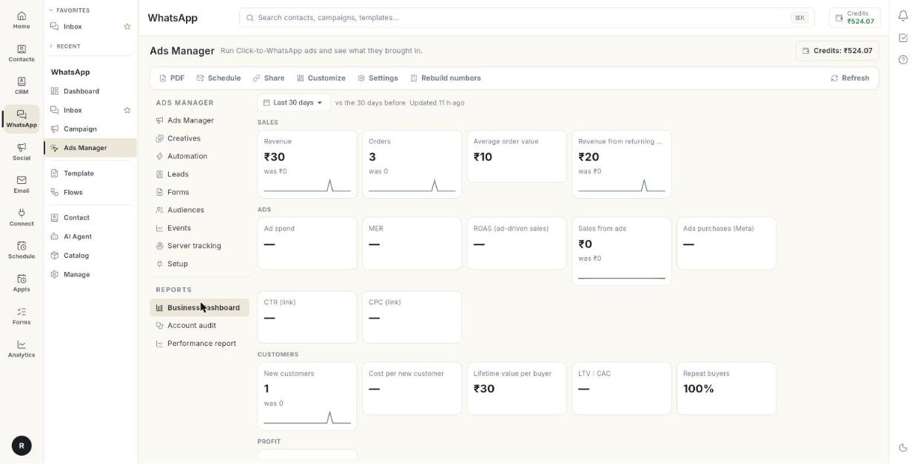

# बिज़नेस डैशबोर्ड पढ़ें { #read-the-business-dashboard }

**Business dashboard** से देखें कि आपके स्टोर ने क्या बेचा और उसके मुकाबले आपके विज्ञापनों पर कितना खर्च हुआ। आख़िर में आप किसी अवधि की कमाई, विज्ञापन खर्च पर रिटर्न, नए ग्राहक की लागत और मुनाफ़ा पढ़ चुके होंगे, और रिपोर्ट डाउनलोड, शेड्यूल या शेयर कर सकेंगे। इसमें करीब 10 मिनट लगते हैं।

## शुरू करने से पहले { #before-you-start }

- आपका Meta विज्ञापन अकाउंट कनेक्ट हो। देखें [Ads Manager सेट करें](set-up-ads-manager.md)।
- Shopify या WooCommerce कनेक्ट हो, ताकि Ohanvi आपके स्टोर के ऑर्डर देख सके। देखें [वेबहुक और इंटीग्रेशन](../whatsapp-webhooks-and-integrations.md)।
- आपके विज्ञापन लोगों को आपके स्टोर पर भेजते हों। Ohanvi विज्ञापन के लिंक से ऑर्डर को विज्ञापन से मिलाता है, इसलिए डैशबोर्ड को मिलाने के लिए ऑर्डर चाहिए। [VERIFY: page that explains order matching]
- आपको **WhatsApp** पैनल में **Ads Manager** दिखता हो। न दिखे तो अपने एडमिन से पूछें।

## डैशबोर्ड क्या दिखाता है { #what-the-dashboard-shows }

आँकड़े **Sales**, **Ads**, **Customers** और **Profit** में बँटे होते हैं। हर कार्ड वैल्यू, पिछली अवधि से बदलाव (जैसे **+12% vs before**) और एक छोटी ट्रेंड लाइन दिखाता है। हरा बदलाव बेहतर है। लाल बदलाव बुरा है। डैश (—) का मतलब है कि उस कार्ड के लिए डेटा नहीं है।

| कार्ड | इसका मतलब |
|------|---------------|
| **Revenue** | इस अवधि में आपके स्टोर में आया पैसा। |
| **Orders** | इस अवधि में स्टोर के ऑर्डर की संख्या। |
| **Average order value** | कमाई को ऑर्डर की संख्या से भाग देने पर मिली रकम। |
| **Revenue from returning customers** | उन खरीदारों से कमाई जो पहले भी ऑर्डर कर चुके थे। |
| **Ad spend** | आपके विज्ञापनों पर खर्च हुआ पैसा। |
| **MER** | स्टोर की कमाई को कुल विज्ञापन खर्च से भाग देने पर मिला अनुपात। |
| **ROAS (ad-driven sales)** | किसी विज्ञापन से जुड़ी बिक्री को विज्ञापन खर्च से भाग देने पर मिला अनुपात। |
| **Sales from ads** | किसी विज्ञापन से जुड़े स्टोर ऑर्डर की कमाई। |
| **Ads purchases (Meta)** | Meta के अपने एट्रिब्यूशन से, Meta के बताए अनुसार खरीदारी। |
| **CTR (link)** | सभी विज्ञापन प्लेटफ़ॉर्म पर लिंक क्लिक को इम्प्रेशन से भाग देने पर मिला अनुपात। |
| **CPC (link)** | विज्ञापन खर्च को लिंक क्लिक से भाग देने पर मिली रकम। |
| **New customers** | वे खरीदार जिनका पहला ऑर्डर इस अवधि में आया। |
| **Cost per new customer** | विज्ञापन खर्च को नए ग्राहकों से भाग देने पर मिली रकम। इसे CAC भी कहते हैं। |
| **Lifetime value per buyer** | हर खरीदार से अब तक की कुल कमाई। |
| **LTV : CAC** | लाइफ़टाइम वैल्यू को नए ग्राहक की लागत से भाग देने पर मिला अनुपात। |
| **Repeat buyers** | उन खरीदारों का हिस्सा जिन्होंने अब तक एक से ज़्यादा बार ऑर्डर किया। |
| **Net profit after ads** | कमाई गुणा आपका मार्जिन, घटा विज्ञापन खर्च। |

!!! tip "MER और ROAS एक जैसे नहीं हैं"
    **MER** स्टोर की पूरी कमाई को पूरे विज्ञापन खर्च से भाग देता है। **ROAS (ad-driven sales)** सिर्फ़ उन ऑर्डर को गिनता है जिन्हें Ohanvi ने किसी विज्ञापन से जोड़ा। जब कई खरीदार विज्ञापनों से नहीं आते, तब MER बड़ा नंबर होता है।

## चरण { #steps }

### डैशबोर्ड खोलें और अवधि चुनें { #open-the-dashboard-and-pick-a-period }

1. लेफ़्ट रेल में **WhatsApp** खोलें, फिर **Ads Manager** चुनें।
2. बाईं कॉलम में **Reports** के नीचे **Business dashboard** पर क्लिक करें।

    

3. ऊपर की तारीख़ सूची से अवधि चुनें: **Today**, **Yesterday**, **Last 3 days**, **Last 7 days**, **Last 14 days**, **Last 30 days**, **Last 90 days** या **Custom range…**।

    

4. कस्टम रेंज के लिए तारीखें चुनें। रेंज 200 दिन तक की हो सकती है। इससे लंबी रेंज पर संदेश **Pick at most 200 days.** दिखता है।
5. अवधि के पास का टेक्स्ट पढ़ें, **vs the 7 days before**। यह बताता है कि हर नंबर की तुलना किससे हो रही है।
6. दूसरी लाइन पढ़ें, जैसे **Updated 10 minutes ago**। यह बताती है कि नंबर आख़िरी बार कब बने। वे हर 15 मिनट में दोबारा बनते हैं। शब्द होते हैं **Updated just now**, **Updated 10 min ago**, **Updated 3 h ago** या तारीख के साथ **Updated**।

### नंबर कार्ड पढ़ें { #read-the-number-cards }

1. **Sales** कार्ड पढ़ें: **Revenue**, **Orders**, **Average order value** और **Revenue from returning customers**।
2. **Ads** कार्ड पढ़ें: **Ad spend**, **MER**, **ROAS (ad-driven sales)**, **Sales from ads**, **Ads purchases (Meta)**, **CTR (link)** और **CPC (link)**।
3. **Customers** कार्ड पढ़ें: **New customers**, **Cost per new customer**, **Lifetime value per buyer**, **LTV : CAC** और **Repeat buyers**।
4. **Profit** कार्ड पढ़ें, **Net profit after ads**।
5. अगर कार्ड आपसे **Set your margin** करने को कहे, तो [अपना मार्जिन और रिपोर्ट सेटिंग्स सेट करें](#set-your-margin-and-report-settings) देखें।

### चार्ट और टेबल पढ़ें { #read-the-charts-and-tables }

1. **Revenue vs ad spend** तक स्क्रॉल करें। यह रोज़ की कमाई और विज्ञापन खर्च दिखाता है, MER दाईं धुरी पर होता है।

    

2. **By ad platform** पढ़ें। इसमें हर प्लेटफ़ॉर्म की एक पंक्ति है।
3. **SPEND**, **CTR**, **CPC**, **CPM** और **PURCHASES\*** पढ़ें। ये प्लेटफ़ॉर्म से आते हैं। तारा (\*) का मतलब प्लेटफ़ॉर्म का अपना आँकड़ा है।
4. **STORE ORDERS**, **STORE SALES**, **STORE ROAS** और **COST / NEW CUSTOMER** पढ़ें। ये आपके स्टोर से आते हैं।
5. **Meta vs your store** पढ़ें। यह दिखाता है कि Meta के अनुसार उसके विज्ञापनों ने क्या बेचा, उसके पास Meta विज्ञापनों से जुड़े स्टोर ऑर्डर, और दोनों के बीच का अंतर प्रतिशत में।
6. उस ब्लॉक का बैज पढ़ें। नीचे की बैज टेबल देखें।
7. **Campaigns** पढ़ें। इसमें हर Meta कैंपेन की एक पंक्ति है: **SPEND**, **RESULTS**, **COST / RESULT**, **PURCHASES\***, **ROAS\***, **STORE ORDERS** और **STORE SALES**।
8. **Latest orders from ads** पढ़ें। इसके कॉलम हैं **ORDER**, **DATE**, **AMOUNT**, **FROM**, **CUSTOMER** और **SENT TO META**।
9. **FROM** कॉलम पढ़ें। यह प्लेटफ़ॉर्म का नाम और ऑर्डर को कैसे मिलाया गया, यह बताता है। नीचे की मैच टेबल देखें।
10. **SENT TO META** पढ़ें। इसमें **Sent** या **Failed** लिखा होता है। ब्योरे के लिए उस पर माउस ले जाएँ।

Click-to-WhatsApp की बिक्री भी Meta को खरीदारी के रूप में भेजी जाती है। **By ad platform** में, जिस प्लेटफ़ॉर्म का खर्च अभी नहीं पहुँचा, उस पर **Not synced yet** लिखा होता है।

| बैज | मतलब |
|-------|---------|
| **Close match** | Meta की गिनती और आपके स्टोर की गिनती मेल खाती हैं। |
| **Usual gap** | दोनों में अपेक्षित अंतर है। |
| **Check your setup** | अंतर बड़ा है। उसके नीचे लिखी वजहें पढ़ें। |
| **Different currencies** | स्टोर और विज्ञापन अकाउंट की करेंसी अलग-अलग है। |
| **No store sales traced** | कोई भी स्टोर ऑर्डर किसी Meta विज्ञापन से नहीं मिलाया जा सका। |

| FROM की वैल्यू | ऑर्डर कैसे मिलाया गया |
|------------|---------------------------|
| **Click-to-WhatsApp ad** | ग्राहक Click-to-WhatsApp विज्ञापन से आया। |
| **Ad id in the link** | स्टोर लिंक में विज्ञापन की ID थी। |
| **Google ad click** | ऑर्डर Google विज्ञापन के क्लिक से आया। |
| **Paid UTM link** | स्टोर लिंक में पेड कैंपेन के टैग थे। |

### अपना मार्जिन और रिपोर्ट सेटिंग्स सेट करें { #set-your-margin-and-report-settings }

1. **Settings** पर क्लिक करें। अगर मार्जिन सेव है, तो लिखा होता है **Settings · margin 40%**।
2. **Report & naming settings** में अपना **Gross margin** प्रतिशत में लिखें, जैसे 40। यह प्रोडक्ट की लागत के बाद बची कमाई का हिस्सा है। खाली छोड़ने पर **Net profit after ads** छिप जाता है।

    

3. **Reports (PDF and shared links)** के नीचे, अगर आप अपने संगठन के नाम से अलग नाम चाहते हैं, तो **Company name on reports** भरें।
4. **Report currency** चुनें, या **Same as the store**।
5. **Attribution window** चुनें। यह तय करती है कि हर रिपोर्ट में Meta बिक्री का श्रेय विज्ञापनों को कैसे देता है। इसे बदलने पर पिछले 30 दिन दोबारा पढ़े जाते हैं।
6. **Naming convention** के नीचे Create Ad से बनने वाले **Campaign** नामों का टेम्प्लेट सेट करें।
7. **Ad set** नामों का टेम्प्लेट सेट करें।
8. **Ad** नामों का टेम्प्लेट सेट करें।
9. **Save** पर क्लिक करें।

| Attribution window | यह क्या गिनती है |
|--------------------|----------------|
| **Same as Ads Manager (each ad set's setting)** | हर ad set की अपनी सेटिंग। |
| **1-day click** | क्लिक के 1 दिन के भीतर की बिक्री। |
| **7-day click** | क्लिक के 7 दिन के भीतर की बिक्री। |
| **28-day click** | क्लिक के 28 दिन के भीतर की बिक्री। |
| **1-day click or 1-day view** | क्लिक या व्यू के 1 दिन के भीतर की बिक्री। |
| **7-day click or 1-day view** | क्लिक के 7 दिन या व्यू के 1 दिन के भीतर की बिक्री। |

### चुनें कि डैशबोर्ड क्या दिखाए { #choose-what-the-dashboard-shows }

1. **Customize** पर क्लिक करें।
2. **Customize dashboard** में जो नंबर दिखाने हैं उन पर टिक करें।
3. नंबरों का क्रम बदलने के लिए उन्हें खींचें।
4. **Sections** के नीचे जिन ब्लॉक की ज़रूरत नहीं है उन्हें छिपाएँ।
5. **Save** पर क्लिक करें। डिफ़ॉल्ट लेआउट पर लौटने के लिए **Reset** पर क्लिक करें।

आपकी अपनी सूची **Your numbers** शीर्षक के नीचे दिखती है।

### PDF डाउनलोड करें { #download-a-pdf }

1. **PDF** पर क्लिक करें, या **Download PDF** पर।
2. फ़ाइल खोलें। उसका नाम `business-dashboard-` और उसके बाद दिन या तारीखें होती हैं।

अगर यह फ़ेल हो, तो संदेश **Could not build the PDF.** दिखता है।

### रिपोर्ट को शेड्यूल पर ईमेल करें { #email-the-report-on-a-schedule }

1. **Schedule** पर क्लिक करें, या **Schedule email** पर। **Scheduled report emails** विंडो खुलती है।
2. **New schedule** पर क्लिक करें। **New scheduled email** फ़ॉर्म खुलता है।

    

3. एक **Name (optional)** लिखें, जैसे Monday numbers for the owner।
4. **Report** चुनें: **Business dashboard** या **Account audit**।
5. फ़्रीक्वेंसी चुनें: **Daily**, **Weekly** या **Monthly**।
6. दिन चुनें, फिर **At** के नीचे घंटा चुनें।
7. चुनें कि **Report covers** क्या हो: **Last 7 days**, **Last 14 days**, **Last 30 days** या **Last 90 days**।
8. **Send to** में कॉमा से अलग करके अधिकतम 10 ईमेल पते लिखें। अपनी टीम से चुनने के लिए **Add team members** पर क्लिक करें।
9. **CC (optional)** भरें। उन्हें उसी ईमेल की कॉपी मिलती है। सबको दिखता है कि ईमेल किसे मिला।
10. अटैच्ड PDF में सेक्शन और मेज़र चुनने के लिए **Edit PDF view** पर क्लिक करें।
11. **Numbers in the email body** के नीचे वे नंबर चुनें जो ईमेल में दिखें। कोई न चुनने पर कुछ मानक नंबर इस्तेमाल होते हैं।
12. शेड्यूल चलाने या रोकने के लिए **Active** को चालू या बंद करें।
13. **Send a test email** पर क्लिक करें। संदेश **Test email sent. It can take a minute to arrive.** दिखता है।
14. शेड्यूल सेव करें।

!!! warning "भेजा गया ईमेल वापस नहीं लिया जा सकता"
    सेव करने से पहले **Send to** सूची जाँच लें। सूची में लिखे सभी लोगों को रिपोर्ट मिलती है।

### लाइव लिंक शेयर करें { #share-a-live-link }

1. **Share** पर क्लिक करें, या **Share link** पर। **Share the …** विंडो खुलती है।
2. एक्सपायरी चुनें: **Expires in 7 days**, **Expires in 30 days** या **Expires in 90 days**।
3. **Create & copy link** पर क्लिक करें।
4. लिंक भेजें। जिसके पास भी लिंक है, वह पिछले 7, 14, 30 या 90 दिनों का लाइव पेज देखता है, जिसमें PDF डाउनलोड भी है। लॉगिन की ज़रूरत नहीं है।
5. एक्सेस रोकने के लिए, उसी विंडो की सूची से लिंक रद्द (revoke) करें।

!!! warning "लिंक वाला कोई भी नंबर पढ़ सकता है"
    जब लिंक की ज़रूरत न रहे, तो उसे रद्द करें।

### नंबर दोबारा बनाएँ { #rebuild-the-numbers }

1. नए स्टोर ऑर्डर को विज्ञापनों से मिलाने और दोबारा गिनने के लिए **Rebuild numbers** पर क्लिक करें। काम के दौरान बटन पर **Rebuilding…** लिखा होता है।
2. नतीजे का संदेश पढ़ें, जैसे **3 new orders matched to ads.**

## समस्या का समाधान { #troubleshooting }

| समस्या | कारण | समाधान |
|-------|-------|-----|
| **No numbers yet. They build every 15 minutes from your store orders and Meta spend — or press "Rebuild numbers" now.** | पहला बिल्ड अभी नहीं चला है। | **Rebuild numbers** पर क्लिक करें। |
| **No store orders in this period. Connect Shopify or WooCommerce to see revenue, MER and profit next to your ad spend.** | कोई स्टोर कनेक्ट नहीं है, या इस अवधि में कोई ऑर्डर नहीं है। | अपना स्टोर कनेक्ट करें, या लंबी अवधि चुनें। |
| संदेश कि आपके स्टोर और विज्ञापन अकाउंट की करेंसी अलग हैं | स्टोर और विज्ञापन अकाउंट की करेंसी अलग हैं, इसलिए MER, ROAS, प्रति ग्राहक लागत और मुनाफ़ा छिपे हैं। | दोनों पर एक ही करेंसी रखें, या **Settings** में **Report currency** को विज्ञापन अकाउंट की करेंसी पर सेट करें। |
| **Net profit after ads** में **Set your margin** दिखता है | कोई ग्रॉस मार्जिन सेव नहीं है। | **Settings** पर क्लिक करें और **Gross margin** भरें। |
| **Could not load the business dashboard** | डैशबोर्ड लोड नहीं हुआ। | **Retry** पर क्लिक करें। |
| **Could not build the PDF.** | PDF पूरा नहीं बना। | **PDF** पर दोबारा क्लिक करें। |
| **Could not create the link.** | शेयर लिंक नहीं बना। | **Create & copy link** पर दोबारा क्लिक करें। |

## संबंधित गाइड { #related }

- [परफ़ॉर्मेंस रिपोर्ट पढ़ें](read-the-performance-report.md)
- [अपने विज्ञापन प्रबंधित करें](manage-your-ads.md)
- [अकाउंट ऑडिट चलाएँ](run-an-account-audit.md)
- [वेबसाइट इवेंट ट्रैक करें](track-website-events.md)
- [Click-to-WhatsApp विज्ञापन चलाएँ](../click-to-whatsapp-ads.md)
