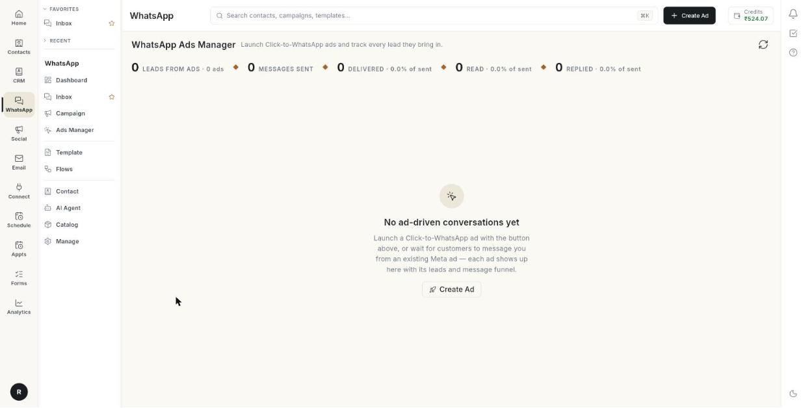

# विज्ञापनों की परफ़ॉर्मेंस रिपोर्ट पढ़ें { #read-the-ads-performance-report }

**Performance report** खोलकर देखें कि हर विज्ञापन से कितनी लीड्स आईं, आपके भेजे मैसेज का क्या हुआ, और विज्ञापनों पर कितना खर्च हुआ। अंत में आप हर कार्ड पढ़ सकेंगे, अपने विज्ञापन क्रेडिट जाँच सकेंगे और पैसे जोड़ सकेंगे। इसमें लगभग 5 मिनट लगते हैं।

## शुरू करने से पहले { #before-you-start }

- आपका Facebook अकाउंट, Page, ऐड अकाउंट और व्हाट्सऐप नंबर कनेक्ट हैं। देखें [Ads Manager सेट करें](set-up-ads-manager.md)।
- आपके पास कम से कम 1 ऐसा विज्ञापन है जिससे लीड आई है। देखें [विज्ञापन बनाएँ](create-an-ad.md)।
- आपको **WhatsApp** पैनल में **Ads Manager** दिखता है। अगर नहीं, तो अपने एडमिन से कहें।

## रिपोर्ट में क्या दिखता है { #what-the-report-shows }

रिपोर्ट में ऊपर से नीचे 5 हिस्से हैं: समरी कार्ड, **Meta spend — last 30 days** स्ट्रिप, **Credits & billing** कार्ड, **New leads per day** चार्ट, और हर विज्ञापन का एक कार्ड।

कुछ आँकड़े Ohanvi से आते हैं और कुछ Meta से। डैश (—) का मतलब है कि Meta ने वह आँकड़ा नहीं लौटाया।

## चरण { #steps }

### रिपोर्ट खोलें { #open-the-report }

1. लेफ़्ट रेल में **WhatsApp** खोलें, फिर **Ads Manager** चुनें।
2. बाईं कॉलम में **Reports** के नीचे **Performance report** पर क्लिक करें। **WhatsApp Ads Manager** पेज खुलता है।

    

3. ताज़ा आँकड़े लोड करने के लिए ऊपर दाईं ओर रिफ़्रेश आइकन पर क्लिक करें।

    

अगर अब तक किसी विज्ञापन से कोई लीड नहीं आई है, तो पेज पर **No ad-driven conversations yet** लिखा होता है। **Create Ad** पर क्लिक करें या इंतज़ार करें कि ग्राहक किसी विज्ञापन से आपको मैसेज करें।

### समरी कार्ड पढ़ें { #read-the-summary-cards }

ऊपर के कार्ड आपके सभी विज्ञापनों का जोड़ दिखाते हैं।

1. **Leads from ads** पढ़ें। यह उन लोगों को गिनता है जिन्होंने किसी विज्ञापन से आपको मैसेज किया। नीचे की लाइन बताती है कि कितने विज्ञापनों से वे आए।
2. **Messages sent** पढ़ें। यह उन लीड्स को आपके भेजे मैसेज गिनता है।
3. **Delivered** पढ़ें। यह वे मैसेज गिनता है जो लीड के फ़ोन तक पहुँचे। नीचे की लाइन भेजे गए मैसेज का हिस्सा बताती है।
4. **Read** पढ़ें। यह वे मैसेज गिनता है जो लीड ने खोले। नीचे की लाइन भेजे गए मैसेज का हिस्सा बताती है।
5. **Replied** पढ़ें। यह वे मैसेज गिनता है जिनका लीड ने जवाब दिया। नीचे की लाइन भेजे गए मैसेज का हिस्सा बताती है।
6. **Ad spend** पढ़ें। यह पिछले 30 दिनों में विज्ञापनों पर खर्च हुआ पैसा दिखाता है।
7. **Cost per lead** पढ़ें। यह विज्ञापन के खर्च को लीड्स से भाग देने पर मिलता है। नीचे की लाइन बताती है कि Meta ने कितनी चैट गिनीं।

**Ad spend** और **Cost per lead** तभी दिखते हैं जब आपका Meta ऐड अकाउंट कनेक्ट हो। कार्ड न दिखने का मतलब है कि खर्च का डेटा नहीं आया। इसका मतलब यह नहीं कि लीड्स मुफ़्त थीं।

### Meta spend स्ट्रिप पढ़ें { #read-the-meta-spend-strip }

कार्ड के नीचे **Meta spend — last 30 days** स्ट्रिप Meta के अपने आँकड़े दिखाती है।

1. **SPEND** पढ़ें। यह ऐड अकाउंट पर खर्च हुआ पैसा है।
2. **IMPRESSIONS** पढ़ें। यह बताता है कि आपके विज्ञापन कितनी बार दिखाए गए। एक व्यक्ति एक से ज़्यादा बार जोड़ सकता है।
3. **CLICKS** पढ़ें। यह बताता है कि लोगों ने आपके विज्ञापनों पर कितनी बार क्लिक किया।
4. **CTR** पढ़ें। यह क्लिक को इम्प्रेशन से भाग देने पर प्रतिशत में मिलता है।
5. **CONVERSATIONS** पढ़ें। Meta के अनुसार आपके विज्ञापनों ने जितनी व्हाट्सऐप चैट शुरू कीं।
6. **COST / CONVERSATION** पढ़ें। यह खर्च को बातचीत से भाग देने पर मिलता है।

!!! note "लीड की दो गिनतियाँ अलग हो सकती हैं"
    **Leads from ads** वे संपर्क गिनता है जो Ohanvi ने दर्ज किए। **CONVERSATIONS** वे चैट गिनता है जो Meta ने दर्ज कीं। दोनों में कुछ का फ़र्क हो सकता है। [VERIFY: फ़र्क का कारण]

### अपने क्रेडिट और बिलिंग जाँचें { #check-your-credits-and-billing }

**Credits & billing** कार्ड दिखाता है कि आपके विज्ञापन का खर्च कैसे चुकाया जाता है।

1. स्टेटस बैज पढ़ें, जैसे **ACTIVE**। यह Meta ऐड अकाउंट की स्थिति दिखाता है। कोई और वैल्यू एम्बर रंग में दिखती है।
2. **Credits balance (shared)** पढ़ें। ये आपके प्रीपेड क्रेडिट हैं। हर प्रोडक्ट इसी एक बैलेंस से खर्च करता है।
3. **Old ads credits** पढ़ें। यह पहले के विज्ञापन वॉलेट का बचा हुआ बैलेंस है। यह तभी दिखता है जब उसमें पैसे हों।
4. **Meta payment method** पढ़ें। यह ऐड अकाउंट पर लगा कार्ड या UPI दिखाता है, या **Not added yet**।
5. **Total ad spend** पढ़ें। यह ऐड अकाउंट का अब तक का पूरा खर्च है।
6. **Unbilled spend** पढ़ें। यह वह खर्च है जिसका बिल Meta ने अभी नहीं बनाया।

### अपने विज्ञापन क्रेडिट में पैसे जोड़ें { #add-money-to-your-ad-credits }

1. **Credits & billing** कार्ड पर **Add money** पर क्लिक करें। **Add money to Ads Credits** विंडो खुलती है।
2. **Amount (₹)** लिखें। कम से कम ₹10 होना चाहिए।
3. **Pay with Razorpay** पर क्लिक करें।
4. UPI, कार्ड, नेटबैंकिंग या वॉलेट से भुगतान करें।
5. वापस आकर **I have paid — check** पर क्लिक करें। बैलेंस अपडेट हो जाता है।

अगर कोई रीचार्ज बाकी है, तो एक एम्बर पंक्ति पर **Recharge of … is pending payment.** लिखा होता है, साथ में **Pay now** और **I have paid — check**।

!!! note "Add money बटन नहीं दिख रहा"
    अगर आपका प्लान Shopify के ज़रिए बिल होता है, तो **Add money** छिपा रहता है। आपके विज्ञापन का खर्च आपके मासिक Shopify बिल में जुड़ जाता है। डिलीवरी के लिए Meta फिर भी ऐड अकाउंट के अपने पेमेंट तरीके से चार्ज करता है।

### Meta पेमेंट तरीका जोड़ें { #add-a-meta-payment-method }

1. **Credits & billing** कार्ड पर **Add Meta payment method** पर क्लिक करें। अगर कोई पहले से है, तो बटन पर **Meta billing** लिखा होता है।
2. Meta का पेमेंट पेज खुलता है। कार्ड या UPI जोड़ें।

!!! warning "विज्ञापनों के लिए Meta पर पेमेंट तरीका ज़रूरी है"
    विज्ञापन तभी चलते हैं जब Meta ऐड अकाउंट पर पेमेंट तरीका जोड़ा जा चुका हो। Meta का पेज कार्ड और UPI स्वीकार करता है।

### Pay with Ohanvi से खर्च की सीमा तय करें { #set-a-spend-cap-with-pay-with-ohanvi }

**Pay with Ohanvi** कार्ड **Credits & billing** के नीचे होता है। इससे Meta, Ohanvi को बिल करता है, और खर्च आपके क्रेडिट से कटता है।

1. शुरू करने के लिए **Turn on** पर क्लिक करें। रोकने के लिए **Turn off** पर क्लिक करें।
2. **Spend cap** तय करने के लिए **Change cap** पर क्लिक करें। यह वह ज़्यादा से ज़्यादा रकम है जो अकाउंट खर्च कर सकता है। सीमा पूरी होने पर Meta डिलीवरी रोक देता है।
3. फ़िलहाल डिलीवरी रोकने के लिए **Pause** पर क्लिक करें। दोबारा शुरू करने के लिए **Resume** पर क्लिक करें।

### रोज़ की लीड्स का चार्ट पढ़ें { #read-the-leads-per-day-chart }

1. **New leads per day** ढूँढें। हर बार 1 दिन है।
2. किसी बार पर माउस ले जाएँ। तारीख और लीड्स की संख्या पढ़ें।
3. चार्ट के नीचे पहली और आखिरी तारीखें पढ़ें।

### विज्ञापन कार्ड पढ़ें { #read-an-ad-card }

जिस भी विज्ञापन से लीड आई है, उसका अपना कार्ड है।

1. विज्ञापन की हेडलाइन और **Ad ID** पढ़ें। बड़ी संख्या इस विज्ञापन से आई लीड्स हैं।
2. सूची खोलने के लिए **View leads** पर क्लिक करें। देखें [विज्ञापन से आई लीड्स प्रबंधित करें](manage-ad-leads.md)।
3. मैसेज फ़नल को बाएँ से दाएँ पढ़ें। नीचे की टेबल के चिप इस्तेमाल करें।
4. जब खर्च उपलब्ध हो, तो पैसों की पंक्ति पढ़ें। यह **Spent**, **Per lead**, और Meta के चैट गिनने पर **Per chat** दिखाती है।
5. **Read rate** पढ़ें। यह भेजे गए मैसेज का वह हिस्सा है जो पढ़ा गया।
6. लीड सूची में, बचे हुए समय के साथ **Free to reply** पढ़ें, जैसे **· 3h left**। यह तब दिखता है जब लीड की 72 घंटे की विज्ञापन विंडो खुली होती है। इस विंडो में आप पेड टेम्प्लेट के बिना जवाब दे सकते हैं।

| चिप | यह क्या गिनता है |
|------|----------------|
| **Sent** | इस विज्ञापन की लीड्स को आपके भेजे मैसेज। |
| **Delivered** | वे मैसेज जो फ़ोन तक पहुँचे। |
| **Read** | वे मैसेज जो लीड ने खोले। |
| **Replied** | वे मैसेज जिनका लीड ने जवाब दिया। |
| **Clicked** | आपके मैसेज के अंदर बटन या लिंक पर क्लिक। [VERIFY: क्लिक का स्रोत] |
| **Failed** | वे मैसेज जो नहीं गए। सिर्फ़ तब दिखता है जब 0 से ज़्यादा हो। |

## समस्या का समाधान { #troubleshooting }

| समस्या | कारण | समाधान |
|-------|-------|-----|
| **Could not load ads report** | रिपोर्ट लोड नहीं हुई। | **Retry** पर क्लिक करें। |
| **No ad-driven conversations yet** | इस रिपोर्ट में किसी विज्ञापन से कोई लीड नहीं आई है। | विज्ञापन बनाएँ, या इंतज़ार करें कि कोई ग्राहक उससे आपको मैसेज करे। |
| **Ad spend** और **Cost per lead** कार्ड नहीं दिख रहे | Meta ऐड अकाउंट कनेक्ट नहीं है, या Meta ने खर्च नहीं लौटाया। | **Setup** पूरा करें। देखें [Ads Manager सेट करें](set-up-ads-manager.md)। |
| **Add money** नहीं दिख रहा | आपका प्लान Shopify के ज़रिए बिल होता है, या क्रेडिट लोड नहीं हुए। | अपने Shopify बिल से भुगतान करें। नहीं तो पेज रिफ़्रेश करें। |
| **Minimum recharge is ₹10.** | रकम 10 से कम है। | 10 या उससे ज़्यादा लिखें। |
| **Could not start the recharge** | पेमेंट पेज नहीं खुला। | फिर कोशिश करें। अगर बार-बार हो, तो सपोर्ट से संपर्क करें। |
| **Could not check payment status.** | पेमेंट की जाँच पूरी नहीं हुई। | एक मिनट बाद फिर **I have paid — check** पर क्लिक करें। |
| **Could not load leads** | उस विज्ञापन की लीड सूची लोड नहीं हुई। | विंडो बंद करें और फिर **View leads** पर क्लिक करें। |

## संबंधित गाइड { #related }

- [अपने विज्ञापन प्रबंधित करें](manage-your-ads.md)
- [बिज़नेस डैशबोर्ड पढ़ें](read-the-business-dashboard.md)
- [विज्ञापन से आई लीड्स प्रबंधित करें](manage-ad-leads.md)
- [Ads Manager सेट करें](set-up-ads-manager.md)
- [Click-to-WhatsApp विज्ञापन चलाएँ](../click-to-whatsapp-ads.md)
