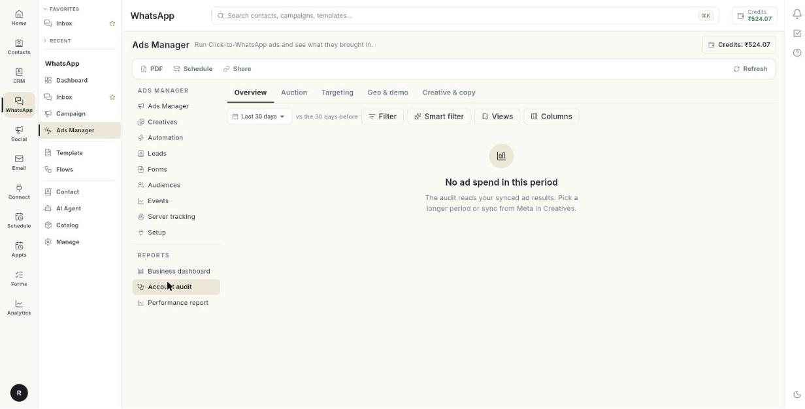

# अकाउंट ऑडिट चलाएँ { #run-an-account-audit }

**Ads Manager** में **Reports** के नीचे **Account audit** खोलें। यह आपके सिंक किए गए विज्ञापन नतीजे पढ़कर दिखाता है कि पैसा कहाँ जा रहा है, क्या ज़रूरत से ज़्यादा महँगा है, और पहले क्या ठीक करना है। अंत में आपके पास ठीक करने की एक छोटी सूची और ऐसी रिपोर्ट होगी जिसे आप डाउनलोड, ईमेल या शेयर कर सकते हैं। पहली बार पढ़ने में करीब 10 मिनट लगते हैं।

## शुरू करने से पहले { #before-you-start }

- आपका Facebook अकाउंट, पेज और विज्ञापन अकाउंट **Setup** में कनेक्ट हों। देखें [Ads Manager सेट करें](set-up-ads-manager.md)।
- आपके विज्ञापनों ने चुनी गई अवधि में पैसा खर्च किया हो। ऑडिट सिंक किए गए नतीजे पढ़ता है, Meta की लाइव स्क्रीन नहीं।
- आपको **WhatsApp** पैनल में **Ads Manager** दिखता हो। न दिखे तो अपने एडमिन से पूछें।

## ऑडिट क्या दिखाता है { #what-the-audit-shows }

ऑडिट में 5 टैब हैं। हर टैब आपकी चुनी अवधि की तुलना उससे पहले के उतने ही दिनों से करता है।

| टैब | यह किस सवाल का जवाब देता है |
| --- | --- |
| **Overview** | ऑडिट में क्या मिला? फ़नल के चरणों में खर्च कैसे बँटा है? |
| **Auction** | लोगों तक पहुँचने में कितना खर्च होता है? आपके ad set कैसे सेट हैं? Meta आपके विज्ञापनों को कैसे रैंक करता है? |
| **Targeting** | कौन-सी ऑडियंस सबसे अच्छे नतीजे लाती हैं? |
| **Geo & demo** | कौन-से देश, क्षेत्र, उम्र और भाषाएँ नतीजे लाती हैं? |
| **Creative & copy** | इमेज, वीडियो और विज्ञापन टेक्स्ट की रिपोर्ट के शॉर्टकट। |

## चरण { #steps }

### ऑडिट खोलें और अवधि सेट करें { #open-the-audit-and-set-the-period }

1. बाएँ रेल में **WhatsApp** खोलें, फिर **Ads Manager** चुनें।
2. बाएँ कॉलम में **Reports** के नीचे **Account audit** चुनें।

    

3. अवधि चुनें: **Last 7 days**, **Last 14 days**, **Last 30 days** या **Last 90 days**। **vs the N days before** वाली पंक्ति बताती है कि हर नंबर की तुलना किससे हो रही है।
4. वैकल्पिक: **Filter**, **Smart filter** या **Views** से ऑडिट को सीमित करें। देखें [ऑडिट फ़िल्टर करें](#filter-the-audit)।
5. ऑडिट दोबारा बनाने के लिए **Refresh** पर क्लिक करें।

अगर पेज पर **No ad spend in this period** दिखे, तो लंबी अवधि चुनें या **Creatives** में **Sync from Meta** पर क्लिक करें।

### Overview टैब पढ़ें { #read-the-overview-tab }

1. **Overview** टैब चुनें।
2. सबसे पहले **What the audit found** पढ़ें। निष्कर्ष सबसे ज़रूरी वाले पहले दिखते हैं। हर एक पर एक लेबल होता है।
3. अगर कार्ड पर **Nothing needs attention in this period.** लिखा है, तो कोई निष्कर्ष नहीं निकला।
4. उसके नीचे के टाइल पढ़ें। हर टाइल पिछली अवधि के मुकाबले बदलाव दिखाता है। हरे का मतलब बेहतर। लाल का मतलब बदतर।
5. **By funnel stage** पढ़ें। हर ad set को उसकी टारगेट की गई ऑडियंस के हिसाब से एक चरण में रखा जाता है: **Prospecting**, **Re-engagement**, **Retargeting** या **Retention**।
6. तालिका में दिखने वाले नंबर चुनने के लिए **Columns** पर क्लिक करें: **Share of spend**, **Spend**, नतीजे का नाम, **Cost / result**, **Revenue**, **ROAS**, **CPM**, **CPC**, **CTR**, **Frequency**, **Impressions** और **Link clicks**।
7. डिफ़ॉल्ट कॉलम पर लौटने के लिए **Reset** पर क्लिक करें।
8. **Stage by stage** पढ़ें। 2 नंबर चुनें। हर चरण के लिए, हर दिन, एक बार के रूप में और एक लाइन के रूप में दिखता है।
9. **Stage drilldown** पढ़ें। सभी चरणों की एक नंबर पर तुलना करने के लिए **Spend** या **CPM** जैसा कोई चिप चुनें।
10. **Spend by stage** पढ़ें। यह हर दिन का खर्च चरण के हिसाब से ऊपर-नीचे जमाकर दिखाता है।

| लेबल | मतलब |
| --- | --- |
| **Fix first** | ऊँची गंभीरता की समस्या। किसी भी और चीज़ से पहले इस पर काम करें। |
| **Worth a look** | मध्यम गंभीरता की समस्या। |
| **Opportunity** | कुछ ऐसा जो बेहतर नतीजे ला सकता है। |
| **Tip** | एक छोटा सुझाव। |

| टाइल | यह क्या दिखाता है |
| --- | --- |
| **Spend** | अवधि में खर्च किया गया पैसा। |
| नतीजे का टाइल | वह नतीजा जिस पर आपके विज्ञापन मापे जाते हैं: **Conversations**, **Leads**, **Purchases** या **Link clicks**। |
| **Cost per result** | खर्च को नतीजों से भाग देने पर। कम बेहतर है। |
| **ROAS** | रेवेन्यू को खर्च से भाग देने पर। |
| **CPM** | 1,000 इम्प्रेशन की लागत। कम बेहतर है। |
| **Link CTR** | लिंक क्लिक को इम्प्रेशन से भाग देने पर। |
| **Frequency / day** | उस दिन किसी व्यक्ति ने विज्ञापन कितनी बार देखा। कम बेहतर है। |

!!! tip "सुझाव"
    जाँचें कि आपका ज़्यादातर खर्च उसी चरण में जा रहा है जिसे आप फ़ंड करना चाहते थे। जैसे, **Retargeting** का बड़ा हिस्सा और **Prospecting** का छोटा हिस्सा होने का मतलब है कि बहुत कम नए लोग आपके विज्ञापन देख रहे हैं।

### Auction टैब पढ़ें { #read-the-auction-tab }

1. **Auction** टैब चुनें।
2. **Cost to reach people** पढ़ें। यह हर दिन का CPM और प्रति लिंक क्लिक लागत दिखाता है।
3. **Attention** पढ़ें। यह हर दिन का लिंक CTR (%) और फ़्रीक्वेंसी दिखाता है।
4. **Dashboard view** या **Table view** चुनें। डैशबोर्ड बार दिखाता है। तालिका में **GROUP**, एक गिनती, **SPEND**, **SHARE**, नतीजे का नाम, **COST / RESULT** और **ROAS** दिखते हैं।
5. हर ब्रेकडाउन कार्ड पढ़ें। हर एक आपके खर्च और नतीजों को ग्रुप में बाँटता है।
6. **How Meta ranks your ads** पढ़ें। बार दिखाते हैं कि आपके खर्च का कितना हिस्सा **Above average**, **Average**, **Below average** या **No ranking** में है।
7. बार के नीचे की तालिका पढ़ें। यह हर विज्ञापन को **QUALITY**, **ENGAGEMENT** और **CONVERSION** के साथ दिखाती है।

| कार्ड | यह क्या बताता है |
| --- | --- |
| **Learning phase** | वे ad set जो अब भी सीख रहे हैं, सीखना पूरा कर चुके हैं, या बहुत कम नतीजों की वजह से सीमित हैं। |
| **Budget type** | कैंपेन बजट (CBO) बनाम ad set बजट (ABO)। |
| **Budget breakdown** | बजट के आकार के हिसाब से खर्च। Low, medium और high आपके अपने रोज़ के बजट का निचला, बीच वाला और ऊपरी एक-तिहाई हिस्सा हैं। |
| **Automatic vs manual bid** | Meta सबसे ज़्यादा नतीजों के लिए बिड कर रहा है, या आपका तय किया लागत, बिड या ROAS लक्ष्य है। |
| **Bid strategy** | इस्तेमाल में आ रही हर स्ट्रेटेजी। |
| **Campaign objective** | हर कैंपेन ने Meta से क्या माँगा था। |
| **Ad delivery optimisation** | हर ad set किस नतीजे के लिए ऑप्टिमाइज़ होता है। |
| **Ad type** | सामान्य विज्ञापन, डायनेमिक क्रिएटिव (DCO), कई टेक्स्ट (MTO) और कैटलॉग विज्ञापन (DPA)। |
| **Quality ranking**, **Engagement rate ranking**, **Conversion rate ranking** | उन्हीं लोगों के लिए होड़ करने वाले विज्ञापनों के मुकाबले Meta की रैंकिंग। |
| **Placement type** और **Placement** | विज्ञापन कहाँ चले। |
| **Desktop vs mobile**, **Operating system**, **Device** | लोगों ने विज्ञापन किस पर देखे। |
| **Hour of day** | विज्ञापन अकाउंट के टाइम ज़ोन के हिसाब से हर घंटे के नतीजे, प्रति नतीजा लागत के साथ। |
| **Day of week** | किन दिनों नतीजे सबसे सस्ते मिलते हैं। |
| **Frequency** | एक दिन में किसी व्यक्ति ने विज्ञापन कितनी बार देखा, और उससे क्या मिला। |

!!! note "ध्यान दें"
    रैंकिंग के लिए डेटा चाहिए। 500 से कम इम्प्रेशन वाले विज्ञापनों को कोई रैंकिंग नहीं मिलती। रैंकिंग **Above average**, **Average**, **Bottom 35%**, **Bottom 20%** या **Bottom 10%** के रूप में दिखती है। रैंकिंग न हो तो **Not enough data** दिखता है।

### Targeting टैब पढ़ें { #read-the-targeting-tab }

1. **Targeting** टैब चुनें। यह 3 व्यू के साथ **Top audiences** खोलता है: **Audiences**, **Funnel** और **Breakdowns**।
2. **Last 7 days**, **Last 14 days**, **Last 30 days** या **Last 90 days** चुनें।
3. **Audiences** में तालिका पढ़ें: **AUDIENCE**, **AD SETS**, खर्च, **RESULTS**, **COST / [result]**, **VS AVERAGE** और **EXCLUDED IN**।
4. **Account average** पढ़ें। यह पूरे अकाउंट की प्रति नतीजा लागत दिखाता है।
5. किसी पंक्ति पर **Use in ad** पर क्लिक करें, तो उसी ऑडियंस के चुने जाने के साथ **Create Ad** खुलता है।
6. **Funnel** में हर चरण को **LIVE / CREATED**, नतीजे, लागत और **VS AVERAGE** के साथ पढ़ें।
7. **Breakdowns** में **Buyers by frequency and value**, **Lookalike %**, **Lookalike × seed recency** और **Audience recency** पढ़ें।

अगर **No audience results yet** दिखे, तो आपकी ऑडियंस इस्तेमाल करने वाले ad set ने इस अवधि में खर्च नहीं किया है। देखें [विज्ञापन ऑडियंस बनाएँ](build-ad-audiences.md)।

### Geo & demo टैब पढ़ें { #read-the-geo-demo-tab }

1. **Geo & demo** टैब चुनें।
2. **Grade countries by** के नीचे **Cost per result**, **ROAS** या **CTR** चुनें।
3. **Countries** पढ़ें। यह देशों को अच्छे, औसत, महँगे और बिना नतीजे वाले में बाँटता है।
4. **Country tiers** पढ़ें। Tier 1 सबसे महँगे बाज़ार हैं। Tier 4 सबसे सस्ते।
5. **Wasted spend by country** पढ़ें। यह उन देशों को गिनता है जो अकाउंट से 1.5 गुना बदतर हैं या जिनमें कोई नतीजा नहीं है। यह **Share of spend wasted** और **Potential uplift** दिखाता है।
6. **Trending countries** पढ़ें। यह पिछली अवधि के मुकाबले सबसे बड़ा बदलाव दिखाता है।
7. किसी देश के क्षेत्र देखने के लिए मैप पर उस पर क्लिक करें। वापस आने के लिए **Show all** पर क्लिक करें।
8. **International scaling** पढ़ें। दिन-ब-दिन के बदलाव देखने के लिए **Tiers** या **Regions** चुनें।
9. **Age & gender** पढ़ें। **Age × gender**, **Age** या **Gender** चुनें।
10. **Language** पढ़ें। इसमें **Targeting language**, **Copy language** और **Spoken country language** शामिल हैं।

अगर टैब पर **No breakdowns for this period** दिखे, तो देश, क्षेत्र और उम्र के नतीजे विज्ञापन चलने के बाद दिखते हैं।

### Creative & copy टैब पढ़ें { #read-the-creative-copy-tab }

1. **Creative & copy** टैब चुनें।
2. यह देखने के लिए कि कौन-सी इमेज और वीडियो फ़ॉर्मैट के हिसाब से जीत रही हैं, थकान के निशानों के साथ, **Open creative insights** पर क्लिक करें।
3. यह देखने के लिए कि टेक्स्ट की लंबाई, इमोजी, लिंक और वाक्यांश कैसा प्रदर्शन करते हैं, **Open ad copy insights** पर क्लिक करें।

इन रिपोर्ट के लिए देखें [विज्ञापन क्रिएटिव का इस्तेमाल करें](use-ad-creatives.md)।

### निष्कर्षों पर कार्रवाई करें { #act-on-the-findings }

1. हर **Fix first** निष्कर्ष से शुरू करें। उसकी ब्योरे वाली पंक्ति पढ़ें।
2. निष्कर्ष से मेल खाता पेज खोलें।
3. एक बार में 1 ही चीज़ बदलें।
4. कुछ दिन बाद ऑडिट दोबारा चलाकर बदलाव देखें।

| अगर निष्कर्ष इस बारे में है | यहाँ जाएँ |
| --- | --- |
| ऐसे विज्ञापन जो खर्च करते हैं पर नतीजा नहीं देते, या थके हुए विज्ञापन | [अपने विज्ञापन ऑटोमेट करें](automate-your-ads.md)। **Stop Loss** रूल बनाएँ। |
| कमज़ोर या थकी हुई इमेज और टेक्स्ट | [विज्ञापन क्रिएटिव का इस्तेमाल करें](use-ad-creatives.md) |
| ऐसी ऑडियंस जो बहुत महँगी पड़ती हैं | **Targeting** टैब, फिर **Use in ad** |
| ऐसे देश जो खर्च बर्बाद करते हैं | [विज्ञापन बनाएँ](create-an-ad.md)। उन लोकेशन को हटा दें। |

### ऑडिट फ़िल्टर करें { #filter-the-audit }

1. **Filter** पर क्लिक करें। फ़िल्टर चालू होने पर बटन पर **Filter · N** लिखा होता है।
2. **Filter data** विंडो भरें। फ़ील्ड देखने के लिए [विज्ञापन क्रिएटिव का इस्तेमाल करें](use-ad-creatives.md#filter-the-data) देखें।
3. या **Smart filter** पर क्लिक करें और कोई तैयार फ़िल्टर चुनें, जैसे **Spending with no results**।
4. अपनी सेटिंग सहेजने के लिए **Views** पर क्लिक करें, फिर **Save the current filter and columns…** पर।
5. सभी फ़िल्टर हटाने के लिए **Clear filters** पर क्लिक करें।

### ऑडिट को PDF के रूप में डाउनलोड करें { #download-the-audit-as-a-pdf }

1. ऑडिट डाउनलोड करने के लिए ऊपर की बार में **PDF** पर क्लिक करें। जिस पेज पर ऊपर की बार नहीं है, वहाँ बटन पर **Download PDF** लिखा होता है।
2. फ़ाइल खोलें। उसका नाम `ad-account-audit-30d.pdf` जैसा होता है।

### तय समय पर ऑडिट ईमेल करें { #email-the-audit-on-a-schedule }

1. **Schedule** पर क्लिक करें। **New scheduled email** विंडो खुलती है।
2. **Name (optional)** लिखें, जैसे "Monday numbers for the owner"।
3. **How often** के नीचे **Daily**, **Weekly** या **Monthly** चुनें। कम से कम 1 चुनें।
4. **Monthly** के लिए **Day of month** सेट करें।
5. ईमेल जाने का घंटा **At** में और मिनट **Minute** में सेट करें।
6. **Send to** में अधिकतम 10 ईमेल पते कॉमा से अलग करके लिखें। अपनी टीम में से चुनने के लिए **Add team members** पर क्लिक करें।
7. वैकल्पिक: कॉपी भेजने के लिए **CC (optional)** में पते लिखें।
8. वैकल्पिक: PDF में सेक्शन, मापदंड और लोगो चुनने के लिए **Edit PDF view** पर क्लिक करें।
9. **Active** को चालू रखें। शेड्यूल रोकने के लिए इसे बंद करें।
10. जाँचने के लिए **Send a test email** पर क्लिक करें।
11. **Save** पर क्लिक करें।

### लिंक से ऑडिट शेयर करें { #share-the-audit-with-a-link }

1. **Share** पर क्लिक करें। **Share the Account audit** विंडो खुलती है।
2. **Create & copy link** के बगल की सूची से समाप्ति चुनें: **Expires in 7 days**, **Expires in 30 days**, **Expires in 90 days** या **Never expires**।
3. **Create & copy link** पर क्लिक करें।
4. लिंक भेजें। लिंक वाला कोई भी व्यक्ति बिना लॉगिन के PDF डाउनलोड के साथ एक लाइव पेज देखता है।
5. शेयर करना बंद करने के लिए उसी विंडो में लिंक रद्द करें।

!!! warning "शेयर किया गया लिंक सार्वजनिक होता है"
    जिसके पास भी लिंक है, वह आपका खर्च और नतीजे तब तक पढ़ सकता है जब तक आप उसे रद्द न करें या वह खत्म न हो जाए।

## समस्या का समाधान { #troubleshooting }

| समस्या | कारण | समाधान |
| --- | --- | --- |
| **Could not build the audit** | ऑडिट आपका सिंक किया हुआ डेटा नहीं पढ़ सका। | **Retry** पर क्लिक करें। बार-बार हो तो **Setup** जाँचें। |
| **No ad spend in this period** | आपके विज्ञापनों ने अवधि में खर्च नहीं किया, या नतीजे सिंक नहीं हुए हैं। | लंबी अवधि चुनें। **Creatives** में **Sync from Meta** पर क्लिक करें। |
| किसी कार्ड पर **No data in this period.** | उस ग्रुप में कोई ad set या विज्ञापन नहीं आया। | लंबी अवधि चुनें। |
| **No breakdowns for this period** | देश, क्षेत्र और उम्र के नतीजों के लिए विज्ञापन अभी इतने समय नहीं चले। | विज्ञापन चलने तक रुकें, फिर **Refresh** पर क्लिक करें। |
| रैंकिंग में **Not enough data** | विज्ञापन के 500 से कम इम्प्रेशन हैं। | विज्ञापन को और चलने दें। |
| **Could not build the PDF.** | PDF एक्सपोर्ट फ़ेल हो गया। | **PDF** पर दोबारा क्लिक करें। बार-बार हो तो अवधि छोटी करें। |

## संबंधित गाइड { #related }

- [Ads Manager सेट करें](set-up-ads-manager.md)
- [परफ़ॉर्मेंस रिपोर्ट पढ़ें](read-the-performance-report.md)
- [बिज़नेस डैशबोर्ड पढ़ें](read-the-business-dashboard.md)
- [विज्ञापन क्रिएटिव का इस्तेमाल करें](use-ad-creatives.md)
- [अपने विज्ञापन ऑटोमेट करें](automate-your-ads.md)
- [Click-to-WhatsApp विज्ञापन चलाएँ](../click-to-whatsapp-ads.md)
