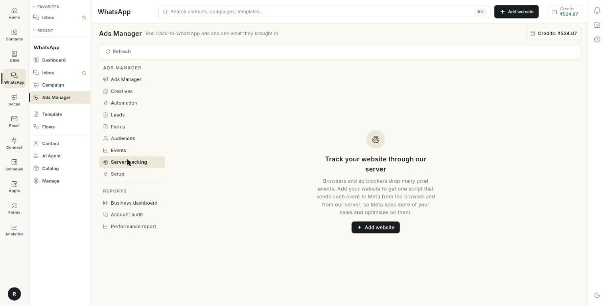

# सर्वर ट्रैकिंग सेट करें { #set-up-server-tracking }

अपनी वेबसाइट को **Server tracking** में जोड़ें और एक स्क्रिप्ट इंस्टॉल करें, ताकि हर इवेंट ब्राउज़र से भी और हमारे सर्वर से भी Meta तक पहुँचे। ब्राउज़र और ऐड ब्लॉकर कई पिक्सल इवेंट गिरा देते हैं। सर्वर वाली कॉपी से Meta आपकी ज़्यादा बिक्री देख पाता है। इसमें करीब 15 मिनट लगते हैं।

## शुरू करने से पहले { #before-you-start }

- आपका Facebook अकाउंट, Page और ad अकाउंट **Setup** में कनेक्ट हों। देखें [Click-to-WhatsApp विज्ञापन चलाएँ](../click-to-whatsapp-ads.md)।
- ad अकाउंट पर आपका एक डेटासेट (पिक्सल) हो। देखें [वेबसाइट इवेंट ट्रैक करें](track-website-events.md)।
- आप अपनी वेबसाइट की थीम या कोड एडिट कर सकते हों। Shopify पर इसकी जगह आप अपना स्टोर कनेक्ट करके 1 क्लिक में इंस्टॉल कर सकते हैं।
- आपको अपनी वेबसाइट का डोमेन पता हो, जैसे `myshop.com`। अगर आप Shopify इस्तेमाल करते हैं, तो अपना चेकआउट डोमेन भी पता हो, जैसे `myshop.myshopify.com`।

## यह कैसे काम करता है { #how-it-works }

आप एक वेबसाइट जोड़ते हैं और आपको एक ट्रैकिंग स्क्रिप्ट मिलती है। स्क्रिप्ट अपने-आप एक **PageView** भेजती है। हर इवेंट ब्राउज़र पिक्सल को जाता है और, उसी इवेंट आईडी के साथ, हमारे सर्वर से होकर Meta की Conversions API को जाता है। Meta एक ही कॉपी रखता है। आपके स्टोर के ऑर्डर भी सर्वर से रिपोर्ट हो सकते हैं।

टैब में बाईं ओर आपकी वेबसाइटें और दाईं ओर चुनी हुई वेबसाइट दिखती है। हर वेबसाइट के 4 टैब हैं: **Overview**, **Health**, **Install** और **Settings**।

## चरण { #steps }

### वेबसाइट जोड़ें { #add-a-website }

1. लेफ़्ट रेल में **WhatsApp** खोलें, फिर **Ads Manager** चुनें।
2. **Server tracking** पर क्लिक करें।

    

3. **Add website** पर क्लिक करें। **Add website** विंडो खुलती है।

    

4. **Website name \*** लिखें, जैसे `Main store`।
5. अपने **Domains \*** लिखें, जैसे `myshop.com, myshop.myshopify.com`। सब-डोमेन शामिल रहते हैं। किसी और साइट के इवेंट नामंज़ूर कर दिए जाते हैं।
6. **This website already has the Meta pixel** तभी चालू करें जब आपकी साइट पर पहले से Meta पिक्सल लोड होता हो।
7. **Add** पर क्लिक करें।

अगर आप कोई बॉक्स खाली छोड़ते हैं, तो संदेश **Name and domain are required.** दिखता है।

!!! warning "चेतावनी"
    अगर आपकी साइट पर पहले से पिक्सल है और आप स्विच चालू करते हैं, तो स्क्रिप्ट सिर्फ़ सर्वर इवेंट भेजती है। Meta कुछ इवेंट दो बार गिन सकता है, क्योंकि आपके पिक्सल के इवेंट में अलग आईडी होती हैं। पुराना पिक्सल हटाकर इस स्क्रिप्ट से उसे लोड कराने पर यह नहीं होता।

### हर पेज पर स्क्रिप्ट इंस्टॉल करें { #install-the-script-on-every-page }

1. वेबसाइट चुनें, फिर **Install** पर क्लिक करें। टैब में 5 चरण हैं। हर चरण को देखने के लिए उसे खोलें।
2. चरण 1, **Add the script to every page**, खोलें।
3. **Tracking script** बॉक्स के कॉपी बटन पर क्लिक करें। संदेश **Script copied** दिखता है।
4. स्क्रिप्ट को हर पेज पर `</head>` से ठीक पहले पेस्ट करें।
5. Shopify पर इसे Online Store → Themes → Edit code → theme.liquid में पेस्ट करें।
6. WordPress पर इसे header-scripts प्लगइन से या अपनी थीम के हेडर में पेस्ट करें।
7. या, अगर आपका Shopify स्टोर कनेक्ट है, तो **Install on Shopify** पर क्लिक करें। यह थीम एडिट किए बिना स्टोर के हर पेज पर स्क्रिप्ट इंस्टॉल कर देता है। संदेश **Installed on your Shopify store** दिखता है।
8. Shopify से हटाने के लिए **Remove** पर क्लिक करें।

**PageView** के अलावा दूसरे इवेंट भेजने के लिए अपनी साइट से यह कॉल करें:

```js
ohTrack('track', 'AddToCart', {value: 499, currency: 'INR'})
```

### थैंक-यू पेज पर ऑर्डर ट्रैक करें { #track-orders-on-the-thank-you-page }

यह हर ऑर्डर को खरीदार के ad क्लिक से जोड़ता है। तब ब्राउज़र पिक्सल ब्लॉक होने पर भी खरीद Meta तक पहुँचती है। **Install** टैब पर चरण 2 खोलें और जो प्लैटफ़ॉर्म आप इस्तेमाल करते हैं उसका पालन करें।

#### Shopify पर { #on-shopify }

1. Shopify एडमिन में Settings → Customer events खोलें।
2. Add custom pixel पर क्लिक करें और उसे नाम दें।
3. चरण 2 से **Custom pixel code** पेस्ट करें।
4. Save पर क्लिक करें, फिर Connect पर क्लिक करें।
5. अपना चेकआउट डोमेन, जैसे `yourstore.myshopify.com`, इस वेबसाइट के डोमेन में जोड़ें।

#### WooCommerce पर { #on-woocommerce }

1. **Download WordPress plugin** पर क्लिक करें।
2. WordPress में Plugins → Add New → Upload Plugin खोलें और फ़ाइल अपलोड करें।
3. Activate पर क्लिक करें। प्लगइन हर पेज पर स्क्रिप्ट जोड़ता है और प्रोडक्ट व्यू, add to cart, चेकआउट और ऑर्डर भेजता है।
4. चरण 1 और स्निपेट छोड़ दें।

अगर आप प्लगइन की जगह WooCommerce के लिए PHP स्निपेट इस्तेमाल करते हैं, तो उसे कोड स्निपेट प्लगइन से या थीम की `functions.php` में जोड़ें। चरण 1 की स्क्रिप्ट पहले से हेडर में होनी चाहिए।

#### किसी भी दूसरी वेबसाइट पर { #on-any-other-website }

1. **Thank-you page** बॉक्स से कोड कॉपी करें।
2. ऑर्डर कन्फ़र्मेशन पेज पर, ट्रैकिंग स्क्रिप्ट के बाद, `ohTrack('identify', …)` कॉल करें।
3. फिर `ohTrack('track', 'Purchase', …)` कॉल करें।

### कनेक्शन टेस्ट करें { #test-the-connection }

1. Meta Events Manager में अपना डेटासेट खोलें, फिर **Test events** खोलें। वहाँ दिखा टेस्ट कोड कॉपी करें।
2. **Install** टैब पर चरण 3 खोलें।
3. कोड को **Test event code** में पेस्ट करें। हिंट में **e.g. TEST12345** लिखा है।
4. **Send test event** पर क्लिक करें।
5. नतीजा पढ़ें। **Sent. Open Events Manager → Test events: a server PageView should appear within a minute.** का मतलब है कि यह काम कर गया।
6. अपनी वेबसाइट खोलें। हमारे सर्वर को पहला इवेंट मिलते ही सूची में उसके पास का बिंदु हरा हो जाता है।
7. बिंदु जाँचने के लिए **Refresh** पर क्लिक करें।

### लाइव इवेंट देखें { #watch-live-events }

1. **Install** टैब पर चरण 4 खोलें।
2. **Watch live events** पर क्लिक करें। यह व्यू 30 मिनट तक चालू रहता है और हर 5 सेकंड में रिफ़्रेश होता है। पहले इवेंट से पहले इसमें **Waiting for the first event…** लिखा होता है।
3. अपनी वेबसाइट दूसरे टैब में खोलें और इधर-उधर क्लिक करें।
4. हर पंक्ति पढ़ें। इसमें समय, इवेंट का नाम, उसमें गए ग्राहक के ब्योरे का प्रकार (कभी उनकी वैल्यू नहीं), पेज, और Meta ने उसका क्या किया, यह दिखता है।
5. इसे जल्दी रोकने के लिए **Stop live view** पर क्लिक करें।

| नतीजा | मतलब |
|--------|---------|
| **Sent to Meta** | Meta ने इवेंट स्वीकार किया। |
| **Failed** | Meta ने इवेंट नामंज़ूर किया। कारण पंक्ति में दिखता है। |
| **Not sent here** | इवेंट रोक लिया गया है, जैसे किसी सेटिंग की वजह से। |
| **Waiting** | इवेंट क्यू में है। |

### Meta के साथ अपना डोमेन वेरिफ़ाई करें { #verify-your-domain-with-meta }

Meta जानना चाहता है कि जिस वेबसाइट पर आपके विज्ञापन लोगों को भेजते हैं, वह आपकी ही है।

1. **Install** टैब पर चरण 5 खोलें।
2. हर डोमेन का स्टेटस पढ़ें।
3. जो डोमेन **Not in Business Manager** है, उसके लिए **Add to Business Manager** पर क्लिक करें।
4. डोमेन पर DNS TXT रिकॉर्ड से मालिकाना हक साबित करें। TXT वैल्यू कॉपी करने के लिए कॉपी आइकन पर क्लिक करें।
5. या कॉपी किया हुआ मेटा टैग होम पेज के `<head>` में डालें।
6. **Open Business settings** पर क्लिक करें और वहाँ Verify दबाएँ।
7. वापस आएँ और स्टेटस रिफ़्रेश करने के लिए **Check again** पर क्लिक करें।

हर डोमेन इनमें से एक स्टेटस दिखाता है:

- **Verified**
- **Added, not verified yet**
- **Not in Business Manager**
- **Check in Business settings**

WordPress प्लगइन आपके लिए मेटा टैग जोड़ देता है। डोमेन जोड़ने के बाद उसे दोबारा डाउनलोड करें। Shopify पर DNS रिकॉर्ड इस्तेमाल करें, या मेटा टैग को theme.liquid में `<head>` के अंदर पेस्ट करें।

### Overview पढ़ें { #read-the-overview }

1. वेबसाइट चुनें, फिर **Overview** खोलें।
2. **Status** पढ़ें। यह **Receiving events**, **Waiting for the first event — install the script**, या **No events in the last 24 hours** दिखाता है।
3. **Domains** पढ़ें। ये वे डोमेन हैं जो आपने जोड़े।
4. **Dataset** पढ़ें। यह वह डेटासेट है जिसमें इवेंट जाते हैं। खाली होने पर यह **None selected** दिखाता है।
5. **Browser pixel** पढ़ें। यह **Loaded by this script** या **Already on the site — the script sends server events only** दिखाता है।
6. **Last event** पढ़ें। यह आख़िरी इवेंट की तारीख है।
7. **Website purchases** पढ़ें। यह **Sent by us from your store orders** या **Reported by your store's own Meta app** दिखाता है।
8. **Received** पढ़ें। ये वे इवेंट हैं जो हमारे सर्वर तक पहुँचे।
9. **Sent to Meta** पढ़ें। ये वे इवेंट हैं जिन्हें Meta ने स्वीकार किया।
10. **Failed** पढ़ें। ये वे इवेंट हैं जिन्हें Meta ने नामंज़ूर किया।
11. इनके नीचे की टेबल पढ़ें। यह हर इवेंट नाम के लिए **Event**, **Received**, **Sent** और **Failed** सूचीबद्ध करती है।

गिनती पिछले 14 दिनों की होती है, जो हमारे सर्वर पर गिनी जाती है। इसे बदलने के लिए गिनती के ऊपर **Last 7 days**, **Last 14 days** या **Last 30 days** चुनें।

### ट्रैकिंग ऑडिट जाँचें { #check-the-tracking-audit }

1. वेबसाइट चुनें, फिर **Health** खोलें। **Tracking audit** सबसे ऊपर है।
2. स्कोर पढ़ें, जैसे **6 / 8 checks pass**।
3. हर खुला चेक पढ़ें। उसमें एक नाम, एक ब्योरा और एक समाधान होता है।
4. किसी चेक पर **Open** पर क्लिक करें ताकि उस टैब या चरण पर पहुँचें जो उसे ठीक करता है।
5. समाधान के बाद **Run again** पर क्लिक करें।
6. पास हुए चेक देखने के लिए **Show 5 passed checks** पर क्लिक करें।

| लेबल | मतलब |
|-------|---------|
| **Pass** | चेक ठीक है। |
| **Fix this** | कुछ टूटा हुआ है। तीर से शुरू होने वाली लाइन का पालन करें। |
| **Check** | कुछ गड़बड़ हो सकती है। उसे देखें। |
| **Tip** | एक वैकल्पिक सुधार। |

### हेल्थ चार्ट पढ़ें { #read-the-health-charts }

1. **Health** पर **Last 7 days**, **Last 14 days** या **Last 30 days** चुनें।
2. **Events through our server** पढ़ें। यह रोज़ के इवेंट दिखाता है, जो **Sent to Meta** और **Failed** में बँटे होते हैं।
3. **What Meta received** पढ़ें। यह पिछले 7 दिन वैसे दिखाता है जैसे Meta गिनता है, **Browser (pixel)** बनाम **Server**। ऐड ब्लॉकर के पिक्सल रोकने पर भी सर्वर इवेंट Meta तक पहुँचते हैं।
4. **Purchases Meta credited to your ads** पढ़ें। यह पिछले 28 दिनों के लिए **Per day before**, **Per day since** और **Change** दिखाता है। Meta को किसी बिक्री का क्रेडिट देने में 3 दिन तक लग सकते हैं।
5. **Store orders reported to Meta** पढ़ें। यह दिखाता है कि कितने ऑर्डर **Purchase** के रूप में भेजे गए। लाइनें हैं **Sent**, **Waiting for COD confirmation**, **Not sent**, **Failed at Meta**, और वे कारण जिनसे कुछ नहीं भेजे गए।
6. **Meta match quality** पढ़ें। यह हर इवेंट के लिए Meta की Event Match Quality है, 0 से 10 तक। ज़्यादा का मतलब है आपके विज्ञापनों को ज़्यादा बिक्री का क्रेडिट। स्कोर दिखाने से पहले Meta को कुछ दिनों के इवेंट चाहिए।

अगर 10 में से 6 से कम ऑर्डर थैंक-यू पेज के ब्योरे के साथ आते हैं, तो **Install** टैब का चरण 2 जाँचें। वे ऑर्डर फिर भी जाते हैं, पर खरीदार को पहचानने के लिए कम जानकारी के साथ।

### वेबसाइट की सेटिंग्स बदलें { #change-the-website-settings }

1. वेबसाइट चुनें, फिर **Settings** खोलें।
2. वेबसाइट का नाम बदलने या उसके डोमेन बदलने के लिए **Website name \*** या **Domains \*** बदलें।
3. इवेंट के लिए **Dataset** चुनें। **Ads account dataset** आपके ad अकाउंट का डेटासेट इस्तेमाल करता है।
4. सिर्फ़ सर्वर इवेंट भेजने के लिए **This website already has the Meta pixel** चालू करें।
5. वैकल्पिक: **Also send to datasets** में कॉमा से अलग करके 5 तक डेटासेट आईडी लिखें। इसे एजेंसी पिक्सल और ब्रांड पिक्सल के लिए इस्तेमाल करें। हर इवेंट उन्हें भी जाता है।
6. अगर आपकी साइट कुकी या प्राइवेसी बैनर दिखाती है, तो **Wait for visitor consent** चालू करें। जब तक आपका बैनर `ohTrack('consent', 'grant')` कॉल नहीं करता, कुछ भी स्टोर या भेजा नहीं जाता।
7. जब कोई विज़िटर मना करे तो `ohTrack('consent', 'revoke')` कॉल करें। Global Privacy Control वाले ब्राउज़र हमेशा सीमित डेटा इस्तेमाल के रूप में भेजे जाते हैं।
8. वैकल्पिक: **Never send these events** में इवेंट के नाम लिखें, जैसे `PageView, Search`। इन्हें ब्राउज़र में और हमारे सर्वर पर गिरा दिया जाता है।
9. ईमेल, फ़ोन, नाम या पता न भेजने के लिए **Don't send customer details** चालू करें। तब Meta कम बिक्री मिला पाता है। बंद होने पर ब्योरे हमारे सर्वर से निकलने से पहले हैश कर दिए जाते हैं।
10. **Save** पर क्लिक करें। संदेश **Website saved** दिखता है।

### अपने सब-डोमेन से स्क्रिप्ट चलाएँ { #serve-the-script-from-your-own-sub-domain }

**Tracking sub-domain** इस्तेमाल करें ताकि ब्राउज़र ad-क्लिक कुकी ज़्यादा देर रखें और ब्लॉकर स्क्रिप्ट को आपकी अपनी साइट का हिस्सा समझें।

1. **Settings** खोलें।
2. **Tracking sub-domain** में सब-डोमेन लिखें, जैसे `track.myshop.com`। यह फ़ील्ड वैकल्पिक है।
3. **Save** पर क्लिक करें।
4. अपने डोमेन प्रोवाइडर पर CNAME रिकॉर्ड जोड़ें। नाम और वैल्यू बॉक्स के नीचे दिखते हैं।
5. **Check DNS** पर क्लिक करें।
6. जब लाइन में **is verified** लिखा आए, तो **Install** खोलें और स्क्रिप्ट दोबारा कॉपी करें। अब वह आपके डोमेन से लोड होती है।

### चुनें कि खरीद कैसे रिपोर्ट हो { #choose-how-purchases-are-reported }

वेबसाइट फ़ॉर्म के नीचे **Purchases — all websites and stores** हर वेबसाइट पर लागू होता है। हर चुनाव तुरंत सेव हो जाता है। संदेश **Saved** दिखता है।

1. वेबसाइट खरीद के नीचे एक विकल्प चुनें।
    - **My store's Meta app reports website purchases**: अगर Shopify का Facebook & Instagram ऐप या कोई दूसरा प्लगइन पहले से खरीद भेजता है, तो इसे रखें। Click-to-WhatsApp विज्ञापनों की बिक्री हम फिर भी रिपोर्ट करते हैं।
    - **Send website purchases from our server**: हर ऑनलाइन ऑर्डर आपके स्टोर के डेटा और थैंक-यू पेज कोड से Meta को जाता है।
2. अगर आप **Send website purchases from our server** चुनते हैं, तो पहले अपने स्टोर के Meta ऐप में खरीद ट्रैकिंग बंद करें। नहीं तो Meta हर बिक्री दो बार गिनेगा।
3. **Cash on delivery** के नीचे चुनें कि COD ऑर्डर कब रिपोर्ट हो।
    - **Report when the order is placed**: Meta हर COD ऑर्डर से तुरंत सीखता है।
    - **Report once the order is confirmed**: स्टोर के उसे shipped, paid या completed मार्क करने पर भेजा जाता है। रद्द किए गए ऑर्डर कभी नहीं गिने जाते। ऑर्डर के 7 दिन के भीतर भेजा जाता है।
4. **Google Ads conversion** के नीचे किसी Google Ads कन्वर्ज़न का रिसोर्स नाम पेस्ट करें, जैसे `customers/1234567890/conversionActions/987654321`। Google ad क्लिक से आई स्टोर की बिक्री इसे भेजी जाती है। छोड़ने के लिए इसे खाली रखें।
5. उसके पास **Save** पर क्लिक करें।

### स्क्रिप्ट key बदलें या वेबसाइट हटाएँ { #replace-the-script-key-or-remove-a-website }

1. नई key बनाने के लिए **New script key** पर क्लिक करें। जब तक आप नई key पेस्ट नहीं करते, आपकी वेबसाइट की स्क्रिप्ट काम करना बंद कर देती है।
2. **Install** खोलें और स्क्रिप्ट दोबारा कॉपी करें।
3. किसी वेबसाइट को ट्रैक करना बंद करने के लिए **Remove website** पर क्लिक करें, फिर **Remove** पर। उसकी स्क्रिप्ट इवेंट भेजना बंद कर देती है। पुरानी गिनती बनी रहती है।

!!! warning "चेतावनी"
    **New script key** तभी इस्तेमाल करें जब key का ग़लत इस्तेमाल हुआ हो। उसके बाद **Install** से स्क्रिप्ट दोबारा कॉपी करें।

## समस्या का समाधान { #troubleshooting }

| समस्या | कारण | समाधान |
|-------|-------|-----|
| **Set up now** बटन के साथ **Connect your Meta ad account** | सेटअप पूरा नहीं हुआ है। | **Set up now** पर क्लिक करें और **Setup** पूरा करें। |
| **Could not load your websites** | सूची लोड नहीं हुई। | **Retry** पर क्लिक करें। |
| **Name and domain are required.** | **Add website** में कोई बॉक्स खाली है। | **Website name \*** और **Domains \*** भरें। |
| **Waiting for the first event — install the script** | हमारे सर्वर तक कोई इवेंट नहीं पहुँचा। | स्क्रिप्ट हर पेज पर पेस्ट करें, अपनी साइट खोलें, फिर **Refresh** पर क्लिक करें। इवेंट आते देखने के लिए **Watch live events** इस्तेमाल करें। |
| **No events in the last 24 hours** | स्क्रिप्ट हटा दी गई थी, या साइट पर ट्रैफ़िक नहीं है। | जाँचें कि स्क्रिप्ट अब भी पेज पर है। साइट खोलें और लाइव इवेंट देखें। |
| **Paste the test code from Events Manager → Test events first.** | **Test event code** खाली है। | Meta Events Manager से कोड कॉपी करके पेस्ट करें। |
| **Meta did not accept the test event.** | टेस्ट कोड ग़लत है या एक्सपायर हो गया है। | नया टेस्ट कोड कॉपी करें और फिर **Send test event** पर क्लिक करें। |
| कोई डोमेन **Not in Business Manager** दिखाता है | डोमेन आपके Business Manager में जोड़ा नहीं गया था। | **Add to Business Manager** पर क्लिक करें, फिर **Open Business settings** में वेरिफ़ाई करें। |
| **Could not read domains.** | Meta ने डोमेन की सूची नहीं लौटाई। | **Check again** पर क्लिक करें। |
| **Could not change live view.** | लाइव व्यू शुरू या बंद नहीं हुआ। | बटन पर दोबारा क्लिक करें। |

## संबंधित गाइड { #related }

- [वेबसाइट इवेंट ट्रैक करें](track-website-events.md)
- [विज्ञापन ऑडियंस बनाएँ](build-ad-audiences.md)
- [अकाउंट ऑडिट चलाएँ](run-an-account-audit.md)
- [परफ़ॉर्मेंस रिपोर्ट पढ़ें](read-the-performance-report.md)
- [Click-to-WhatsApp विज्ञापन चलाएँ](../click-to-whatsapp-ads.md)
