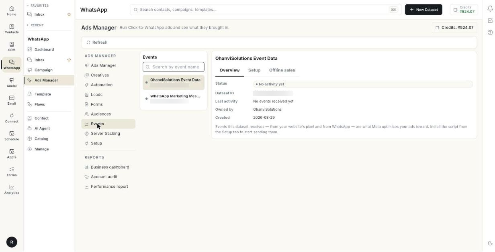

# वेबसाइट इवेंट ट्रैक करें { #track-website-events }

**Ads Manager** में एक डेटासेट बनाएँ। उसकी इवेंट स्क्रिप्ट कॉपी करके अपनी वेबसाइट पर लगाएँ, और देखें कि Meta को इवेंट मिल रहे हैं। जो बिक्री दुकान या फ़ोन पर हुई, उसे भी अपलोड कर सकते हैं। इसके बाद Meta इन इवेंट से आपके विज्ञापनों के लिए खरीदार ढूँढ सकता है। इसमें करीब 10 मिनट लगते हैं।

## शुरू करने से पहले { #before-you-start }

- आपका Facebook अकाउंट, पेज और विज्ञापन अकाउंट **Setup** में कनेक्ट होने चाहिए। देखें [Click-to-WhatsApp विज्ञापन चलाएँ](../click-to-whatsapp-ads.md)।
- आप अपनी वेबसाइट का कोड बदल सकते हों, या आपको पता हो कि यह कौन कर सकता है।
- ऑफ़लाइन बिक्री के लिए आपके पास एक CSV फ़ाइल होनी चाहिए। उसमें हर बिक्री के सामने फ़ोन नंबर या ईमेल हो।

## डेटासेट क्या है { #what-a-dataset-is }

डेटासेट Meta में वह जगह है जहाँ आपकी वेबसाइट के इवेंट जमा होते हैं। इवेंट यानी ग्राहक के किए हुए काम, जैसे **PageView**, **AddToCart** और **Purchase**। Meta डेटासेट को पिक्सेल भी कहता है। आपकी वेबसाइट और WhatsApp, दोनों के इवेंट डेटासेट में जाते हैं। Meta इन्हीं के हिसाब से आपके विज्ञापन बेहतर बनाता है।

**Events** टैब में बाईं ओर डेटासेट की लिस्ट होती है और दाईं ओर चुना हुआ डेटासेट।

| डेटासेट के बगल का बिंदु | इसका मतलब |
|----------------------|---------------|
| हरा | Meta को इससे कम से कम 1 इवेंट मिल चुका है। |
| स्लेटी | अभी कोई इवेंट नहीं आया है। |

## स्टेप { #steps }

### डेटासेट बनाएँ { #create-a-dataset }

1. लेफ़्ट रेल में **WhatsApp** खोलें, फिर **Ads Manager** चुनें।
2. **Events** पर क्लिक करें।

    

3. **New Dataset** पर क्लिक करें। **Create Dataset** विंडो खुलेगी।

    

4. **Dataset name \*** में नाम लिखें, जैसे `Website Event Data`।
5. **Create** पर क्लिक करें। डेटासेट Meta Events Manager में आपके विज्ञापन अकाउंट पर बन जाता है। डेटासेट बनते ही इवेंट स्क्रिप्ट **Setup** में दिखने लगती है।

!!! note "पहले Setup पूरा करें"
    अगर Setup पूरा नहीं है, तो **New Dataset** दबाने पर आप **Setup** में पहुँच जाते हैं।

### डेटासेट खोजें { #find-a-dataset }

1. **Events** पर क्लिक करें। बाईं ओर डेटासेट की लिस्ट खुलेगी।
2. लिस्ट के ऊपर **Search by event name** में नाम या ID लिखें।
3. डेटासेट पर क्लिक करें। दाईं ओर उसके टैब खुल जाएँगे।
4. लिस्ट दोबारा लोड करने के लिए **Refresh** पर क्लिक करें। हर डेटासेट के बगल का बिंदु नया हो जाएगा।

### Overview पढ़ें { #read-the-overview }

1. कोई डेटासेट चुनें, फिर **Overview** खोलें।
2. **Status** देखें। इसमें डेटासेट की स्थिति दिखती है, जैसे **Active**।
3. **Dataset ID** देखें। यह वह नंबर है जिससे Meta आपके डेटासेट को पहचानता है। इसे कॉपी करने के लिए कॉपी आइकन (**Copy ID**) पर क्लिक करें।
4. **Last activity** देखें। इसमें आखिरी इवेंट की तारीख़ दिखती है। जब तक कोई इवेंट नहीं आता, यहाँ **No events received yet** लिखा रहता है।
5. **Owned by** देखें। इसमें उस बिज़नेस का नाम दिखता है जो डेटासेट का मालिक है। यह तभी दिखता है जब Meta यह जानकारी दे।
6. **Created** देखें। इसमें डेटासेट बनने की तारीख़ दिखती है।

### इवेंट स्क्रिप्ट इंस्टॉल करें { #install-the-event-script }

1. डेटासेट चुनें, फिर **Setup** पर क्लिक करें।
2. **Copy the Event Script** खोलें।
3. **Event Code** बॉक्स के कॉपी बटन पर क्लिक करें। **Event script copied** मैसेज आएगा।
4. **Install on Your Website** खोलें।
5. कोड को अपनी वेबसाइट के **हर पेज** पर पेस्ट करें। उसे बंद होने वाले `</head>` टैग से ठीक पहले रखें।

    

6. अपनी वेबसाइट पर यह बदलाव सेव करें और पब्लिश करें।

पैनल में दिया उदाहरण कुछ ऐसा दिखता है:

```html
<head>
  <!-- Your existing head content -->
  <!-- Paste your event code here -->
</head>
```

### इंस्टॉलेशन जाँचें { #verify-the-installation }

1. **Setup** में **Verify the Installation** खोलें।
2. अपनी वेबसाइट पर जाएँ और कोई भी पेज खोलें। इससे पहला **PageView** इवेंट चला जाता है।
3. Meta Events Manager में **Test Events** टूल खोलें। देख लें कि इवेंट एक्टिव है और डेटा आ रहा है।
4. **Events** पर वापस आएँ और **Refresh** पर क्लिक करें। Meta को पहला इवेंट मिलते ही डेटासेट के बगल का बिंदु हरा हो जाता है।

!!! tip "सुझाव"
    किसी डेटासेट को नाम या ID से खोजना हो, तो लिस्ट के ऊपर **Search by event name** में लिखें।

### ऑफ़लाइन बिक्री भेजें { #send-offline-sales }

जो बिक्री आपकी वेबसाइट पर नहीं हुई, उसके लिए **Offline sales** इस्तेमाल करें। जैसे दुकान के काउंटर की बिक्री, फ़ोन पर मिले ऑर्डर, या कैश ऑन डिलीवरी जिसका पेमेंट बाद में मिला। जिन विज्ञापनों से ये खरीदार आए, Meta उन्हें इसका श्रेय देता है।

1. डेटासेट चुनें, फिर **Offline sales** पर क्लिक करें।
2. एक CSV फ़ाइल तैयार करें। कॉलम किसी भी क्रम में रख सकते हैं। नीचे की टेबल वाले कॉलम इस्तेमाल करें।
3. देख लें कि हर पंक्ति में ईमेल या फ़ोन नंबर हो।
4. **Choose CSV** पर क्लिक करें और अपनी फ़ाइल चुनें। इसके बाद बटन पर **Choose another** लिखा आएगा।
5. वह लाइन पढ़ें जो बताती है कि कितनी बिक्री भेजने के लिए तैयार है, जैसे **120 sales ready to send**। **3 rows skipped: no email or phone** जैसी लाइनें बताती हैं कि कौन-सी पंक्तियाँ छूट गईं।
6. **Send to Meta** पर क्लिक करें।
7. **Sending… 40 of 120** पूरा होने तक रुकें। फिर यह मैसेज आएगा: **Meta received 120 sales. They show in Events Manager under this dataset within about an hour.**

**CSV के कॉलम**

| कॉलम | किसलिए |
|--------|-----|
| `email` | खरीदार का ईमेल। |
| `phone` | खरीदार का फ़ोन नंबर। |
| `date` | बिक्री की तारीख़। `2026-10-02` या `02/10/2026` लिखें। |
| `value` | बिक्री की रकम। |
| `currency` | करेंसी, जैसे INR। खाली छोड़ें तो INR माना जाता है। |
| `order_id` | ऑर्डर नंबर। |
| `first_name`, `last_name` | खरीदार का नाम। |
| `city`, `state`, `pincode`, `country` | खरीदार का पता। |

सीमाएँ और नियम:

- हर पंक्ति में ईमेल या फ़ोन नंबर ज़रूर होना चाहिए।
- इवेंट **Purchase** माना जाता है। हाँ, अगर फ़ाइल में `event` कॉलम है, तो उसी का इवेंट लिया जाता है।
- Meta 62 दिन तक की पुरानी बिक्री लेता है। 62 दिन से पुरानी पंक्ति छोड़ दी जाती है। इसका कारण **date outside the last 62 days** दिखता है।

!!! tip "सुझाव"
    हर पंक्ति में `order_id` डालें। तब वही फ़ाइल दोबारा भेज दें, तो भी हर बिक्री एक ही बार गिनी जाएगी।

## समस्या का समाधान { #troubleshooting }

| समस्या | कारण | समाधान |
|-------|-------|-----|
| **Set up now** बटन के साथ **Connect your Meta ad account** | Setup पूरा नहीं हुआ है। | **Set up now** पर क्लिक करें और **Setup** पूरा करें। |
| **No datasets yet** | विज्ञापन अकाउंट पर अभी कोई डेटासेट नहीं है। | **Create Dataset** पर क्लिक करें। |
| **Could not load datasets** | लिस्ट लोड नहीं हुई। | **Retry** पर क्लिक करें। |
| **Could not create the dataset — is Facebook connected?** | Facebook कनेक्ट नहीं है, या Meta ने रिक्वेस्ट मना कर दी। | **Setup** देखें, Facebook दोबारा कनेक्ट करें और डेटासेट फिर से बनाएँ। |
| डेटासेट के बगल का बिंदु स्लेटी ही रहता है | Meta तक कोई इवेंट नहीं पहुँचा। | देखें कि कोड हर पेज पर लगा है। फिर अपनी साइट खोलें और **Refresh** पर क्लिक करें। पक्का करने के लिए Meta का **Test Events** टूल इस्तेमाल करें। |
| **Last activity** में **No events received yet** दिखता है | स्क्रिप्ट इंस्टॉल नहीं है, या ब्लॉक हो रही है। | स्क्रिप्ट दोबारा इंस्टॉल करें। अगर ऐड ब्लॉकर चालू है, तो साफ़ ब्राउज़र में टेस्ट करें। बेहतर ट्रैकिंग के लिए देखें [सर्वर ट्रैकिंग सेट करें](set-up-server-tracking.md)। |
| **Upload failed.** | Meta ने बिक्री मना कर दी, या कनेक्शन टूट गया। | CSV के कॉलम और तारीख़ें देखें। **Send to Meta** पर फिर से क्लिक करें। |
| **rows skipped: no email or phone** | किसी पंक्ति में न ईमेल है, न फ़ोन नंबर। | हर पंक्ति में इनमें से एक जोड़ें और फ़ाइल फिर से चुनें। |

## संबंधित गाइड { #related }

- [सर्वर ट्रैकिंग सेट करें](set-up-server-tracking.md)
- [विज्ञापन ऑडियंस बनाएँ](build-ad-audiences.md)
- [विज्ञापन बनाएँ](create-an-ad.md)
- [Click-to-WhatsApp विज्ञापन चलाएँ](../click-to-whatsapp-ads.md)
