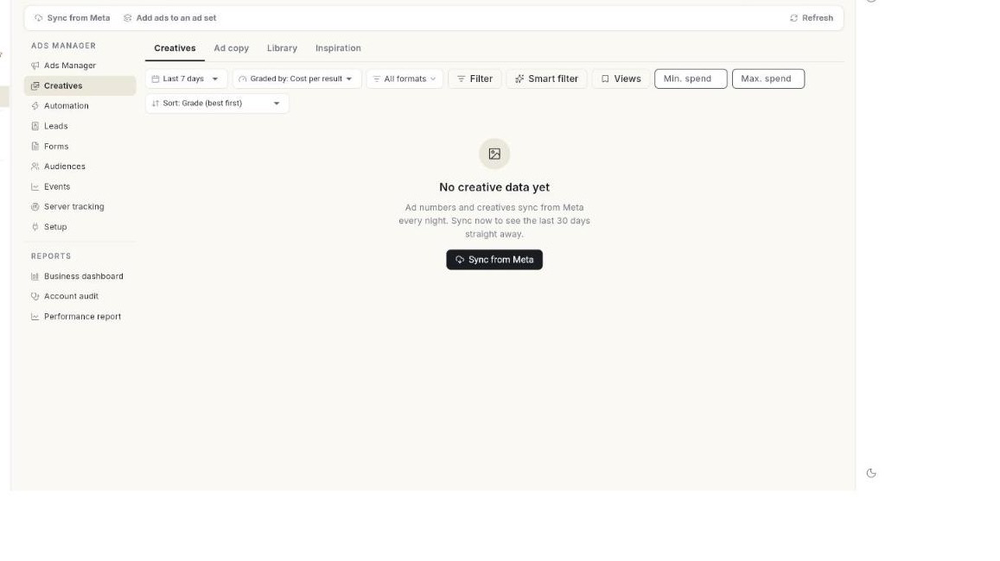

# विज्ञापन क्रिएटिव का इस्तेमाल करें { #use-ad-creatives }

**Creatives** में देखें कि हर तस्वीर और विज्ञापन टेक्स्ट कैसा चला। डेटा फ़िल्टर करें, अपनी फ़ाइलें **Library** में रखें और नए आइडिया खोजें। अंत में आपको पता होगा कि कौन-से क्रिएटिव रखने हैं और कौन-से थक चुके हैं। साथ ही, सबसे अच्छे क्रिएटिव आप नए विज्ञापन में दोबारा लगा चुके होंगे।

## शुरू करने से पहले { #before-you-start }

- आपका Facebook अकाउंट, पेज और विज्ञापन अकाउंट **Setup** में कनेक्ट होने चाहिए। देखें [Ads Manager सेट करें](set-up-ads-manager.md)।
- आपका कम से कम 1 विज्ञापन चल चुका हो। आँकड़े हर रात Meta से सिंक होते हैं।
- आपको **WhatsApp** पैनल में **Ads Manager** दिखना चाहिए। अगर न दिखे, तो अपने एडमिन से पूछें।

## Creatives में क्या-क्या है { #how-creatives-is-organised }

**Creatives** में ऊपर 4 टैब होते हैं।

| टैब | क्या दिखाता है |
| --- | --- |
| **Creatives** | हर इमेज, वीडियो या कैरोसेल, जितने भी विज्ञापनों में लगा, उन सबमें कैसा चला। |
| **Ad copy** | हर प्राइमरी टेक्स्ट कैसा चला। साथ में लंबाई, इमोजी, लिंक और फ़्रेज़ के नतीजे भी। |
| **Library** | आपके विज्ञापन अकाउंट की हर इमेज और वीडियो। इन्हें अपलोड करें, नाम बदलें, आर्काइव करें और दोबारा लगाएँ। |
| **Inspiration** | Meta की Ad Library में खोजें, पसंद के विज्ञापन सेव करें और नोट लिखें। |

अगर **Creatives** में डेटा की जगह **Setup** दिखे, तो पहले **Setup** में कनेक्शन पूरा करें।

## स्टेप { #steps }

### Creatives खोलें और आँकड़े सिंक करें { #open-creatives-and-sync-the-numbers }

1. लेफ़्ट रेल में **WhatsApp** खोलें, फिर **Ads Manager** चुनें।
2. बाएँ कॉलम में **Creatives** चुनें। **Creatives** टैब खुल जाएगा।
3. ताज़ा आँकड़े अभी मँगाने के लिए **Sync from Meta** पर क्लिक करें। **Ad data synced from Meta.** मैसेज आएगा।

    

4. तारीख़ों की सीमा चुनें। ये विकल्प हैं: **Last 7 days**, **Last 14 days**, **Last 30 days** और **Last 90 days**।
5. **Graded by** चुनें। ये विकल्प हैं: **Cost per result**, **Results**, **ROAS**, **Revenue** और **CTR**। इसी ग्रेड से तय होता है कि हर क्रिएटिव की रैंक क्या होगी।
6. ज़रूरी हो तो: **All formats** पर क्लिक करें और जो फ़ॉर्मैट रखने हैं, उन पर टिक करें। ये विकल्प हैं: **Image**, **Short video**, **Medium video**, **Long video**, **Carousel** और **Catalog**।
7. ज़रूरी हो तो: डेटा छाँटने के लिए **Filter** पर क्लिक करें। देखें [डेटा फ़िल्टर करें](#filter-the-data)।
8. ज़रूरी हो तो: **Min. spend** या **Max. spend** लिखें।
9. ज़रूरी हो तो: **Sort** का क्रम चुनें। खर्च और सॉर्ट की सेटिंग लिस्ट और मैट्रिक्स को बदलती है, कुल आँकड़ों को नहीं।
10. ऊपर की समरी टाइल देखें: **Spend**, आपके विज्ञापनों का रिज़ल्ट नाम, **Cost per result**, **CTR (link)** और **Revenue · ROAS**।

### फ़ॉर्मैट कार्ड और मैट्रिक्स पढ़ें { #read-the-format-cards-and-the-matrix }

1. फ़ॉर्मैट कार्ड तक स्क्रॉल करें। हर कार्ड पर फ़ॉर्मैट और क्रिएटिव की संख्या होती है, जैसे **Image (4)**।
2. हर कार्ड पर **Spend**, **Cost / result**, **CTR** और **Conv. rate** देखें।
3. **Spend** और **Results** बार देखें। ये दिखाते हैं कि हर फ़ॉर्मैट का कितना हिस्सा है।
4. अगर किसी कार्ड पर **Not used yet — worth testing.** लिखा है, तो **Find inspiration** पर क्लिक करें। **Inspiration** टैब खुल जाएगा।
5. **Creative matrix** देखें। इसमें खर्च और आपके ग्रेड को आमने-सामने रखा गया है।
6. किसी क्रिएटिव को खोलने के लिए उसके बिंदु पर क्लिक करें।
7. मैट्रिक्स के नीचे लेजेंड देखें। हर क्रिएटिव किसी एक समूह में आता है।

| समूह | कैसा दिखता है |
| --- | --- |
| **Core performer** | हरा बिंदु। खर्च मीडियन के बराबर या उससे ज़्यादा है, और नतीजे औसत से बेहतर हैं। |
| **Scalable** | खर्च मीडियन से कम है, लेकिन नतीजे औसत से बेहतर हैं। |
| **Overspend** | लाल बिंदु। खर्च मीडियन के बराबर या उससे ज़्यादा है, लेकिन नतीजे औसत से बेहतर नहीं हैं। |
| **Getting started** | जिन क्रिएटिव का डेटा कम है, वे इसी समूह में रहते हैं। |

### क्रिएटिव की लिस्ट पढ़ें { #read-the-creative-list }

1. क्रिएटिव की लिस्ट तक स्क्रॉल करें। हर पंक्ति एक क्रिएटिव है।
2. **CREATIVE**, **FORMAT** और **ADS** कॉलम देखें। इनमें तस्वीर, उसकी किस्म और यह दिखता है कि वह कितने विज्ञापनों में लगी।
3. **SPEND**, रिज़ल्ट, **COST / RESULT**, **CTR** और **ROAS** कॉलम देखें। **STATUS** सबसे आखिर में देखें।
4. क्रिएटिव खोलने के लिए पंक्ति पर क्लिक करें। विंडो में तस्वीर, हेडलाइन, टेक्स्ट, **Spend**, **Cost / result**, **CTR**, **Revenue** और **ROAS** दिखते हैं।
5. **Last 7 days vs the 7 before** वाली लाइन देखें। इसमें CTR और कॉस्ट पर रिज़ल्ट का बदलाव दिखता है। **Fatigued** का मतलब है कि CTR 20% या ज़्यादा गिरा और कॉस्ट पर रिज़ल्ट 25% या ज़्यादा बढ़ा। **Watch** का मतलब है कि इन दोनों में से सिर्फ़ एक इतना बदला। हर हफ़्ते के लिए कम से कम 1,000 इम्प्रेशन चाहिए।
6. विंडो के नीचे **Used in N ad(s)** देखें। इसमें हर विज्ञापन और उसका स्टेटस लिखा होता है।

| कॉलम | क्या दिखाता है |
| --- | --- |
| चेकबॉक्स | क्रिएटिव को दोबारा लगाने के लिए उन पर टिक करें। |
| **CREATIVE** | थंबनेल, नाम, और हेडलाइन या प्राइमरी टेक्स्ट। |
| **FORMAT** | इमेज, वीडियो (कितना लंबा), कैरोसेल या कैटलॉग। |
| **ADS** | यह क्रिएटिव कितने विज्ञापनों में लगा। |
| **SPEND** | इस पर कितना पैसा खर्च हुआ। |
| रिज़ल्ट कॉलम | वह नतीजा जिस पर आपके विज्ञापन नापे जाते हैं, जैसे बातचीत। |
| **COST / RESULT** | खर्च में नतीजों की संख्या से भाग देने पर आने वाली रकम। |
| **CTR** | लिंक क्लिक को इम्प्रेशन से भाग देने पर आने वाला अनुपात। |
| **ROAS** | रेवेन्यू को खर्च से भाग देने पर आने वाला अनुपात। |
| **STATUS** | मैट्रिक्स का समूह। क्रिएटिव थकने लगे, तो साथ में **Fatigued** या **Watch** भी दिखता है। |

!!! note "Fatigued और Watch"
    **Fatigued** लाल रंग में दिखता है। **Watch** एम्बर रंग में दिखता है। दोनों का मतलब है कि क्रिएटिव पिछले हफ़्ते से कमज़ोर चल रहा है। **Fatigued** क्रिएटिव की जगह नया क्रिएटिव लगाएँ।

### AI टैग और ट्रेंड पढ़ें { #read-ai-tags-and-the-trend }

1. **AI tags** तक स्क्रॉल करें। यह बताता है कि तस्वीरों में क्या है, जैसे लोग, प्रोडक्ट, टेक्स्ट, लोगो, ऑफ़र बैज, स्टाइल, सेटिंग और रंग।
2. किसी कैटेगरी चिप पर क्लिक करें। टेबल में **TAG**, **CREATIVES**, **SPEND**, **SHARE**, रिज़ल्ट कॉलम, **COST / RESULT** और **ROAS** दिखते हैं।
3. **N of M creatives tagged. Tags are AI guesses, not always right.** वाली लाइन पढ़ें।
4. क्रिएटिव का अगला बैच टैग करने के लिए **Tag now** पर क्लिक करें। **Tagged N creatives** मैसेज आएगा।
5. **Performance trend** तक स्क्रॉल करें। चार्ट और टेबल में ऊपर वाले क्रिएटिव के पिछले चार हफ़्ते दिखते हैं।
6. मैट्रिक्स देखें: **Spend**, **Cost per result**, **CTR**, **Conversion rate**, **Revenue**, **Average order value** और **ROAS**।

नए क्रिएटिव सिंक होने के बाद हर दो घंटे में टैग होते हैं। अभी कोई टैग न हो, तो पेज पर **No tags yet. New creatives are tagged every two hours after they sync.** लिखा आता है।

### डेटा फ़िल्टर करें { #filter-the-data }

1. **Filter** पर क्लिक करें। **Smart filter** मेन्यू खुलेगा। फ़िल्टर चालू हों, तो बटन पर **Filter · N** लिखा आता है।
2. कोई बना-बनाया फ़िल्टर चुनें:
    - **Active ads only**
    - **Spending with no results**
    - **Big spenders (over 1,000)**
    - **Low CTR (under 1%)**
    - **Tired ads (frequency over 3)**
    - **Prospecting only**
    - **Retargeting & retention**
3. या अपना फ़िल्टर बनाने के लिए **Filter data** विंडो खोलें।
4. कैंपेन, ऐड सेट या विज्ञापन का नाम खोजने के लिए **Name contains** में लिखें।
5. कैंपेन, ऐड सेट या विज्ञापन की ID खोजने के लिए **ID** में लिखें।
6. **Status** चुनें: **Any**, **Active** या **Not active**।
7. चिप में से **Funnel stage** चुनें: **Prospecting**, **Re-engagement**, **Retargeting** या **Retention**।
8. **Ad sets where** के नीचे एक मैट्रिक, तुलना और वैल्यू चुनें। मैट्रिक ये हैं: **Spend**, **Results**, **Cost per result**, **CTR %**, **CPM**, **CPC**, **ROAS** और **Frequency**।
9. **Saved views** खोलने के लिए **Views** पर क्लिक करें।
10. फ़िल्टर को नाम देकर सेव करने के लिए **Save the current filter…** पर क्लिक करें।
11. सारे फ़िल्टर हटाने के लिए **Clear filters** पर क्लिक करें।

फ़िल्टर **Creatives** और **Ad copy**, दोनों टैब पर लगता है।

### Ad copy टैब पढ़ें { #read-the-ad-copy-tab }

1. **Ad copy** टैब चुनें। समरी टाइल ये हैं: **Copies**, **Spend**, **Cost per result** और **CTR (link)**।
2. **Pieces of copy** देखें। यह सभी विज्ञापन टेक्स्ट का मैट्रिक्स है। किसी टेक्स्ट को खोलने के लिए उसके बिंदु पर क्लिक करें।
3. लिस्ट देखें। कॉलम ये हैं: **COPY**, **LENGTH**, **ADS**, **SPEND**, रिज़ल्ट कॉलम, **COST / RESULT**, **CTR** और **STATUS**।
4. **Ad copy length** देखें। नीचे की टेबल पढ़ें।
5. **Emoji performance** और **Link performance** देखें। दोनों में उन टेक्स्ट की तुलना होती है जिनमें इमोजी या लिंक है और जिनमें नहीं है।
6. **Top emojis** और **Top links** देखें। इनमें सबसे अच्छा चलने वाले दिखते हैं।
7. **Top phrases** देखें। इसमें दो और तीन शब्दों के वे फ़्रेज़ आते हैं जो कम से कम दो टेक्स्ट में मिले। उन्हें नतीजों के हिसाब से रैंक किया जाता है।
8. **Top AI tags by category** देखें। यह बताता है कि विज्ञापन का टेक्स्ट क्या काम करता है: ऑफ़र, जल्दी करने का दबाव, सोशल प्रूफ़, शुरुआत, लहजा और कॉल टू एक्शन।

| लंबाई | मतलब |
| --- | --- |
| **Short** | 125 अक्षर तक। "See more" से पहले पूरा दिख जाता है। |
| **Medium** | 126–300 अक्षर। |
| **Long** | 300 से ज़्यादा अक्षर। |

अगर टैब में **No ad copy yet** दिखे, तो प्राइमरी टेक्स्ट वाले विज्ञापन तब आएँगे जब उनके आँकड़े Meta से सिंक हो जाएँ।

### क्रिएटिव और कॉपी को नए विज्ञापन में दोबारा लगाएँ { #reuse-creatives-and-copy-in-a-new-ad }

1. क्रिएटिव की लिस्ट में जिस भी इमेज क्रिएटिव को दोबारा लगाना है, उसके चेकबॉक्स पर टिक करें।
2. **Open selected in Create Ad** पर क्लिक करें। फ़ॉर्म खुलेगा और उसमें तस्वीरें पहले से भरी होंगी।

    

3. कॉपी लगानी हो, तो **Ad copy** टैब में कॉपी पर टिक करें। फिर **Open selected in Create Ad** पर क्लिक करें। Meta टेक्स्ट को बारी-बारी से चलाता है।
4. टिक हटाने के लिए **Clear** पर क्लिक करें।

सीमाएँ:

- सिर्फ़ इमेज दोबारा लग सकती हैं। वीडियो, कैरोसेल और कैटलॉग विज्ञापन यहाँ से दोबारा नहीं लगाए जा सकते।
- एक विज्ञापन में ज़्यादा से ज़्यादा 3 तस्वीरें लग सकती हैं।
- एक विज्ञापन में ज़्यादा से ज़्यादा 5 टेक्स्ट और 5 हेडलाइन लग सकती हैं।

### चल रहे ऐड सेट में विज्ञापन जोड़ें { #add-ads-to-an-ad-set-that-is-running }

1. ऊपर की बार में **Add ads to an ad set** पर क्लिक करें।
2. कोई **Ad set** चुनें। नए विज्ञापन उस ऐड सेट के किसी पुराने विज्ञापन से पेज, बटन, लिंक और WhatsApp ग्रीटिंग कॉपी कर लेते हैं। ऑडियंस और बजट जैसे हैं, वैसे ही रहते हैं।
3. **Pictures** के नीचे **Add from library** पर क्लिक करें।
4. **Texts** के नीचे **Primary text 1** भरें।
5. **Headline 1 (optional)** भरें।
6. और टेक्स्ट जोड़ने के लिए **Add text** पर क्लिक करें।
7. तस्वीरों और टेक्स्ट का गुणा बताने वाली लाइन देखें, जैसे **2 pictures × 3 text(s) = 6 ads**।
8. **Start them right away** को चालू या बंद करें। बंद रखने पर विज्ञापन रुके हुए बनते हैं। उन्हें **Ads Manager** में चालू करें।
9. **Add N ads** पर क्लिक करें। **Ads added. Their numbers show here after the next sync.** मैसेज आएगा।

### Library टैब का इस्तेमाल करें { #use-the-library-tab }

1. **Library** टैब चुनें।
2. गिनती वाली लाइन देखें, जैसे **N files · N images · N videos · N not used yet**।
3. टाइप फ़िल्टर चुनें: **Images & videos**, **Images** या **Videos**।
4. सोर्स फ़िल्टर चुनें: **All sources**, **From Meta**, **Uploaded** या **AI generated**।
5. शेप फ़िल्टर चुनें: **Any shape**, **Square**, **Portrait** या **Landscape**।
6. इस्तेमाल वाला फ़िल्टर चुनें: **Used & unused**, **Used in ads** या **Not used yet**।
7. सॉर्ट चुनें: **Newest**, **Most spend**, **Cheapest result** या **Most used**।
8. फ़ाइल खोजने के लिए **Search by name** में लिखें।
9. **Upload image** पर क्लिक करें और फ़ाइल चुनें। **Uploaded to your ad account.** मैसेज आएगा।
10. किसी फ़ाइल का नाम बदलना हो, तो उसका **More** मेन्यू खोलें और **Rename** पर क्लिक करें।
11. फ़ाइल को चल रहे ऐड सेट में डालने के लिए **Add to an existing ad set** पर क्लिक करें।
12. फ़ाइल को आर्काइव भी उसी मेन्यू से करें। आर्काइव की हुई फ़ाइलें लाइब्रेरी से हट जाती हैं।
13. आर्काइव की हुई फ़ाइलें देखने और उन्हें वापस लाने के लिए **Archived** पर क्लिक करें।
14. किसी फ़ाइल पर **Use in new ad** पर क्लिक करें। **Create Ad** खुलेगा और वह इमेज पहले से चुनी हुई होगी।

अपलोड की सीमा: इमेज 30 MB से छोटी होनी चाहिए।

!!! tip
    **Generated with AI** पट्टी में वे AI इमेज दिखती हैं जो अभी लाइब्रेरी में नहीं हैं। जो पसंद आएँ, उन्हें जोड़ लें। फिर आप उन्हें किसी भी विज्ञापन में दोबारा लगा सकते हैं।

### Inspiration टैब में आइडिया खोजें { #find-ideas-in-the-inspiration-tab }

1. **Inspiration** टैब चुनें।
2. **Find competitor ads** के नीचे सर्च बॉक्स में कोई ब्रांड या कीवर्ड लिखें, जैसे "saree"।
3. कोई देश चुनें: **India**, **UAE**, **United Kingdom**, **United States**, **Germany** या **France**।
4. **Search** पर क्लिक करें। Meta की Ad Library के विज्ञापन **Results for "…"** के नीचे आ जाएँगे।
5. किसी विज्ञापन पर **Follow** पर क्लिक करें। वह ब्रांड **Brands you follow** में जुड़ जाएगा।
6. विज्ञापन को **Saved ads** में जोड़ने के लिए **Save** पर क्लिक करें।
7. विज्ञापन को Meta पर खोलने के लिए **View** पर क्लिक करें।
8. **Make one like this** पर क्लिक करें। **Create Ad** खुलेगा और उसमें उस विज्ञापन का टेक्स्ट शुरुआत के तौर पर भरा होगा।
9. नोट सेव करने के लिए **Note** पर क्लिक करें, जैसे कि इसमें से क्या अपनाना है।
10. सेव किए हुए विज्ञापनों में से कोई विज्ञापन हटाने के लिए **Remove** पर क्लिक करें।
11. Meta की वेबसाइट पर खोजना हो, तो **Open Meta Ad Library** पर क्लिक करें।
12. कहीं और मिला विज्ञापन सेव करने के लिए उसका Ad Library लिंक **Saved ads** बॉक्स में पेस्ट करें और **Save link** पर क्लिक करें।
13. सेव किए हुए विज्ञापन को किसी फ़ोल्डर में रखने के लिए उस पर **Collection** पर क्लिक करें। नया बनाने के लिए **New collection…** चुनें।

## समस्या का समाधान { #troubleshooting }

| समस्या | कारण | समाधान |
| --- | --- | --- |
| **No creative data yet** | विज्ञापन के आँकड़े हर रात सिंक होते हैं, और अभी तक कुछ सिंक नहीं हुआ है। | पिछले 30 दिन का डेटा लाने के लिए **Sync from Meta** पर क्लिक करें। |
| **No creatives match these filters** | फ़ॉर्मैट, खर्च या फ़िल्टर की सेटिंग की वजह से कोई भी क्रिएटिव नहीं दिख रहा। | फ़ॉर्मैट फ़िल्टर हटाएँ या तारीख़ों की लंबी सीमा चुनें। |
| **Pick image creatives — videos, carousels and catalogue ads cannot be reused in a new ad from here.** | आपने सिर्फ़ वीडियो, कैरोसेल या कैटलॉग क्रिएटिव पर टिक किया था। | कम से कम 1 इमेज क्रिएटिव पर टिक करें। |
| **Images must be under 30 MB — Meta refuses larger files.** | अपलोड की गई फ़ाइल साइज़ की सीमा से बड़ी है। | इमेज को कंप्रेस करें और दोबारा अपलोड करें। |
| **AI tagging is not set up on this server.** | Ohanvi सर्वर पर AI मॉडल सेट नहीं है। | Ohanvi सपोर्ट से संपर्क करें। |
| **Meta did not return ads for this search.** | इस खोज में कुछ नहीं मिला, या Meta की Ad Library ने जवाब नहीं दिया। | दूसरा कीवर्ड या देश आज़माएँ। या **Open Meta Ad Library** पर क्लिक करें। |

## संबंधित गाइड { #related }

- [Ads Manager सेट करें](set-up-ads-manager.md)
- [विज्ञापन बनाएँ](create-an-ad.md)
- [अपने विज्ञापन मैनेज करें](manage-your-ads.md)
- [अपने विज्ञापन ऑटोमेट करें](automate-your-ads.md)
- [Click-to-WhatsApp विज्ञापन चलाएँ](../click-to-whatsapp-ads.md)
