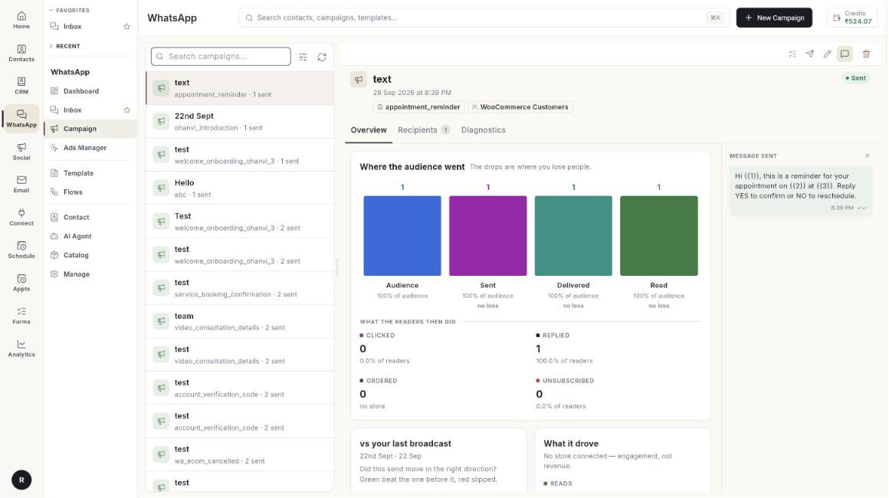

# कैंपेन { #campaign }

कैंपेन एक मंज़ूर टेम्प्लेट मैसेज एक साथ कई लोगों को भेजते हैं। आप अभी भेज सकते हैं, बाद के लिए शेड्यूल कर सकते हैं, और देख सकते हैं कि किसे मिला।

**यह कहाँ मिलेगा:** लेफ़्ट रेल में **WhatsApp** खोलें, फिर **Campaign** चुनें।

## गाइड { #guides }

| गाइड | कब इस्तेमाल करें |
| --- | --- |
| [ब्रॉडकास्ट कैंपेन भेजें](../send-broadcast-campaign.md) | आप संपर्कों के किसी समूह को मैसेज भेजना चाहते हैं। |
| [कई व्हाट्सऐप नंबर चलाएँ](../run-multiple-whatsapp-numbers.md) | आप चाहते हैं कि कैंपेन आपके Default के अलावा किसी दूसरे नंबर से जाए। |
| [कैंपेन रिपोर्ट पढ़ें](../read-campaign-report.md) | आप डिलीवर, पढ़े गए और फ़ेल हुए मैसेज देखना चाहते हैं। |

## शुरू करने से पहले { #before-you-start }

- आपका व्हाट्सऐप नंबर Ohanvi से कनेक्ट है। देखें [अपना व्हाट्सऐप नंबर कनेक्ट करें](../connect-whatsapp-number.md)।
- आपके रोल को इस स्क्रीन का एक्सेस है। न दिखे, तो अपने एडमिन से पूछें।
