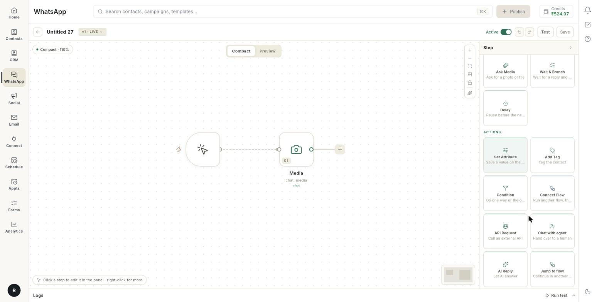

# चैटबॉट फ़्लो में एक्शन ब्लॉक जोड़ें { #add-action-blocks-to-a-chatbot-flow }

कुछ ब्लॉक चैट के पीछे चुपचाप काम करते हैं। ये कॉन्टैक्ट पर वैल्यू सेव करते हैं, टैग लगाते हैं, API कॉल करते हैं, चैट एजेंट को देते हैं, AI से जवाब लिखवाते हैं, दूसरे फ़्लो पर ले जाते हैं या बातचीत खत्म करते हैं। हर ब्लॉक जोड़ने में करीब 2 मिनट लगते हैं।

## शुरू करने से पहले { #before-you-start }

- कैनवास पर आपका चैटबॉट फ़्लो खुला होना चाहिए। देखें [WhatsApp चैटबॉट फ़्लो बनाएँ](../create-whatsapp-flow.md)।
- **Jump to flow** और **Connect Flow** के लिए **WhatsApp** → **Flows** में कम से कम 1 और फ़्लो होना चाहिए।
- **Chat with agent** के लिए पहले अपनी टीम के लोगों को जोड़ लें। देखें [WhatsApp एजेंट जोड़ें](add-whatsapp-agents.md)।

## हर ब्लॉक क्या करता है { #what-each-block-does }

| ब्लॉक | चैट में क्या होता है |
| --- | --- |
| **Set Attribute** | कॉन्टैक्ट पर एक वैल्यू सेव करता है। |
| **Add Tag** | कॉन्टैक्ट पर टैग लगाता है। |
| **Condition** | चैट को **True** या **False** वाले रास्ते पर भेजता है। देखें [नाम, फ़ोन, ईमेल और पता पूछें, फिर इंतज़ार करें या ब्रांच करें](chatbot-ask-details-blocks.md)। |
| **Connect Flow** | दूसरा फ़्लो चलाता है, फिर वापस आ जाता है। |
| **API Request** | बाहर की API को कॉल करता है और उसका जवाब रख लेता है। |
| **Chat with agent** | चैट किसी इंसान को दे देता है। |
| **AI Reply** | AI से जवाब लिखवाता है। |
| **Jump to flow** | बातचीत को दूसरे फ़्लो में ले जाता है। वह वापस नहीं आती। |
| **End** | बातचीत खत्म कर देता है। |

## स्टेप { #steps }

### Actions ब्लॉक खोलें { #open-the-actions-blocks }

1. **WhatsApp** → **Flows** खोलें, फिर अपना फ़्लो खोलें।
2. जिस ब्लॉक के बाद एक्शन चलाना है, उसके बाद वाले **+** पर क्लिक करें। **Add a step after** मेनू खुलेगा।
3. **All steps** पर क्लिक करें।
4. **Actions** ग्रुप ढूँढें। इस पेज के सारे ब्लॉक इसी में हैं।

    

5. जो ब्लॉक चाहिए, उस पर क्लिक करें। उसकी सेटिंग्स दाईं तरफ़ के पैनल में खुल जाएँगी।

### कॉन्टैक्ट पर वैल्यू सेव करें { #save-a-value-on-the-contact }

1. **Set Attribute** ब्लॉक जोड़ें।
2. **Question** में वह टेक्स्ट लिखें जो ब्लॉक इस्तेमाल करेगा। बॉक्स में `Type your question...` दिखता है।
3. **Save the answer as** के नीचे **Choose…** पर क्लिक करें और एक नाम चुनें: **name**, **contact_number**, **email**, **address**, **city**, **interests** या **goal**।
4. अपना नाम रखना हो तो **Custom…** चुनें। `company_name` जैसा नाम लिखें और **Use** पर क्लिक करें। मैसेज में इसे `{{company_name}}` लिखकर इस्तेमाल करें।
5. **The answer should be** के नीचे वैल्यू का टाइप चुनें: **Short text**, **Long text**, **Number**, **Email**, **Phone number**, **Date**, **Time**, **One choice**, **Several choices**, **Yes or no**, **A file**, **A location**, **A rating** या **An NPS score**।

!!! note "Set Attribute और Ask Question"
    [VERIFY: Set Attribute uses the same Question, Save the answer as and The answer should be fields as Ask Question.] सेव किया हुआ जवाब मैसेज में कैसे दिखता है, यह जानने के लिए देखें [WhatsApp चैटबॉट फ़्लो बनाएँ](../create-whatsapp-flow.md)।

### कॉन्टैक्ट पर टैग लगाएँ { #tag-the-contact }

1. **Add Tag** ब्लॉक जोड़ें।
2. **Tag** में टैग का नाम लिखें। बॉक्स में `tag name` दिखता है।
3. **WhatsApp** → **Manage** → **Tags** में जाकर टैग देख लें। देखें [टैग, यूज़र एट्रिब्यूट और कस्टम इवेंट मैनेज करें](tags-attributes-and-events.md)।

### दूसरा फ़्लो चलाएँ और वापस आएँ { #run-another-flow-and-come-back }

1. **Connect Flow** ब्लॉक जोड़ें। इसके नीचे लिखा होता है **Run another flow, then come back**।
2. **Step name** में लिखें कि यह स्टेप किसलिए है। यह ज़रूरी नहीं है।
3. **Which flow** के नीचे **Runs** खोलें और फ़्लो चुनें।
4. लिस्ट खाली हो तो पैनल में **No other flows to run yet.** लिखा आता है। पहले दूसरा फ़्लो बना लें।

दूसरा फ़्लो पूरा चलता है। उसके खत्म होने के बाद ही यह फ़्लो आगे बढ़ता है।

### बाहर की API कॉल करें { #call-an-external-api }

1. **API Request** ब्लॉक जोड़ें।
2. **Method** के पास दिख रही वैल्यू पर क्लिक करें। हर क्लिक पर **GET**, **POST**, **PUT**, **PATCH** और **DELETE** बदलते रहते हैं। पहले से **GET** चुना होता है।
3. **URL** में एड्रेस लिखें, जैसे `https://api.example.com/orders/{{orderId}}`।
4. **Headers (JSON)** में हेडर लिखें, जैसे `{ "Authorization": "Bearer …" }`।
5. **Body (JSON)** में वह डेटा लिखें जो आप भेजना चाहते हैं, जैसे `{ "phone": "{{phone}}" }`।
6. **Save the answer as** के नीचे वह नाम चुनें जिसमें जवाब सेव होगा। यह वैसे ही करें जैसे "कॉन्टैक्ट पर वैल्यू सेव करें" में किया था।

सेव किए हुए जवाब को URL, हेडर या बॉडी में दोहरे कर्ली ब्रैकेट में लिखें। नाम छोटे अक्षरों में रखें।

!!! warning "चेतावनी"
    जब भी कोई ग्राहक इस ब्लॉक तक पहुँचता है, यह उस एड्रेस को कॉल करता है। इसलिए पहले अपने नंबर से टेस्ट करें।

### चैट एजेंट को दें { #hand-the-chat-to-an-agent }

1. **Chat with agent** ब्लॉक जोड़ें। कैनवास पर इसके कार्ड पर **Handoff** लिखा होता है।
2. पैनल में नोट पढ़ें: **Handoff to agent**। इस ब्लॉक में भरने के लिए कोई फ़ील्ड नहीं है।
3. इसे उस मैसेज के बाद रखें जो ग्राहक को बताता है कि कोई इंसान जवाब देगा, जैसे `Connecting you to our team.`

बातचीत **WhatsApp** → **Inbox** में **Requesting** में आ जाती है। वहाँ से कोई एजेंट उसे ले लेता है। देखें [WhatsApp इनबॉक्स का इस्तेमाल करें](use-whatsapp-inbox.md)।

### AI से जवाब दिलवाएँ { #let-ai-reply }

1. **AI Reply** ब्लॉक जोड़ें।
2. नोट पढ़ें: **The AI writes this reply**। AI हर ग्राहक के लिए अलग शब्दों में जवाब लिखता है। पब्लिश करने से पहले टेस्ट कर लें।
3. **Guidance for the AI (optional)** में AI को बताएँ कि क्या जवाब देना है, जैसे `Answer questions about our return policy in one short paragraph.`
4. **Model (optional)** में मॉडल का नाम लिखें। डिफ़ॉल्ट मॉडल चाहिए तो इसे खाली छोड़ दें।

### दूसरे फ़्लो में आगे बढ़ें { #continue-in-another-flow }

1. **Jump to flow** ब्लॉक जोड़ें।
2. **Continue in** के पास **Choose a flow** पर क्लिक करें। **Jump to which flow** लिस्ट खुलेगी।
3. फ़्लो चुनें। अब बटन पर उस फ़्लो का नाम दिखेगा।
4. लिस्ट में **No other flows to jump to yet.** लिखा हो, तो पहले दूसरा फ़्लो बना लें।

बातचीत वहाँ चली जाती है और वापस नहीं आती। बाद में वापस आना हो, तो **Connect Flow** इस्तेमाल करें।

| ज़रूरत | क्या इस्तेमाल करें |
| --- | --- |
| दूसरा फ़्लो चलाएँ, फिर यहीं आगे बढ़ें | **Connect Flow** |
| दूसरे फ़्लो में जाएँ और वहीं रहें | **Jump to flow** |

### बातचीत खत्म करें { #end-the-conversation }

1. किसी रास्ते के आखिरी ब्लॉक की जगह **End** ब्लॉक जोड़ें। कैनवास पर इसके कार्ड पर **End conversation** लिखा होता है।
2. नोट पढ़ें: **Ends the conversation**। बॉट यहीं रुक जाता है और सेशन बंद हो जाता है।

### सेव करें और पब्लिश करें { #save-and-publish }

1. **Save** पर क्लिक करें। चिप पर **DRAFT** लिखा दिखेगा।
2. **Test** टैब खोलें और अपने कीवर्ड के लिए **Check** पर क्लिक करें।
3. **Publish** पर क्लिक करें।
4. अपने टेस्ट फ़ोन से कीवर्ड भेजें और बॉट के रास्ते पर चलकर देखें। फिर कॉन्टैक्ट में देखें कि नया टैग या वैल्यू आई या नहीं।

## वीडियो वॉकथ्रू { #video-walkthrough }

[VIDEO]

## समस्या का समाधान { #troubleshooting }

| समस्या | कारण | समाधान |
| --- | --- | --- |
| **No other flows to jump to yet.** | आपके वर्कस्पेस में सिर्फ़ यही फ़्लो है। | दूसरा फ़्लो बनाकर सेव करें, फिर **Jump to flow** दोबारा खोलें। |
| **No other flows to run yet.** | आपके वर्कस्पेस में सिर्फ़ यही फ़्लो है। | दूसरा फ़्लो बनाएँ, फिर **Connect Flow** दोबारा खोलें। |
| **Could not publish — the step that needs fixing is marked on the canvas** | कोई ब्लॉक अधूरा है, जैसे टैग का नाम नहीं भरा। | निशान लगा कार्ड खोलें, छूटी हुई फ़ील्ड भरें, सेव करें और पब्लिश करें। |
| AI हर बार अलग जवाब देता है | **AI Reply** हर ग्राहक के लिए नए शब्दों में जवाब लिखता है। | **Guidance for the AI (optional)** में साफ़ निर्देश लिखें। पब्लिश करने से पहले कई बार टेस्ट करें। |
| **Chat with agent** के बाद बॉट आगे नहीं बढ़ता | चैट अब एजेंट के पास है। फ़्लो वहीं रुक जाता है। | **WhatsApp** → **Inbox** से जवाब दें। |
| API का जवाब बाद के मैसेज में नहीं आ रहा | जवाब उस नाम से सेव नहीं हुआ जो मैसेज में लिखा है। | **Save the answer as** देखें। मैसेज में वही नाम छोटे अक्षरों में लिखें, जैसे `{{orderId}}`। |

## संबंधित गाइड { #related }

- [WhatsApp चैटबॉट फ़्लो बनाएँ](../create-whatsapp-flow.md)
- [फ़्लो बिल्डर को समझें](understand-the-flow-builder.md)
- [चैटबॉट में ऑर्डर और बुकिंग खोजें](chatbot-store-action-blocks.md)
- [फ़्लो में इंटीग्रेशन और एडवांस्ड स्टेप जोड़ें](chatbot-integration-and-advanced-steps.md)
- [WhatsApp एजेंट जोड़ें](add-whatsapp-agents.md)
- [WhatsApp इनबॉक्स का इस्तेमाल करें](use-whatsapp-inbox.md)
- [फ़्लो टेस्ट करें और फ़ेल हुए रन ठीक करें](../flows/test-and-monitor-flows.md)
