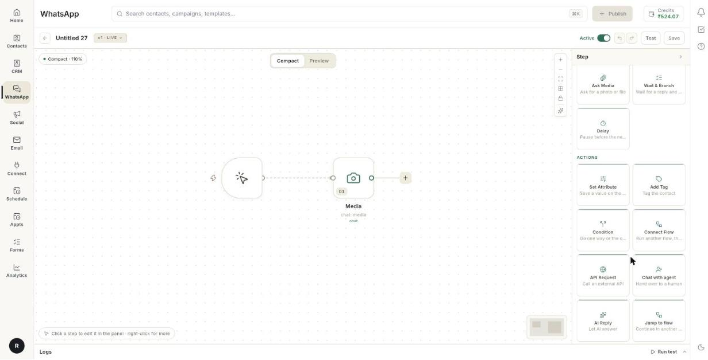

# चैटबॉट में लोकेशन, फ़ाइल या जवाब माँगें { #ask-for-a-location-a-file-or-a-reply-in-a-chatbot }

चैटबॉट में सिर्फ़ टेक्स्ट जवाब से ज़्यादा इकट्ठा करें। अंत में आपका बॉट टाइप किया हुआ सवाल पूछ सकेगा, शेयर की गई लोकेशन माँग सकेगा, फ़ोटो या फ़ाइल माँग सकेगा, या टैप का इंतज़ार करके हर विकल्प को उसके अपने रास्ते पर भेज सकेगा।

## शुरू करने से पहले { #before-you-start }

- बिल्डर में आपका एक चैटबॉट फ़्लो खुला है। देखें [व्हाट्सऐप चैटबॉट फ़्लो बनाएँ](../create-whatsapp-flow.md)।
- आप जानते हैं कि कौन-से जवाब रखने हैं। हर जवाब आपके चुने हुए नाम से सेव होता है।

## Ask ब्लॉक कैसे काम करते हैं { #how-ask-blocks-work }

हर Ask ब्लॉक एक मैसेज भेजता है, ग्राहक का इंतज़ार करता है और जवाब एक नाम से सेव करता है। उस नाम को आप बाद में किसी मैसेज में `{{name}}` के रूप में इस्तेमाल करते हैं।

| ब्लॉक | ग्राहक क्या करता है |
| --- | --- |
| **Ask Question** | जवाब टाइप करता है। |
| **Ask Location** | व्हाट्सऐप से लोकेशन शेयर करता है। |
| **Ask Media** | फ़ोटो, वीडियो, डॉक्यूमेंट या ऑडियो फ़ाइल भेजता है। |
| **Wait & Branch** | एक विकल्प पर टैप करता है। हर विकल्प अपने रास्ते पर जाता है। |

चारों **All steps** → **Ask the customer** के नीचे मिलते हैं।

## चरण { #steps }

### Ask ब्लॉक जोड़ें { #add-an-ask-block }

1. बिल्डर में अपना फ़्लो खोलें।
2. किसी चरण के बगल में **+** पर क्लिक करें, या कार्ड के नीचे **+ Add Content** पर क्लिक करें।
3. **All steps** चुनें।
4. **Ask the customer** के नीचे **Ask Question**, **Ask Location**, **Ask Media** या **Wait & Branch** चुनें।

    

5. ब्लॉक पर क्लिक करें ताकि उसके फ़ील्ड दाईं ओर के पैनल में खुलें।

### सवाल पूछें और जवाब का प्रकार चुनें { #ask-a-question-and-choose-the-answer-type }

पहले चरण [व्हाट्सऐप चैटबॉट फ़्लो बनाएँ](../create-whatsapp-flow.md) में हैं। यह काम जवाब का प्रकार जोड़ता है।

1. **Ask Question** ब्लॉक खोलें।
2. **Question** लिखें।
3. **Save the answer as** के नीचे कोई नाम चुनें। देखें [चुनें कि जवाब कहाँ सेव हो](#choose-where-the-answer-is-saved)।
4. **The answer should be** के नीचे कोई प्रकार चुनें।

प्रकार हैं **Short text**, **Long text**, **Number**, **Email**, **Phone number**, **Date**, **Time**, **One choice**, **Several choices**, **Yes or no**, **A file**, **A location**, **A rating** और **An NPS score**।

### लोकेशन माँगें { #ask-for-a-location }

1. **Ask Location** ब्लॉक जोड़ें।
2. **Ask for a location** के नीचे मैसेज लिखें, जैसे `Please share your location…`।
3. **Save the answer as** के नीचे कोई नाम चुनें। देखें [चुनें कि जवाब कहाँ सेव हो](#choose-where-the-answer-is-saved)।
4. वैकल्पिक: **Set Timeout** चालू करें और **Timeout after (minutes)** लिखें।

### फ़ोटो या फ़ाइल माँगें { #ask-for-a-photo-or-file }

1. **Ask Media** ब्लॉक जोड़ें।
2. **Ask for a file** के नीचे मैसेज लिखें, जैसे `Please send a photo or document…`।
3. **Accepts** के नीचे पंक्ति पर क्लिक करके **IMAGE**, **VIDEO**, **DOCUMENT** और **AUDIO** के बीच बदलें।
4. **Save the answer as** के नीचे कोई नाम चुनें। देखें [चुनें कि जवाब कहाँ सेव हो](#choose-where-the-answer-is-saved)।
5. वैकल्पिक: **Set Timeout** चालू करें और **Timeout after (minutes)** लिखें।

### चुनें कि जवाब कहाँ सेव हो { #choose-where-the-answer-is-saved }

1. **Save the answer as** के नीचे की पंक्ति पर क्लिक करें। **Save the answer as** सूची खुल जाती है।
2. कोई बना-बनाया नाम चुनें, या ऐसा नाम जो यह फ़्लो पहले से सेव करता है।
3. अपना नाम इस्तेमाल करने के लिए **Custom…** चुनें। ब्योरे में **Your own name, e.g. company_name** दिखता है।
4. नाम लिखें और **Use** पर क्लिक करें। Ohanvi उसे छोटे अक्षरों और अंडरस्कोर में बदल देता है।
5. जवाब को बाद में `{{company_name}}` के रूप में इस्तेमाल करें।

!!! warning "छोटे अक्षरों में डबल कर्ली ब्रैकेट इस्तेमाल करें"
    `{{company_name}}` काम करता है। `{{Company_Name}}` ग्राहक को सादे टेक्स्ट के रूप में भेज दिया जाता है।

### टैप का इंतज़ार करें और शाखाएँ बनाएँ { #wait-for-a-tap-and-branch }

**Wait & Branch** विकल्पों वाला मैसेज भेजता है और इंतज़ार करता है। हर विकल्प का कार्ड पर अपना निकास होता है।

1. **Wait & Branch** ब्लॉक जोड़ें।
2. वैकल्पिक: **Header** लिखें। इसमें 20 अक्षर तक आ सकते हैं।
3. **Body** लिखें। इसमें 4,096 अक्षर तक आ सकते हैं।
4. वैकल्पिक: **Footer** लिखें, 60 अक्षर तक।
5. विकल्प जोड़ने के लिए **+ Add Section** पर क्लिक करें। बटन पर **+ Add Section** लिखा है, लेकिन वह सूची की एक पंक्ति जोड़ता है।
6. **Item** में विकल्प का नाम लिखें, 24 अक्षर तक।
7. **Describe it** में नाम के नीचे की छोटी पंक्ति लिखें, 72 अक्षर तक।
8. हर विकल्प के लिए चरण 5 से 7 दोहराएँ। आप 10 तक जोड़ सकते हैं।
9. **Button label** में उस बटन पर लिखे शब्द लिखें जो विकल्प खोलता है, 20 अक्षर तक।
10. किसी विकल्प के दाएँ सिरे पर **+** पर क्लिक करें और वह चरण चुनें जो उस विकल्प के लिए चलेगा।

जिन विकल्पों को आप जोड़े बिना छोड़ देते हैं, वे कार्ड के अगले ब्लॉक पर चले जाते हैं।

### उस ग्राहक को संभालें जो जवाब नहीं देता { #handle-a-customer-who-does-not-reply }

1. जवाब का इंतज़ार करने वाला ब्लॉक खोलें: **Ask Question**, **Ask Location**, **Ask Media** या **Wait & Branch**।
2. **Set Timeout** चालू करें।
3. **Timeout after (minutes)** लिखें।
4. नए **Timed out** निकास को किसी फ़ॉलो-अप चरण से जोड़ें, जैसे रिमाइंडर मैसेज।

## समस्या का समाधान { #troubleshooting }

| समस्या | कारण | समाधान |
| --- | --- | --- |
| जवाब मैसेज में `{{Name}}` के रूप में दिखता है। | वैरिएबल में बड़ा अक्षर है। | उसे छोटे अक्षरों में लिखें: `{{name}}`। |
| बॉट कस्टम जवाब वाला नाम इस्तेमाल नहीं करता। | नाम में खाली जगह या चिह्न हैं। | सिर्फ़ अक्षर, अंक और अंडरस्कोर इस्तेमाल करें, फिर **Use** पर दोबारा क्लिक करें। |
| ग्राहक गलत तरह की फ़ाइल भेजता है। | **Accepts** किसी दूसरे प्रकार पर सेट है। | **Accepts** को वह प्रकार करें जो आप चाहते हैं। |
| **+ Add Section** नहीं दिख रहा। | ब्लॉक में पहले से 10 विकल्प हैं। | कोई विकल्प हटाएँ, या विकल्पों को 2 ब्लॉक में बाँट दें। |
| बातचीत किसी सवाल पर रुक जाती है। | ग्राहक ने जवाब नहीं दिया और कोई **Timeout** नहीं है। | **Set Timeout** चालू करें और **Timed out** को अगले चरण से जोड़ें। |
| कोई विकल्प कुछ नहीं करता। | उसके निकास पर कोई तार नहीं जुड़ा है। | विकल्प को किसी चरण से जोड़ें, या उसे अगले ब्लॉक पर जाने दें। |

## संबंधित गाइड { #related }

- [व्हाट्सऐप चैटबॉट फ़्लो बनाएँ](../create-whatsapp-flow.md)
- [फ़्लो बिल्डर को समझें](understand-the-flow-builder.md)
- [नाम, फ़ोन, ईमेल और पता पूछें, फिर इंतज़ार करें या शाखाएँ बनाएँ](chatbot-ask-details-blocks.md)
- [मीडिया, कैटलॉग, प्रोडक्ट, टेम्प्लेट और फ़ॉर्म ब्लॉक जोड़ें](chatbot-message-blocks.md)
- [टैग सेट करें, API कॉल करें और एजेंट को हैंडऑफ़ करें](chatbot-action-blocks.md)
- [चैट सिम्युलेटर से फ़्लो टेस्ट करें](test-a-flow-with-the-chat-simulator.md)
