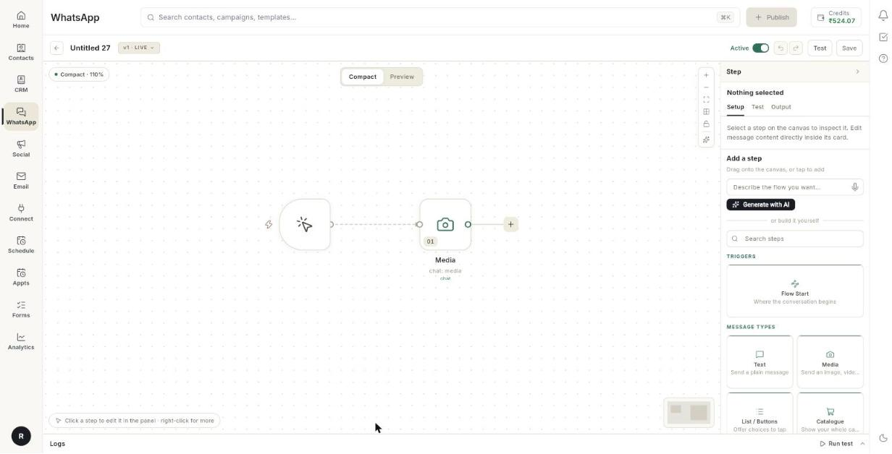
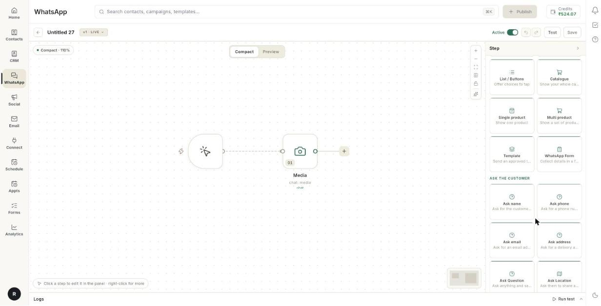

# चैटबॉट में मीडिया, कैटलॉग, प्रोडक्ट, Template और फ़ॉर्म ब्लॉक जोड़ें { #add-media-catalogue-product-template-and-form-blocks-to-a-chatbot }

चैटबॉट फ़्लो में सादे टेक्स्ट के अलावा और तरह के मैसेज ब्लॉक भी जोड़े जा सकते हैं। इस गाइड के बाद आपका बॉट फ़ाइल, आपका कैटलॉग, एक प्रोडक्ट, कई प्रोडक्ट, approved Template या WhatsApp के अंदर खुलने वाला फ़ॉर्म भेज सकेगा।

## शुरू करने से पहले { #before-you-start }

- बिल्डर में आपका एक चैटबॉट फ़्लो खुला हो। देखें [WhatsApp चैटबॉट फ़्लो बनाएँ](../create-whatsapp-flow.md)।
- **Catalogue**, **Single product** और **Multi product** के लिए आपके नंबर से प्रोडक्ट कैटलॉग कनेक्ट हो। देखें [अपना WhatsApp कैटलॉग सेट करें](set-up-whatsapp-catalog.md)।
- **Template** के लिए कम से कम 1 Template का स्टेटस **Approved** हो। देखें [WhatsApp मैसेज Template बनाएँ](create-message-template.md)।
- **WhatsApp Form** के लिए आपके पास एक पब्लिश किया हुआ फ़ॉर्म हो।

## मैसेज ब्लॉक कैसे काम करते हैं { #how-message-blocks-work }

फ़्लो कार्ड में एक या ज़्यादा ब्लॉक होते हैं। हर ब्लॉक बॉट का एक मैसेज होता है। नीचे के सभी ब्लॉक स्टेप लिस्ट के **Message types** ग्रुप में मिलते हैं।

| ब्लॉक | ग्राहक को क्या मिलता है |
| --- | --- |
| **Text** | सादा मैसेज। इसमें 3 तक रिप्लाई बटन लग सकते हैं। देखें [WhatsApp चैटबॉट फ़्लो बनाएँ](../create-whatsapp-flow.md)। |
| **List / Buttons** | ऐसा मैसेज जिसमें टैप करने के लिए कई विकल्प हों। देखें [WhatsApp चैटबॉट फ़्लो बनाएँ](../create-whatsapp-flow.md)। |
| **Media** | इमेज, वीडियो, डॉक्यूमेंट या ऑडियो फ़ाइल। साथ में कैप्शन और 3 तक बटन लग सकते हैं। |
| **Catalogue** | आपका पूरा कैटलॉग। |
| **Single product** | आपके कैटलॉग का एक प्रोडक्ट। |
| **Multi product** | कई प्रोडक्ट, जो सेक्शन में बँटे होते हैं। |
| **Template** | एक approved Template। |
| **WhatsApp Form** | ऐसा फ़ॉर्म जिसे ग्राहक चैट से बाहर गए बिना भरता है। |

## स्टेप { #steps }

### कार्ड में ब्लॉक जोड़ें { #add-a-block-to-a-card }

1. बिल्डर में अपना फ़्लो खोलें।

    

2. किसी स्टेप के पास **+** पर क्लिक करें, या कार्ड के नीचे **+ Add Content** पर क्लिक करें।
3. **All steps** चुनें।
4. **Message types** में से अपना ब्लॉक चुनें।

    

5. कार्ड में ब्लॉक पर क्लिक करें। उसकी फ़ील्ड दाईं ओर के पैनल में खुल जाएँगी।

!!! note "मैसेज ब्लॉक में कीवर्ड"
    ज़्यादातर मैसेज ब्लॉक में सबसे ऊपर **Type, press enter to add AI keyword** फ़ील्ड होती है। कोई शब्द लिखें और जोड़ने के लिए **Enter** दबाएँ। [VERIFY: what AI keywords change in the flow]

### मीडिया भेजें { #send-media }

1. **Media** ब्लॉक जोड़ें।
2. **Select media type** के नीचे वाली पंक्ति पर क्लिक करें। इससे आप **IMAGE**, **VIDEO**, **DOCUMENT** और **AUDIO** में से एक चुन सकते हैं।
3. अपलोड बॉक्स में फ़ाइल चुनें, या पेस्ट करें। वेब पर पेस्ट करने के लिए **Ctrl+V** दबाएँ।
4. प्रीव्यू दिखने तक रुकें। Ohanvi फ़ाइल आपके लिए सेव कर लेता है।
5. **Caption...** लिखें। इसमें 1,024 अक्षर तक लिख सकते हैं।
6. वैकल्पिक: **+ Add Button** पर क्लिक करें और हर रिप्लाई बटन का लेबल लिखें।
7. वैकल्पिक: **Set Delay** और **Set Timeout** सेट करें। देखें [डिले और टाइमआउट](#set-a-delay-and-a-timeout)।

बटन की सीमाएँ:

- **Media** ब्लॉक पर 3 तक बटन लग सकते हैं।
- बटन का लेबल 20 अक्षर तक का हो सकता है।
- 3 बटन हो जाने पर **+ Add Button** वाली पंक्ति गायब हो जाती है।

!!! tip "फ़ाइल सेव क्यों होती है"
    बिल्डर आपकी फ़ाइल की अपनी एक कॉपी रखता है। इसलिए कोई ग्राहक कई दिन बाद भी इस स्टेप पर पहुँचे, तो उसे फ़ाइल मिल जाती है।

### अपना पूरा कैटलॉग भेजें { #send-your-whole-catalogue }

1. **Catalogue** ब्लॉक जोड़ें।
2. **Body** लिखें। इसमें 1,024 अक्षर तक लिख सकते हैं।
3. वैकल्पिक: **Footer** लिखें। यह 60 अक्षर तक का हो सकता है।

### एक प्रोडक्ट भेजें { #send-one-product }

1. **Single product** ब्लॉक जोड़ें।
2. **+ Add Product** पर क्लिक करें। **Choose a product** लिस्ट खुलेगी।
3. लिस्ट से एक प्रोडक्ट चुनें।
4. **Body** लिखें। यह 1,024 अक्षर तक की हो सकती है।
5. वैकल्पिक: **Footer** लिखें। यह 60 अक्षर तक का हो सकता है।

अगर लिस्ट में **No product catalogue is connected.** लिखा आए, तो पहले कैटलॉग कनेक्ट करें।

### कई प्रोडक्ट एक साथ भेजें { #send-a-group-of-products }

1. **Multi product** ब्लॉक जोड़ें।
2. **Header** लिखें। इसमें 20 अक्षर तक लिख सकते हैं।
3. **Body** लिखें। इसमें 1,024 अक्षर तक लिख सकते हैं।
4. वैकल्पिक: **Footer** लिखें। यह 60 अक्षर तक का हो सकता है।
5. प्रोडक्ट्स का ग्रुप जोड़ने के लिए **+ Add Section** पर क्लिक करें। [VERIFY: how products are chosen inside each section]
6. कार्ड पर **View Items** बटन दिखता है। इस बटन के शब्द WhatsApp ख़ुद तय करता है, इसलिए आप इन्हें बदल नहीं सकते।

एक Multi product मैसेज में 10 तक आइटम हो सकते हैं।

### approved Template भेजें { #send-an-approved-template }

1. **Template** ब्लॉक जोड़ें।
2. **Select Template** पर क्लिक करें। **Choose a template** लिस्ट खुलेगी।
3. एक Template चुनें। लिस्ट में सिर्फ़ approved Template दिखते हैं।
4. अगर Template के हेडर में फ़ोटो, वीडियो या डॉक्यूमेंट है, तो **Header media, shown by Meta** ढूँढें।
5. हेडर का टाइप चुनने के लिए पंक्ति पर क्लिक करें। डिफ़ॉल्ट **Image** है।
6. हेडर के लिए फ़ाइल अपलोड करें।

ब्लॉक से कुछ हटाना हो, तो ये करें:

- Template हटाने के लिए Template के नाम पर बने बिन आइकन पर क्लिक करें। अगर हेडर फ़ाइल जुड़ी है, तो टूलटिप में **Remove template and its media** लिखा आता है।
- सिर्फ़ फ़ाइल हटाने के लिए **Header media, shown by Meta** के पास बने क्रॉस पर क्लिक करें। टूलटिप में **Remove media only, keep the template** लिखा आता है।
- Template बदलना हो, तो Template के नाम पर क्लिक करें और दूसरा चुनें।

अगर लिस्ट में **No approved templates yet.** लिखा आए, तो पहले Template बनाकर सबमिट करें।

### WhatsApp फ़ॉर्म भेजें { #send-a-whatsapp-form }

1. **WhatsApp Form** ब्लॉक जोड़ें।
2. **Message above the form** में मैसेज लिखें, जैसे `Please fill in your details`।
3. **Form** में **Choose a form** पर क्लिक करें और कोई पब्लिश किया हुआ फ़ॉर्म चुनें।
4. **Button label** में उस बटन के शब्द लिखें जिससे फ़ॉर्म खुलता है, जैसे `Open form`।
5. **Save answers as** में जवाब सेव करने के लिए एक नाम लिखें, जैसे `form`।

अगर लिस्ट में **No forms published yet.** लिखा आए, तो पहले कोई फ़ॉर्म पब्लिश करें।

### डिले और टाइमआउट सेट करें { #set-a-delay-and-a-timeout }

कुछ ब्लॉक में कार्ड के नीचे समय की सेटिंग्स होती हैं।

1. ब्लॉक के नीचे ग्रे रंग का टाइमिंग वाला हिस्सा ढूँढें।
2. **Set Delay** के लिए **Type delay in seconds...** में लिखें कि कितने सेकंड रुकना है। डिले सिर्फ़ **Media**, **Text** और **AI reply** ब्लॉक में मिलता है।
3. **Set Timeout** के लिए उसे चालू करें। फिर **Timeout after (minutes)** में मिनट लिखें।
4. कार्ड पर एक नया **Timed out** एग्ज़िट आ जाता है। उसे उस स्टेप से जोड़ें जो तब चलेगा जब ग्राहक जवाब न दे।

टाइमआउट **Media** और **WhatsApp Form** ब्लॉक में मिलता है। यह list ब्लॉक और ask ब्लॉक में भी मिलता है। जो मैसेज सिर्फ़ जानकारी देता है, उसमें डिले नहीं होता।

## समस्या का समाधान { #troubleshooting }

| समस्या | कारण | समाधान |
| --- | --- | --- |
| किसी फ़ील्ड के नीचे अक्षरों की गिनती लाल हो गई है। | टेक्स्ट उस फ़ील्ड की सीमा से लंबा है। | टेक्स्ट छोटा करें। बहुत लंबी Body को WhatsApp काटता नहीं है, सीधे मना कर देता है। |
| **+ Add Button** नहीं दिख रहा। | ब्लॉक में पहले से 3 बटन हैं। | कोई बटन हटाएँ। ज़्यादा विकल्प चाहिए, तो **List / Buttons** ब्लॉक इस्तेमाल करें। |
| **No approved templates yet.** | किसी भी Template का स्टेटस **Approved** नहीं है। | Template बनाएँ और Meta के approve करने का इंतज़ार करें। |
| **No product catalogue is connected.** | आपके नंबर से कोई कैटलॉग जुड़ा नहीं है। | कैटलॉग कनेक्ट या सिंक करें। |
| **No forms published yet.** | फ़ॉर्म की लिस्ट खाली है। | कोई फ़ॉर्म पब्लिश करें, फिर ब्लॉक दोबारा खोलें। |
| मीडिया स्टेप कई दिन बाद कुछ नहीं भेजता। | फ़ाइल बिल्डर से अपलोड नहीं की गई थी। | फ़ाइल को अपलोड बॉक्स में दोबारा अपलोड करें। |

## संबंधित गाइड { #related }

- [WhatsApp चैटबॉट फ़्लो बनाएँ](../create-whatsapp-flow.md)
- [फ़्लो बिल्डर को समझें](understand-the-flow-builder.md)
- [चैटबॉट में टेक्स्ट और लिस्ट मैसेज भेजें](chatbot-text-and-list-blocks.md)
- [लोकेशन, फ़ाइल या जवाब माँगें](chatbot-ask-and-wait-blocks.md)
- [चैट सिम्युलेटर से फ़्लो टेस्ट करें](test-a-flow-with-the-chat-simulator.md)
- [अपना WhatsApp कैटलॉग सेट करें](set-up-whatsapp-catalog.md)
- [WhatsApp मैसेज Template बनाएँ](create-message-template.md)
