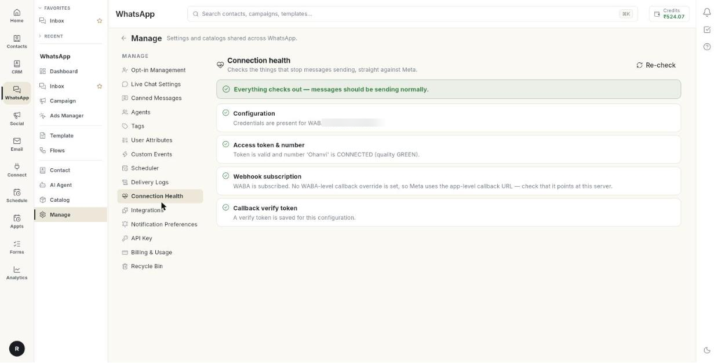

# कनेक्शन की सेहत जाँचें { #check-connection-health }

Connection Health आपके WhatsApp कनेक्शन को सीधे Meta से चेक करता है। इसके बाद आपको पता चल जाएगा कि मैसेज जा सकते हैं या नहीं और आ सकते हैं या नहीं। जो भी चेक फ़ेल हुआ, उसका साफ़ हल भी मिलेगा। एक चेक में कुछ सेकंड ही लगते हैं।

## शुरू करने से पहले { #before-you-start }

- आप **WhatsApp** पैनल में **Manage** खोल पाते हों। न खुले, तो अपने एडमिन से पूछें।
- आपने Ohanvi में WhatsApp नंबर जोड़ा हो। देखें [अपना WhatsApp नंबर कनेक्ट करें](connect-whatsapp-number.md)।

## चारों चेक का मतलब { #what-the-four-checks-mean }

| चेक | यह क्या देखता है | फ़ेल होने का आम मतलब |
| --- | --- | --- |
| **Configuration** | क्या आपके WhatsApp सेटअप में एक्सेस टोकन, WABA ID और Phone Number ID मौजूद हैं। | कोई फ़ील्ड खाली है, या अभी तक कोई कॉन्फ़िगरेशन बना ही नहीं है। |
| **Access token & number** | क्या Meta आपका टोकन मान रहा है और नंबर **CONNECTED** है। यह नंबर की क्वालिटी भी देखता है। | टोकन की मियाद खत्म हो गई या वह कैंसिल हो गया, Phone Number ID गलत है, या नंबर पर रोक लगी है। |
| **Webhook subscription** | क्या आपका WhatsApp Business Account किसी ऐप से सब्सक्राइब है, और **messages** फ़ील्ड चालू है। | ग्राहकों के जवाब Ohanvi तक नहीं पहुँचते। |
| **Callback verify token** | क्या वेबहुक का वेरिफ़ाई टोकन सेव है। | Meta आपके वेबहुक को वेरिफ़ाई नहीं कर पाता। |

!!! note "क्वालिटी रेटिंग"
    जब किसी नंबर की क्वालिटी **RED** हो जाती है, तब Meta उस नंबर से मैसेज भेजना सीमित या बंद कर देता है। अगर चेक क्वालिटी को लेकर चेतावनी दे, तो कम मैसेज भेजें और अपने मैसेज की भाषा नरम रखें।

## स्टेप { #steps }

### हेल्थ चेक चलाएँ { #run-the-health-check }

1. लेफ़्ट रेल में **WhatsApp** खोलें, फिर **Manage** चुनें।
2. **Connection Health** चुनें। पेज का टाइटल **Connection health** होता है, और चेक अपने आप शुरू हो जाता है।

    

3. सबसे ऊपर की लाइन पढ़ें। अगर **Everything checks out — messages should be sending normally.** लिखा है, तो सब ठीक है।
4. चारों चेक एक-एक करके पढ़ें। जो चेक फ़ेल हुआ है, वह बताएगा कि क्या गड़बड़ है और उसे कैसे ठीक करना है।

### फ़ेल हुआ चेक ठीक करें { #fix-a-failed-check }

1. लिस्ट में फ़ेल हुआ चेक ढूँढें।
2. उसकी डिटेल वाली लाइन और उसे ठीक करने वाली लाइन पढ़ें।
3. ज़रूरी बदलाव करें। आम तरीके नीचे बताए हैं।
4. **Re-check** पर क्लिक करें। पेज चारों चेक दोबारा चलाएगा।

आम तरीके:

- **Configuration:** **Settings** → **WhatsApp** → **Configuration** खोलें। जो टोकन या ID खाली है, उसे भरें और सेव करें। देखें [अपना WhatsApp नंबर कनेक्ट करें](connect-whatsapp-number.md)।
- **Access token & number:** नया परमानेंट एक्सेस टोकन पेस्ट करें, और Phone Number ID दोबारा देख लें।
- **Webhook subscription:** वेबहुक दोबारा कनेक्ट करें। देखें [वेबहुक और इंटीग्रेशन](whatsapp-webhooks-and-integrations.md)।
- **Callback verify token:** आपने अपने Meta ऐप में जो वेरिफ़ाई टोकन डाला था, वही यहाँ सेव करें।

### चेक दोबारा चलाएँ { #run-the-check-again }

1. जब चाहें, **Re-check** पर क्लिक करें।
2. अगर चेक चल ही नहीं पाया, तो **Retry** पर क्लिक करें।

## समस्या का समाधान { #troubleshooting }

| समस्या | कारण | समाधान |
| --- | --- | --- |
| **No WhatsApp configuration found for this organisation.** | अभी तक कोई नंबर जोड़ा नहीं गया है। | **Settings** → **WhatsApp** → **Configuration** में अपने Cloud API क्रेडेंशियल जोड़ें। |
| **Could not run the health check.** | Ohanvi सर्विस तक नहीं पहुँच पाया। | **Retry** पर क्लिक करें। |
| **The health check did not return a result.** | चेक से कोई नतीजा नहीं आया। | **Re-check** पर क्लिक करें। |
| Meta ने रिक्वेस्ट रिजेक्ट कर दी | एक्सेस टोकन की मियाद खत्म हो गई है या वह कैंसिल हो गया है। | नया परमानेंट टोकन बनाएँ और उसे **Configuration** में सेव करें। |
| This WABA is not subscribed to any app | Meta आने वाले मैसेज Ohanvi को नहीं भेज रहा। | अकाउंट को दोबारा सब्सक्राइब करें। देखें [वेबहुक और इंटीग्रेशन](whatsapp-webhooks-and-integrations.md)। |
| **messages** फ़ील्ड नहीं मिल रही | वेबहुक सब्सक्राइब है, लेकिन messages के लिए नहीं। | अपने Meta ऐप में **messages** फ़ील्ड चालू करें। |

## संबंधित गाइड { #related }

- [कनेक्शन की सेहत, अलर्ट और WhatsApp बिलिंग देखें](health-notifications-and-billing.md)
- [अपना WhatsApp नंबर कनेक्ट करें](connect-whatsapp-number.md)
- [नोटिफ़िकेशन की पसंद सेट करें](set-notification-preferences.md)
- [वेबहुक और इंटीग्रेशन](whatsapp-webhooks-and-integrations.md)
