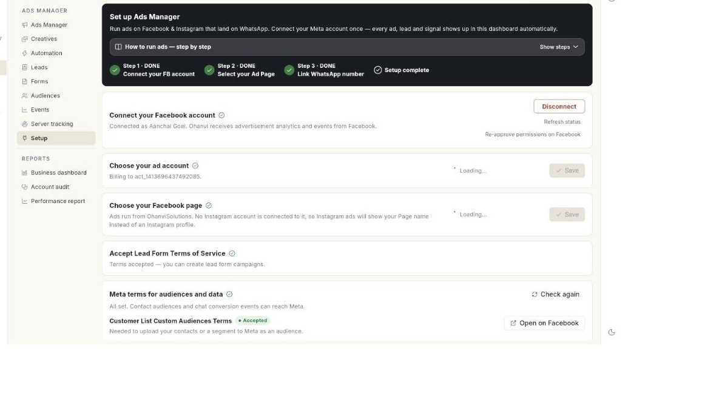
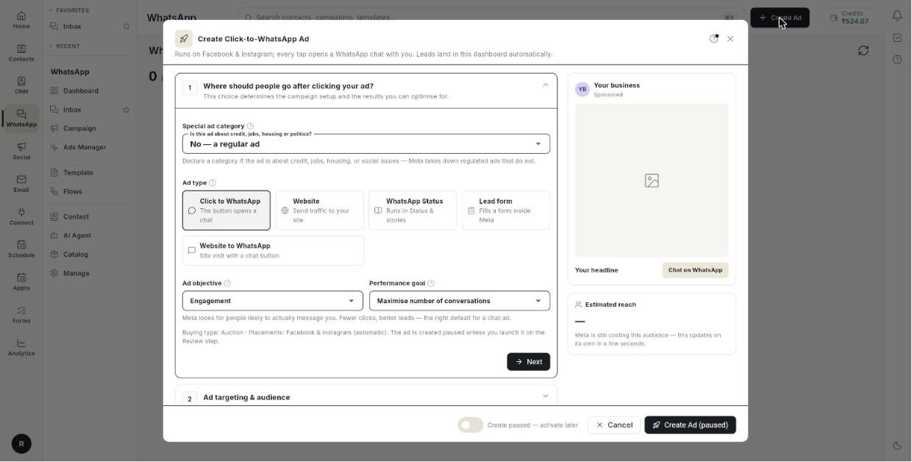
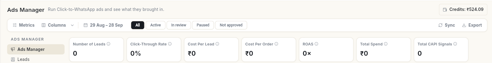

# Click-to-WhatsApp विज्ञापन चलाएँ { #run-click-to-whatsapp-ads }

Facebook और Instagram पर ऐसे विज्ञापन चलाएँ जो आपके बिज़नेस के साथ व्हाट्सऐप चैट खोलते हैं। अंत में आपका Facebook अकाउंट, पेज, ऐड अकाउंट और व्हाट्सऐप नंबर **Ads Manager** में कनेक्ट हो जाते हैं, आपका पहला विज्ञापन बन जाता है, और उससे आने वाली हर लीड Ohanvi में दिखती है।

## शुरू करने से पहले { #before-you-start }

- आपका व्हाट्सऐप नंबर Ohanvi से कनेक्ट हो। देखें [अपना व्हाट्सऐप नंबर कनेक्ट करें](connect-whatsapp-number.md)।
- आप एक Facebook पेज और एक Meta ऐड अकाउंट संभालते हों। अभी ऐड अकाउंट नहीं है? Meta Business Settings → Ad Accounts में बनाएँ।
- **WhatsApp** पैनल में आपको **Ads Manager** दिखता हो। न दिखे तो अपने एडमिन से कहें। देखें [रोल और अनुमतियाँ](../settings/roles-and-permissions.md)।

## Ads Manager क्या करता है { #what-ads-manager-does }

**Ads Manager** Ohanvi के अंदर से Meta विज्ञापन चलाता है। जब कोई विज्ञापन पर टैप करता है, तो आपके साथ व्हाट्सऐप चैट खुलती है, और उनका संदेश आपके **Inbox** में आता है। **Ads Manager** के बाएँ कॉलम में ये सेक्शन होते हैं:

| सेक्शन | इसमें क्या है |
| --- | --- |
| **Ads Manager** | आपके विज्ञापन, उनकी स्थिति, खर्च, लीड और नतीजे। |
| **Leads** | वे सभी लोग जिन्होंने विज्ञापन से आपको मैसेज किया। लीड अपने-आप यहाँ आती हैं। |
| **Forms** | आपके लीड फ़ॉर्म विज्ञापनों में इस्तेमाल होने वाले लीड फ़ॉर्म। |
| **Audiences** | टारगेट करने के लिए कस्टम, वेबसाइट और लुकअलाइक ऑडियंस। |
| **Events** | डेटासेट (पिक्सेल) जो वेबसाइट इवेंट Meta को भेजते हैं। |
| **Setup** | Facebook, आपके पेज, ऐड अकाउंट और व्हाट्सऐप नंबर से कनेक्शन। |
| **Performance report** | पुरानी परफ़ॉर्मेंस रिपोर्ट, **Reports** के नीचे। |

## चरण { #steps }

### चरण 1: अपना Facebook अकाउंट कनेक्ट करें { #step-1-connect-your-facebook-account }

1. लेफ़्ट रेल में **WhatsApp** खोलें, फिर **Ads Manager** चुनें।
2. **Setup** पर क्लिक करें। पूरा होने तक वह **Setup · pending** दिखाता है। **Set up Ads Manager** पेज खुलता है।

    

3. **Continue with Facebook** पर क्लिक करें।
4. उस Facebook अकाउंट से लॉग इन करें जो आपका बिज़नेस संभालता है।
5. Meta की स्क्रीन पर Businesses और Pages दोनों के लिए **Opt in to all current and future** चुनें। संदेश **Facebook connected!** दिखता है।

### चरण 2: अपना पेज और ऐड अकाउंट चुनें { #step-2-pick-your-page-and-ad-account }

1. **Choose your Facebook page** के नीचे वह पेज चुनें जिससे आपके विज्ञापन चलेंगे। अगर उससे कोई Instagram अकाउंट जुड़ा है, तो Instagram विज्ञापन उसी अकाउंट के रूप में चलते हैं।
2. **Choose your business portfolio** के नीचे वह Meta बिज़नेस चुनें जिसका आपका ऐड अकाउंट है।
3. **Choose your ad account** के नीचे वह अकाउंट चुनें जिस पर आपके कैंपेन का बिल बनेगा।
4. **Save** पर क्लिक करें।
5. लीड फ़ॉर्म विज्ञापन चलाने के लिए **I accept the Terms of Service for Lead Form Ads** पर टिक करें और **Accept Terms** पर क्लिक करें।

### चरण 3: अपना व्हाट्सऐप नंबर लिंक करें { #step-3-link-your-whatsapp-number }

1. **Link your WhatsApp number** के नीचे वह नंबर चुनें जहाँ लीड आनी चाहिए। सिर्फ़ वही नंबर दिखते हैं जो व्हाट्सऐप सेटअप में पहले से कनेक्ट हैं।
2. **Send code** पर क्लिक करें। Meta उस नंबर पर व्हाट्सऐप में एक कोड भेजता है।
3. उसे **Code from WhatsApp** में लिखें और **Verify** पर क्लिक करें। संदेश **WhatsApp number linked to your page.** दिखता है।

नंबर को अपने पेज से लिंक करने से ही विज्ञापन आपके साथ चैट खोलता है।

### चरण 4: विज्ञापनों का भुगतान करें { #step-4-pay-for-the-ads }

चुनें कि आपके विज्ञापन खर्च का भुगतान Meta को कैसे होगा:

- **Add Meta payment method**: Meta पर ऐड अकाउंट में कार्ड जोड़ें। Meta सीधे कार्ड से बिल लेता है।
- **Pay with Ohanvi**: Meta, Ohanvi को बिल करता है, और खर्च आपके Ohanvi क्रेडिट से कटता है। **Spend cap** तय करें। सीमा पूरी होने पर Meta विज्ञापन दिखाना बंद कर देता है। आपकी सीमा आपके क्रेडिट बैलेंस से बंधी होती है। फ़्री ट्रायल पर **Pay with Ohanvi** मना है, इसलिए इसके बजाय Meta का पेमेंट तरीका जोड़ें [VERIFY: refusal message on trial]।

क्रेडिट जोड़ने के लिए **Buy Credits** पर क्लिक करें। **Add money to Ads Credits** विंडो खुलती है। **Amount (₹)** लिखें और **Pay with Razorpay** पर क्लिक करें।

### चरण 5: विज्ञापन बनाएँ { #step-5-create-an-ad }

1. **Create Ad** पर क्लिक करें। **Create Click-to-WhatsApp Ad** फ़ॉर्म खुलता है, जिसके बगल में प्रीव्यू होता है।

    

2. **Ad type** के नीचे **Click to WhatsApp** चुनें। बाकी प्रकार हैं **Website**, **WhatsApp Status**, **Lead form** और **Website to WhatsApp**।
3. **Ad objective** के नीचे चुनें कि Meta किस चीज़ के लिए ऑप्टिमाइज़ करे, जैसे **Maximise number of conversations**।
4. **Ad targeting & audience** के नीचे **Select locations** में जगहें चुनें, फिर जेंडर, उम्र और चाहें तो रुचियाँ। आपके चुनने के साथ **Estimated reach** बदलता रहता है।
5. **Special ad category** के नीचे **No — a regular ad** चुनें, या अगर विज्ञापन क्रेडिट, नौकरी, आवास या राजनीति के बारे में है तो वह श्रेणी चुनें।
6. **Ad budget** के नीचे **Daily budget** या **Lifetime budget** चुनें, राशि लिखें, और **Start date** तथा चाहें तो **End date** तय करें। फ़ॉर्म Meta का न्यूनतम दिखाता है: डेली बजट के लिए प्रति दिन, और लाइफ़टाइम बजट के लिए प्रति दिन गुणा दिनों की संख्या। आगे की **Start date** दोनों में रखी जाती है।
7. **Ad creative** के नीचे विज्ञापन का टेक्स्ट और हेडलाइन लिखें, और इमेज, वीडियो या कैरोसेल जोड़ें।
8. वैकल्पिक: **Greeting & icebreakers (optional)** के नीचे चैट का पहला संदेश और उसके नीचे टैप करने वाले सवाल लिखें।
9. **Goes live after Meta approves** चुनें, या **Create paused — activate later**।
10. **Launch Ad** या **Create Ad (paused)** पर क्लिक करें।

इनमें से एक संदेश दिखता है:

- **Ad launched — it is now live on Meta (Ad ID …).**
- **Ad created in paused state (Ad ID …). Activate it when you are ready to spend.**

Meta विज्ञापन की समीक्षा करता है, आमतौर पर 24 घंटे के अंदर। तब तक वह **In review** दिखाता है।

### अपने विज्ञापन और लीड ट्रैक करें { #track-your-ads-and-leads }

1. हर विज्ञापन की स्थिति, **Total Spend**, **Number of Leads**, **Cost Per Lead** और **Click-Through Rate** देखने के लिए **Ads Manager** खोलें। विज्ञापनों को **All**, **Active**, **Completed**, **In review**, **Paused** या **Not approved** से फ़िल्टर करें, और ऊपर तारीख की सीमा चुनें।

    
2. विज्ञापन से किसने आपको मैसेज किया, यह देखने के लिए **Leads** खोलें। नाम, फ़ोन या विज्ञापन से खोजें, या **Download Report** पर क्लिक करें।
3. उन्हें **Inbox** से जवाब दें, जैसे किसी भी दूसरी चैट को।

## वीडियो वॉकथ्रू { #video-walkthrough }

[VIDEO]

## समस्या का समाधान { #troubleshooting }

| समस्या | कारण | समाधान |
| --- | --- | --- |
| **Please select OPT-IN to all for Business and Page to proceed.** | Meta की स्क्रीन पर हर Business और Page को ऑप्ट-इन नहीं किया गया। | **Continue with Facebook** पर फिर क्लिक करें और दोनों के लिए **Opt in to all current and future** चुनें। |
| **Facebook is connected, but ads access is still pending** | लॉगिन में विज्ञापन संभालने की अनुमति शामिल नहीं थी। | आपके पेज और व्हाट्सऐप नंबर वाले चरण फिर भी काम करते हैं। Meta के अनुमति मंज़ूर करने पर विज्ञापन बनाना चालू हो जाता है। |
| **Connect your Facebook account in Setup before creating an ad.** | चरण 1 पूरा नहीं हुआ है। | **Setup** पूरा करें, फिर **Create Ad** पर क्लिक करें। |
| **Choose the ad account your campaigns are billed to in Setup.** | कोई ऐड अकाउंट चुना नहीं गया है। | **Choose your ad account** के नीचे एक चुनें और **Save** पर क्लिक करें। |
| **Add your privacy policy URL — Meta requires one on every lead form.** | लीड फ़ॉर्म विज्ञापन में प्राइवेसी पॉलिसी का लिंक नहीं है। | **Privacy policy URL** भरें। |
| विज्ञापन **Not approved** दिखाता है | Meta ने विज्ञापन अस्वीकार कर दिया। | Meta के विज्ञापन नियमों के हिसाब से टेक्स्ट या इमेज बदलें, फिर उसे दोबारा बनाएँ। |

## संबंधित गाइड { #related }

- [ब्रॉडकास्ट कैंपेन भेजें](send-broadcast-campaign.md)
- [मार्केटिंग एनालिटिक्स पढ़ें](../analytics/read-marketing-analytics.md)
- [क्रेडिट और बिलिंग](../credits-and-billing.md)
- [CRM](../crm/index.md)
