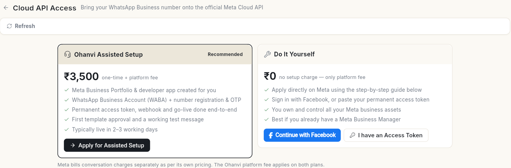

# अपना व्हाट्सऐप नंबर कनेक्ट करें { #connect-your-whatsapp-number }

अपना WhatsApp Business नंबर Ohanvi से जोड़ें, ताकि आप ऐप से ग्राहकों को मैसेज कर सकें। आखिर में आपका नंबर कनेक्टेड दिखता है, व्हाट्सऐप का **Dashboard** खुलता है, और आप **Configuration** से एक से ज़्यादा नंबर चला सकते हैं।

## शुरू करने से पहले { #before-you-start }

- आपको लेफ़्ट रेल में **WhatsApp** दिखता है। न दिखे तो अपने एडमिन से अपने रोल को व्हाट्सऐप एक्सेस देने को कहें। देखें [टीम, रोल और अनुमतियाँ](../settings/roles-and-permissions.md)।
- आप Meta Business Manager में अपने बिज़नेस के एडमिन हैं, या उस एडमिन के रूप में Facebook में साइन इन कर सकते हैं।
- आपके पास ऐसा फ़ोन नंबर है जिस पर टेक्स्ट मैसेज या कॉल आ सकती है। नए नंबर के लिए, वह किसी भी व्हाट्सऐप ऐप, पर्सनल या बिज़नेस, से जुड़ा नहीं होना चाहिए।
- आप वेब ऐप इस्तेमाल कर रहे हैं। Facebook पॉपअप मोबाइल पर नहीं चलता। मोबाइल पर इसके बजाय Cloud API क्रेडेंशियल इस्तेमाल करें।

## चरण { #steps }

### कनेक्ट करने का तरीका चुनें { #choose-how-to-connect }

1. लेफ़्ट रेल में **WhatsApp** खोलें, फिर **Dashboard** चुनें। जब तक कोई नंबर कनेक्ट नहीं होता, यहाँ **Connect WhatsApp** स्क्रीन खुलती है।
2. **How do you want to connect?** के नीचे एक विकल्प चुनें:

    | विकल्प | कब इस्तेमाल करें |
    | --- | --- |
    | **New number** | आप Meta पॉपअप से नया नंबर बनाना और वेरिफ़ाई करना चाहते हैं। |
    | **Verified number** | आपका नंबर Meta पर पहले से वेरिफ़ाइड है। एक्सेस टोकन आपके लिए अपने आप लिया जाता है। |
    | **WhatsApp Business app** | आप अपने फ़ोन से चैट करते रहना चाहते हैं। Ohanvi कैंपेन, बॉट और शेयर्ड इनबॉक्स के लिए वही नंबर इस्तेमाल करता है। |
    | **Cloud API credentials** | आपके पास Meta से स्थायी एक्सेस टोकन और ID पहले से हैं। |

बाद में दूसरा या तीसरा नंबर जोड़ने के लिए **Configuration** में **Add number** पर क्लिक करें। यही पेज और यही विकल्प खुलते हैं। देखें [कई व्हाट्सऐप नंबर चलाएँ](run-multiple-whatsapp-numbers.md)।

आप अपने प्रोफ़ाइल मेन्यू से भी शुरू कर सकते हैं: अपने नाम के पहले अक्षरों पर क्लिक करें, फिर **Settings** → **Connectors**, और **WhatsApp (Meta)** कार्ड पर **Set up WhatsApp** पर क्लिक करें।

### नया नंबर कनेक्ट करें { #connect-a-new-number }

1. **New number** चुनें। **Business details** चरण खुलता है।
2. **WhatsApp phone number** में देश चुनें और नंबर लिखें।
3. **Business display name** में वह नाम लिखें जो ग्राहकों को दिखेगा।
4. **Business website (optional)** में अपनी आधिकारिक वेबसाइट जोड़ें। इसके बिना Meta बाद में आधिकारिक दस्तावेज़ माँगता है।
5. **Business category** में सबसे मिलती-जुलती श्रेणी चुनें। **Next step** पर क्लिक करें। **Link Facebook** चरण खुलता है।
6. **Continue with Facebook** पर क्लिक करें। Meta पॉपअप खुलता है।
7. पॉपअप में अपने Meta Business Manager एडमिन के रूप में साइन इन करें और अनुमतियाँ दें।
8. अपना बिज़नेस पोर्टफ़ोलियो चुनें, फिर नया WhatsApp Business अकाउंट और प्रोफ़ाइल बनाएँ।
9. **Add a new number** चुनें। **Text message** या **Phone call** चुनें, फिर Meta का भेजा कोड डालें।
10. पॉपअप पूरा करें। Ohanvi कनेक्शन सेव करता है और आपका **Dashboard** खोल देता है।

!!! tip "सुझाव"
    Meta का **Get a free WhatsApp number** विकल्प Click-to-WhatsApp विज्ञापनों के लिए इस्तेमाल नहीं हो सकता, और कनेक्ट करने के बाद उसे आधिकारिक दस्तावेज़ चाहिए। इसके बजाय **Add a new number** चुनें।

### Meta पर पहले से वेरिफ़ाइड नंबर कनेक्ट करें { #connect-a-number-already-verified-on-meta }

1. **Verified number** चुनें।
2. **WhatsApp phone number**, **Business display name** और **Business category** भरें।
3. **Continue with Facebook** पर क्लिक करें।
4. पॉपअप में अपना मौजूदा बिज़नेस पोर्टफ़ोलियो, WhatsApp Business अकाउंट और फ़ोन नंबर चुनें। कोड की ज़रूरत नहीं है।

इसके बजाय जानकारी हाथ से डालने के लिए **Enter API credentials manually** पर क्लिक करें। **Phone Number ID**, **WABA ID**, **Meta Business Manager ID** और **Access Token** भरें, फिर **Save & Connect** पर क्लिक करें।

### Cloud API क्रेडेंशियल से कनेक्ट करें { #connect-with-cloud-api-credentials }

1. **Cloud API credentials** चुनें।
2. अपना **Permanent access token** पेस्ट करें।
3. **WhatsApp Business Account ID (WABA ID)**, **Phone Number ID** और **Meta Business Manager ID** भरें।
4. **Configuration name** रखें या बदलें। डिफ़ॉल्ट **Cloud API** है।
5. **Webhook verify token** कॉपी करें। वही टोकन Meta → App Dashboard → WhatsApp → Configuration → Webhooks में पेस्ट करें।
6. **Verify & Connect WhatsApp** पर क्लिक करें। जब Meta टोकन स्वीकार कर लेता है, तो **Opening your dashboard…** दिखता है।

!!! warning "चेतावनी: स्थायी टोकन इस्तेमाल करें"
    Meta Developer Console → API Setup से कॉपी किए गए टोकन 24 घंटे में एक्सपायर हो जाते हैं, और मैसेजिंग बंद हो जाती है। Meta Business Settings से स्थायी System User टोकन इस्तेमाल करें।

अभी Meta अकाउंट नहीं है? **No credentials? Get Cloud API access →** पर क्लिक करें। **Cloud API Access** पेज खुलता है। Ohanvi टीम से अपना Meta सेट करवाने के लिए **Apply for Assisted Setup** चुनें, या **How to apply on Meta yourself** फ़ॉलो करें।

### नंबर चालू करें { #activate-the-number }

अगर Meta ने नंबर अभी चालू नहीं किया है, तो Dashboard में इसके बजाय 4 चरणों वाला **Connect Account** दिखता है।

1. **Connect WhatsApp** के नीचे अपना WhatsApp Business अकाउंट कनेक्ट करें।
2. **Request verification code from Meta** के नीचे **Text message** या **Voice Call** चुनें, फिर **Send Verification Code** पर क्लिक करें।
3. **Enter the verification code** के नीचे 6 अंकों का कोड लिखें और **Verify** पर क्लिक करें। कोड 10 मिनट में एक्सपायर हो जाता है। न आए तो **Resend code** पर क्लिक करें।
4. **Register & activate your number** के नीचे Meta की टू-स्टेप वेरिफ़िकेशन के लिए 6 अंकों का PIN सेट करें। **Register & Activate** पर क्लिक करें।

PIN संभालकर रखें। नंबर को कभी दोबारा रजिस्टर करना पड़े तो यह चाहिए होगा।

### Cloud API में मदद लें { #get-help-with-the-cloud-api }

**WhatsApp** → **Manage** → **API Key** खोलें। **Cloud API Access** आपके नंबर को आधिकारिक Meta Cloud API पर लाने के 2 तरीके देता है:

- **Ohanvi Assisted Setup** (सुझाया गया): Ohanvi आपका Meta Business Portfolio और डेवलपर ऐप बनाता है, आपका नंबर रजिस्टर करता है, एक्सेस टोकन और वेबहुक सेट करता है, और आपका पहला टेम्प्लेट Approved करवाता है। कार्ड पर दिखाई गई एकमुश्त फ़ीस में यह आमतौर पर 2–3 कार्य दिवसों में लाइव हो जाता है। **Apply for Assisted Setup** पर क्लिक करें।
- **Do It Yourself**: सेटअप का कोई शुल्क नहीं। **Continue with Facebook** पर क्लिक करें, या अगर आपके पास स्थायी टोकन पहले से है तो **I have an Access Token** पर। कार्ड के नीचे **How to apply on Meta yourself** फ़ॉलो करें: 7 चरण, अगर आपके बिज़नेस दस्तावेज़ तैयार हैं तो करीब 30–45 मिनट।

Meta बातचीत का शुल्क अलग से लेता है। Ohanvi प्लेटफ़ॉर्म फ़ीस दोनों पर लागू होती है।

### अपने नंबर प्रबंधित करें { #manage-your-numbers }

1. नीचे बाएँ कोने में अपने नाम के पहले अक्षरों पर क्लिक करें, फिर **Settings** पर क्लिक करें।
2. **WhatsApp** चुनें, फिर **Configuration**। पेज का शीर्षक **WhatsApp numbers** है। हर नंबर एक पंक्ति है, जिसमें बैज, उसका लेबल, किसी एक नंबर पर **Default** टैग, फ़ोन नंबर और उसकी क्वालिटी रेटिंग होती है।

    <!-- SCREENSHOT TODO: add the image, then restore this line:  -->

3. दाईं ओर ब्योरा देखने के लिए किसी नंबर पर क्लिक करें। पैनल के ऊपर के बटन इस्तेमाल करें:
    - **Make default**: कैंपेन, ब्रॉडकास्ट और पहले मैसेज इसी नंबर से भेजें। डिफ़ॉल्ट नंबर पर **Default** दिखता है।
    - **Edit**: लेबल, बैज का रंग, नाम, ID या टोकन बदलें। **Save** पर क्लिक करें।
    - **Disconnect**: Ohanvi में इस नंबर का इस्तेमाल बंद करें। उसकी चैट इनबॉक्स में बनी रहती हैं।
4. दूसरा नंबर जोड़ने के लिए ऊपर दाईं ओर **Add number** पर क्लिक करें। ऊपर बताए विकल्पों के साथ **Connect WhatsApp** पेज खुलता है।
5. अगर कोई नंबर आपके WhatsApp Business Account में है और ग्राहक उसे मैसेज कर रहे हैं लेकिन वह कनेक्ट नहीं है, तो वह **In your WhatsApp account, not connected** के नीचे दिखता है। **Connect** पर क्लिक करें, **Label** लिखें और **Connect** पर क्लिक करें। कोड या टोकन की ज़रूरत नहीं है।

किसी नंबर का **Call settings** सेक्शन ग्राहकों को उसे कॉल करने देता है। इसके लिए पहले Meta से Calling API एक्सेस मंज़ूर होना चाहिए। देखें [व्हाट्सऐप कॉलिंग का इस्तेमाल करें](whatsapp-calling.md)।

एक से ज़्यादा नंबर चलाने के लिए [कई व्हाट्सऐप नंबर चलाएँ](run-multiple-whatsapp-numbers.md) देखें।

## वीडियो वॉकथ्रू { #video-walkthrough }

[VIDEO]

## समस्या का समाधान { #troubleshooting }

| समस्या | कारण | समाधान |
| --- | --- | --- |
| **Facebook sign-up did not complete. Please try again.** | Meta पॉपअप जल्दी बंद हो गया या अनुमतियाँ नहीं दी गईं। | **Continue with Facebook** पर दोबारा क्लिक करें और पॉपअप के हर चरण को पूरा करें। app.ohanvi.com के लिए पॉपअप की अनुमति दें। |
| **Access token is required. Connect with Facebook or paste your Meta token.** | Facebook से कोई टोकन नहीं आया, और कोई पेस्ट भी नहीं किया गया। | Facebook पॉपअप पूरा करें, या स्थायी टोकन पेस्ट करें। |
| किसी नंबर पर **Access token expired or revoked** | टोकन अस्थायी था या Meta में हटा दिया गया। मैसेज और कॉल फ़ेल होते हैं। | **Fix now** पर क्लिक करें, फिर नया स्थायी टोकन पेस्ट करें या Facebook से दोबारा कनेक्ट करें। |
| **Meta keeps rejecting this request** | सेव किया हुआ फ़ोन नंबर उस WhatsApp Business अकाउंट में नहीं है, या गलत ID सेव हो गई। | **Edit phone number** पर क्लिक करें और नंबर व ID जाँचें। |
| **WhatsApp broadcasting is restricted** | Meta ने नंबर पर पाबंदी लगा दी है। | इसे Meta WhatsApp Manager में सुलझाएँ, फिर **Check status again** पर क्लिक करें। |
| **Connecting via Facebook is available on the web app.** | आप मोबाइल पर हैं। | वेब ऐप इस्तेमाल करें, या अपने API क्रेडेंशियल हाथ से डालें। |

## संबंधित गाइड { #related }

- [कई व्हाट्सऐप नंबर चलाएँ](run-multiple-whatsapp-numbers.md)
- [अपनी व्हाट्सऐप बिज़नेस प्रोफ़ाइल सेट करें](whatsapp-business-profile.md)
- [अपना नंबर Ohanvi पर लाएँ](migrate-to-ohanvi.md)
- [व्हाट्सऐप डैशबोर्ड पढ़ें](whatsapp-dashboard.md)
- [अपनी या मैनेज्ड सेवाएँ चुनें](../settings/choose-connectors.md)
- [सेटिंग्स का ओवरव्यू](../settings/index.md)
