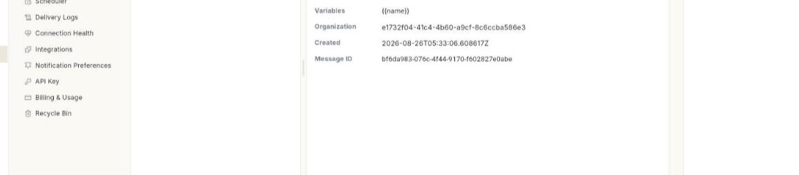
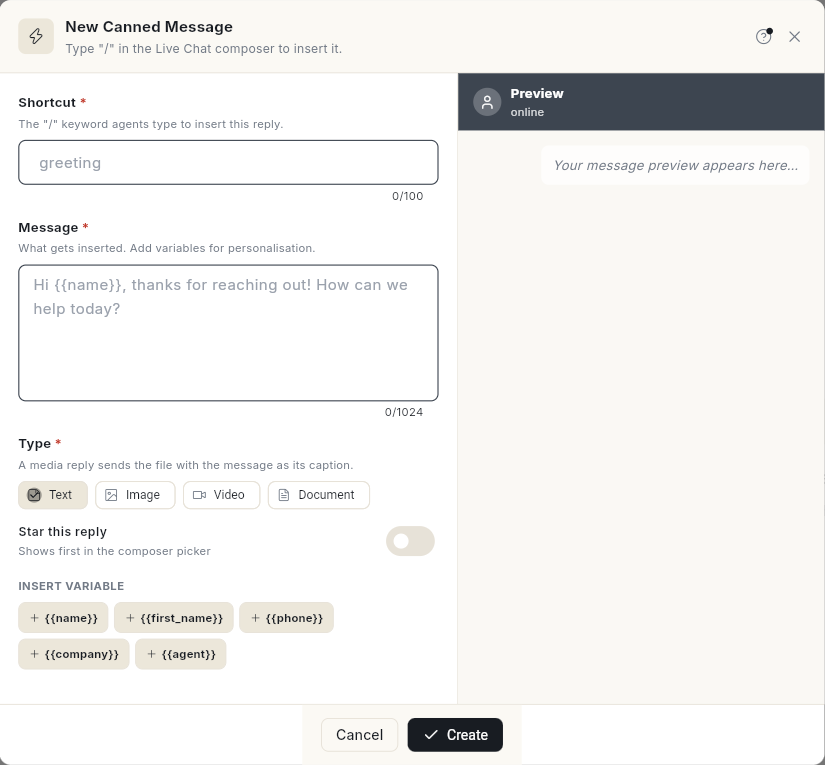

# तैयार मैसेज बनाएँ { #create-canned-messages }

जो जवाब आप बार-बार भेजते हैं, उन्हें सेव कर लें। फिर आपकी टीम इनबॉक्स में **/** और शॉर्टकट टाइप करके उन्हें डाल सकती है। इस पेज के बाद आपका शॉर्टकट कंपोज़र के पिकर में दिखेगा और मैसेज भेजने के लिए तैयार होगा। इसमें करीब 3 मिनट लगते हैं।

## शुरू करने से पहले { #before-you-start }

- आपका WhatsApp नंबर Ohanvi से कनेक्ट हो। देखें [अपना WhatsApp नंबर कनेक्ट करें](connect-whatsapp-number.md)।
- **WhatsApp** पैनल में आपको **Manage** दिखे। न दिखे, तो अपने एडमिन से कहें कि वे आपके रोल को एक्सेस दें। देखें [रोल और अनुमतियाँ](../settings/roles-and-permissions.md)।
- आपका रोल तैयार मैसेज बना और एडिट कर सके। ऐसा न हो, तो **New quick reply** ग्रे दिखता है।
- इमेज, वीडियो या दस्तावेज़ वाले जवाब के लिए फ़ाइल पहले से तैयार रखें।

## तैयार मैसेज क्या है { #what-a-canned-message-is }

तैयार मैसेज (canned message) एक सेव किया हुआ जवाब है। आपकी टीम उसे चैट में **/** और उसका शॉर्टकट टाइप करके डालती है। ऐप में इसे **quick reply** भी कहते हैं।

हर तैयार मैसेज में एक **Shortcut**, एक **Message** और एक **Type** होता है। **Type** चार तरह का हो सकता है: **Text**, **Image**, **Video** या **Document**। मीडिया वाले जवाब में फ़ाइल जाती है, और आपका मैसेज उसके कैप्शन की तरह लगता है।

### वेरिएबल { #variables }

वेरिएबल एक खाली जगह जैसा होता है, जैसे `{{name}}`। उसे डालने के लिए **INSERT VARIABLE** के नीचे वाले चिप पर क्लिक करें। जब आप जवाब को चैट में डालते हैं, तो Ohanvi हर वेरिएबल की जगह उस ग्राहक की जानकारी भर देता है।

| वेरिएबल | क्या भरता है |
| --- | --- |
| `{{name}}` | ग्राहक का नाम। |
| `{{first_name}}` | ग्राहक का पहला नाम। |
| `{{phone}}` | ग्राहक का फ़ोन नंबर। |
| `{{company}}` | ग्राहक की कंपनी। यह अभी चैट में नहीं भरता, इसलिए जैसा लिखा है वैसा ही रहता है। इसे हाथ से बदलें। |
| `{{agent}}` | जवाब भेजने वाले एजेंट का नाम। |

## स्टेप { #steps }

### Canned Messages खोलें { #open-canned-messages }

1. लेफ़्ट रेल में **WhatsApp** खोलें, फिर **Manage** चुनें।
2. **Canned Messages** चुनें। लिस्ट खुलेगी, और उसमें यह लाइन दिखेगी: **Saved quick-replies your team inserts with "/" in the Live Chat composer.**

    

3. **Canned Messages** कार्ड देखें। उसमें आपके सेव किए हुए जवाबों की गिनती होती है।

### तैयार मैसेज बनाएँ { #create-a-canned-message }

1. **New quick reply** पर क्लिक करें। लिस्ट खाली हो, तो **New Canned Message** पर क्लिक करें। **New Canned Message** फ़ॉर्म खुलेगा।

    

2. **Shortcut** में वह शब्द लिखें जो आपकी टीम **/** के बाद टाइप करेगी, जैसे `greeting`। यहाँ स्लैश मत लिखें।
3. **Message** में जवाब लिखें, जैसे `Hi {{name}}, thanks for reaching out! How can we help today?`
4. वेरिएबल जोड़ना हो, तो कर्सर को उस जगह रखें जहाँ वेरिएबल चाहिए। फिर **INSERT VARIABLE** के नीचे कोई चिप चुनें, जैसे `{{name}}`।
5. **Type** के नीचे **Text**, **Image**, **Video** या **Document** चुनें।
6. **Image**, **Video** या **Document** चुना है, तो **Attachment** में जाकर फ़ाइल जोड़ें। फ़ाइल अपने-आप अपलोड हो जाती है।
7. चाहें तो **Star this reply** चालू करें। स्टार किया हुआ जवाब कंपोज़र पिकर में सबसे ऊपर दिखता है।
8. **Preview** देखें। उसमें सिर्फ़ नमूने की वैल्यू दिखती हैं। इनबॉक्स में ये वैल्यू नहीं भरतीं।
9. **Create** पर क्लिक करें। जवाब लिस्ट में आ जाएगा।

**Shortcut** और **Message** दोनों ज़रूरी हैं। मीडिया टाइप में फ़ाइल भी ज़रूरी है।

### तैयार मैसेज देखें { #read-a-canned-message }

1. शॉर्टकट या जवाब के शब्दों से ढूँढने के लिए **Search shortcut or text…** में टाइप करें।
2. लिस्ट में जवाब पर क्लिक करें। उसकी डिटेल दाईं ओर खुलेगी।
3. **Shortcut**, **Variables**, **Organization**, **Created** और **Message ID** वाली लाइनें देखें।

कुछ भी चुना हुआ न हो, तो पैनल में **Select a canned message** लिखा होता है। उसके साथ **Pick a quick reply from the list to read it here.** भी दिखता है।

### तैयार मैसेज एडिट करें { #edit-a-canned-message }

1. लिस्ट में जवाब पर क्लिक करें।
2. **Edit** पर क्लिक करें। **Edit Canned Message** फ़ॉर्म खुलेगा।
3. **Shortcut**, **Message**, **Type** या **Attachment** में जो बदलना है, बदलें। **Star this reply** को चालू या बंद भी कर सकते हैं।
4. **Save Changes** पर क्लिक करें।

### मैसेज या शॉर्टकट कॉपी करें { #copy-a-message-or-its-shortcut }

1. लिस्ट में जवाब पर क्लिक करें।
2. मैसेज कॉपी करने के लिए **Copy message text** पर क्लिक करें। डिटेल पैनल में इस बटन का नाम **Copy message** है।
3. शॉर्टकट कॉपी करने के लिए **Copy shortcut** पर क्लिक करें।

### तैयार मैसेज डिलीट करें { #delete-a-canned-message }

1. लिस्ट में जवाब पर क्लिक करें।
2. **Delete** पर क्लिक करें। **Delete canned message?** विंडो खुलेगी, जिसमें शॉर्टकट दिखता है।
3. **Delete** पर क्लिक करें। जवाब लिस्ट से हट जाएगा।

जवाब रखना हो, तो **Cancel** पर क्लिक करें।

### अपने कस्टम एट्रिब्यूट इस्तेमाल करें { #use-your-custom-attributes }

कॉन्टैक्ट के लिए आपने जो कस्टम एट्रिब्यूट बनाए हैं, वे भी **INSERT VARIABLE** के नीचे चिप के रूप में दिखते हैं। वे `{{attribute.Name}}` की तरह जुड़ते हैं, जैसे `{{attribute.City}}`।

1. तैयार मैसेज खोलें और एट्रिब्यूट के चिप पर क्लिक करें, जैसे `{{attribute.City}}`।
2. फ़ॉलबैक रखना हो, तो उसे बार (|) के बाद लिखें: `{{attribute.City|there}}`। ग्राहक की कोई वैल्यू न हो, तो फ़ॉलबैक दिखता है।
3. जवाब को चैट में डालें। कॉन्टैक्ट की प्रोफ़ाइल से एट्रिब्यूट की वैल्यू भर जाती है। वैल्यू और फ़ॉलबैक दोनों न हों, तो प्लेसहोल्डर जैसा लिखा है वैसा ही रहता है।

### इनबॉक्स में तैयार मैसेज डालें { #insert-a-canned-message-in-the-inbox }

1. **WhatsApp** → **Inbox** खोलें, फिर कोई चैट खोलें।
2. कंपोज़र में **/** टाइप करें। **Canned messages** की लिस्ट खुलेगी।
3. लिस्ट छोटी करने के लिए शॉर्टकट के कुछ अक्षर टाइप करें।
4. **All**, **Starred**, **Text**, **Image**, **Video** या **Doc** से फ़िल्टर करें।
5. किसी जवाब पर क्लिक करें। वह कंपोज़र में आ जाएगा।
6. मैसेज पढ़ लें, फिर भेजें। वेरिएबल की जगह इस ग्राहक की जानकारी दिखेगी। जिस वेरिएबल की कोई वैल्यू नहीं है, वह जैसा लिखा है वैसा ही रहता है। उसे हाथ से बदल दें।

24 घंटे की विंडो और कंपोज़र की बाकी बातें जानने के लिए देखें [WhatsApp इनबॉक्स का इस्तेमाल करें](use-whatsapp-inbox.md)।

## समस्या का समाधान { #troubleshooting }

| समस्या | कारण | समाधान |
| --- | --- | --- |
| **Shortcut is required** | **Shortcut** बॉक्स खाली है। | शॉर्टकट लिखें, फिर **Create** पर क्लिक करें। |
| **Message is required** | **Message** बॉक्स खाली है। | जवाब लिखें। |
| **A file link is required for this type** | आपने **Image**, **Video** या **Document** चुना, पर कोई फ़ाइल नहीं जोड़ी। | **Attachment** में फ़ाइल जोड़ें, या **Text** चुनें। |
| **Unable to save canned message.** | मैसेज सेव नहीं हो पाया। | **Create** या **Save Changes** पर फिर से क्लिक करें। |
| **New quick reply** ग्रे है। | आपका रोल तैयार मैसेज नहीं बना सकता। | अपने एडमिन से कहें। देखें [रोल और अनुमतियाँ](../settings/roles-and-permissions.md)। |
| **/** टाइप करने पर शॉर्टकट नहीं दिखता। | फ़िल्टर ने उसे छिपा दिया है, या शॉर्टकट की स्पेलिंग अलग है। | **All** चुनें, फिर शॉर्टकट के कम अक्षर टाइप करें। |

## संबंधित गाइड { #related }

- [WhatsApp इनबॉक्स का इस्तेमाल करें](use-whatsapp-inbox.md)
- [अपनी WhatsApp बिज़नेस प्रोफ़ाइल सेट करें](whatsapp-business-profile.md)
- [फ़ाइलें और वॉइस नोट भेजें](send-files-and-voice-notes.md)
