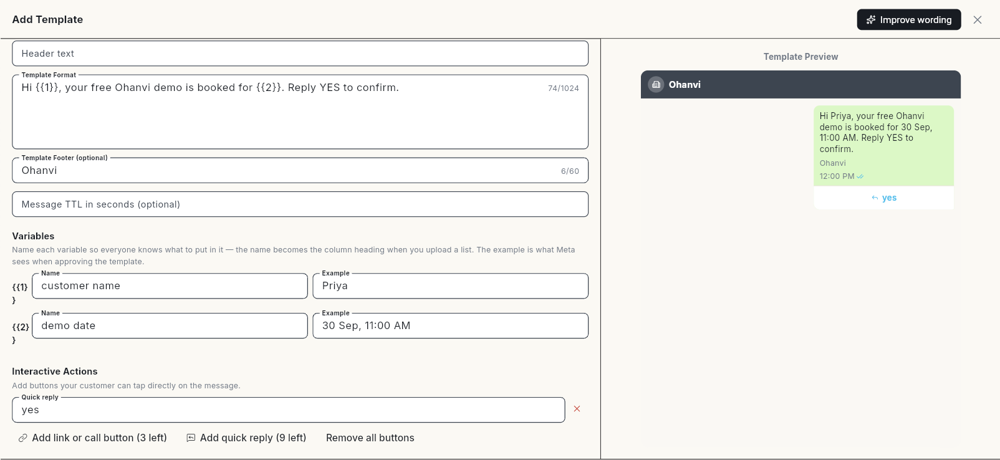
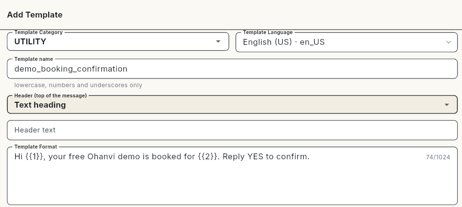
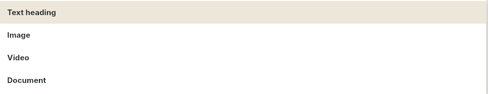
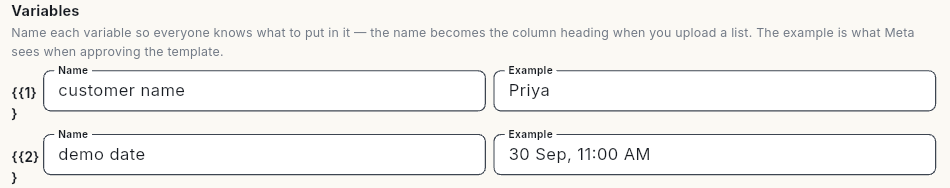
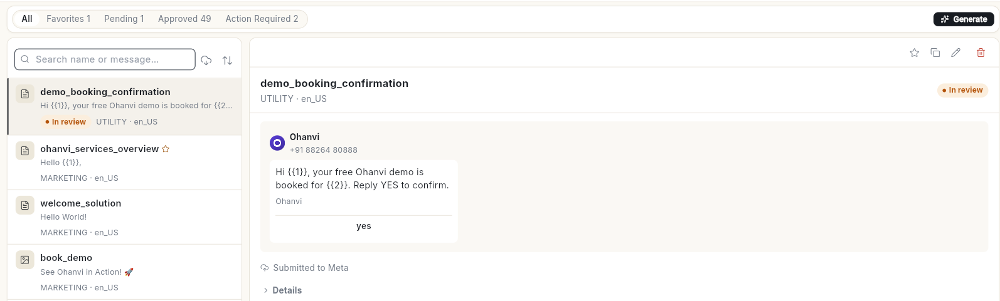
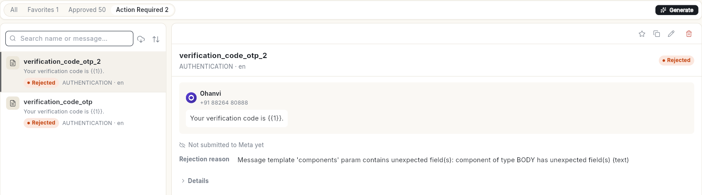

# WhatsApp मैसेज टेम्प्लेट बनाएँ { #create-a-whatsapp-message-template }

हेडर, बॉडी, फ़ुटर और बटन वाला मैसेज Template लिखें, फिर उसे Meta को भेजें। इसके बाद आपका Template Meta के पास **In review** में रहेगा। जब वह **Approved** दिखे, तब आप उसे कैंपेन और फ़्लो में इस्तेमाल कर सकते हैं। 24 घंटे की चैट विंडो के बाहर जवाब देने में भी वह काम आता है।

## शुरू करने से पहले { #before-you-start }

- आपका WhatsApp नंबर Ohanvi से कनेक्ट हो। देखें [अपना WhatsApp नंबर कनेक्ट करें](connect-whatsapp-number.md)।
- **WhatsApp** पैनल में आपको **Template** दिखे। न दिखे, तो अपने एडमिन से कहें कि वे आपके रोल को Template का एक्सेस दें। देखें [रोल और अनुमतियाँ](../settings/roles-and-permissions.md)।
- आपको पता हो कि आपका मैसेज किस कैटेगरी में आता है। नीचे [कैटेगरी चुनें](#choose-a-category) देखें।

## टेम्प्लेट क्या है { #what-a-template-is }

WhatsApp पर कोई बिज़नेस सिर्फ़ Template से ही बातचीत शुरू कर सकता है, या 24 घंटे की चुप्पी के बाद लिख सकता है। और यह Template Meta से Approved होना चाहिए। 24 घंटे की विंडो के बाहर आप जो भी कैंपेन और ऑटोमैटिक मैसेज भेजते हैं, उन सबमें Template ही लगता है।

### कैटेगरी चुनें { #choose-a-category }

Meta कैटेगरी के हिसाब से Template की कीमत तय करता है और उसे जाँचता है। जो कैटेगरी आपके मैसेज के काम से मिलती हो, वही चुनें।

| कैटेगरी | किसके लिए चुनें | उदाहरण |
| --- | --- | --- |
| **MARKETING** | ऑफ़र, नया लॉन्च, त्योहार की सेल, पुराने ग्राहकों को वापस बुलाना, और हर तरह का प्रमोशन। | "Diwali sale: 20% off until Sunday." |
| **UTILITY** | ग्राहक ने जो काम किया है उसकी जानकारी: ऑर्डर, बुकिंग, पेमेंट, शिपिंग। | "Your order {{1}} has shipped." |
| **AUTHENTICATION** | सिर्फ़ OTP जैसे वन-टाइम पासकोड। इसके शब्द Meta खुद लिखता है। | "{{1}} is your verification code." |

कुछ **Template type** चुनने पर कैटेगरी अपने-आप तय हो जाती है। **Carousel**, **Catalog**, **Multi-product** और **Limited Time Offer** हमेशा **MARKETING** होते हैं। **Order details (Payment)**, **Order Status** और **Call Permission Request** हमेशा **UTILITY** होते हैं।

### Template का टाइप चुनें { #choose-a-template-type }

| Template का टाइप | यह क्या भेजता है |
| --- | --- |
| **Default** | आम मैसेज। इसमें चाहें तो हेडर और बटन जोड़ सकते हैं। |
| **Carousel** | दो से दस कार्ड, जिन्हें स्वाइप करके देखा जाता है। हर कार्ड में अपनी तस्वीर और बटन होते हैं। |
| **Order details (Payment)** | ग्राहक से पेमेंट करने को कहता है। इसके लिए Meta के साथ पेमेंट सेट होना चाहिए। |
| **Catalog** | आपका WhatsApp कैटलॉग खोलता है। इसके लिए इस नंबर पर कैटलॉग होना चाहिए। |
| **Multi-product** | चुने हुए प्रोडक्ट सेक्शन में दिखाता है। इसके लिए कैटलॉग चाहिए। |
| **Authentication** | वन-टाइम पासकोड। इसके शब्द Meta खुद लिखता है। |
| **Flows** | पब्लिश किया हुआ Flow खोलता है। यानी ऐसा फ़ॉर्म, जिसे ग्राहक WhatsApp के अंदर ही भरता है। |
| **Order Status** | ग्राहक को बताता है कि उसका ऑर्डर कहाँ तक पहुँचा। |
| **Call Permission Request** | कॉल करने की इजाज़त माँगता है। इसमें बटन नहीं होते, और कॉलिंग चालू होनी चाहिए। |
| **Limited Time Offer** | काउंटडाउन के साथ ऑफ़र कोड। इसमें फ़ुटर नहीं होता। |

## स्टेप { #steps }

### Template बनाएँ { #create-the-template }

1. लेफ़्ट रेल में **WhatsApp** खोलें, फिर **Template** चुनें। **Templates** पेज खुलेगा।
2. **New template** पर क्लिक करें। **Add Template** फ़ॉर्म खुलेगा। उसके बगल में **Template Preview** दिखेगा।

    
3. आपके पास एक से ज़्यादा **Organization** हैं, तो अपना **Organization** चुनें।
4. **Template type** चुनें। फ़ील्ड के नीचे लिखा होता है कि हर टाइप क्या करता है।
5. **Template Category** चुनें: **UTILITY**, **MARKETING** या **AUTHENTICATION**।
6. **Template name** लिखें, जैसे `order_shipped`। इसमें सिर्फ़ छोटे अक्षर, अंक और अंडरस्कोर इस्तेमाल करें। नाम किसी नियम के खिलाफ़ हो, तो फ़ील्ड के नीचे आए **Use "…"** सुझाव पर क्लिक करें।
7. **Template Language** चुनें। ढूँढने के लिए **Search language or code** में लिखें, जैसे `Hindi` या `en_US`।

    

!!! tip "सुझाव: बने-बनाए टेम्प्लेट से शुरू करें"
    लाइब्रेरी से Template कॉपी करने के लिए **Browse Library** पर क्लिक करें। या **Generate** पर क्लिक करके मैसेज के बारे में लिखें, तो AI उसे लिख देगा। भेजने से पहले नतीजा एक बार पढ़ लें।

### हेडर जोड़ें { #add-the-header }

हेडर ज़रूरी नहीं है। यह मैसेज के सबसे ऊपर दिखता है।

1. **Header (top of the message)** चुनें: **Text heading**, **Image**, **Video** या **Document**। "none" का ऑप्शन नहीं है। हेडर न चाहिए, तो **Text heading** रहने दें और **Header text** खाली छोड़ दें।

    

2. **Text heading** में **Header text** लिखें। इसमें 60 अक्षर तक और ज़्यादा से ज़्यादा 1 वेरिएबल हो सकता है।
3. **Image**, **Video** या **Document** में एक सैंपल फ़ाइल अपलोड करें। Meta इसी सैंपल से Template जाँचता है। असली फ़ाइल आप हर बार कैंपेन भेजते समय चुनते हैं।

अपलोड की लिमिट: इमेज 5 MB तक, वीडियो 16 MB तक, डॉक्यूमेंट 100 MB तक। **Video** हेडर में सैंपल हमेशा चाहिए। **Image** और **Document** में सैंपल खाली छोड़ दें, तो Ohanvi एक सादा प्लेसहोल्डर भेज देता है।

### बॉडी और फ़ुटर लिखें { #write-the-body-and-footer }

1. **Template Format** में मैसेज लिखें। इसमें 1,024 अक्षर तक आ सकते हैं।
2. जहाँ हर ग्राहक की अपनी जानकारी आनी है, वहाँ वेरिएबल लगाएँ। उन्हें क्रम से `{{1}}`, `{{2}}` और आगे इसी तरह लिखें।
3. चाहें तो **Template Footer (optional)** लिखें, 60 अक्षर तक। फ़ुटर में वेरिएबल नहीं लग सकते।
4. चाहें तो **Message TTL in seconds (optional)** सेट करें, जैसे `3600`। इतनी देर तक Meta मैसेज पहुँचाने की कोशिश करता रहता है।

बॉडी में Meta के ये नियम मानने होंगे:

- वेरिएबल `{{1}}` से शुरू हों और क्रम से चलें। बीच में कोई नंबर छूटे नहीं।
- 2 वेरिएबल आपस में सटे न हों। `{{1}}` और `{{2}}` के बीच शब्द रखें।
- बॉडी में सिर्फ़ वेरिएबल न हों। बॉडी वेरिएबल से शुरू या खत्म भी नहीं होनी चाहिए।
- लगातार 3 से ज़्यादा खाली लाइनें न छोड़ें।

### हर वेरिएबल को नाम और सैंपल दें { #name-each-variable-and-give-a-sample }

1. **Variables** के नीचे हर वेरिएबल का **Name** भरें, जैसे `customer name`। रिसीवर की लिस्ट अपलोड करते समय यही नाम कॉलम का हेडिंग बन जाता है।
2. हर वेरिएबल का **Example** भरें, जैसे `Lakshmi` या `ORD-10482`। Meta Template जाँचते समय यही उदाहरण देखता है।

    

उदाहरण असली जैसे दें, `xxx` जैसे नहीं। जो Template असली मैसेज जैसा नहीं पढ़ा जाता, उसे Meta रिजेक्ट कर देता है।

### बटन जोड़ें { #add-buttons }

1. **Interactive Actions** के नीचे **Add link or call button** या **Add quick reply** पर क्लिक करें। हर बटन के साथ दिखता है कि और कितने बटन जोड़ सकते हैं।
2. लिंक बटन के लिए **Button label** और `https://` से शुरू होने वाला URL लिखें। URL के आखिर में `{{1}}` भी जोड़ सकते हैं, जैसे `https://example.com/{{1}}`।
3. कॉल बटन के लिए **Button label** और देश के कोड वाला फ़ोन नंबर लिखें।
4. **Quick reply** के लिए वह **Button label** लिखें जिस पर ग्राहक टैप करेगा।
5. चाहें तो **Enable Click Tracking** चालू करें। इससे कैंपेन रिपोर्ट में लिंक के क्लिक गिने जाते हैं। ग्राहक फिर भी उसी URL पर पहुँचते हैं जो आपने डाला है।

बटन की लिमिट:

- कुल मिलाकर 10 बटन तक।
- 2 लिंक बटन और 1 कॉल बटन तक।
- 10 क्विक रिप्लाई तक।
- बटन का लेबल 25 अक्षर तक हो, और किन्हीं 2 बटन का लेबल एक जैसा न हो।
- लिंक और कॉल बटन एक साथ रखें, और क्विक रिप्लाई एक साथ रखें।

### वन-टाइम कोड वाला Template बनाएँ { #set-up-a-one-time-code-template }

**Template type** में **Authentication** चुनें। बॉडी की जगह **One-time code template** सेक्शन आ जाएगा।

1. Meta की "यह कोड किसी से शेयर न करें" वाली लाइन जोड़ने के लिए **Add security recommendation** चालू रहने दें।
2. **Code expires in (minutes)** सेट करें।
3. **Button** के नीचे **Copy code** चुनें। Android ऐप के लिए **One-tap autofill** चुनें।
4. **One-tap autofill** में **Android package name** और **App signature hash** भरें। दोनों न भरे हों, तो Template **Copy code** वाले रूप में ही चला जाता है।

Authentication Template में मीडिया हेडर या कॉल-टू-एक्शन बटन नहीं लग सकते।

### मंज़ूरी के लिए भेजें { #submit-for-approval }

1. **Template Preview** देखें। फ़ॉर्म के नीचे कोई समस्या लिखी हो, तो उसे ठीक करें।
2. **Save & Submit for Approval** पर क्लिक करें। **Template submitted to WhatsApp. Awaiting approval.** मैसेज दिखेगा। Template **In review** दिखाएगा और **Pending** टैब में गिना जाएगा।

    

3. Meta को भेजे बिना सेव करना हो, तो **Save as Draft** पर क्लिक करें। जब तक आप इसे भेजते नहीं, Template **Draft** दिखाएगा।

फ़्री ट्रायल में फ़ॉर्म पर यह लिखा आता है: **Free trial: a “Powered by Ohanvi” footer is added to your templates.**

Meta आमतौर पर कुछ मिनटों में फ़ैसला कर देता है। कभी-कभी 24 घंटे तक लग जाते हैं। Ohanvi खुद स्टेटस देखता रहता है। अभी देखना हो, तो सर्च फ़ील्ड के बगल में **Sync from Meta — pull the latest approval status** आइकन पर क्लिक करें। आप 2 मिनट बाद फिर सिंक कर सकते हैं।

## Template के स्टेटस { #template-statuses }

लिस्ट को छाँटने के लिए **All**, **Favorites**, **Pending**, **Approved** और **Action Required** टैब का इस्तेमाल करें। **Action Required** में वे सारे Template रहते हैं जिन्हें आपको ठीक करना है।

| स्टेटस | इसका मतलब | क्या करें |
| --- | --- | --- |
| **Draft** | अभी Meta को नहीं भेजा गया। | इसे खोलें और मंज़ूरी के लिए भेजें। |
| **In review** | Meta इसे जाँच रहा है। | इंतज़ार करें। मंज़ूरी आमतौर पर कुछ मिनटों में मिल जाती है। कभी-कभी 24 घंटे तक लगते हैं। |
| **Approved** | भेजने के लिए तैयार। | इसे कैंपेन या फ़्लो में इस्तेमाल करें। |
| **Rejected** | Meta ने इसे मंज़ूर नहीं किया। | **Rejection reason** पढ़ें, शब्द बदलें और दोबारा भेजें। |
| **Paused** | बहुत से रिसीवर ने इसे ब्लॉक किया या रिपोर्ट किया। | इंतज़ार करें। रोक हटते ही मैसेज भेजना अपने-आप फिर शुरू हो जाता है। |
| **Disabled** | क्वालिटी की समस्याएँ बार-बार आने पर Meta ने इसे हमेशा के लिए बंद कर दिया। | अलग शब्दों में नया Template बनाएँ। |
| **In appeal** | आपने Meta के फ़ैसले के खिलाफ़ अपील की है और उसकी दोबारा जाँच हो रही है। | नतीजे का इंतज़ार करें। |
| **Deleting** / **Deleted** | Meta इसे हटा रहा है, या यह अब Meta के पास नहीं है। | इसकी जगह नया बनाएँ। |

Approved Template पर क्वालिटी रेटिंग भी दिख सकती है: **High quality**, **Medium quality** या **Low quality**। **Medium quality** या **Low quality** दिखे, तो जल्दी ही शब्दों को नरम करें। जिस Template की क्वालिटी लगातार गिरती रहती है, उसे Meta रोक देता है।

## रिजेक्ट हुआ Template ठीक करें { #fix-a-rejected-template }

1. **Action Required** टैब खोलें और Template पर क्लिक करें। प्रीव्यू के नीचे **Rejection reason** दिखता है। यह Meta के अपने शब्दों में होता है, जैसे `INVALID_FORMAT`।

    
2. वजह को नीचे की टेबल से मिलाएँ और Template में बदलाव करें।
3. **Edit** पर क्लिक करें, बदलाव करें, फिर **Save Changes** पर क्लिक करें। Template दोबारा Meta को चला जाता है।

रिजेक्ट हुआ Template आप कैंपेन में भेजने की कोशिश करें, तो Ohanvi उसे रोक देता है। वह वजह उसी वाक्य में बताता है जो दूसरे कॉलम में लिखा है।

| Meta की ओर से वजह | Ohanvi आपको क्या बताता है | क्या बदलें |
| --- | --- | --- |
| `INVALID_FORMAT` | **WhatsApp says the layout is wrong — usually a placeholder like {{1}} at the very start or end of the text, two placeholders touching, or an example value missing.** | हर वेरिएबल के पहले और बाद में शब्द जोड़ें। वेरिएबल आपस में अलग रखें। हर **Example** भरें। |
| `ABUSIVE_CONTENT` | **WhatsApp says the wording breaks its content rules.** | धमकियाँ, एडल्ट कंटेंट और भ्रामक दावे हटाएँ। |
| `SCAM` | **WhatsApp flagged the wording as looking like a scam.** | इनाम, लॉटरी, रिफ़ंड और तुरंत पेमेंट वाली भाषा से बचें। |
| `PROMOTIONAL` | **WhatsApp says this is promotional, but it was submitted as a utility template.** | इसे **MARKETING** कैटेगरी में दोबारा भेजें। |
| `INCORRECT_CATEGORY` / `TAG_CONTENT_MISMATCH` | **WhatsApp says the category is wrong for this wording.** | कैटेगरी बदलें, या मैसेज के शब्द ऐसे बदलें कि वे कैटेगरी से मेल खाएँ। |

## Template एडिट, डुप्लिकेट या डिलीट करें { #edit-duplicate-or-delete-a-template }

- **Edit**: Template पर माउस ले जाएँ और **Edit** पर क्लिक करें। बदलाव करें, फिर **Save Changes** पर क्लिक करें। जो Template भेजा जा चुका है, वह फिर से **In review** में चला जाता है। नया वर्शन Meta से मंज़ूर होने तक वह वहीं रहता है।
- **Duplicate**: **Duplicate** पर क्लिक करें। **Duplicate Template** फ़ॉर्म में उसकी कॉपी खुल जाती है। इससे नई भाषा का वर्शन या कोई दूसरा रूप बना सकते हैं।
- **Favorites**: किसी Template को **Favorites** टैब में रखने के लिए उस पर **Add to favorites** पर क्लिक करें।
- **Delete**: **Delete** पर क्लिक करें, फिर **Delete template?** विंडो में दोबारा **Delete** पर क्लिक करें। **Template deleted.** मैसेज दिखेगा।

!!! warning "डिलीट करने पर टेम्प्लेट Meta से भी हट जाता है"
    Ohanvi Template को Ohanvi से तो हटाता ही है, Meta पर आपके WhatsApp अकाउंट से भी डिलीट कर देता है। इसे वापस नहीं लाया जा सकता। जिन कैंपेन और फ़्लो में यह Template लगा है, वे इसे आगे नहीं भेज पाएँगे।

## वीडियो वॉकथ्रू { #video-walkthrough }

[VIDEO]

## समस्या का समाधान { #troubleshooting }

| समस्या | कारण | समाधान |
| --- | --- | --- |
| **Meta only allows lowercase letters, numbers and underscores** | नाम में स्पेस, बड़े अक्षर या चिह्न हैं। | **Use "…"** सुझाव पर क्लिक करें, या नाम बदलें, जैसे `order_shipped`। |
| **Template with this name and language already exists** | इस भाषा में इसी नाम का Template आपके पास पहले से है। | कोई दूसरा नाम चुनें, या पुराना Template एडिट करें। |
| **Could not save this template. Your WhatsApp account may not be connected, or Meta could not be reached — check WhatsApp Settings, then try again.** | आपका नंबर कनेक्ट नहीं है, या Meta से जवाब नहीं मिला। | **Settings** → **WhatsApp** → **Configuration** में अपना कनेक्शन देखें, फिर दोबारा कोशिश करें। |
| **You have reached WhatsApp's limit of 250 templates.** | Meta हर WhatsApp Business अकाउंट पर 250 Template ही रखने देता है। | जो Template अब इस्तेमाल नहीं करते, उन्हें डिलीट करें। फिर नया बनाएँ। |
| **Add a sample video — Meta needs one to approve a media header.** | **Video** हेडर में सैंपल नहीं है। | सैंपल वीडियो अपलोड करें, फिर दोबारा भेजें। |
| **This template could not be deleted. It may still be used by a campaign, or your role may not allow deleting templates.** | कोई कैंपेन अब भी इसे इस्तेमाल कर रहा है, या आपका रोल Template डिलीट नहीं कर सकता। | पहले इसे कैंपेन से हटाएँ, या अपने एडमिन से कहें। |

## संबंधित गाइड { #related }

- [ब्रॉडकास्ट कैंपेन भेजें](send-broadcast-campaign.md)
- [कैंपेन रिपोर्ट पढ़ें](read-campaign-report.md)
- [WhatsApp चैटबॉट फ़्लो बनाएँ](../create-whatsapp-flow.md)
- [WhatsApp कैटलॉग सेट करें](set-up-whatsapp-catalog.md)
