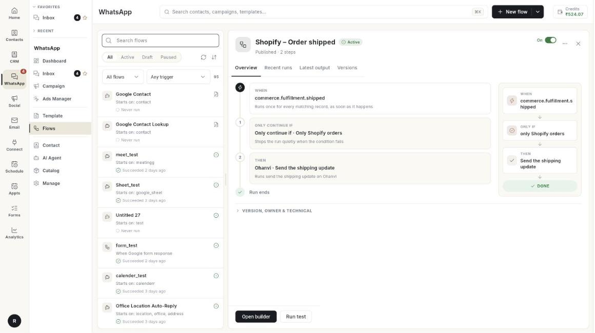

# फ़्लो { #flows }

फ़्लो अपने-आप चलने वाली चैट हैं। चैटबॉट फ़्लो आपकी ओर से ग्राहकों को जवाब देता है, सवाल पूछता है, और ज़रूरत पड़ने पर किसी व्यक्ति को बात सौंप देता है। ये गाइड बिल्डर के हर ब्लॉक को और यह समझाती हैं कि क्या भरना है।

**यह कहाँ मिलेगा:** लेफ़्ट रेल में **WhatsApp** खोलें, फिर **Flows** चुनें।

## गाइड { #guides }

| गाइड | कब इस्तेमाल करें |
| --- | --- |
| [फ़्लो बिल्डर को समझें](../understand-the-flow-builder.md) | आप बिल्डर में नए हैं और हर हिस्से और हर ब्लॉक ग्रुप का टूर चाहते हैं। |
| [चैटबॉट फ़्लो बनाएँ](../../create-whatsapp-flow.md) | आप अपना पहला चैटबॉट बना रहे हैं। |
| [फ़्लो का Start और ट्रिगर](../chatbot-flow-start-and-triggers.md) | आप चुनना चाहते हैं कि फ़्लो कैसे शुरू हो। |
| [टेक्स्ट और लिस्ट / बटन ब्लॉक](../chatbot-text-and-list-blocks.md) | आप चाहते हैं कि बॉट टेक्स्ट भेजे या ग्राहकों को विकल्पों में से चुनने दे। |
| [मीडिया, प्रोडक्ट और फ़ॉर्म ब्लॉक](../chatbot-message-blocks.md) | आप चाहते हैं कि बॉट तस्वीरें, प्रोडक्ट, टेम्प्लेट या फ़ॉर्म भेजे। |
| [नाम, फ़ोन, ईमेल, पता, Delay और Condition पूछें](../chatbot-ask-details-blocks.md) | आप जानकारी इकट्ठा करना, रुकना, या किसी जवाब के हिसाब से अलग रास्ता लेना चाहते हैं। |
| [Ask Question, Location, Media और Wait & Branch](../chatbot-ask-and-wait-blocks.md) | आप चाहते हैं कि बॉट लोकेशन, फ़ाइल या जवाब माँगे। |
| [एक्शन ब्लॉक](../chatbot-action-blocks.md) | आप चाहते हैं कि बॉट संपर्क को टैग करे, API कॉल करे या एजेंट को बात सौंपे। |
| [Action चरण और Condition के नियम](../flow-action-and-condition-steps.md) | आप कोई तैयार एक्शन चलाना, Zapier या Pabbly को कॉल करना, या कोई बात सच होने पर ही आगे बढ़ना चाहते हैं। |
| [स्टोर एक्शन ब्लॉक](../chatbot-store-action-blocks.md) | आप चाहते हैं कि बॉट ऑर्डर, रिटर्न और पते संभाले। |
| [Google Workspace के चरण](../flow-google-workspace-steps.md) | आप Google Sheets, Calendar, Meet या Contacts इस्तेमाल करना चाहते हैं। |
| [इंटीग्रेशन और एडवांस्ड चरण](../chatbot-integration-and-advanced-steps.md) | आप स्प्लिट टेस्ट करना, वेबहुक कॉल करना या CRM में सेव करना चाहते हैं। |
| [चैट सिम्युलेटर से टेस्ट करें](../test-a-flow-with-the-chat-simulator.md) | आप फ़्लो को पब्लिश करने से पहले आज़माना चाहते हैं। |

## शुरू करने से पहले { #before-you-start }

- आपका व्हाट्सऐप नंबर Ohanvi से कनेक्ट हो। देखें [अपना नंबर कनेक्ट करें](../connect-whatsapp-number.md)।
- आपके रोल के पास इस स्क्रीन का एक्सेस हो। न दिखे तो अपने एडमिन से पूछें।
