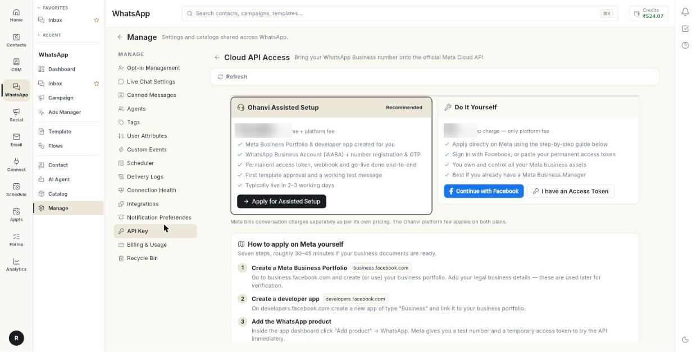

# Cloud API एक्सेस पाएँ { #get-cloud-api-access }

Cloud API Access की मदद से आप अपना WhatsApp बिज़नेस नंबर आधिकारिक Meta Cloud API पर ला सकते हैं। आखिर में आपका नंबर Meta से वेरिफ़ाई हो जाता है और Ohanvi में कॉन्फ़िगरेशन के तौर पर सेव हो जाता है। असिस्टेड सेटअप में करीब 2–3 कामकाजी दिन लगते हैं। खुद करने में करीब 30–45 मिनट लगते हैं, बशर्ते आपके डॉक्यूमेंट तैयार हों।

## शुरू करने से पहले { #before-you-start }

- आप **WhatsApp** पैनल में **Manage** खोल पाते हों। न खुले, तो अपने एडमिन से पूछें।
- आपके पास वह WhatsApp बिज़नेस नंबर हो जिसे आप इस्तेमाल करना चाहते हैं।
- खुद सेटअप करना हो, तो Meta वेरिफ़िकेशन के लिए आपके बिज़नेस डॉक्यूमेंट तैयार हों।

## रास्ता चुनें { #choose-a-route }

| रास्ता | किसके लिए सबसे अच्छा | क्या होता है |
| --- | --- | --- |
| **Ohanvi Assisted Setup** (**Recommended** के निशान के साथ) | जिन बिज़नेस का अभी तक कोई Meta सेटअप नहीं है | Ohanvi टीम आपका Meta Business Portfolio और डेवलपर ऐप बनाती है और आपका नंबर रजिस्टर करती है। वह एक्सेस टोकन और वेबहुक सेट करती है, और आपका पहला टेम्प्लेट अप्रूव करवाती है। |
| **Do It Yourself** | जो बिज़नेस पहले से Meta Business Manager इस्तेमाल करते हैं | आप Meta पर खुद अप्लाई करते हैं। आपके सारे Meta बिज़नेस एसेट आपके ही नाम पर रहते हैं। |

!!! note "Meta बातचीत का बिल अलग से लेता है"
    Meta बातचीत के लिए अपनी कीमतों के हिसाब से चार्ज करता है। Ohanvi का प्लेटफ़ॉर्म चार्ज दोनों रास्तों पर लगता है।

## स्टेप { #steps }

### Cloud API Access खोलें { #open-cloud-api-access }

1. लेफ़्ट रेल में **WhatsApp** खोलें, फिर **Manage** चुनें।
2. **API Key** चुनें। **Cloud API Access** पेज खुलेगा।

    

3. ऊपर कोई बैनर दिखे, तो उसे पढ़ें:
    - **Cloud API connected** का मतलब है कि एक चालू कॉन्फ़िगरेशन पहले से जुड़ा है। आप चाहें तो और नंबर भी जोड़ सकते हैं।
    - **Assisted setup request under review** का मतलब है कि Ohanvi टीम को आपकी रिक्वेस्ट मिल गई है। टीम आपसे संपर्क करेगी।

### असिस्टेड सेटअप के लिए अप्लाई करें { #apply-for-assisted-setup }

1. **Ohanvi Assisted Setup** कार्ड पर **Apply for Assisted Setup** पर क्लिक करें। **Apply for Assisted Setup** विंडो खुलेगी।
2. अपना **Contact name \*** लिखें।
3. अपना **Contact phone \*** लिखें।
4. ज़रूरी नहीं: अपना **Contact email** लिखें।
5. ज़रूरी नहीं: अपना **Business name** और **Business website** लिखें।
6. **WhatsApp number to register (with country code)** में वह नंबर लिखें जिसे रजिस्टर करना है।
7. ज़रूरी नहीं: टीम को जो कुछ बताना है, वह **Anything else we should know?** में लिखें।
8. **Submit Request** पर क्लिक करें। यह मैसेज दिखेगा: **Request submitted — our team will contact you shortly.**

इसके बाद कार्ड पर **Request pending — our team will reach out** लिखा दिखता है।

### Meta खुद सेट करें { #set-up-meta-yourself }

1. **Do It Yourself** कार्ड पर **Continue with Facebook** पर क्लिक करें और Meta की विंडो में बताए स्टेप फ़ॉलो करें। अगर आपके पास पहले से परमानेंट टोकन है, तो **I have an Access Token** पर क्लिक करें।
2. **How to apply on Meta yourself** तक स्क्रॉल करें। इसमें सात स्टेप हैं।
3. हर स्टेप को एक-एक करके क्रम से करें:
    1. business.facebook.com पर **Create a Meta Business Portfolio**।
    2. developers.facebook.com पर Business टाइप का **Create a developer app**।
    3. ऐप डैशबोर्ड में **Add the WhatsApp product**।
    4. WhatsApp → API Setup में **Add & verify your phone number**।
    5. Business Settings में System User बनाकर **Generate a permanent access token**।
    6. **Copy your IDs**: Phone Number ID और WABA ID।
    7. **Complete business verification & go live**, फिर ऐप को Live मोड पर कर दें।

### अपने क्रेडेंशियल वेरिफ़ाई करें और सेव करें { #verify-your-credentials-and-save-them }

1. **Verify & connect with your credentials** तक स्क्रॉल करें।
2. **Permanent access token \*** में टोकन पेस्ट करें।
3. अपना **WABA ID \*** पेस्ट करें।
4. अपना **Phone Number ID** पेस्ट करें।
5. **API version** जैसा है वैसा रखें, या बदल दें।
6. **Configuration name** जैसा है वैसा रखें, या बदल दें।
7. **Verify with Meta** पर क्लिक करें। यह मैसेज आपके बिज़नेस के नाम और नंबर के साथ दिखेगा: **Credentials verified with Meta.**

8. **Save as Configuration** पर क्लिक करें। यह मैसेज दिखेगा: **Configuration saved. Activate it from WhatsApp → Configuration.**

!!! note "सेव करने के बाद नंबर जाँच लें"
    सेव किया हुआ नंबर **Settings** → **WhatsApp** → **Configuration** में दिखता है। आपका पहला नंबर **Default** बन जाता है। दूसरा नंबर भी कनेक्ट रहता है, और उसकी चैट के जवाब उसी नंबर से जाते हैं। उस पर **Make default** तभी क्लिक करें जब कैंपेन उसी नंबर से भेजने हों। देखें [कई WhatsApp नंबर चलाएँ](run-multiple-whatsapp-numbers.md)।

### अपनी ऑनबोर्डिंग रिक्वेस्ट देखें { #check-your-onboarding-requests }

1. **My onboarding requests** तक स्क्रॉल करें।
2. हर लाइन पढ़ें। उसमें **Assisted setup** या **Self setup** लिखा होता है, और रिक्वेस्ट की तारीख भी।

## समस्या का समाधान { #troubleshooting }

| समस्या | कारण | समाधान |
| --- | --- | --- |
| **Contact name and phone are required.** | दोनों ज़रूरी बॉक्स में से कोई एक खाली है। | **Contact name \*** और **Contact phone \*** भरें। |
| **Could not submit the request. Please try again.** | रिक्वेस्ट Ohanvi तक नहीं पहुँची। | **Submit Request** पर फिर से क्लिक करें। |
| **Verification failed** | Meta ने टोकन या IDs को रिजेक्ट कर दिया। | टोकन, WABA ID और Phone Number ID दोबारा देखें। फिर **Verify with Meta** पर क्लिक करें। |
| **Could not save the configuration. Please check the details.** | कोई फ़ील्ड गलत है या खाली है। | हर फ़ील्ड देखें और **Save as Configuration** पर फिर से क्लिक करें। |
| सेव करने के बाद भी कैंपेन पुराने नंबर से जा रहे हैं | कैंपेन Default नंबर से जाते हैं, जब तक आप दूसरा नंबर न चुनें। | **Configuration** में नए नंबर पर **Make default** पर क्लिक करें, या अपने कैंपेन में **Send from** में उसे चुनें। |

## संबंधित गाइड { #related }

- [अपना WhatsApp नंबर कनेक्ट करें](connect-whatsapp-number.md)
- [कनेक्शन की सेहत जाँचें](check-connection-health.md)
- [WhatsApp नंबर एडिट करें](whatsapp-configuration-settings.md)
- [वेबहुक और इंटीग्रेशन](whatsapp-webhooks-and-integrations.md)
