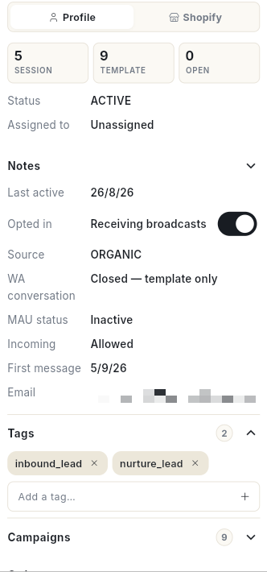

# Inbox में स्टोर के ऑर्डर संभालें { #handle-store-orders-in-the-inbox }

**Orders** टैब में ऑर्डर के स्टेटस से खरीदारों को ढूँढें। फिर अपने स्टोर का एडमिन खोले बिना, चैट से ही उनका ऑर्डर ठीक करें। इसके बाद आप ऑर्डर की जानकारी भेज पाएँगे और ऑर्डर को shipped मार्क कर पाएँगे। आप ट्रैकिंग सुधार पाएँगे, डिस्काउंट कोड या क्रेडिट भेज पाएँगे, और ऑर्डर कैंसल, रिफ़ंड या रिटर्न कर पाएँगे।

## शुरू करने से पहले { #before-you-start }

- आपका WhatsApp नंबर कनेक्ट होना चाहिए। आपका Shopify या WooCommerce स्टोर भी **Integrations → Stores** में कनेक्ट होना चाहिए। [VERIFY: मेन्यू का रास्ता] **Orders** टैब और Store पैन तभी दिखते हैं जब कोई स्टोर कनेक्ट हो।
- **WhatsApp** पैनल में आपको **Inbox** दिखना चाहिए। देखें [WhatsApp Inbox का इस्तेमाल करें](use-whatsapp-inbox.md)।
- ऑर्डर को shipped मार्क करने, डिस्काउंट कोड भेजने या स्टोर क्रेडिट जोड़ने के लिए आप एडमिन या मैनेजर होने चाहिए।
- ज़्यादातर बदलावों के लिए ऐसा Shopify कनेक्शन चाहिए जिसमें बदलाव करने की अनुमति हो। कोई बटन ग्रे दिखे, तो देखें [अनुमति छूटे हुए स्टोर को दोबारा कनेक्ट करें](#reconnect-a-store-that-is-missing-permissions)।

## दोनों जगहें क्या करती हैं { #what-the-two-places-do }

| जगह | किसलिए है |
| --- | --- |
| चैट लिस्ट में **Orders** टैब | स्टोर से जुड़ी चैट की लिस्ट दिखाता है। इससे आप जान सकते हैं कि किसे जवाब देना बाकी है और किसकी डिलीवरी में दिक्कत है। |
| चैट में **Store** पैन | एक खरीदार के ऑर्डर, कार्ट और हिस्ट्री दिखाता है। ऑर्डर बदलने के बटन भी यहीं मिलते हैं। पैन पर आपके स्टोर का नाम लिखा होता है, जैसे **Shopify** या **WooCommerce**। |

## स्टेप { #steps }

### Orders टैब से खरीदारों को ढूँढें { #find-shoppers-with-the-orders-tab }

1. लेफ़्ट रेल में **WhatsApp** खोलें, फिर **Inbox** चुनें।
2. चैट लिस्ट के ऊपर **Orders** टैब पर क्लिक करें।
3. लिस्ट छोटी करने के लिए टैब के नीचे किसी चिप पर क्लिक करें:

    | चिप | क्या दिखाता है |
    | --- | --- |
    | **All** | स्टोर से जुड़ी हर चैट। |
    | **Awaiting reply** | वे खरीदार जिन्होंने मैसेज किया है और जिन्हें अभी जवाब मिलना बाकी है। |
    | **Confirmed** | वे चैट जिनमें सबसे ताज़ा स्टोर इवेंट ऑर्डर देना है। |
    | **Shipped** | वे चैट जिनमें सबसे ताज़ा स्टोर इवेंट शिपमेंट है। |
    | **Abandoned cart** | वे चैट जिनमें सबसे ताज़ा स्टोर इवेंट अधूरा छोड़ा गया चेकआउट है। |
    | **Cancelled** | वे चैट जिनमें सबसे ताज़ा स्टोर इवेंट कैंसल हुआ ऑर्डर है। |
    | **Delivery issue** | वे चैट जिनमें डिलीवरी की कोशिश फ़ेल हो गई। |

4. किसी चैट पर क्लिक करें। उस लाइन का चिप सबसे ताज़ा स्टोर इवेंट बताता है, जैसे **Confirmed**, **Out for delivery**, **Delivery failed**, **Refunded** या **Cart abandoned**।

लिस्ट संकरी हो, तो चिप साइड में स्क्रॉल होते हैं।

### Store पैन खोलें { #open-the-store-pane }

1. किसी खरीदार की चैट खोलें। दाईं तरफ़ प्रोफ़ाइल पैनल खुलता है।
2. पैनल के ऊपर अपने स्टोर के नाम पर क्लिक करें, जैसे **Shopify**। दूसरा विकल्प **Profile** है।

    

3. पैन के ऊपर की लाइन पढ़ें। उसमें आपके स्टोर के साथ **Live from** और **Read from … just now** लिखा होता है। या फिर **From last sync** और **Showing our last synced copy of the store** लिखा होता है।
4. स्टोर का डेटा दोबारा पढ़ने के लिए **Refresh from** और आपके स्टोर के नाम वाले बटन पर क्लिक करें।
5. स्टोर को नए टैब में खोलने के लिए **Open** और आपके स्टोर के **admin** वाले बटन पर क्लिक करें।

पैन में **Open orders**, **Products & stock** और **Order history** की लिस्ट होती है। अगर कोई कार्ट छूटी हो, तो **Abandoned cart** भी दिखता है। खरीदार अभी स्टोर का ग्राहक नहीं है, तो लिखा आता है **Not found as a customer in the store — no order under this number or email yet.**

### ग्राहक की समरी पढ़ें { #read-the-customer-summary }

1. पैन के ऊपर **orders**, **lifetime** और **last 7 days** के आँकड़े पढ़ें।
2. **Customer since** और ग्राहक के टैग पढ़ें।
3. खरीदार के पास स्टोर क्रेडिट हो, तो **Credit** चिप पढ़ें। यह चेकआउट पर लगता है।
4. ग्राहक को स्टोर में खोलने के लिए **Open customer ↗** पर क्लिक करें।

### ऑर्डर की जानकारी या ट्रैकिंग भेजें { #send-order-details-or-tracking }

1. **Open orders** के नीचे ऑर्डर कार्ड ढूँढें। उस पर ऑर्डर नंबर, तारीख, आइटम, कुल रकम और शिपमेंट स्टेटस दिखता है।
2. आइटम, कुल रकम और स्टेटस को चैट में भेजने के लिए **Send details** पर क्लिक करें। **Order details sent to the chat.** मैसेज आता है।
3. ट्रैकिंग नंबर और लिंक भेजने के लिए **Send tracking** पर क्लिक करें। अभी ट्रैकिंग नहीं है, तो यह मौजूदा स्टेटस भेज देता है। **Tracking sent to the chat.** मैसेज आता है।
4. जिस ऑर्डर का पेमेंट नहीं हुआ है, उसके लिए **Send payment link** पर क्लिक करें। **Payment link sent — COD can become prepaid.** मैसेज आता है।
5. खरीदार को वही आइटम दोबारा खरीदने देने के लिए **Reorder link** पर क्लिक करें। यह उन्हीं आइटम वाला स्टोर चेकआउट भेजता है। **Reorder link sent — same items, they pay at checkout.** मैसेज आता है।
6. कूरियर कंपनी का ट्रैकिंग पेज खोलने के लिए ऑर्डर पर **Track ↗** पर क्लिक करें।
7. इस ऑर्डर के लिए चैटबॉट Flow शुरू करने के लिए **Run flow** पर क्लिक करें। जैसे COD कन्फ़र्मेशन, पते की जाँच या रिव्यू माँगना।

**Send details** ग्रे हो, तो उस पर **Needs a live store read — press Refresh** लिखा होता है। पहले **Refresh from** और आपके स्टोर के नाम वाले बटन पर क्लिक करें।

### ऑर्डर को shipped मार्क करें { #mark-an-order-shipped }

1. ऑर्डर कार्ड पर **Mark shipped** पर क्लिक करें। **Mark … shipped** विंडो खुलती है।
2. **Tracking number (AWB)** लिखें।
3. **Carrier** लिखें, जैसे Delhivery, Blue Dart या DTDC।
4. चाहें तो **Tracking link (optional)** लिखें।
5. तय करें कि **Also send Shopify's shipping email** पर टिक करना है या नहीं।
6. **Mark shipped** पर क्लिक करें।

ऑर्डर की सारी खुली लाइनें एक ही फ़ुलफ़िलमेंट में शिप होती हैं। खरीदार को WhatsApp पर शिपिंग अपडेट अपने आप मिल जाता है।

### शिप हो चुके ऑर्डर की ट्रैकिंग सुधारें { #correct-the-tracking-on-a-shipped-order }

1. ऑर्डर कार्ड पर **Update tracking** पर क्लिक करें। ऑर्डर में एक से ज़्यादा शिपमेंट हों, तो **Which shipment?** के नीचे एक चुनें।
2. **Tracking number (AWB)**, **Carrier** या **Tracking link (optional)** बदलें।
3. **Update** पर क्लिक करें। **Tracking updated.** मैसेज आता है।

नई ट्रैकिंग, स्टोर में उस शिपमेंट की पुरानी ट्रैकिंग की जगह ले लेती है। तीनों फ़ील्ड खाली छोड़ दें, तो **Enter a tracking number, carrier or link.** मैसेज आता है।

### डिलीवरी का पता बदलें { #change-the-delivery-address }

1. ऑर्डर कार्ड पर **Edit address** पर क्लिक करें। **Delivery address** विंडो खुलती है।
2. फ़ील्ड बदलें: **First name**, **Last name**, **Address line 1**, **Address line 2**, **City**, **State / province**, **PIN / ZIP**, **Country** और **Phone**। * वाली फ़ील्ड भरना ज़रूरी है।
3. **Save address** पर क्लिक करें। **Address updated in the store.** मैसेज आता है।

!!! warning "ऑर्डर शिप होने के बाद नहीं"
    ऑर्डर शिप हो जाने के बाद स्टोर पता बदलने नहीं देता।

### ऑर्डर में नोट जोड़ें { #add-a-note-to-an-order }

1. ऑर्डर कार्ड पर **Note** पर क्लिक करें। **Order note** विंडो खुलती है।
2. नोट लिखें। वहाँ लिखा होता है कि इसे आपकी टीम स्टोर एडमिन में देखती है, ग्राहक नहीं देखता।
3. **Save note** पर क्लिक करें। **Note saved on the order.** मैसेज आता है।

### डिस्काउंट कोड भेजें { #send-a-discount-code }

1. पैन के ऊपर टैग आइकन पर क्लिक करें। उसका टूलटिप **Send a discount code** है।
2. डिस्काउंट का टाइप चुनें: **%** या **₹**।
3. **Percent off** या **Amount off** लिखें।
4. **Valid for (days)** लिखें।
5. **Reason (goes in the message)** लिखें, जैसे `Late delivery`।
6. **Create & send** पर क्लिक करें। **Discount code sent.** मैसेज आता है।

कोड सिर्फ़ एक बार इस्तेमाल हो सकता है। स्टोर ग्राहक को पहचानता हो, तो कोड सिर्फ़ उसी ग्राहक के लिए चलता है।

### स्टोर क्रेडिट जोड़ें { #add-store-credit }

1. पैन के ऊपर वॉलेट आइकन पर क्लिक करें। उसका टूलटिप **Add store credit** है।
2. **Amount** लिखें। इसके साथ ब्रैकेट में आपकी करेंसी लिखी होती है।
3. चाहें तो **Expires in (days, blank = never)** लिखें।
4. **Reason (goes in the message)** लिखें, जैसे `Damaged item`।
5. **Add & send** पर क्लिक करें। **Store credit added and sent.** मैसेज आता है।

क्रेडिट अगले ऑर्डर के चेकआउट पर अपने आप लग जाता है। पैसा पेमेंट के तरीके में वापस नहीं जाता। वॉलेट आइकन तभी दिखता है जब स्टोर खरीदार को ग्राहक के रूप में पहचानता हो।

### मुफ़्त रिप्लेसमेंट भेजें { #send-a-free-replacement }

1. ऑर्डर कार्ड पर **Free replacement** पर क्लिक करें। **Send a free replacement of …?** विंडो खुलती है।
2. नोट पढ़ें। यह उन्हीं आइटम का एक नया पेड ऑर्डर बनाता है, 100% छूट पर और उसी पते पर, ताकि वेयरहाउस उसे शिप कर दे।
3. **Create replacement** पर क्लिक करें। **Replacement created and sent.** मैसेज आता है।

खरीदार को नया ऑर्डर नंबर चैट में मिल जाता है।

### रिटर्न खोलें { #open-a-return }

1. ऑर्डर कार्ड पर **Open return** पर क्लिक करें। **Open a return for …** विंडो खुलती है।
2. **Reason** चुनें: **Too small**, **Too large**, **Wrong item sent**, **Damaged / defective**, **Not as described**, **Colour**, **Style**, **Changed mind** या **Other**।
3. चाहें तो **Note (optional)** लिखें।
4. **Open return** पर क्लिक करें। **Return opened in the store.** मैसेज आता है।

ऑर्डर के सभी shipped आइटम रिटर्न में आ जाते हैं। रिटर्न को Shopify ट्रैक करता है। कुछ भी शिप न हुआ हो, तो **Open return** ग्रे रहता है।

### ऑर्डर रिफ़ंड करें { #refund-an-order }

1. ऑर्डर कार्ड पर **Refund** पर क्लिक करें। **Refund … in full?** विंडो खुलती है।
2. नोट पढ़ें। रिफ़ंड हो सकने वाला हर आइटम और शिपिंग का पैसा, जिस पेमेंट तरीके से दिया था उसी में वापस जाता है।
3. चाहें तो **Reason (optional)** लिखें।
4. **Refund** पर क्लिक करें। **… refunded.** मैसेज आता है।

कुछ पैसे का रिफ़ंड करना हो, तो वह स्टोर एडमिन में करें।

### ऑर्डर कैंसल करें { #cancel-an-order }

1. ऑर्डर कार्ड पर **Cancel** पर क्लिक करें। **Cancel …?** विंडो खुलती है।
2. नोट पढ़ें। स्टोर ऑर्डर कैंसल करता है, स्टॉक वापस जोड़ता है और रिफ़ंड करता है, ठीक वैसे ही जैसे एडमिन से करने पर होता। फिर वह ऑर्डर-अपडेट मैसेज से खरीदार को WhatsApp पर बता देता है।
3. **Cancel order** पर क्लिक करें। **… cancelled.** मैसेज आता है। पीछे हटना हो, तो विंडो में **Cancel** पर क्लिक करें।

!!! warning "कैंसल करने पर खरीदार को रिफ़ंड मिलता है"
    खरीदार को रिफ़ंड मिल जाता है और WhatsApp पर उसे बता दिया जाता है। इसे Inbox से वापस नहीं किया जा सकता।

### छोड़ी हुई कार्ट पर काम करें { #work-with-an-abandoned-cart }

1. **Abandoned cart** के नीचे **Left** पढ़ें। उसके साथ तारीख, पहले कुछ आइटम और कुल रकम दिखती है।
2. **Copy recovery link** पर क्लिक करें। **Recovery link copied.** मैसेज आता है।
3. लिंक को चैट में पेस्ट करें।

### प्रोडक्ट खोजें और भेजें { #search-products-and-send-one }

1. **Products & stock** के नीचे **Search the catalogue — name, SKU…** में लिखें।
2. **Search** पर क्लिक करें। हर नतीजे में हर वेरिएंट की कीमत और स्टॉक दिखता है।
3. प्रोडक्ट को चैट में भेजने के लिए **Send product** पर क्लिक करें। **… sent to the chat.** मैसेज आता है।
4. प्रोडक्ट को स्टोर में खोलने के लिए **View** पर क्लिक करें।

कुछ न मिले, तो पैन में आपके सर्च के साथ **No product matches** लिखा आता है।

### ऑर्डर हिस्ट्री पढ़ें { #read-the-order-history }

1. **Order history** तक स्क्रोल करें।
2. पूरी लिस्ट खोलने या बंद करने के लिए संख्या वाले **Show all** पर क्लिक करें, या **Show fewer** पर।

कुछ भी सिंक न हुआ हो, तो लिखा आता है **No orders synced for this contact yet.**

### जिस स्टोर में अनुमतियाँ कम हैं, उसे दोबारा कनेक्ट करें { #reconnect-a-store-that-is-missing-permissions }

1. कोई बटन ग्रे हो, तो उसका टूलटिप पढ़ें। उसमें **Needs Shopify to be reconnected** लिखा होता है, और उसके बाद अनुमति का नाम।
2. पैन के ऊपर का बैनर पढ़ें। उसमें लिखा होता है कि स्टोर तब कनेक्ट हुआ था जब कुछ फ़ीचर थे ही नहीं।
3. **Reconnect now** पर क्लिक करें। Shopify सिर्फ़ नई अनुमतियाँ माँगता है।
4. या स्टोर कनेक्शन मैनेज करने के लिए **Integrations → Stores ↗** पर क्लिक करें।

पिछले सिंक की ऑर्डर कॉपी पर बदलाव वाले बटन ग्रे ही रहते हैं। ऑर्डर को लाइव पढ़ने के लिए **Refresh from** और आपके स्टोर के नाम वाले बटन पर क्लिक करें।

## दिक्कत आए तो { #troubleshooting }

| दिक्कत | वजह | क्या करें |
| --- | --- | --- |
| **Orders** टैब या Store पैन नहीं दिख रहा | कोई स्टोर कनेक्ट नहीं है। | **Integrations → Stores** में स्टोर कनेक्ट करें। |
| **Could not read the store.** | स्टोर ने जवाब नहीं दिया। | **Try again** पर क्लिक करें। |
| **Live read failed** के साथ कोई एरर | स्टोर तक पहुँच नहीं हो पाई। | पैन आखिरी सिंक की कॉपी दिखाता है। थोड़ी देर बाद **Refresh from** और आपके स्टोर के नाम वाले बटन पर क्लिक करें। |
| कोई बटन **Needs Shopify to be reconnected** के साथ ग्रे है | स्टोर कनेक्शन में कोई अनुमति नहीं है। | **Reconnect now** पर क्लिक करें। |
| **Mark shipped** नहीं दिख रहा | ऑर्डर खुला नहीं है, या आप एडमिन या मैनेजर नहीं हैं। | ऑर्डर का स्टेटस देखें। एडमिन या मैनेजर से कहें। |
| **Update tracking** नहीं दिख रहा | ऑर्डर का अभी कोई शिपमेंट नहीं है। | पहले **Mark shipped** पर क्लिक करें। |
| **Open return** ग्रे है और उस पर **Nothing has shipped yet** लिखा है | कोई भी आइटम शिप नहीं हुआ। | पहले ऑर्डर को shipped मार्क करें। |
| शिपिंग के बाद **Edit address** काम नहीं करता | शिपमेंट के बाद स्टोर पता बदलने नहीं देता। | कूरियर कंपनी से बात करें। |

## जुड़ी गाइड { #related }

- [WhatsApp Inbox का इस्तेमाल करें](use-whatsapp-inbox.md)
- [Inbox के Board और List व्यू का इस्तेमाल करें](inbox-board-and-list-views.md)
- [स्टोर एनालिटिक्स पढ़ें](../analytics/read-store-analytics.md)
- [WhatsApp इंटीग्रेशन मैनेज करें](manage-whatsapp-integrations.md)
